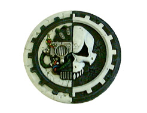

# 机械神教

> barbarrossa

机械神教(Adeptus Mechanicus)是战锤 40000里的一个宗教组织.机械神教确认皇帝是人类帝国的领导者,但却不信奉皇家教派(Imperial Cult),他们有自己的宗教教义.

机械神教相信知识是神圣的表现,所有拥有知识的生物或是文物因此而是神圣的.皇帝是被膜拜的对像因为他拥有非常多的知识.机械神教还相信所有机器里存在一个"机器灵魂"(Machine Spirit),因为机器灵魂的存在所以机器才能被使用.

机械神教的总部在火星并统制着那里.他们提供人类帝国大部份的科技,并制作各种类型的武器,盔甲,车辆和泰坦军团.

机械神教是控制帝国科学和技术的宗教性组织，掌管帝国几乎全部机械和军械的生产。

机械神教发源于火星。据说在帝皇诞生之前，亚空间风暴席卷人类疆域的时候，他们得到机械之神（Mechine God，据说是C'tan中的Void Dragon）的庇护，得以生存下来。因此机械神教崇拜机械之神，认为机械都具有灵魂。

生产各类机械的技术已经失传了，机械神教只能通过STC（Standard Template Construction，标准建设模版）来复制古代已经设计完成并模版化的产品。机械神教的一项重要任务就是在整个帝国疆域内发掘STC，于是科学变成了考古学。出于各种原因，机械神教对于民间自主进行的科技研究采取高压措施，严禁机械神教之外的人擅自进行科学实验。

机械神教的总部设在火星，首脑称为总制造者（Fabricator General）。机械神教控制的世界成为铸造世界，基层的为帝国提供技术支持和机械维护的成员称为科技神甫（Tech priest）。
