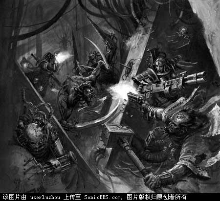
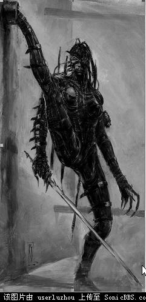

# 赏金杀手－－－ASAID VIRENUS

［翻译］赏金杀手－－－ASAID VIRENUS（完结）

userluzhou

Inquisitor是什么？ Inquisitor是基于战锤40000故事背景和人物的战棋游戏，扮演无畏英雄或者是可怖异端在众星的阴影之间无休止的征战。

在Inquisitor中，玩家将能够扮演那些人类帝国最强大也是最神秘仆人中的一员.这是一个叙述风格的战争游戏，充满了人性的斗争和对抗各种异端、外星异型的血腥战斗。

This is the battle for the Emperor’s Soul

http://www.specialist-games.com/inquisitor/default.asp

赏金杀手－－－ASAID VIRENUS

在Olympas世界上的Perseus巨型城市的底层，对于那些生活在其中的人来说，童年绝对不是一件惬意的事情，Asaid Virenus在很小的时候就意识到了这一点，并且决定要挑战这不公命运。她寻求更好的生活的欲望是如此的强烈，刚刚满六岁时候，她便从公立托儿所逃跑了。

凭着与生俱来的机智与传奇般的模仿天赋，Asaid成功地逃出了都市的底层，并且在上层铸造区社会设法生存了下来。在那儿逗留了几年中，她一直在暗中观察着铸造工会之间永不停息的商业战争。最后，她决定，虽然这里的生活要比噩梦般的底层生活要好的多，但是这仍然不是她的家。

Asaid又花了三年多的时间才得以混入上流社会，开始是假装成一个使女，然后她的伪装身份也越来越大胆起来，直到最后，她杀死了星球总督的一个远房侄女并取而代之。如今，十二岁的Asaid已经成为了一个享有特权的贵族，出入上流舞会，享用纯净的清水，但是她仍然不愿意停止下来，去过平静而舒适的生活。

她从来没有显露过她计划的下一步是什么，并且总是不停的转变身份。在对一系列看似毫无关联的案件进行调查后，检察官Virtuna揭露了Asaid的伪装，女孩逃脱了逮捕，并与检察官和愤怒的总督军队周旋了数天之久，在最终被擒之前，她又顺带捎走了两个追捕者的小命。

总督急切的希望Asaid为她的罪行付出生命的代价，但是检察官Virtuna大人有他的打算。他带走了这个女孩，并且向总督保证她将会弥补所犯下的罪孽。离开了Olympas，Virtuna把Asaid交给了帝国刺客进行测试，以确定她是否适合加入Callidus刺杀神庙。她轻易的通过了体格和技巧的测试，智力测试也清楚地显示她要比绝大多数的帝国臣民聪明得多。因此尽管她对帝国的忠诚受到质疑，神庙的大师们仍是认为，几年艰苦的训练因该能够纠正这点小小的瑕疵。

但是进展并不如预料的那样顺利，Asaid从没停止反抗和自私的行为，17岁那年她最终被鉴定为不适合进一步的训练的失败品，神庙将会赐给她安静而迅速的死亡。尽管在几乎每一样Callidus刺客技能的训练中都表现的无可挑剔，她甚至已经开始了使用变形药的训练。而一想到她如此急切要求此项训练的可疑动机，神庙的大导师也不禁忧心忡忡。

这样看来，Asaid的传奇也就到此结束了，但是Dahwrin检察官的介入改变了这一切。醉心于创造出一个可与人皇的肉身相媲美的容器，以便能够迎接这个人类最强大的灵魂再次降临到这个世界。Dahwrin一直就在神庙的受训者中“实践”他的理论，完全不顾一个又一个的失败所付出的代价。Asaid意识到这是她最后的也是唯一的机会，她“志愿”要求加入了检察官的实验。被Asaid的信仰所感动，神庙的大导师将对Asaid交给了检察官大人。

Asaid最终挺过了实验，她用钢铁般的意志控制住了“容器”的副作用。然而即使是向她也没能料到就此摆脱困境的机会来得如此之快。检察官一些的实验合作者，火星神教的科技神甫们显然不愿意与检察官分享实验带来的荣耀，这给了Asaid一个意想不到的机会。当神甫们为了争夺他们实验成果而与检察官的武装大打出手的时候，成果却意识到她所一直在等待的那个时机到了。变化成神庙大导师外表的Asaid成功的欺骗了检察官的随从，在克服了重重险阻之后，Asaid终于得以逃离Callidus神庙，消失在无际的众星之中.

实验赋予了Asaid无与伦比的力量，她变化成了其中一个叛乱机械神甫Magos Lurd的形象,浑身布满了烧伤和其他恐怖的伤痕。当Asaid操纵着飞行器着陆在神甫们的母船上，她富有煽动性口才马上发挥了巨大作用，她成功的让船上的神甫相信，兄弟们的努力失败了，他们没能得到实验成果，现在，一艘帝国战列舰正载着检察官的怒火向这里赶来。说完这些后，Asaid就控制她的身体进入了不省人事的状态。机械神甫们惊慌失措，不敢想象Dahwrin检察官的惩罚会有多么的严厉，他们便以最快得速度逃离了这个星系，再也不敢停留。

神甫们决定在Aguilana的海军港口稍作停留，当宇宙船几乎还没有在码头停稳，Asaid就已经和神甫们作完告别了，只是欢送她的人员都已经倒在自己的血泊之中，没有能够看到她消失在港口的人群中。在码头上，Asaid随即又搭上了一艘准备出港的海军护卫舰，不久之后，她她的追捕者就已经相隔数个光年之遥。

重获自由的Asaid从来不管她的主顾是谁，不论是充满政治野心的帝国长官，或者是他同样充满野心的竞争对手，外星异型，甚至是邪恶异端的恐怖分子。检察官的实验给她的身体带来了严重副作用，现在她极度的依赖变形稳定剂。她不断雇用人手发起针对机械神教的奇袭，以便她趁乱能够偷偷潜入其中，获得延续她生命的足够变形稳定剂。而频繁的行动也使得他的主要追捕者，检察官领主Antigonous Balorodin，得以一步步的接近她的行踪。

在银河的中心附近的Bagrin Fex独立研究所，检察官几乎就抓住了她，预料到arid moon将会是Asaid的下一个目标，Balorodin带领着他的检察官直属风暴突击队和机械神教的联军在这个卫星上恭候着她的到来。但是Asaid还是察觉到了危险，她选择了逃跑，没有人能够阻Asaid的选择，她逃跑的路线成为了一条名副其实的血路，检察官功亏一篑。但是对于Asaid来说，尽管她再一次逃过了检察官的追捕，但是也不可能再获得延续生命的变形药了。是近乎自杀般的再次袭击机械神教，还是到最后身体的变形失去控制，Asaid已经没有多少时间来决择了。

而对于Balorodin大人来说，他所关心的不仅仅是Asaid所犯下的累累血腥罪行，还有其他的潜在危险需要考虑。只要Asaid还活着，反对帝国的异端就有可能擒获她，并从由此得知Callidus神庙和检察官们的许多秘密。如果关于变形术的秘密被人皇的敌人们得知的话，所带来的破环将是难以置信的，绝密的刺客神庙前哨的坐标也有被泄露的危险。

ASAID VIRENUS

实验赋予了Asaid超越人类的力量，加上她所受到的训练和严格的纪律。他几乎可以完美的模仿任何生物，包括他们的声音甚至是内部的器官，如果这样做有必要的话。这使得她能够进入普通人类难以到达的地区，比如只有一英尺宽的排水管，格状铁窗或者窄小的窗户。

装备和特性：

千变万化、西塔相位剑、神经粉碎机、飞刀、血火手雷、窒息气体

两面三刀、特技大师、剑术大师、猫之灵巧、子弹偏斜、闪避、英雄气概、 闪电反射

WS BS S T I Wp Sg Nv Ld

86 91 65 62 93 98 76 90 35

以下转自战锤中文网

死神刺客

Death-Cult Assassins

拜死神的教徒在帝国境内有许多分支，其中很多人是混沌的信徒，只对血神哥达奉献忠诚，也有少数忠于人类，将猎物作为贡品献给皇帝。审判官经常部署这样的刺客，他们的敏捷身手适合执行一些刺杀或者渗透的任务。他们浑身上下都是近战武器，包括各种令人眼花缭乱的匕首、荆棘长鞭、针刺手枪等等。

文迪卡神庙刺客

Vindicare Temple Assassin

文迪卡刺客专为帝国而杀戮，他们的专长是在神不知鬼不觉的情况下轻易地夺走目标的性命。一切皇帝的敌人都应当可耻地死去——通过一枚狙击步枪的子弹，通过刺客们精湛得堪称艺术的无双枪法，这就是文迪卡刺客的目标。为了实现这一目标，文迪卡神庙特别强调对使用武器、无声潜行、闪避攻击这三大能力的训练。刺客们的格言是：只有在最佳的位置射击，才能干净利落地杀死敌人。事实也正是如此，这些刺客最出名的能力，便是他们能在发动攻击前潜伏数天以获得最有利的射击点的可怕耐心。

那些施行暴政的地方长官，那些煽动暴乱的演讲者，通常都会成为文迪卡刺客的猎杀目标。有如鬼魅般无法捉摸的狙击手无声无息地接近目标，以手中的狙击步枪带来皇帝的神罚。许多自称为救世主的家伙都在传道时被文迪卡的子弹穿透大脑；所有反叛、“起义”的领袖，在大言不惭地散播反帝国的言论时，都暗暗地害怕会有一枚无声的子弹将他们射杀在讲坛上。当看到他们“英明伟大”的领袖被皇帝的一名忠实仆从轻易杀死时，叛乱的支持者们多会树倒猢狲散，再无起事的能力。通过这种方式，文迪卡刺客们阻止了许多次可能发生的叛乱。当然有时出动刺客已经为时太晚，这时就要靠圣锤修会的战斗部队正式出场了。

丘利萨斯神庙刺客

Culexus Temple Assassin

被挑选进入丘利萨斯神庙的刺客往往具有一种神秘的体质，他们可以在次元空间中隐藏起自己的躯体，从某种意义上可以认为他们都是无灵魂无形态的某种特殊存在。

他们头顶一个巨大的头盔被称为杀意之盾，在战斗中他们能用这顶头盔发射集中的抑制灵能射线，当然头盔的主要作用是抑制刺客本身的可怕能量。在战斗时一旦头盔前方的眼睛打开，刺客便能释放出巨大的能量瞬间席卷整个战场。

丘利萨斯刺客具有天生的杀伤力，再加上后天的刻苦训练和精良的装备，敌方灵能者在丘利萨斯刺客面前简直像婴儿一样无助。

卡利都斯神庙刺客

Callidus Temple Assassin

卡利都斯神庙是历史悠久却又不为人知的帝国刺客中最机密敏感的一支，她们的专长是通过伪装和计谋来接近猎物，混在不起眼的信徒中间将混沌的根源瞬间切除。

为了完成他们艰巨的任务，卡利都斯神庙特别擅长制作和使用一种可以使刺客们改变自己形态的变形药物。通过注射这种药物，一名训练有素的卡利都斯刺客可以完全地改变自己的外形，变成他们想要的任何人类的外形——无论是美艳少女还是残疾老人。更有甚者，在帝国医学部的科技协助下，通过一种移植型生化插件，卡利都斯刺客可以进一步变化为外星种族的样子，比如兽人和灵族人。

卡利都斯刺客通过秘密空投进入战场，潜伏在敌人战线后，通过她们的狡诈和变形剂的作用，她们能轻松地干掉一个敌人并取而代之。这样，刺客们慢慢地靠近了敌人指挥官或是强力灵能者，影响他们的决策，在必要的时候—一将他们抹除。

埃佛森神庙刺客

Everson Temple Assassin

埃佛森神庙大概是众多帝国刺客中最可怕的一支，他们最擅长的就是通过大规模恐怖袭击，将恐惧深深地烙在反叛者首脑的心中。如果某个地方政府或是组织的上层已经被混沌力量渗透，埃佛森刺客便会出动，当圣锤修会的战斗部队与敌军大队交战时，刺客已经深入后方，选择适当的时机消灭对方的行动中枢。一名埃佛森刺客很少被指派去消灭单个目标，他的任务往往是在叛乱地区制造毁灭性的浩劫，将反叛头目一举歼灭。这样残暴的袭击能保证没有哪个敌人敢继任，从而杜绝混沌的苗头再次冒出。在埃佛森刺客毫不停歇的攻击下，敌人将被残杀殆尽。
