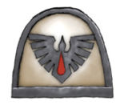
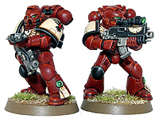

# 最神秘的战团-血鸦战团

> [加里森敢死队](http://game.ali213.net/profile-uid-348856.html)

忽然感兴趣就上GW看了一下，写的十分之短且不过瘾，然后查了下维基，竟然能查到，就自己翻了下看看，错的还希望大家出来指正

## 历史

血鸦成为帝国的防御力量已经有上千年了。除了保护帝国以外，作为秘密知识的保护者也是他们的任务之一，就象资料片暗黑圣战所显示出来的一样。但是，就算他们自己也不知道战团起源的详细情况，包括他们的基因原体（以未知的基因原体称呼他），星际战士军团和基因种子。因此他们崇拜皇帝和伟大的父亲Azariah Vidya ，将他们视为最重要的人。血鸦的Catalepsean神经结部分有轻微的变异，意味着他们能够完全醒来但是永远不会做梦，这两种效果对星际战士心智潜在的伤害让战团外的某些人感到担忧。战团目前的形态最早被战士们所熟知的“伟大的父亲”Azariah Vidya 所影响。

血鸦在星际战士中有着传奇般学者的声望，他们的战吼“知识就是力量”不仅仅是一句格言，而是一种忠实且狂热的信仰。他们在审判庭（发送那些通常不流传出审判庭的研究资料和信息给他们的战团）以及战斗修女团的纯理论研究组织（经常“借”个修女给他们一起合作研究一个项目）中也有着极高的声望。

至少可以这样说，这是非常不正常的，因为就算是自己组织的分支机构，审判庭也很少信任到这种程度，而且星际战士和Ecclesiarchy的传统矛盾使合作研究成为一种罕见的事。事实上，与那些在不同时期有着上千年不和（似乎是说与帝国其他机构的问题）的其他的星际战团相比恰恰相反，血鸦看起来似乎与帝国的各种权利机构有着非同一般的关系（如审判庭，帝国卫队，Ecclesiarchy等）。

## Azariah Vidya
Azariah Vidya（不久后成为众所周知的伟大的父亲Great Father）在哥特地区一场可怕的战役中是战团总智库馆长，就是那场让战团在对一连串叛军遭受巨大损失的战役。在这场战役中，战团长和圣者（Master of Sanctity）因为中圈套而双双阵亡，看起来血鸦就要这样玩完了。

Azariah被认为是一个具有高超智慧的勇士，拥有着灵能者的能力。他花了许多时间研究敌人的运动与反击行动，利用帝国卫队与战团的残余力量进行了一连串的佯攻。利用这些信息，再加上他强大的灵能，他发动了一系列攻击针对一些表面上空旷的区域，实际上这些地方是混沌邪教徒们的集结地或是补给点。

因为Azariah在挫败叛军中所表现出的能力，他被提升为代理战团长（考虑到战团长已死，office of Chapter Master应该是代理而不是助理了- -），同时保留他之前的职务。他领导了一个恢复与重建的计划，没有这个计划战团早就被消灭。

## 组织

血鸦被认为是发自内心遵守阿斯塔特圣典，而不是从书面上。尽管小队以连的形式混合被认为是更加灵活多变的，血鸦的部队还是以标准的连组建而成。

血鸦也因为战团内数量庞大的智库馆长而闻名，他们中的许多人在力量与能力上仅次于灰骑士。总共有多少拥有灵能天赋的星际战士，没人知道确切的数字，但是被认为取决于对于战团智库馆长父亲的崇敬与募兵的程序（意思似乎是说因为对于他们那伟大父亲的崇拜，所以招募新兵的时候似乎更关注灵能者）。

在战团内部，众所周知存在一个名为灵能团（Ordos Psykana），一个只由灵能者组成的组织。他们在战团的战斗母舰上设立了灵能灯塔，第一个是由Azariah Vidya亲自设立的。对于战团来说设立这些灯塔的原因早已丢失了，但是显然地，他们是一种无限电路，设计用来对抗太空骷髅的一种武器。这些东西也被用在一种仪式中，将快要死去的血鸦智库馆长的灵魂召回。灵能团还设立了几个灵力武器库，其中许多武器是从灵族那里获得的，有些是他们赠送给战团的，说明血鸦与灵族之间有着悠久的关系。

## 母星

血鸦没有官方的母星。取而代之的是，他们的要塞修道院位于一艘被称为Omnis Arcanum的战斗母舰上，这艘船也回到他们的Librarium Sanctorum。战团的其余部分在舰队的攻击巡洋舰和战斗母舰上服役。

## 兵源

由于血鸦没有母星，他们被迫从一系列临近的世界招募新兵。在被Gabriel Angelos上尉宣布为一个终结目标之前，Cyrene是人数比较多的兵员来源世界之一。另外一个世界是Rahe's Paradise，由于太空骷髅一支军团在这个星球上的神秘出现而在之后被终结。众所周知血鸦也从帝国的其他一些世界招募新兵，一般其他的星际战团不会去，Scholastica Psykana与这些世界签订了一份协议，被允许招募一定的灵能者作为替补智库馆长。这似乎是他们拥有数量如此众多的智库馆长的原因之一。

## 战吼

在阿斯塔特圣典里（White Dwarf, 2004）战吼是：“知识就是力量，好好保护它。”Knowledge is power, guard it well

在官方战争黎明小说里（Goto, 2004）血鸦的战吼是：“为了伟大的父亲和皇帝”For the Great Father and the Emperor（将Great Father放在皇帝之前，足可见此人在血鸦中的地位）

在Relic的PC游戏里的战吼“我不害怕邪恶因为我就是恐惧的化身”I fear no evil for I am fear incarnate和“战斗到最后一人一弹”To the last man and the last round

## 战斗信条

血鸦认为在利用这些情报彻底地消灭敌人之前，应该研究敌人并且预测他们在不同情况下做出的反击行动。但是这些情报在血鸦决定发动攻击前是不会被流传出去的，这种近似于竞争的方式致使其他多个战团批评了他们。

在战斗中，血鸦的战士们会系统地并且无情且精确地摧毁敌人的单位。他们永远不会改变战斗计划，而且永远没有理由这么做，因为智库馆长们早先就已经预言了和计算了一切可能的情况。

## 始祖战团

很有可能血鸦是从还忠诚于皇帝的千疮之子军团中分裂出来的，尽管有证据支持这个观点（高度重视知识，战团中数量众多的智库馆长以及战团的涂装类似于贺拉斯叛乱前的千疮之子）但是GAME WORKSHOP始终没有赞同或者否认外形上的推测。在战争黎明：暴风雨中，在遭遇了Prodigal Sons of Ahriman，第3连的智库馆长Rhamah（患了失忆症）被同意成为千疮之子的一员（是否是确有其事又或者是Ahriman的诡计永远没有得到确认）。另一方面，Rhamah在Arcadian Librarium看到了一本关于战团隐藏历史的书，并且Ahriman和Vidya两人所拥有的知识有着许多相似的地方，暗示着隐藏在其背后的某些真相。

在PC游戏战锤40K：战争黎明-暗黑圣战中，在Thule上尉指挥下的血鸦被派往Kronus，净化这个世界以保护战团的秘密，他们相信这是血鸦通往过去的关键。不管怎样，当玩家击败血鸦或者是玩家使用血鸦赢得游戏的时候，解说都会暗示着在Kronus上的神圣遗迹很可能和是黑暗起源有关。解说还指出（当使用血鸦赢得游戏）在暗黑圣战后，将会是战团最黑暗时刻的到来。

## 血鸦的著名人物

Gabriel Angelos（加百列·安吉列斯）
在战锤40K战争黎明中，Gabriel Angelos是血鸦第3连的指挥官，the Captain of the Watch，并且是游戏的主角。

就象许多血鸦一样，Gabriel出生在行星Cyrene，战团经常从这个星球的防御力量中招募新兵。甚至是在他的少年时期之前，Gabriel比起同龄人已经是一个多才多艺的领导，之后顺利通过了血鸦牧师们的血之试炼。

许多年后，Gabriel与一整支他指挥的血鸦连队回到了Cyrene，负责血之试炼和招募新成员进战团。但是Gabrie在试炼中觉得有些事变的十分的异常，在应征者中出现了混沌的种子，因而打断了他们的试炼。他迅速地返回了攻击巡洋舰，从系统中发出一条电码信号。在持续发送数个月的信号后，审判庭和帝国海军的船只出现在Cyrene的轨道上，然后对这个星球执行了一次终结行动，轰炸整整持续了一个星期，直到没有任何生物活着。与这次事件有关的记录以及Gabriel发送给审判庭的信息已经被封印，但是Gabriel至今仍对那次行动感到内疚，特别是在Tartarus行星的战斗中。一次看起来很寻常的抵抗兽人入侵的作战行动在帝国审判官Mordecai Toth的出现后很快变的错综复杂起来，他无理的要求血鸦立刻离开这个星球。一场亚空间风暴即将到来，并且在几天后会吞没Tartarus。在发现了神灵族和混沌星际战士的迹象后，Angelos决定继续调查这个星球，将Toth的忠告丢到一旁。之后不久他与Biel-Tan 人工世界，由先知Macha所率领的灵族以及血鸦最大的敌人阿尔法军团发生了战斗。

他暂时与这支灵族部队结盟，但是最后释放了一只关在Maledictum里的恶魔。在面对了恶魔之后，他发誓要消灭它。

不久后（最后被编入战争黎明：Ascension（Goto, 2005））他航行到了Rahe's Paradise世界，在那里负责血之试炼。起初所有看上去都似乎是例行公事（除了Gabriel预感到灵族的一次入侵外），但是在发现了一块古老的灵族/帝国石板后，一切都被打破了。灵族游侠进行了更加频繁的游击，专门集中针对战团的灵能者以及那些候补试炼灵能者，然后Gabriel再一次会见了先知Macha。她表示他们猎杀灵能者是为了防止Lsantril's Shield被破坏；一种能让神灵族的灵能幻象大量出现这个星球上的装置。这将阻止星球地表下隐藏着的太空骷髅醒来，他们将继续沉睡只要他们认为他们古老的敌人还在支配着这个银河。之后什么事都没发生，但是，直到一次星际战斗破坏了Spirit Pool of the Dark Reaper 的表面，幽魂们的灵能尖啸打碎了Lsantril's Shield并因此而唤醒了骷髅。Gabriel命令摧毁这个星球，然后与那些幸存的候补新兵们踏上了Lorn V路上。

当他到达了Lorn V，他想尽办法联络上了一支在战斗中幸存的灵族部队，由先知Taldeer率领，当他传送到战斗母舰Litany of Fury后Taldeer就一直在寻找他。在藐视了第九连的Ulantis上尉对他相当于叛乱的指控，Taldeer说服了Angelos，允许她带领他和一小队血鸦去网路的一个裂口处（是在战争黎明：Ascension中由智库馆长Rhamah造成的）试图到达秩序的世界，Arcadia，去找到最后的Blade of Vaul用来对抗唤醒中的骷髅。在这个星球上接下来与阿里曼（Ahriman）的战斗中，灵族丑角将这把剑交给了他，在回到Lorn V后他将剑给了Macha。有了最后的Blade of Vaul，Macha彻底的消灭了骷髅，不过在那之后再也没有人见过或者听说过她。Gabriel之后继续当着他的Captain of the Watch ，然后遇见了the newly transformed Quirus Ckrius（这个不知道怎么翻了），这些人是血鸦从Tartarus上招募的。

在战争黎明系列小说中，特别是“战争黎明：Ascension”和“战争黎明：暴风雨”，Gabriel与神灵族的Biel-Tan有着神秘的关系，特别是先知Macha。藐视了某些指控甚至被与他共事的指挥官，审判庭，战斗修女团，更甚至是他的好友Isador Akios威胁，Gabriel在企图帮助灵族以及Macha的时候显得十分的顽固。Arcadia的丑角们提到称呼他为“Gabriel of the Hidden Heart”，而且他对于灵族被看成是人形的希望的象征。

## 涂装与徽章

血鸦第1，2和4连穿着暗红色的装甲加以黑色的装饰，红色眼部透镜以及骨色/羊皮纸色涂装的肩部装甲。3连穿着稍微光亮一点的装甲以及绿色的眼部透镜。战团的标志是一只飞翔中的乌鸦的轮廓，从下往上看的样子，和一滴血组成。
