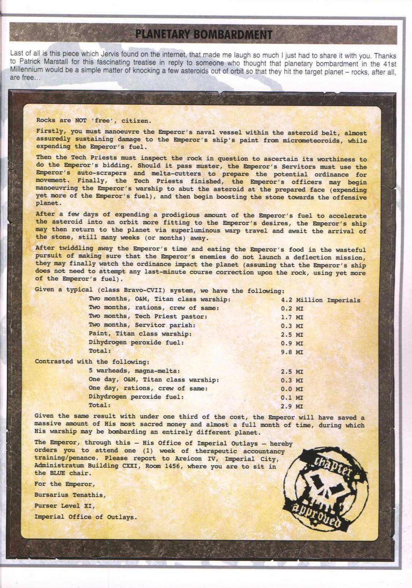

# 在40K的宇宙里进行一次轨道轰炸要花多少钱

> CZ75

在40K的宇宙里进行一次轨道轰炸要花多少钱？为什么在40K的宇宙里很少进行轨道轰炸？看一下下面这篇就知道了，该文翻译自Chapter Approved，下图是原文：

中文翻译：

最后是这份杰维斯（Jervis Johnson，40K的设定人员之一）从网上找到的文件，它使我开怀大笑，所以将它拿出来与你们共享。感谢帕特里克·马斯塔尔（Patrick Marstall）写了这篇有趣的文章，有些人认为，在第41千年中，改变几颗小行星的轨道，将它们用于轰炸行星是很容易的——不就是几块石头嘛，那还不是免费的么……
这篇文章就是为了答复这些人而写的。

公民，石头并不是免费的。

首先，你得让皇帝的船机动到小行星带，几乎可以确定，皇帝的船上的油漆肯定会由于不断遭受微流星体的撞击而被擦伤，此外还要消耗皇帝的燃料。

然后，科技教士还得检查这块石头，看看它是否适合执行皇帝的任务。如果这块石头通过了检测，接下来皇帝的奴工就得使用皇帝的自动铲土机和热熔切割器切削石头，使其能用于可能下达的移动命令。最后，科技教士的活干完了，就该轮到皇帝的军官把皇帝的船机动到小行星的已经准备好的那一面上（还要消耗更多的皇帝的燃料），然后开始把这块石头推向准备对其进行攻击的行星。

在连续几天大量消耗皇帝的燃料，以便把小行星推到更符合皇帝的意愿的轨道上之后，皇帝的船还可能要通过异空间超光速航行回到那颗行星，并等待那块石头到来，这一等可能就是几个星期（或几个月）之久。

当浪费了皇帝的时间和食物进行一次铺张浪费的追击，确认皇帝的敌人并没有发动攻击改变石头的轨道的念头之后，他们才可能最终看见小行星撞击行星（这还是在皇帝的船不需要在石头击中行星之前的最后一分钟都控制着石头航向的前提下，一旦这么做了，又要浪费更多皇帝的燃料）

如果要在一个典型的星系（Bravo-CVII级）中进行一次轨道轰炸，我们需要如下物资：

泰坦级战舰航行两个月所需费用 4.2百万帝国币
船员两个月的配给所需费用 0.2百万帝国币
雇佣科技教士两个月所需费用 1.7百万帝国币
奴工两个月所需费用 0.3百万帝国币
泰坦级战舰的油漆所需费用 2.5百万帝国币
双水合过氧化氢燃料所需费用 0.9百万帝国币
合计： 9.8百万帝国币

与下列相比：

5枚巨型热熔弹头所需费用： 2.5百万帝国币
泰坦级战舰航行一天所需费用： 0.3百万帝国币
船员航行一天的配给所需费用： 0.0百万帝国币
双水合过氧化氢燃料所需费用： 0.1百万帝国币
合计： 2.9百万帝国币

后者只需要花不到前者1/3的钱就能得到同样的效果，而皇帝能省下大笔他最神圣的金钱和差不多整整一个月的时间，在这段时间里他的战舰也许还能轰炸另一个完全不同的行星。

皇帝通过他的的帝国开支局现在命令你必须出席参加为期一周的理财治疗训练/忏悔。请到阿雷孔四号星皇帝城内政部第121号大楼第1456号房间报道，你的席位是蓝色座位。

为了皇帝
布尔萨里乌斯·特纳蒂斯
11级主记官
帝国开支局
