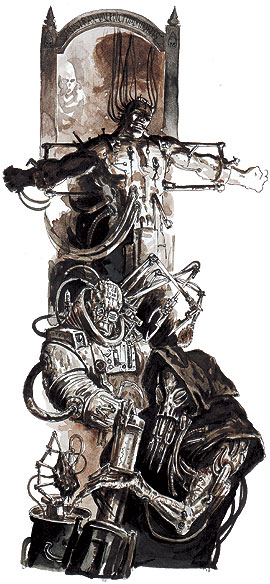
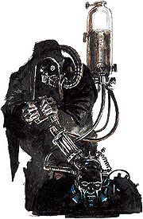
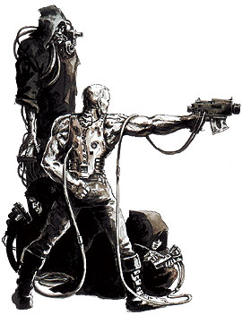
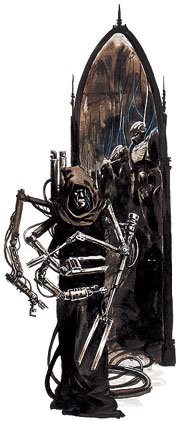
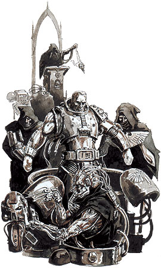
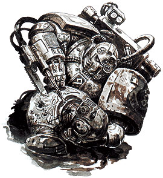
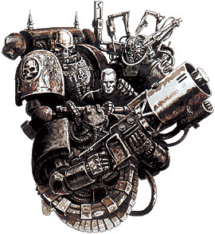
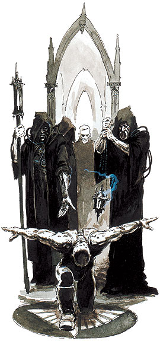
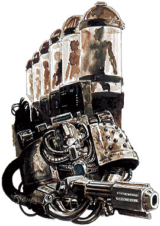

# 星际战士的制造：Creation of Space Marine

> kv85

[[toc]]

## 第一部分，介绍

### Astartes军团【Legions Astartes】的由来

Astartes军团（星际战士【Space Marines】）曾参加在银河建立帝国的早期战争。在冲突年代【Age of Strife】结束时，地球还是一个刚摆脱狂乱的次元风暴【warp-storm】的自治行星。随着次元风暴的突然消失，往返于地球的星际航行再度实现。地球的军队在二百年间开拓出了几乎横跨半个银河的帝国。这便是远大圣战【Great Crusade】

创造星际战士的研究和开发始于第13千年，远大圣战即将开始之时。这一任务在构建于地球深处的实验室内执行。计划的目标是创造一种精英战士，力量超凡且忠心不二。这些战士的前身被帝皇【Emperor】用于重夺地球，征服了一个又个蛮族部落，击败了多个争夺地球的敌对派系。不久以后，帝皇创造了20个称为基因原体【Primarchs】的生命体。帝皇对这些基因原体的确切打算不明，但他们在幼年时便被巨大的混沌漩涡【Chaos vortex】从地球卷走，四散于银河各处。帝皇的基因学者们继续了他们的研究，创造出了第一个真正的星际战士，而其他科学家则制造出了第一件动力装甲【Powered Armour】和第一把Boltgun（星际战士的标准枪支）。

远大圣战的旅程中，帝皇依次遇到了基因原体们，由于他们的超人技能和肉体，每个人都成为了他们第二家乡的头面人物。研究发现，基因原体的遗传密码能大幅加快制造星际战士必需的器官和遗传物质的发育。于是，史称首创【First Founding】的事件发生了。20个星际战士军团【Legion】组建完成，每个都由一个基因原体领导，而他的遗传密码被传给他的战士们。在基因原体贺拉斯【Horus】背叛帝皇后，军团在叫做再创【Second Founding】的时期被拆分为小型的作战团队。这些部队称为战团【Chapter】，约由一千名战士组成。
―――――――――――――――――――――――――――――

### 基因种子和受精卵。

19种基因种子【gene-seed】分别属于19种超人器官，通过手术植入星际战士体内。

很多战团已存续几千年之久。这段时间内，一些战团的基因种子变异了。这导致了人工器官原有性质的变化。这些变化很可能会使人工器官失效。另一种可能是：器官的异变可能降低其功效或导致前所未见的异常效果。不论后果如何，它都将影响整个战团――同一战团的所有星际战士都植入源自相同基因种子的器官。

不仅是器官变异，许多战团因意外事故、遗传失误或其他原因，失去了一种或多种基因种子。只有极少数战团保留着全部的19项器官植入手术。所有战团都拥有甲壳植入手术（阶段19）。不论其他植入、训练和精神培训情况如何，只有这项植入手术能作为星际战士的身份象征。

+++++++++++++++++++++++++++++++++++++++++++++++++++++

## 第二部分，19道手术

基因种子和受精卵。
19种基因种子【gene-seed】分别属于19种超人器官，通过手术植入星际战士体内。

很多战团已存续几千年之久。这段时间内，一些战团的基因种子变异了。这导致了人工器官原有性质的变化。这些变化很可能会使人工器官失效。另一种可能是：器官的异变可能降低其功效或导致前所未见的异常效果。不论后果如何，它都将影响整个战团――同一战团的所有星际战士都植入源自相同基因种子的器官。

不仅是器官变异，许多战团因意外事故、遗传失误或其他原因，失去了一种或多种基因种子。只有极少数战团保留着全部的19项器官植入手术。所有战团都拥有甲壳植入手术（阶段19）。不论其他植入、训练和精神培训情况如何，只有这项植入手术能作为星际战士的身份象征。

器官植入手术
下文记述着由帝皇的古老技师们所创造的十九个器官。每一个器官都极其复杂，许多器官只能在另一个器官存在时正常工作，一个器官的切除或变异都会影响其他器官的正常机能。由于这些原因，植入手术必须严格按照流程进行，还有许多星际战士必须接受矫正手术和化学治疗来恢复其代谢平衡。

### 阶段1――第二心脏【Secondary Heart】

最为简单和完全自持的植入器官。第二心脏不仅能够加快血液供应，也在受体原有心脏损毁时维持完整的生理机能。第一阶段的植入能让星际战士在氧气浓度不足或身受外伤的情况下存活。

### 阶段2――骨强化器官【Ossmodula】

这是一个管状器官，小巧的体积容纳了复杂的结构。骨强化器官监控并分泌影响骨骺愈合和骨骼骨化的激素。同时，特殊的工程激素能促进骨骼组织吸收星际战士口粮中添加的陶瓷类化合物。在植入的两年后，这将会引起长骨的明显加固及胸腔的极度骨化（肋骨长成骨板，相互交错重叠，混然一体），并全面增大受体的骨骼尺寸。

### 阶段3――肌肉强化器官【Biscopea】

此器官植入胸腔。它体积小巧，近似球体，其主要功能在于激素调节，这与骨化强化模块类似。肌肉强化组织能够刺激人体肌肉的发育。

### 阶段4――血液再造器官【Haemastamen】

这个微细的器官被植入一条主血管内。血液再造器官的作用有二。其一是监视，或者说是在某种程度上控制阶段1和阶段2的植入器官。其二，此器官也将改变受体的血液组分。结果是，星际战士的血液比正常人的血液更为高效，由于星际战士的体内装着那么多的额外“生物部件”，此步骤绝对是不可或缺的。

阶段4――重造血器官(Haemastamen)。这个不起眼的器官被植入一条大动脉之中。这个haemastamen主要有两个作用。其一，监视、并在某种程度上控制第2、第3阶段的植入器官。此外，亦起到改变受体的血液成分的作用。因此，一个星际战士的血液，其效率较之常人更高；而且考虑到他体内所携带的额外的生物器官，也的确要求如此。

### 阶段5――拉瑞曼器官【Larraman's Organ】

这是个暗色肉质器官，形似肝脏，约有高尔夫球那么大。它和一组复杂的血管一起植入胸腔。这个组织生成和存储特殊的“拉瑞曼细胞【Larraman's Cell】”。如果受体受伤，这些细胞会被释放到血液里。它们附着于血液中的白血球上，然后被输送到伤处。一旦接触空气，拉瑞曼细胞生成皮肤替代组织，迅速形成疤痕，从而止血并保护暴露的伤处。

### 阶段6――Catalepsean神经结【Catalepsean Node】

此器官通常经由头颅后面枕骨上的一个钻孔植入脑部。这个豆粒大小的组织能影响睡眠的生理节律，和身对在睡眠剥夺的反应。平时，星际战士的睡眠方式和常人相同，但出现睡眠剥夺现象时，Catalepsean神经结开始“介入”。植入此神经结的人能够按序“关闭”大脑的不同区域，从而在睡眠时保持警觉。这一过程完全不能取代正常睡眠，但是能让星际战士在休息时对周围环境保持警惕，提高他们的求生能力。

### 阶段7――预置胃【preomnor】

预置胃是契合胸腔的一个大型植入器官。这是一个进行预先消化的胃，能让星际战士食用多种有毒或几乎无法消化的物质。真正的消化并不在预置管胃内进行。一个个独立的检测管侦测潜在的毒素并加以中和，此外，在必要时，预置胃将和其他消化道隔离。

### 阶段8――基因侦测神经【Omophage】

这是一项复杂的植入手术。它实际上是大脑的一部分，但是位于颈椎和胸椎间的脊髓里。四个称作neuroclea的神经鞘被接入脊柱和预置胃的胃壁之间。Omophagea被设计用于吸收动物体内管理记忆、经验和天赋能力的组织生成的遗传物质。这赋予了星际战士非凡的求生天赋。他实际上能通过进食学习。如果星际战士吃了某个动物的一个部分，他将吸收那种动物的一些记忆。这在异星环境中十分有用。值得一提的是，我们了解到，这种组织的存在导致了许多战团的生肉吞食和鲜血饮用仪式，因此这些战团通常会得到血饮者，或裂肉者等名号。

### 阶段9――多肺【Multi-lung】

这是另一项大型器官植入。多肺，或“第三肺”,是一个灰色的管状器官。血液从嫁接到受体肺系统的血管流过这个器官。空气由此器官上的扩约肌吸入。在有毒空气中，一个伴生括约肌关闭气管，阻止普通呼吸以保护肺部。多肺能从缺氧或有毒的空气中吸收氧气。更重要的是，由于其有效的毒素分解和中和能力以及再生系统，它不会因呼吸毒气而受损。

### 阶段10――视觉控制器官【Occulobe】

这个形似弹头的细小器官位于大脑底部。它提供激素和遗传刺激，能使星际战士的眼响应光学治疗。仅靠视觉控制器官不能增强星际战士的视力，但是它使得技师能够对眼的生长模式和视网膜感光细胞进行调节。一个成年星际战士拥有远胜凡人的视力，而且能在微光环境下正常视物，如同白昼。

### 阶段11――莱曼之耳【Lyman's Ear】

这个组织让星际战士能有意识的增强或过滤特定的背景噪音。不仅是听觉增强了，星际战士也不会因极度方向感缺失而感到晕眩或恶心。莱曼之耳的外形与普通人类耳朵无任何差别。

### 阶段12――Sus-an脑膜【Sus-an Membrane】

这个扁平的圆形器官植入大脑皮层顶部。它完全融合之前在脑部生长。如果没有对应的化学治疗和训练，该器官是无用的。然而，一个接受正确指导的星际战士能够进入一种假死状态。这可能是一个有意识动作，也可能在遭受极度身体创伤时自动启动。在这种状况下，星际战士能继续生存多年，即使已受到几乎致命的伤害。只有药剂师的化学治疗和自我暗示能将星际战士从此状态唤醒――星际战士无法自己唤醒自己。已知，被成功唤醒的最长休眠达到567年：他是brother Silas Err，来自暗黑天使战团【Dark Angel】（d.321 m.37）

### 阶段13――色素控制球【Melanochromic】 ，或色素控制器官【Melanochromic Organ】

此器官呈黑色半球状。它以间接而极端复杂的方式工作。它侦测轰击皮肤的辐射水平和种类，并在必要时开始进行化学反应，将皮肤颜色变暗，以免被紫外线灼伤。它也对其他形式的辐射提供有限的保护。不同战团的不同色素控制器官的基因种子造成不同的肤色和发色，在一些战团所有的星际战士都有相同的颜色，例如亡魂战团皮肤白化的战士。

### 阶段14――卵石肾脏【Oolitic Kidney】

这个棕红色的心形器官改善和调节星际战士的循环系统，使其他的植入器官有效发挥功能。鲕粒岩肾脏还能极其快速有效的过滤血液。第二心脏和卵石肾脏能够协同工作，在星际战士昏迷时，血液高速循环并紧急解毒系统。这能让星际战士在多肺无法处理的毒气中存活下来。

### 阶段15――味觉监测神经【Neuroglottis】

预置胃能消化致命物质，保护星际战士，而味觉监测神经能让他尝出潜在的食物。这个器官被植入口腔后部。通过咀嚼或浅尝，星际战士能发现出多种天然毒素，一些化学物质，甚至某些生物的独特气味。星际战士可以仅凭味觉追踪目标。

### 阶段16――汗腺改进器官【Mucranoid】

这个小型器官被植入肠组织下部，分泌的激素被结肠吸收。这种分泌物造成汗腺的变化。被药剂师的化学处理激活前，这种变化不会造成星际战士的任何改变。此手术的结果是：星际战士的汗成为覆盖皮肤表面的自然清洁剂。此物质也能在极端温度下保护星际战士，并提供一些对真空环境的防护。对进行Mucranoid的化学处理是远航和真空或近乎真空环境下作战的标准流程。

### 阶段17――Betcher腺体【Betcher's Gland】

两个相同腺体分别植入位于下唇处的唾液腺旁边，或硬腭内。Betcher腺体的工作方式和其他毒虫的相似：合成并储存致命毒液。星际战士因为有腺体，对此毒素免疫。这种毒素还具有腐蚀性。一个置身铁牢的星际战士只用几分中就能咬开铁条逃出。

### 阶段18――基因存收腺【Progenoids】

此腺体共两个，一个置于颈部，一个在胸腔深处。这个腺体对星际战士战团的存续十分重要。两个器官在星际战士体内成长，吸收其他器官产生的激素和基因物质。五年后，颈部腺体成熟，可以摘除。十年后，胸腔内腺体成熟，也可摘除。腺体只要发育成熟，便可随时摘除。这些腺体是战团基因种子的唯一来源。成熟时，两个腺体都含有分别对应受体星际战士的每个植入器官的基因种子。一旦手术摘除后，基因存收腺必须小心保管，他的每个基因种子都对变异程度进行检查，健全的基因种子被储存。基因种子在合适环境下被小心保存。

### 阶段19――黑色甲壳【Black Carapace】

这是最后和最特别的植入。它在培养槽里生长时看起来像黑色的塑料胶片。它在移出培养液后被切成大片，直接植入星际战士躯干部分的皮下。几个小时内此组织扩张，外部变硬，并向星际战士身体深处伸出神经束。几个月后，甲壳完全成熟，受体便能和切入硬化甲壳的神经传感器和注入点结合。这些人造“插入点”连接着动力装甲的各个部分，比如监视，医疗和生命维持单元。没有黑色甲壳的辅助，星际战士的动力装甲几乎完全无用。

+++++++++++++++++++++++++++++++++++++++++++++++++++

## 第三部分，战团的一些情况

### 各战团间的变化

各器官的特殊功能已在上文列出。虽然战团的药剂师和外科医师能够完成必要的植入手术，他们对每一项器官的具体机能缺乏必要了解。所有相关程序都已极其古老。手术程序被代代相传，变得越来越仪式化，还受到了曲解。因为这些原因，不同战团的各种器官的效果往往不同，由战团的基因种子及外科手术的异化程度决定。在一些战团，基因种子突变，有缺陷的外科手术，或不当的术后调养，扭曲了植入器官的功能。例如，饮血者战团的基因侦测神经【omophagea】基因种子发生变异，所以所有团员都对鲜血有超自然的渴望。在其他战团，个别器官或根本无效，或已完全失踪。

### 受精卵再造

基因种子只能从活着（或刚死）的星际战士体内取下的一个或一对基因存收腺中提取。因为这个目的，星际战士药剂师携带一个特殊装置，称为回收器【reductor】，能够在战场上取下殉职战士的基因存收腺。基因存收腺的作用是为战团的存续保留基因种子。除此没有任何方法制造受精卵。每个战团库存的基因种子因此是独一无二的。基因种子对一个战团有极大的宗教意义，代表了它的特性和未来。没有基因种子，战团就不再有未来。一种基因种子的消失意味着永远失去一种受精卵。阶段18或19的基因种子的消失从根本上意味着一个战团的终结。

因为每个星际战士只有两个基因存收腺，战团制造新星际战士的速度是有限的。一个遭受惨重损失的战团需要要花费许多年来重建。如果星际战士暴露于强辐射下，或者受到其他遗传干扰，基因种子会失效。不同战团的基因存收腺内存储基因种子的效率各不相同，所以一些战团能够比其他的战团更快的增补新兵。

### 建立新战团

根据战团宪章，每个战团都必须将其5％的遗传物质上交火星上的机械神教【Adeptus Mechanicus on Mars】。这种“宗教税”有两个目的。首先，它使机械神教能够监管各战团的健康状态。其次，它使得机械神教为创建新战团储存基因种子。

新战团不是一夜建成的。每一种受精卵都要相应选出合适的基因种子。接着，受精卵在看护下生长，并被植入人类奴隶试验体内。这些奴隶试验体必须保证生物学参数正常且没有任何突变。奴隶试验体的全部生活都局限于静止的实验舱内。虽然保留了意识，但他们完全不能活动，只是充当各类受精卵用以发育的媒介。从最初的奴隶得到两个基因存收腺，然后分别植入另外两个奴隶体内，收获4个基因存收腺，照此一直继续。制造1000套健康的器官将花费55年。这些器官必须取得机械神教导师的官方审批，然后由帝国最高议会【High Lords of Terra】向帝皇请示（PS：似乎只是一个象征性的仪式而已）。只有帝皇才能授权许可新战团的创建。

### 征兵和入团

各种植入器官对星际战士的体质和精神状态产生极为深远的影响。这些变化大多受天然激素分泌和发育模式的控制。如果受体已到达了一定的自然生长阶段，植入的器官也许不会起效，或者不会完全起效。因此，新兵必须足够年轻。身体组织兼容性也是必须的，否则器官无法正常发育。

第三项考虑是精神匹配。Catalepsean神经结, 视觉控制器官,和sus-an脑膜将只能在催眠暗示的刺激下发育至可用状态。一个新兵必须对这些特殊处理保持敏感。

这些需要考虑的事项意味着只有很小比例的人能成为星际战士。他们必须是男性，因为受精卵是对应男性激素和身体组织类型的，然后根据所需的生理和心理兼容性开始筛选。如果这些测试成功，候选者成为新入者。在器官植入完成并接受化学治疗和心理训练后，头衔变为入门者。入门者在成为正式队员前接受训练。一个星际战士通常在16～18岁间正式入团，但是由于制造星际战士的方法引起的激素变化，在此之前，新兵的身体已经完全发育。战时的压力也将加快这一进程。

++++++++++++++++++++++++++++++++++++++++++++++++

## 第四部分，风险

虽然战团只会选取最为合适的候选者，可是并非所有的新进者能活着成为入门者。这是因为各个战团知识的流失造成了筛选手续不如以前那么有效。某种情况下，手术程序也不是完整有效的。在许多战团中，植入手术已高度仪式化，常常伴随着自残、咒语、长期的祈祷、禁食和各种神秘行为，这些行为将影响医疗效果。例如，太空野狼战团【Space Wolves】的阶段17手术有轻微变异，所以太空野狼的犬齿在他们的一生中持续生长，在几个世纪内将其变为可怕的尖牙。牙齿的长度是战团内资历的标志，甚至也是战团组织的一部分，因此他们组成重武器小队的老兵被称为长牙。

另一个因其基因种子而传闻广播的战团是圣血天使。他们时常坠入由战斗诱发的狂暴中，称为黑色狂怒，随即变成对血肉饥渴不已的狂暴战士。圣血天使一直在寻求对圣吉列斯【Sanguinius】诅咒的治疗方法，不过，以这些狂暴的星际战士组建的死神连队是绝佳的突击部队，他们几乎无视伤痛并空手撕碎敌人。

另一个基因种子异变的极端例子是黑龙战团【Black Dragons Chapter】，其骨强化模块以反常方式生效。这使他们头上长处骨化了的头冠，而前臂和肘部突出利刃般的骨刺。类似于圣血天使的死神连队，被这种反常发育影响的战士被编入一个独立的作战单位。称为龙爪，他们磨利他们的额外骨刺并套上精金外鞘，使之变为可怕的近战武器。

如果一个植入的器官无法正常发育，星际战士的新陈代谢可能会严重失控。他可能会陷入精神异常状态或者过度活跃状态。以上任何情况下，他都可能死亡。

不幸未死的人通常会遭受精神损伤，退化为嗜杀无度的疯子或者是喋喋不休的白痴。如果战团兵员充足，这些不合格者将被结束痛苦的生命。但是，如果战团缺少星际战士，他们常常会被允许活下去，然后会被编入他们自己的特殊单位。表现出精神完全失控的人可被用以组建自杀攻击部队。

某些战团故意制造这类怪物，甚至将残损的受精卵植入部分入门者体内。这是及其危险的，为帝国法令不容。可惜古老的传统都是顽固不化的。

### 精神―化学治疗和其他训练

植入手术和化学治疗、心理训练、潜意识催眠同步进行。所有这些都是星际战士正常发育所必需的。

化学治疗――星际战士在入门前必须接受例行测试和考核。新植入的器官被小心监控，失衡、修正、以及一切损害发育的苗头都被治疗。化学治疗在完成入门过程后减少，但绝不结束。星际战士在他们的余生接受周期性的治疗来保持稳定的新陈代谢。这就是他们的动力装甲带有监视和给药设备的原因。

催眠治疗――在接受极度强化的身体成长的同时，受体必须学习如何运用其新的技巧。一些植入器官，尤其是阶段6、10的注入，只在得到正确的催眠治疗后才能正常工作。催眠治疗通常不像化学治疗那么见效，但也能收到实效。如果星际战士能学会如何控制自身的新陈代谢，他对药物的依赖便会减少。整个过程在称为hypnomat的机器里进行。星际战士进入催眠状态，接受视觉和听觉的幻象，以此唤醒他们对无意识代谢过程的感知。

训练――体能训练刺激植入的器官，并使之能接受效能测试。

教导――星际战士因其超凡力量凌驾于凡人之上。星际战士的心智与精神同样卓尔不群。他们的身体接受了19种植入手术，他们精神也接受了改造，能够解放体内的潜能。这种精神力量上述的身体力量还要强大。例如，一个星际战士能高度控制其感觉和神经系统，因此可以承受会致常人于死地的伤痛。星际战士也能以电光石火般的速度思考和作出反应。记忆训练也是教导的重要部分。某些星际战士强化形象记忆。显而易见，星际战士和常人一样渴求知识，而且他们的独有的心智能力。由此，又一个最杰出的帝国战士诞生了，成为帝国盔甲上的坚实链环。

