# 40000年后的生物。。。

40000年后的生物。。。

五月

Arachnospila

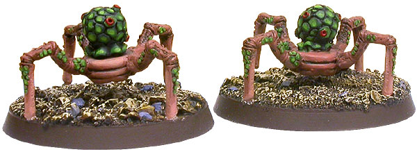

Chiaro Ash Croaker

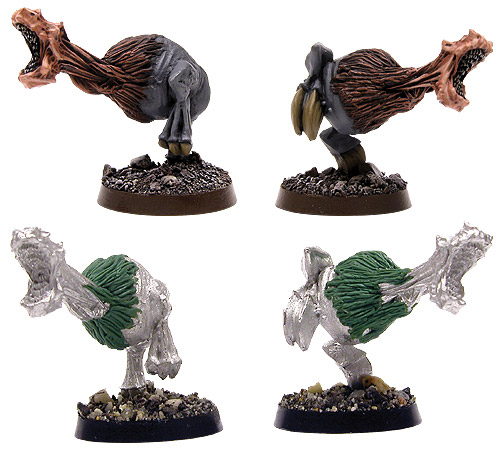

Cuthellian Cudbear

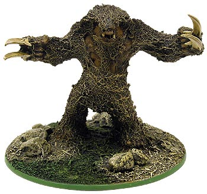

Mordinian Duplicator

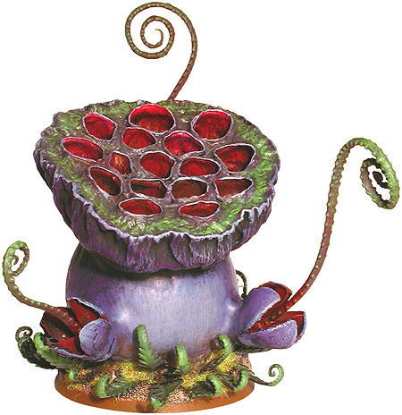

Glovian Stinger

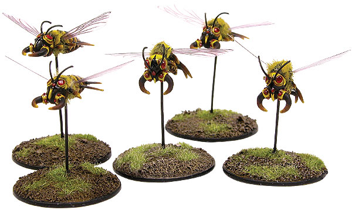

Kalathrax Fiend

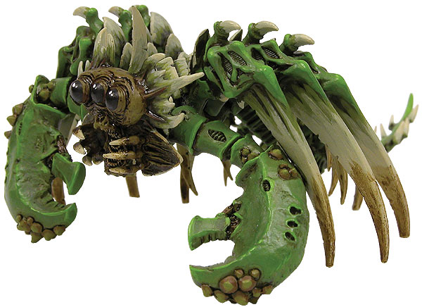

Magmakin

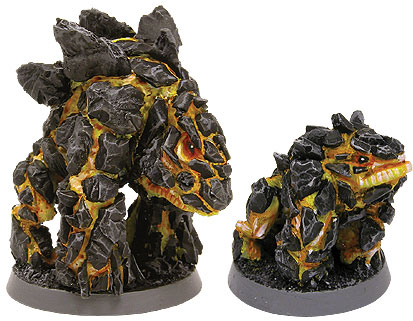

Venus Mantrap

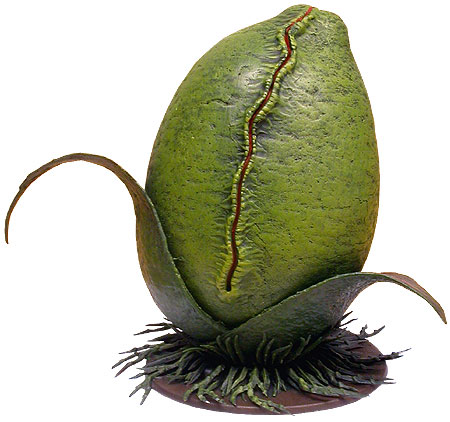

Nivolik Bloom

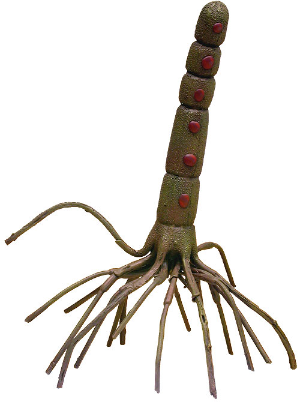

Pentarant

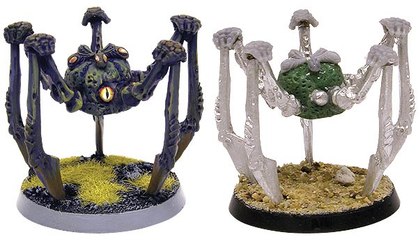

Physokerme

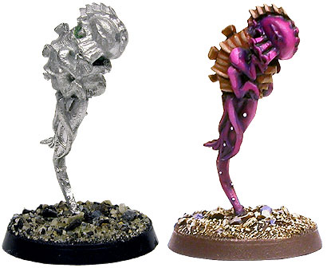

Pyro Spores of Durga IV

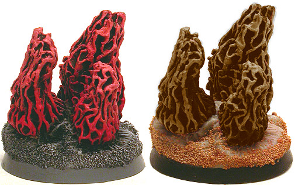

Razorback Hound

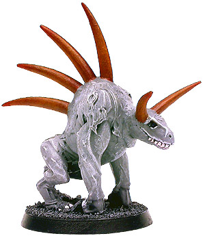

Spined Rhodox

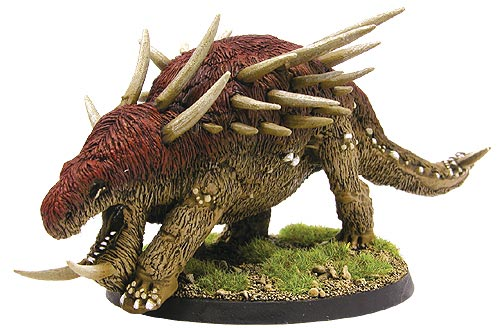

Scuttlehag

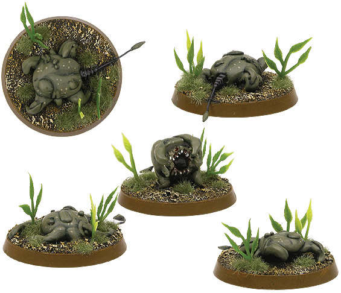

Silkava Gar

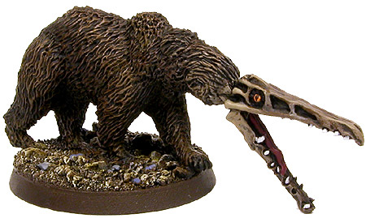

Stragali Stalker

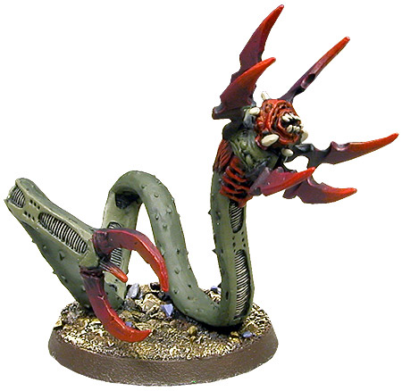

Wuzzit Mud Demon

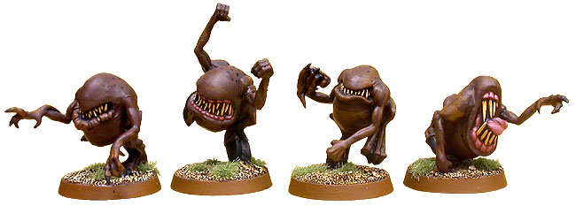

Zigadenus Brain Eater

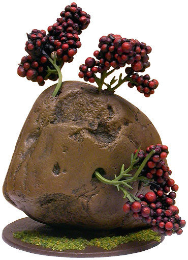

最后发几张合影。。。

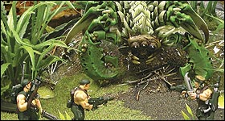

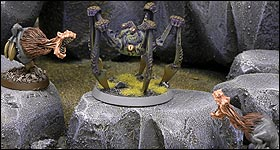

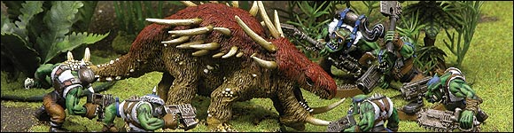

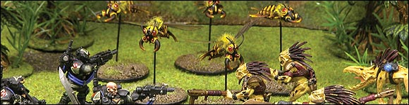

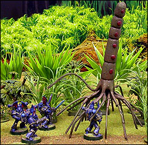

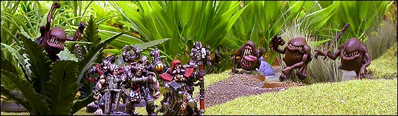

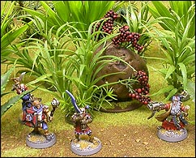

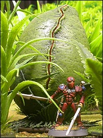

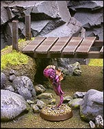

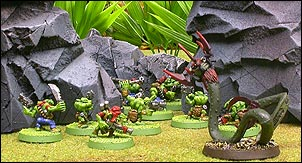

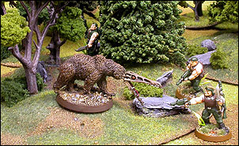 
