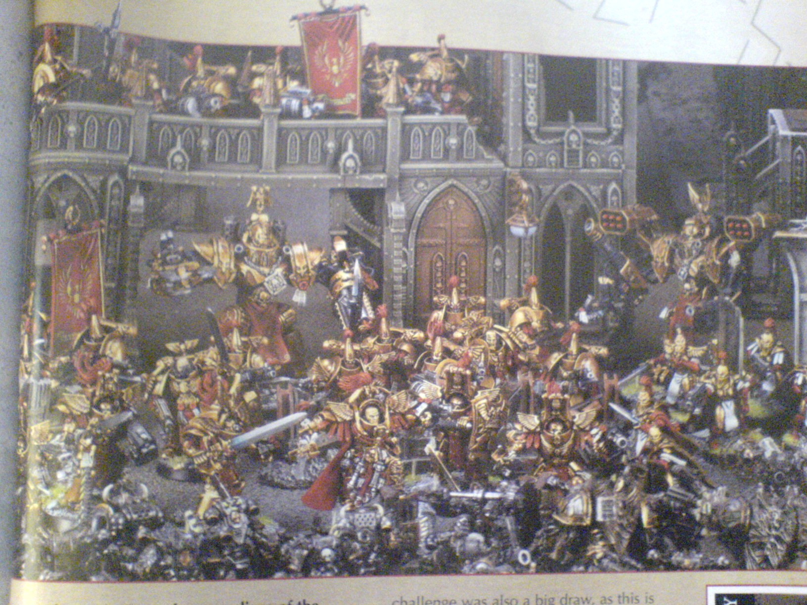
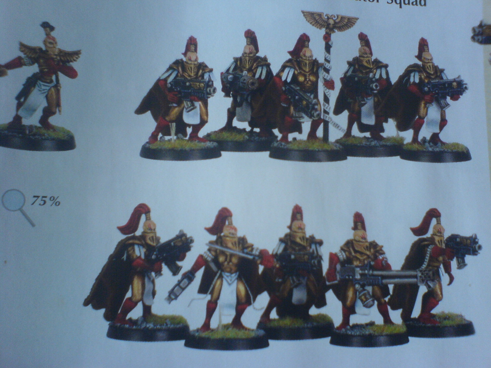
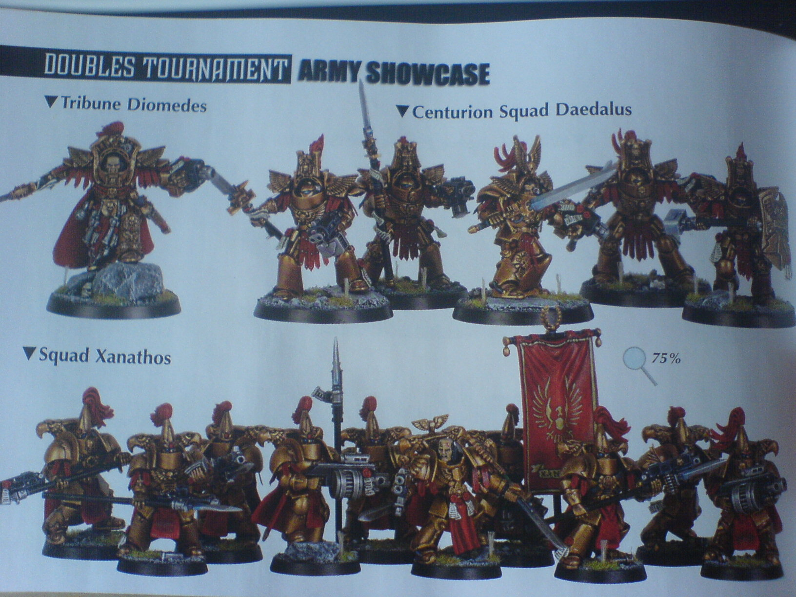
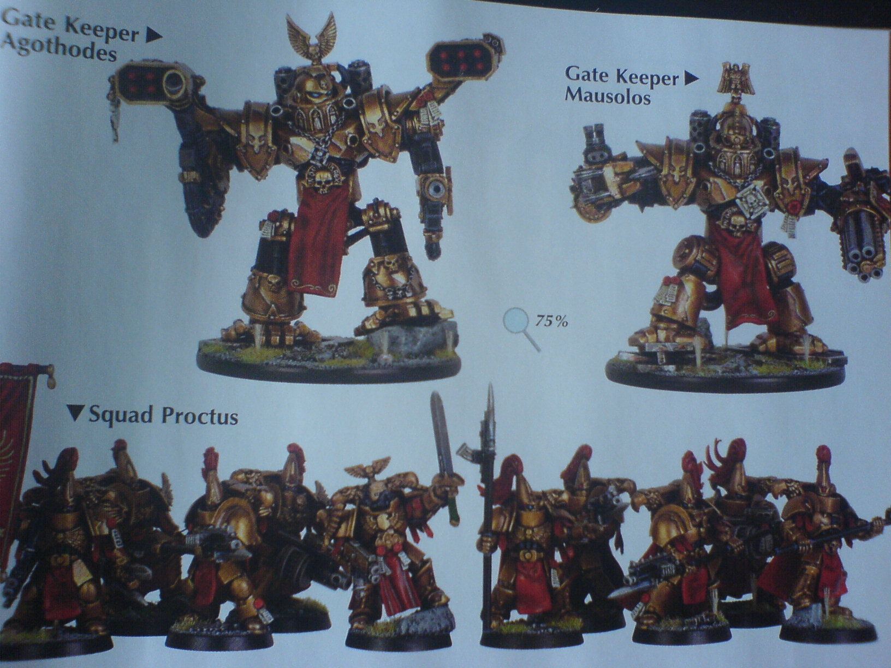

# 帝国之最强战士,皇帝的忠实仆人-帝国之盾

> [qoosong](http://game.ali213.net/profile-uid-1017399.html)

鉴于暗黑圣战资料片发布之际,本人为了庆祝一下,发上一组锤子们少见的图片,不过由于是从书上用手机直接拍摄,分辨率不太好,大家将就了!!!~

这组图片是我买每期games workshop的新模型和战术书上发现的.由于罕见并且强大,所以分享一下.

谁是帝国之盾?
当年郝拉斯叛乱的黑暗年代,叛军直接攻打到了地球,星级战士大部分战团都没能赶回来援救帝王,混沌大军曾一度攻打到了帝王宫殿外围,帝王的御林军-圣殿监察员和寂静修女再最后的防线上抵抗了浑沌军团的攻击以至取得最终的胜利.这些战士的功绩很少人得知,人们不知道在最后的阶段星级战士支持不住的时候,这帮守卫们是如何抵御浑沌的攻击的.

锤子们都知道,星际战士的涂装是各种颜色的,当然这些只是初等战士的颜色,比较精锐的灰骑士盔甲涂装是庄严的银色,目前人们好像知道它们是帝国最精锐的战士,但是帝国之盾属于帝王的直隶卫队,他们才是最强的战士,盔甲涂装直接师承帝王高贵的金色.

废话不多说,都是新模型,games workshop还没正式出版. 目前市面上还买不到,先上图.

帝国之盾在宫殿外围防御混沌的进攻

寂静修女----遗忘骑士和雪豹监察小队

圣殿监察员----狄俄墨得斯指挥官和代达罗斯终结者小队(上组)

圣殿突击小队(下组)

圣殿看护者机甲(留意它们的武器配置,类似小型泰坦)

重点:
留意它们华丽的盔甲,帝国标志双头鹰背囊,不像星级战士和灰骑士背后两个小圆球.终结者队长和指挥官直接装备能量剑和热熔手腕炮,不像星级战士装备离子枪和链锯刀,其它组员装备和灰骑士一样的斩妖能量长矛,不过不痛的是它们的能量长矛上面抓干杯了爆弹枪.普通圣殿突击小队也有成员装备重型爆弹枪,队长装备双管爆弹枪.至于它们的圣殿看护者机甲的武器不知道是不是从猎犬型泰坦上拆下来的武器..

结尾,不知道帝王死后这帮哥们有没有被机械神教清洗.嘿嘿
