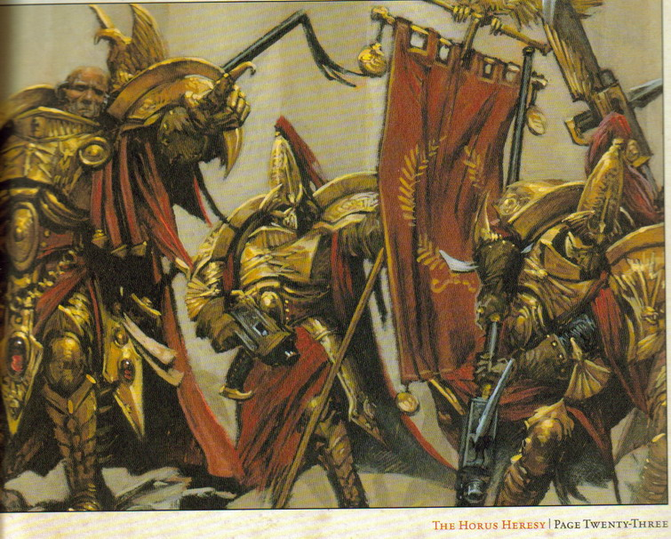
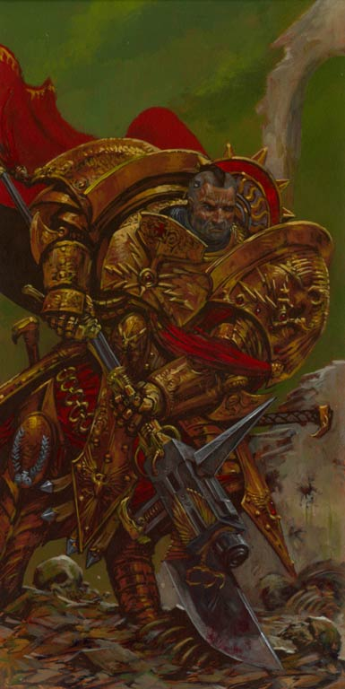
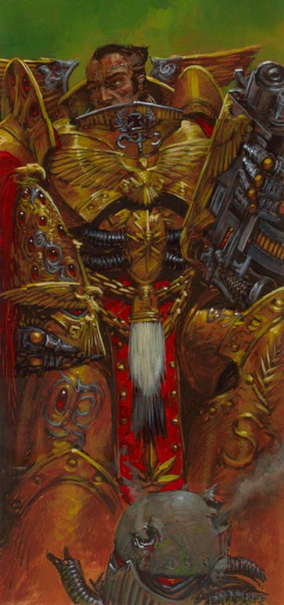
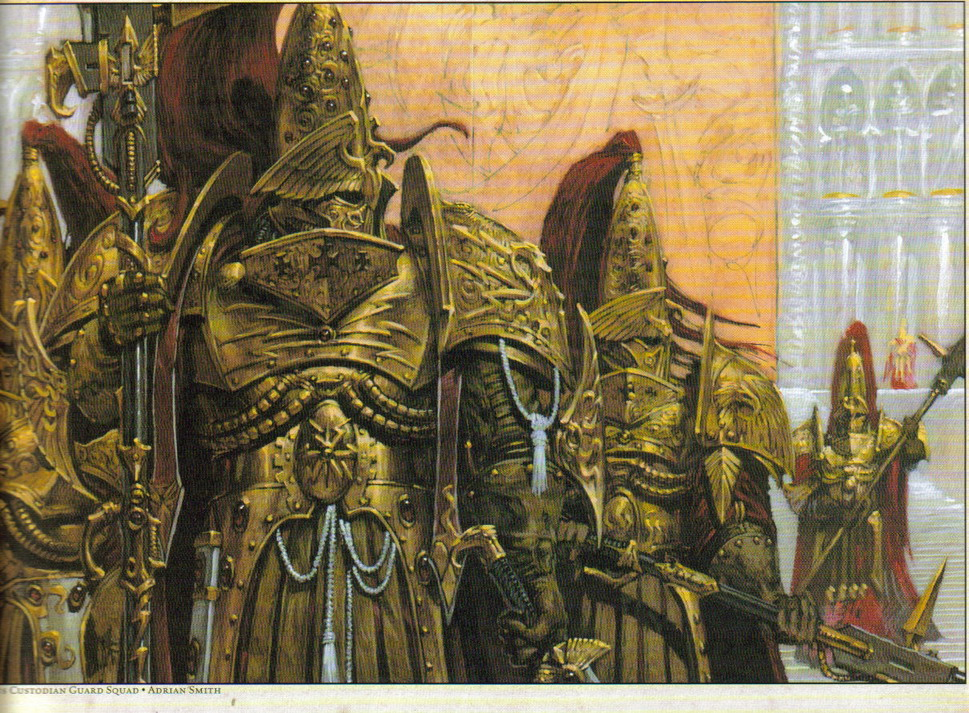
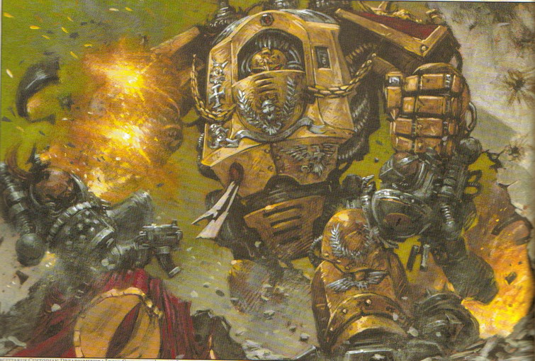
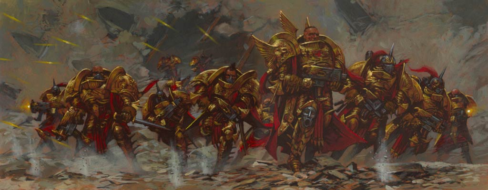
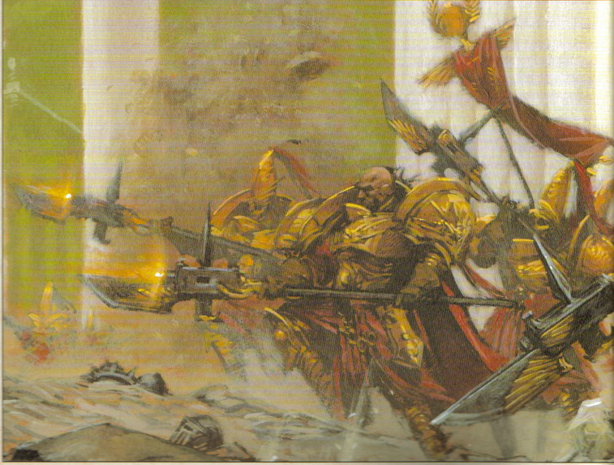
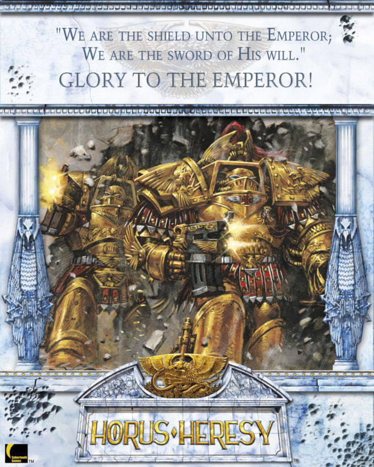

# 禁军

> boltgun

三张是皇帝的“监管者”亲卫军，是皇帝用领主们的基因种子建立星际战士军团之前就创建的超强部队。40000的时候应该只在地球的黄金王座驻守了。

――――――――――――

这是亲卫军的无畏者，从那个头盔式的头部结构有点象MKIV型，但是他的近战斗手臂是五指握拳结构，而且背后的排管子貌似只有三个。暂时理解成是特别型号吧……

顺便，游戏里的箱子造型是MKV，按型号排比MKIV是新了一个号。但是按照皇帝时代的好东西不断地被弄丢失传的情况来看，很怀疑MKIV要比MKV猛得多。

――――――――――――――――

要知道禁卫的刀上可是绑定射击武器的，灰骑只有扣在手上，还造成了射击距离缩短。
而且禁卫军里有女的……

绝对独一份

蓝鹰圣骑

皇宫里的是帝王禁军~帝王的亲卫队.....估计都是亿里挑一的超人,所以当时何露斯明明已经杀到帝王殿门前,里面就剩残余的圣血天使,但考虑到暗黑天使与太空野狼已经逼近——事实上估计他们还在十来个太空年外呢,要赶到战场也不是一两天的事——不敢怠慢,就直接和帝王决战了,很有可能就是因为这些真正传说中的禁军难以估计的战力,搞不好直接就把战斗拖上个把星期甚至数月,然后等部队回援成功就要完蛋了,所以才孤注一掷的.

灰骑士是战后才建立的特别军团,从某种角度来说灰骑士不属于SM,而是属于恶魔审判庭,虽然战力也很惊人,不过依然很难和帝王禁军相比.

帝王禁军很可能清一色的灵力大师,而灰骑士只是每人都有一定的灵力,普通灰骑士的灵力主要用来保护恶魔侵袭,而禁军的灵力应该足以用来进行攻击.武器虽然都是动力长矛,不过禁军的长矛上直接装了风暴矢,而灰骑士只是在手上装了武器,而且是不是风暴矢呢?

boltgun
暴风矢弹枪和终结者装甲都是在老荷做了WARMASTER之后才出现的，而禁军早在SM军团出现之前就有了，所以他们刀上的不是。
灰骑士手上的确实是暴风。

禁军到不是每个人都有异能，不过寂静修女会每个人都免疫异能和CHAOS。

jerrroy
记得有人说是帝王直接传送到何露斯的战舰上决斗的。。。。。。。不知有更详细的描述没有？

非凡龙天子
何露斯突然发神经，把自己的战舰防护罩去掉了，帝王和圣吉利斯2个人一起进去，何露斯杀了圣吉利斯，但是他被帝王打败，帝王自己差不多完蛋了，被放到时间停止的金棺材里去了，，，失去领袖的叛军士气瓦解。都跑了。。

jerrroy
那这样说来，帝王禁军没有和叛军交手吗？。。。。。。。。。。。

蓝鹰圣骑
有~~本来偶还有张图是禁军在皇宫废墟里作战的.....当然图里没敌人=.=

另外帝王传送进何大座舰时不仅带了血天使长,还带了一部分禁军以及某某审判长.....最后就是他们把帝王送回地球的`

boltgun
血天使和帝国之拳在外面跟叛徒死磕，禁军在皇宫的WEBWAY里跟恶魔死磕。
在上去之前，皇帝吩咐找来能力和忠诚绝对可信的凡人与SM各四个，然后吩咐成立对抗人类敌人的审判庭（当时只成立了作为秘密机构的恶审）和专门对抗CHAOS的特殊SM团
皇帝最后带着一队禁军和两个儿子传送到复仇之魂上去的，用的是他自己的能力。当时3G刚跟一只大恶魔对K过，身上有伤。
荷鲁斯扰乱WARP，让他们传送进来之后不在一起。
被亚空间污染的战舰本身还会攻击他们……
3G应该是在离老荷比较近的地方，先找到了他。老荷说得未果，于是挑掉。
然后是零散的禁军，被通杀，然后是皇帝。
两个人单挑，老荷一度将皇帝压制，然后又冲进来一个禁军，被老荷眼神秒杀，皇帝爆发，对老荷致命一击。然后CHAOS很失望……
老荷连人带精神投影一起被灭
皇帝被顿带回地球，在皇宫里，皇帝对顿和白痕的大汗做了最后的嘱咐，然后在黄金王座上闭关了。

