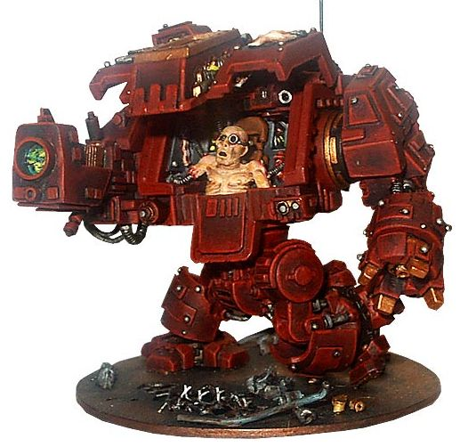

# 无畏的驾驶员

想了解无畏的驾驶员是个啥样子么。。。

图片：

此内幕由锤友“温柔地哭泣”揭露

将楼上的异端全拉到审判庭等候圣裁

无畏的驾驶员通常是军团中的精英战士，但由于种种原因无法再以正常星际战士的身份服务于帝皇（比如被炸得……但还没牺牲），那么他们可以选择是否进入无畏的金属子宫再次奋战，至死方休。
无畏的驾驶员通常也是军团中资格最老的战士，有的拥有上千乃至上万年的记忆
如果战场上有无畏倒下，通常星际战士会不计代价抢回残骸，将牺牲者安置入军团墓地或纪念堂，而机甲则会在重铸后容纳新的战士。
比较之下，在人类帝国，无畏机甲是一种活动的纪念碑，让已经逝去的伟大战士继续为皇帝尽责。在混沌军团中，无畏机甲代表了不休止的疼痛和诅咒，被活活关在钢铁身躯中的战士时时处在愤恨中，偶尔的发泄并不能舒缓他的痛苦，他一直仇视着外面的世界，时时在想着把一切都粉碎。

