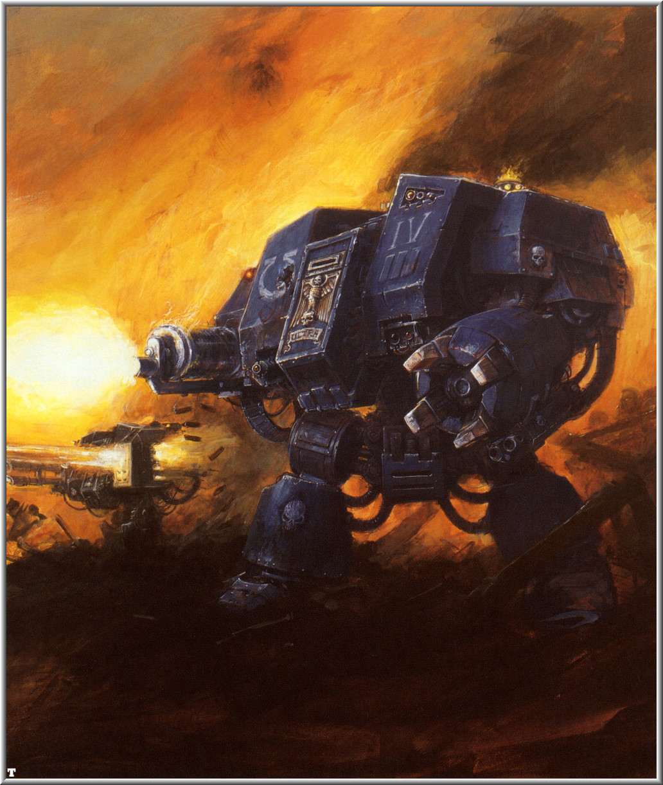
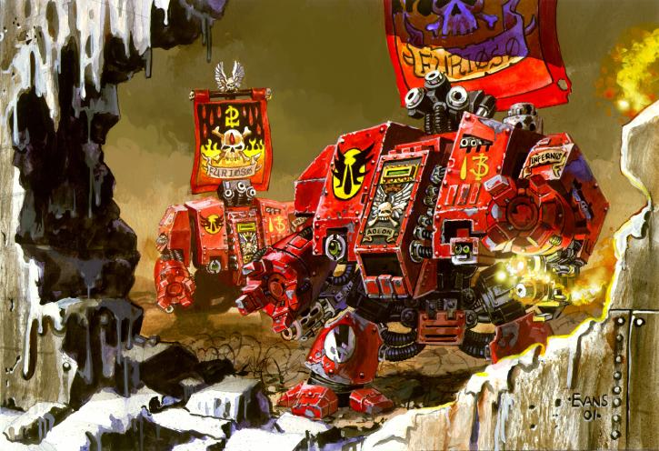
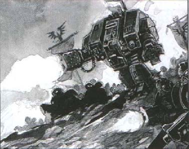
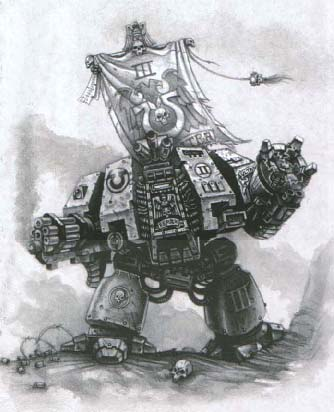

# 无畏机甲

> 兔子半妖

无畏机甲是巨大的战斗机器,它的高度是常人的2到3倍,而重量可达数吨.当它们大步冲向敌人的时候,厚重的装甲上火花像雨点般溅落,高耸的躯体内安装的武器向外喷射炽热的死亡,而金属的双臂将一切障碍击得粉碎.没有哪一次大规模的突击不是以一波无畏机甲的强袭作为开场的,它们义无返顾地杀向敌阵,在防御阵地中打开一个缺口.

无畏机甲时常被误认为是机器人或者大型装甲战斗服,事实上,它与这两者有共同点,却又不尽相同.无畏机甲是相当独特的,每部无畏机甲都将一个活物的神经系统与机甲的由电子生化纤维和磁力线圈构成的"肌肉"接驳在一起,使得机甲能像一个活着的生物一样轻松自如地行走.驾驶者(就是那个"活物")通过机甲的水晶棱镜观看,通过机甲的金属肢体行动.一旦一个生物与无畏机甲接驳,它便无法活着离开它的金属子宫;它的宿命就是在这个行走的坟墓中战斗到生命的终结.

星际陆战队无畏机甲可能是最古老的无畏机甲型号,一些机甲的生产日期可能能追溯到数千年前的"动荡之年"(Age of Strife).无畏机甲是复杂的机器,需要特别的材料和技术来建造.每个星际陆战队员都对无畏机甲充满崇敬,因为它们的制造技术已经差不多失传了.星际陆战队无畏机甲的驾驶员绝非普通的陆战队员,他们是"长者"(The Old Ones)的一员,他们都是英雄般的陆战队勇士,曾在很久以前的战斗中负伤,因而被赋予了这项荣誉――以不死的无畏机甲的身份,继续为帝王服务."长者"的身体像胎儿般蜷缩在无畏机甲的内部,而他的神经系统直接与机甲的系统相连."长者"通过这具金属身体,或者说棺材得到重生.

一些"长者"的记忆能追溯到数十个世纪之前,他们所属的战团建立的时候.其他的星际陆战队员十分尊敬他们,因为他们是强大的战士,还因为他们是不老的祖先,是很久之前的战斗的见证者.在战斗中幸存下来的无畏机甲都被精心地维护和修理.如果一台无畏机甲在战斗中被摧毁,其他的星际陆战队员将奋不顾身地将它抢回,以便将这光荣的战士安葬在战团的宏伟的陵墓中.而无畏机甲的机体部分将会被修复,并成为另一名新"长者"――濒死的陆战队员的金属身体.

与大多数无畏机甲类似,星际陆战队无畏机甲的双臂可搭载多种武器,这种便利的设计使它能迅速更换武器配置以适应不同的战斗需要.星际陆战队无畏机甲搭载的武器与陆战队员或者终结者小队配备的重武器差不多.然而,由于无畏机甲的武器系统在机体的抗打击能力、载弹量、瞄准系统的精确程度上都远胜步兵,因此能发挥出更强大的战斗效能.这些优点都被计入了无畏的弹道计算能力、移动能力和重武器射击能力中(这里在说桌面游戏- -).此外,星际陆战队无畏机甲的武器还有以下的特殊规则.

__突击加农炮和暴风矢__

造成这两样武器射击中断的原因通常要么是弹药失效,或者是武器过热,再不就是弹夹耗空.而星际陆战队无畏机甲的巨大弹仓中携带了数千枚弹药供其扫射之用,同时,通过液氮冷却系统和软弹链自动装弹装置保证了射击的持续性.(- -无畏在桌面游戏中无视装弹一说……)

__导弹发射器__

比较老的无畏机甲搭载普通的导弹发射器,而大部分较新的机甲都将其升级为拥有三连发能力的新型号.不幸的是,发射器的制导装置不时会耍耍脾气,无法准确地同时瞄准多个目标.虽然有这样的毛病,但大多数陆战队战团的指挥官们都认为发射器提供的强大火力足以弥补这个缺陷.

__联装热熔波武器__

普通的热熔波武器能准确地以一道狭窄的热熔波射击目标并立刻以高热将其引爆,而无畏机甲的热熔波武器通过一系列聚焦,可以将热熔波扩展到一大片范围.这种牺牲射程和威力的方式换取了大面积攻击能力,在与大群敌人近距离战斗时极其有效.

__双联激光炮__

普通的无畏机甲装备双联激光炮以在远距离摧毁敌军载具或建筑.双联激光炮精密的探测器可以区分目标的各个部分,使得无畏机甲能精确地射击敌人的某个部分.

__能量拳__

能量拳赋予无畏机甲恐怖的肉搏战力,让它们能轻易将目标撕成碎块.这在对载具作战时非常有用,能对目标搭载的武器造成难以想象的伤害.

转自[战锤中文论坛](http://www.zhanchui.com.cn/bbs/)的几台无畏机甲的资料

翻译 by 废柴

【背景】无畏的故事

老早以前翻译的东西，后来丢在角落里忘了，大家随便看看，自己改造的时候作为背景设定也行。

## 加塔纳湾：九号门之战

在第三次阿玛加顿战役期间，曾经爆发过一次最大规模的机甲战，加塔纳湾的淡水处理厂附近是这次战斗的主战场。在干旱的阿玛加顿，淡水是最宝贵最缺少的物资之一，旱季来临的时候尤其显著，而流往主星的每滴水都来自加塔纳湾的淡水厂。
此前兽人对水厂的几次攻击均以失败告终，随着时间和资源日渐紧迫，战况对兽人愈加不利，加洛格大统领（Judrog Irontoof）孤注一掷，投入了手头所有的兽人无畏和废罐机器人进行这次攻击。兽人突击队连日连夜的发动强攻和偷袭，进一步削弱帝国军防线上的一些薄弱部位，然后针对这些地段发动决定性一击，上百部兽人机甲排出密集方阵，吵吵嚷嚷向目标冲去。

防御者被这次突然的全面攻击打晕了，他们的阵地被炮火反复犁过，压得抬不起头来，奉命出击的陆上突击艇被密集的机枪火力击落，碉堡和工事被毫不吝惜弹药的火箭弹雨炸平。加洛格的机甲大军毫不费力的撕开防御，踏上通往水厂的中央大道。兽人大军两眼血红的往前狂冲，用动力爪撕烂每扇防护门，直到第九号大门出现在他们面前。
他们很惊讶的看到防护壁缓缓升起，八台无畏机甲站在大门前，挡在前进的道路上。站在最前面的是灰岩天使战团（The Angels Porphyr）的达莫斯兄弟，他曾经在休姆奔袭战中受到严重创伤，被装入圣柜中，已经有三千年的战斗经验。这位老战士曾经面对无数次这样凶险的战况，随他站在一起的无畏机甲全部装备了远程武器，包括各种型号的激光炮，自动加农炮和导弹发射器，首轮齐射就在对方战列中挖开一个口子，不过倒下的兽人很快被推倒一边，剩下的继续鼓噪向前。相比之下，星际战团的无畏机甲具有更好的武器和观瞄设备，兽人每向前推进一码都付出了昂贵代价，他们执缪地推进着，一直接近到有效的开火距离。当然兽人的射击水准无法与星际战团的英雄相比，那些神圣无畏个个都有数个世纪的战斗经验，人人都是战团的楷模，不管他们的外观是肉身还是钢铁，都是无所畏惧的勇者。

由无畏组成的火力小队被兽人压制着，缓缓后退。但这仅仅是一种战术，就在大门另一边，来自欧米茄战团的魏兰兄弟带领9台无畏机甲严阵以待，他们装备的是动力爪和短射程的突击加农炮还有多管微波枪。

## 灰岩天使战团的达莫斯兄弟

达莫斯兄弟曾经是灰岩天使第九连的指挥官，一个拥有300年战斗经验的老兵，他直接指挥的破坏者小队可以说是重武器部队的楷模，总是在战场上提供及时精确的火力打击，将敌方的装甲部队消灭殆尽。在休姆奔袭战的时候，他的部队负责保卫236高地，就是在这里背叛者的轰炸机突袭了他们的防线，达莫斯在碉堡之间的空地上中弹，所有人都认为他战死了。当轰炸结束后，弟兄们发现他那支离破碎的身体居然还有细微的呼吸起伏，他要求继续战斗下去，于是肉体残骸被装进静力场，送回要塞修道院。在那里他被植入一部无畏的圣柜中。在以后3000年的时间内他与新的钢铁身躯一起为皇帝效忠，继续为他的兄弟们提供精确的火力支持，继续领导着战团的破坏者部队。

在400米殊死推进的过程中，付出了17台兽人机甲作为代价，绿皮们开始愤怒的冲锋，他们眼睁睁看着星际战团的无畏缓缓后退，面前又放下一道沉重的防护门。兽人们狂怒的冲上前去，用身体，用液压的巨爪狠砸铁门，决不放过那些可恶的对手。而达莫斯和他的火力支援分队一边补充弹药，一边退到后方早已构筑好的工事中，炮口朝前，指向扭曲变形的防护门。随着一声轰响大门倒下，战火重新燃起。这次交战距离只有30米！30米的距离，双方火力全开，整整7分钟的混战中，机炮和火箭乱飞，直到武器过热，然后就开始了钢铁巨灵之间的肉搏。此前兽人的机甲密密排在大道上，迎面扑来的火力如果暴雨狂飚，让它们无法前进一步，后方又被废罐机器人堵住了，也不能后退半步。前排的机甲很快变成残骸，随即被星际战团的机甲踩在脚下，魏兰奋力爬过一堆冒烟的兽人，扑到能动的敌人中间。他一边脚踩掌击，每当有人试图朝他挥起动力武器时，就会被侧面多管微波枪的准确一击打穿。

加洛格这次大胆突击的缺陷完全暴露出来了，缺乏步兵的支持并且在过于密集狭小的地段战斗，兽人机甲的这次战斗注定会失败，出于狂燥本能和血性，没有一个兽人选择撤退或者逃跑。

随着最后预备队被摧毁，加洛格不得不下令撤退，雷鹰重新出现在战场上空开始俯冲轰炸。这次战败让兽人一蹶不振，但是星际战团也没有庆祝，在参战的17部无畏中有7台被完全摧毁了，这些可敬的老战士加起来有9000年的战斗经验，他们在9号门这里最后一次献出了对皇帝的忠诚。

## 失落之手比约克：第一次狼牙堡战役

Bjorn the Fell-Handed: The Fist Battle of The Fang
太空战狼战团拥有帝国最古老的无畏机甲，这些可敬的老战士与皇帝的敌人作战长达几个世纪，甚至几千年之久。其中最有名的就是比约克，人称失落之手，他曾经与战狼的基因原体——黎曼鲁斯并肩作战，在鲁斯失踪后他成为第一任头狼，带领战团的兄弟前往寻找基因原体的踪迹。

但是比约克作为头狼的日子没有持续多久，关于失落之手的萨迦中叙述了这样的故事：伟大的头狼在营救兄弟的厄日要塞攻防战中受到了致命伤，行动很成功，但是比约克濒临死亡，符石法师也无法挽回他的伤势，作为肉身的他留下遗嘱，希望进入无畏机甲的圣柜，为皇帝继续战斗下去。于是在此后五百年中，比约克与热爱的战团继续并肩作战，将皇帝的敌人用闪电爪逐个撕碎。在盎格鲁九号行星，他杀死了上等恶魔塔拉沙巴；在夸兰的沙漠里他凭一己之力干掉了兽人酋长马克利马，肆力者沃诺兰也死在比约克的手里，桑克斯星系的叛乱由此平息。

就算是钢铁身躯也不可能长生不死，常年的战争造成的创伤和机体本身开始老化，比约克不得不在头狼大厅下面的静力场中渡过越来越多的时间，为了表彰这位光荣的战士，战狼的钢铁牧师允许他休息，并且精心维护着他的躯体。每过一千年，比约克会苏醒一次，与符石牧师对话，讲述那些亘古流传的萨迦，考察他们的智慧，鼓励年轻的战狼沿着黎曼鲁斯留下的光辉道路走下去。仅仅在那些最危急的时刻，钢铁法师才会叫醒比约克，其中最有名的一次，便是第一次狼牙堡战役。

关于第一次狼牙堡战役的起因和比约克参战的特殊环境，由战狼的老兵口口传颂着，用来提醒血爪战士，告诫他们混沌肆力造成的幻觉有多可怕。众所周知，千疮之子的基因原体，红发马努斯一直痛恨着黎曼鲁斯和他的军团，在贺拉斯叛变的前夜，由于可怕的错误和偏见，千疮之子的家园佩斯配罗被狂热的野狼摧毁，所以他制定了一个完美的报复计划。首先是出动混沌军团突袭芬利斯附近的星球，屠杀全部人口后扬长而去。当时的战狼首领，人称铁盔的哈罗克（Harek     Ironhelm）狂怒如雷，带领战团主力追击马努斯，但每次都是堪堪错过。

随着更多的星球被夷为平地，哈罗克对马努斯的愤恨变成一种执念，战狼深入恐惧之眼，直到追到甘加瓦，哈罗克相信这里便是千疮之子的秘密基地，下令冒着猛烈的炮火猛攻狂冲。其实那里只是马努斯布下的陷阱，将野狼的主力吸引并困住，而千疮之子的主力此刻在芬利斯的外围布置完毕，发动全面突击，目标直指野狼的家园——狼牙堡。
此时留在狼牙堡的保卫者还剩下一些新兵小队和奴工，狼牙堡的陷落看来不可避免，在最危急的关头，长老们决定唤醒比约克，希望他的经验和知识能够帮助野狼渡过这次难关。

比约克临危受命，从前很少有无畏机甲担任战团指挥官的。他的勇气和指挥在很大程度上弥补了兵力的不足，在整整四十个昼夜的战斗结束后，千疮之子依然无法突破野狼的防线。比约克参加过当年突袭佩斯配罗的战役，当时还是一名血爪队员，但他的战斗狂热一点不减当年。总是站在关键的道口亲自拦截敌人，比约克在狼牙堡组织的这次防守被认为是军事指挥和组织艺术的巅峰之作。通过一系列精心准备的突袭，野狼在狼牙堡地下幽暗弯曲的隧道中拼死抵抗，他们时不时发起突袭，砍下敌人头颅后迅速后撤，将引来的敌人埋葬在坍塌的隧道里，随着战事逐渐接近地核，千疮之子逐渐接近了比约克精心准备的陷阱——在狼牙堡的核心深处，遍布有各种圈套和巨大的坍塌。

与此同时，一小队狼族侦察兵，在黑翼哈肯的率领下突破千疮之子的包围，将家园正被围攻的消息带给头狼。哈拉克当时的愤怒和窘迫可想而知，暴怒的战狼全军返航，在芬利斯上空将千疮之子的舰队彻底击溃。在芬利斯的高地上，哈罗克终于与马努斯面对，但后者毕竟是基因原体，并且已经成为恶魔郡主，具有各种混沌肆力，实力上的差距不是狂热和勇气就能弥补的。头狼含恨倒下了，用临终前的最后一击重伤了马努斯，千疮之子仓皇逃离了芬利斯。
至于比约克，据说他扛起哈罗克的尸体，默默返回狼牙堡的大厅，在静力场中再次进入沉睡，等待着战团的再次召唤。

## 萨维鲁斯兄弟的故事

萨维鲁斯兄弟在年轻时参加了奎坦、塔伦特斯和马撒里三个行星世界联合举办的一项竞技运动，这项运动每7年举办一次，目的便是为深蓝战团输送身体强健的星际步兵候选人，这种高度危险的比赛使得三分之一的参加者非死即伤。最后作为十六名获胜者之一，他有幸来到马克罗格，成为这个光荣战团的一员。

年轻的萨维鲁斯在星团历356.M41成为深蓝团员，他在侦察连的服役纪录平淡无奇，成为正式团员后他在战场上的睿智和冷静才开始得到长官的赏识，星团历358.M41在对抗灵族海盗的战斗中他获得了神射手勋章，在第二年科普尔四号行星的净化行动中光荣负伤，头盔上纹上了象征老兵的月桂树叶。星团历362.M41他成为深蓝第三连的一名军士长，一个小队的星际步兵在他指挥下参加了贝流斯行星围攻战和第一次巴勒尔圣战。

在巴勒尔行星战役中，他和他的小队第一个成功突破兽人的包围圈，这次勇敢果断的行动为他挣到了终结者徽章，在星团历367.M41光荣成为深蓝第一连的一员。但萨维鲁斯兄弟的服役生涯在星团历371.M31嘎然中止，他在科林斯战役中受了致命伤，恰好卡莫迪斯兄弟的无畏机甲也在那次战斗中受到重创，于是机械神父将两者残存的部分合为一体，萨维鲁斯兄弟得以顺利的植入了圣龛，用他生前的智慧和经验继续为战团服务。

在此后整整三个世纪的漫长征战中萨维鲁斯和他的铁爪无畏获得无数功勋，在星团历698.M41他重返科林斯战场，目睹这场长达七年圣战的落幕。星团历745.M41萨维鲁斯兄弟参加了杰罗姆战役，准备对新崛起的钛帝国发动一次突击战，但这次多灾多难的战斗进行得很不顺利，一开始就损失了第三连的阿迪厄斯连长，即将发动的远征也随着第一次虫族入侵舰队即将到来的警报宣告中止，全连迅速返回马克罗格，准备抗击虫族大军。

关于这次段短促但是惨烈的大战已经有太多笔墨来描述，深蓝战团的舰队在卡尔加战团长艺术般的指挥下取得太空战的胜利是关键所在。但战斗还远没有结束，第三连在新任连长法比乌斯带领下负责重新夺回北极要塞。他们惊讶的发现行星防御轨道、原本在地面上无数的激光炮塔和碉堡已经荡然无存。第一波登陆到行星表面的部队几乎瞬间被虫群淹没，落脚的地方除了虫子还是虫子。毁灭者小队和雷鹰炮艇在零距离玩命扫射才清理出一块登陆场，在法比乌斯连长身边只有三台无畏机甲可以投入战斗，他们要清理整个北极要塞的地下网络。

越是深入地下，见到的景象越是惊心，地下通道已经被改造成扭曲交错的迷宫，到处渗出酸液，遥远的孔洞中不时传来异型的尖叫声。活着的虫子躲在各处拐角和尸体堆中，随时跃起扑向深蓝盔甲的战士。后者用火焰喷射器努力扫出一条道路。随着不断深入，越来越多步兵被派去守住已经占领的通道口，于是无畏机甲渐渐突前成为推进的尖刀。在深蓝战团的队形拉得足够长之后，虫子集中力量发动了一波突袭，完全由刽子手和角虫组成的突击波瞬间将星际步兵的纵队切成两段，断肢和弹壳在地上乱滚，无畏的突击炮怒吼，在墙壁上喷满紫色虫血。马克西莫兄弟的无畏被扭断一条胳膊，他用双脚一路飞踢，硬是顶住了虫子的最后疯狂反扑。
最后只剩下萨维鲁斯兄弟的铁爪无畏依然完好，他带领第三连的剩余步兵进入第8号炮垒，这里曾经布置有巨大、足以击毁战舰的对空激光炮阵列，现在已经成为虫子的巢穴之一。当扭曲的隔离门被砸开后，一阵精心布置的猛烈射击迎面扑来，腐蚀性的酸液伴随着乱抓乱咬的钻孔虫落在动力护甲上，同时大群杀手弹射而至，双方在面对面的距离上扭成一团，牙齿和镰刀爪，锯剑和枪托在做最后的猛烈搏击。萨维鲁斯兄弟信手抓起一只只虫子乱丢，动力爪一捏便结果一条性命。剩余的士兵渐渐聚集到他背后，像洪流中的磐石一样，顶着潮涌的怪物坚定前行。

这个小分队最终撞上了一头虫族暴君，那头怪物轻轻一挥便将三名士兵切成六截。愤怒的无畏机甲迎着冲上去，马达轧轧转动，人造的肌肉纤维爆发出巨大的能量，对抗着异型怪兽钢铁般的筋肉。暴君的连续猛击将无畏推得东倒西歪，萨维鲁斯勉强维持着平衡，用力撕开对方的骨质甲片，将恶心体液撒得到处都是，但这也迷糊了观瞄设备，受了重伤的巨兽拼死一击，拉下了无畏的一条腿，让他倒在地板上。幸好法比乌斯及时跳进来，用等离子手枪击中暴君头部，结束了这场战斗。

没有暴君的中介，在场所有虫子顿时失去群体思想的引导，陷入一片混乱中。爆弹枪开始有效率的收割生命，第三连继续推进，清空了整个极地要塞。战役结束后，铁爪无畏被修葺一新，萨维鲁斯兄弟继续与第三连在一起战斗，直到今天。在他长长的功勋列表中，马克罗格战役是最荣耀的一章，这是近战中杀死虫族暴君的唯一记录。

zhxhrzs
老资格星际战士重伤后,如果无法医治就会放进去发挥余热.平常是休眠状态,战时才唤醒. BT小佩 太空野狼有一台活了1W年,见过黎曼鲁斯和皇帝.
无畏更多的作用是教导者和长者

蓝鹰圣骑 其实无畏里的人应该除了大脑神经,其他部分都死亡了吧?所以也没必要留一大截身子~多装点装甲是王道=.=

"即便死亡,.我依然可以为帝王战斗." 

korr
星际神族的龙骑兵就是跟他学的。每个sm都是宝啊，只要没死都有用。就算是死的，他的基因还能拿回去再用。
一个sm可以出1对基因，死了一个sm能回收两分基因，能再强化两个普通人成为sm，其实还赚了。

邪恶的是火星的机械神教。拿活人当基因培养槽。那些作为实验体的人象植物一样被放在培养器里，先植入sm的基因，等基因和他们融合，复制成双的时候，取出两分基因，这就算成功收获了。当然，那个作为培养容器的实验体肯定是要完蛋的。sm战团就是这样慢慢建立起来的。

DC里面那个血鸦的连队指挥官不是说了吗？他连他们的基因原体是谁都不知道，很明显血鸦就是机械神教这样调制出来的。 蓝鹰圣骑 SM与机械教是完全不同的两个组织~SM有SM自己的技术部队~机械教是插不进手的~~事实上整个帝国也没有什么时候有能力插手进入这些帝王之子的内部事务~所以战役里才会出现SM与IG翻脸的事嘛.....

korr
楼上的不知道所有战团就要向机械神教交基因税啊？就是10%的战团基因，新的战团就是靠这些基因税由火星神教创建的。这也是为了避免团灭的时候基因彻底遗失。 蓝鹰圣骑 呃~这么说的话似乎也是....不过这些基因不是"税"的形式强制上缴的吧?我认为SM是以帝王之名将基因交给机械教保管,然后同样是以帝王之名建立新团,的确是有些次级战团搞不清自己是源自哪位基因原体,但是历史悠久的战团会分派一些上古无畏给自己的子战团,这么说来即便新战团的基因组建是由机械教经手,最后还应该算是SM战团自愿新建的子战团吧?

BT小佩
给机械教的基因一个是留后路,另一个是给开新战团做准备.
像血鸦这种连自己基因原体都不知道的就太扯了,机械教翻翻档案就出来了. korr 整个说来就是无畏非常宝贵，就算在战场上无畏被破坏了，sm们也会拼了命的去把残骸抢回来

炽天使军团
同样的机体...无畏一般作为一个战团的纪念碑存在的。。。2次重建有许多老无畏被分给2级战团作指导用的。。平时睡觉，如果要他们出动的话。。一般就是关系到一个战团的生死存亡了..
无畏的构造非常复杂....绝对不是模型上看到的那么简单...2级团好像没有制造他们的技术... 　
