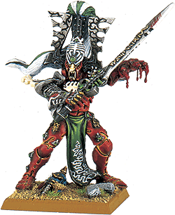

# [說故事]艾法特傳奇

[说故事]艾法特传奇

ADAN

 

稍微了解艾尔达(Eldar)故事的人就会知道... 他们的战神艾法特(Avatar)是数万年前血神盖恩与chaos老大哥达大战时... 因为战败..身体被哥达打碎...然后漂流到艾尔达的星舰中... 每片碎片都变成了一个艾法特... 

但是在40k小说中... 叙述了一段故事...Necrons之神Nightbringer曾经与哥达大战... Nightbringer并没有实体...所以他的身体是由Necrons用他们的武器将Nightbringer包覆起来... 所以Nightbringer的身体才会是T8啊!!... Nightbringer利用这个身体与哥达大战了数百年...(神对神的战争果然打的比较久) Nightbringer物质身体逐渐不支....所以终究被哥达打散... 所有金属碎片激射崁入歌达的身体里.... 哥达回到老巢后...沙历士即将诞生... 沙历士的胎动蕴含无限能量...甚至超越宇宙最有力量的哥达...(这是很奇怪的论调..但是在沙历士未出生前..他是最强的CHAOS邪神) 哥达不想让沙历士出世...所以哥达以身体抱住沙历士的&quot;蛋&quot;? 乐高跟辛烈志都劝哥达别做傻事...沙历士是一定会出世的...CHAOS会有4个邪神是早就注定的事了... 后来...沙历士的&quot;蛋&quot;? 以无比能量爆发...连哥达都被炸开... 崁在哥达身上的Nightbringer碎片激射而出...飞往宇宙各处... 每片碎片都蕴含着三位巨神的能量... 

此时的艾尔达...是已经在宇宙漂流而又漫无目标的种族.. 他们在寻求一种力量..一种执念(报复CHAOS) 于是蕴含无限能量的碎片在艾尔达星舰慢慢聚集.... 

所以...艾法特是???而血神凯恩又是?....................... 

此故事由George口述.... 

据George说40k故事可是超棒的哦
