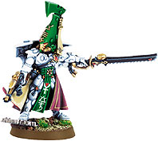
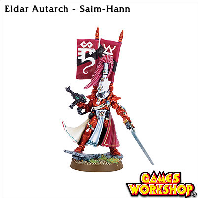
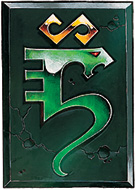
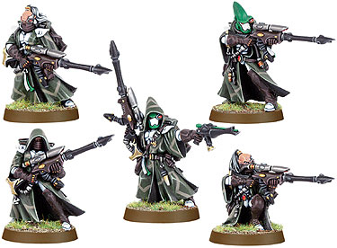
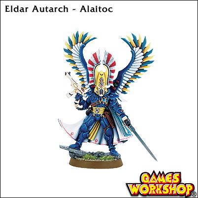
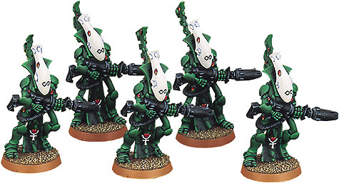
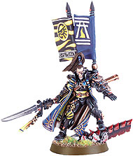
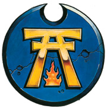
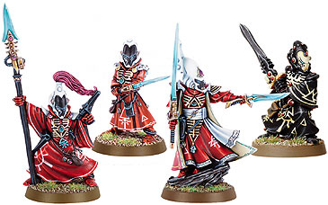

# ELDAR创造世界介绍

ELDAR创造世界介绍！

xxx193838

Biel-Tan 军事力量最强的灵族世界，以复兴文明为己任.为了收回领土经常与帝国发生战争，DOW第

一部里的灵族，白绿色装涂。

Biel-Tan创造世界是一个高度军事化的社会（有点像斯巴达） 他们拥有ELDAR全部的兵种

他们的旗帜象征着ELDAR的重生

Saim-Hann 这里的战士以其强大的浮空飞艇、摩托而文明

快速打击是他们的强项。Saim-Hann 是最具狂野气质的创造世界，连很多灵族人都认为

他们战斗的方式太粗鲁了。（正是这种性格导致了他们的堕落）

红色的装涂很漂亮

Alaitoc 这个漂浮在银河东部边缘的创造世界拥有星河里最强的侦察兵。审判庭曾调查过他们的数量，

发现结果很另人震惊，并掩盖了真正的数量。

他们渗透在银河各个角落，监视着敌人的一举一动。Alaitoc 的战力也非常强。在兵强马壮的

帝国东部，也没人能把这些狡猾的灵族人怎么样

他们的指挥官装备了飞翼

Iyanden

位于银河东南。在第二次虫族入侵后，人口遭受了极大的损失。所以部队有很多灵骨战士

拯救他们的是海盗王子Yriel ，在关键时刻带领他的舰队回来了，消灭了虫族。虽然他现在

已经是Iyanden的最高首脑，但他还是带领他的舰队在无尽的星海中游荡，与虫族和混沌

交战。

 

Ulthw&Eacute; 坐落在恐惧之眼旁边，先知的能力最强。Eldrad Ulthran则是已知的最强先知，

是Ulthw&Eacute; 的最高领袖。他用他的智慧引领着他的人民一次又一次的逢凶化吉，

在凶险复杂的恐惧之眼成为一支不可忽视的力量。

依靠先知的预测，屡次挫败了CHAOS的入侵.在WA和DC中登场的就是这支部队

