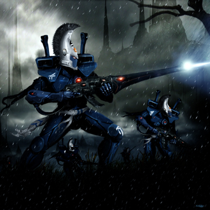

# eldar的步兵盔甲介绍

drydry

上课无聊，翻译了一节eldar宝典中的士兵装甲简介，恩，翻译的不好莫要见怪

相对与与帝国士兵装备的厚重的铠甲（原文是plate，板甲。。。）eldar人宁可使用具有极高灵活性的战斗装甲。守护者们身着具有一定防弹防冲击效果的复合生化塑料装甲（注1），而精英战士（女妖，战蝎，死神什么的）使用具有相似外观设计，但增强了防御模块。但无论何种eldar盔甲，都具有高度的灵敏性和伸展性。它们可以随着使用者姿态的改变来改变自身的形状。当eldar战士激烈运动或者战斗的时候，你会发现它们的盔甲就像皮肤一样贴身。甚至就算是大司教所着的最厚重最华丽的盔甲，和其他种族所用的防具比较，也是如羽毛一般的轻盈。

eldar军队还普遍装备了力场护盾，小到个人使用的护盾装置，到悬浮坦克和泰坦巨人上所用的holo力场（注2），甚至还有更稀有更特殊的装备灵石的抗灵力盔甲（对付灵能者还有智库馆长还有混沌的腐蚀吧？我猜的），以及传说中小丑们所穿的holo光学迷彩护甲，不一而足。

[注1]在第三版的eldar宝典中，他们穿的盔甲居然叫做-锁甲。。现在更新到第四版了，装备档次终于上去了，生化塑料盔甲-听上去挺美~

[注2]holo力场是在eldar车辆上普遍装备的玩意，原理是扭曲使用者身边的空间，让敌人难以瞄准集中使用者（听上去玄乎，但无论是蝮蛇飞车，大毒蛇运兵车，火鹰/炎晶坦克还是变帅了的战行者机器人，都能装备，恩还有泰坦。不过冥灵君主不能享受这种待遇----因为他们是~怪物）怎么理解这个防护效果呢？就是对方玩家瞄准并且击中了一个使用holo力场的eldar单位，得扔色子看伤害，但是必须扔两次然后取最小值作为最后的伤害数值。你说你rp好，次次仍的高，恩，赐你称号RP巨人！！
