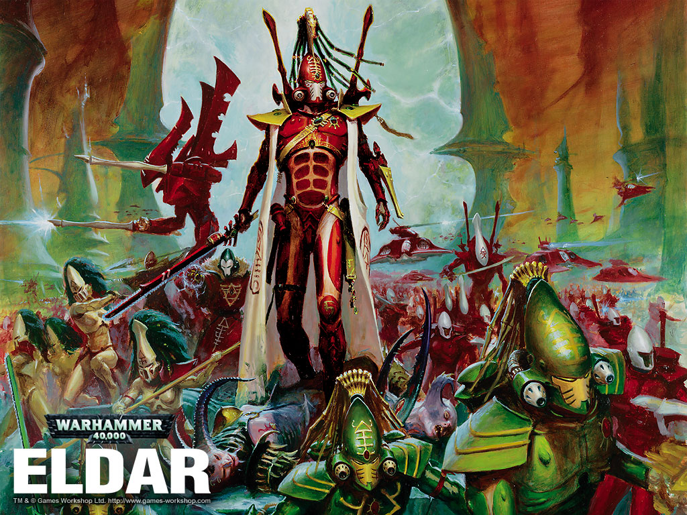

# Eldar概述

Eldar概述

Eldar/Cloudcrack

Eldar，从背景上说，有些象魔戒的精灵，并且带有北欧神话的影子，他们是银河中极古老的文明，关于他们的起源，有两个说法，一说是Old ones的造物，但他们自称是女神艾莎的后裔，他们有四螺旋的DNA，1000年的寿命，远强于人类的感知力，他们热爱美的事物，精于艺术，但容易堕入追求感官享受的网罗之中，这是他们灵魂中无法摆脱的黑暗面，并最终为整个种族带来了巨大的灾难，Eldar曾经称霸银河数万年，拥有先进的科技和璀璨的文化。但他们的享乐追求最终导致了第四邪神沙那里士的降生，无数的埃达人瞬间丧生，灵魂被沙那里士吞噬，他们的家园星系也变成了现在的混沌老巢——恐惧之眼，只有少数远离故土者得以幸存，这在历史上称为埃达之殒（Fall of Eldar），虽有少数远离故土者得以幸存，但是辉煌的岁月自此一去不返。埃达的陨落成就了人类的崛起，但这是后话，现在埃达人居住在称为方舟世界（Craftworld）的人工天体上，流浪在黑暗的星河中，他们称沙那里士为灵族大敌（Great Enemy），通过修行来对抗堕落的诱惑，并用灵石来存放亡者的灵魂以免被沙那里士所吞噬——而诸多先知们所预见的未来，则是悲壮的末日，当所有的埃达都在黄昏之战中死去，死亡之神将从黑暗中降生，为大敌带来最后的终结。

从战斗风格上说，Eldar的最大特点是机动性与专精性，大部分步兵拥有良好的移动力，并且他们的坦克都是悬浮的高速车辆，他们总是突然出现，如风般席卷敌人，然后又迅速的离去，很少进行大规模的阵地战。而专精性则是指，他们每种单位都有比较专一的用途，不象星际战士那样单个小队就可以胜任各种任务，换言之，就是eldar每个兵种的优点和弱点都非常明显。然后，Eldar的体质并不强，普遍是S3T3（T=坚固度，T高也就是肉厚，枪打不疼，一般人类是T3，星际战士普遍T4，骷髅一些单位是T5，恶魔王子，虫王之类的怪物则更高，S=力量，S高就是力气大，近战砍人疼），所以不太经打，肉搏也不太厉害。然后，Eldar有亡灵部队，就是用盛装着死者灵魂的灵石驱动的战斗机甲，普通的叫亡灵守卫，很强悍，S5T6，超硬的步兵，而高级的亡灵领主就是游戏里看到的蛋蛋机甲了，S10T8，火力和硬度都高。

至于艺术风格，Eldar给大家留下印象最深的是他们的头盔，不同的单位都有精美的头盔来表现他们的身份，头盔往往高高隆起，有些象古罗马的缨盔，头盔上镶嵌着椭圆的宝石，镌刻着代表所属兵种的符文，并有长长的发缨为装饰，相比与星际战士那千篇一律的头盔，埃达要显得有艺术感得多。然后他们的装甲显得轻巧贴身，称为守护者的普通战士身穿生化链甲（Mesh Armor），而支派武士穿的是加装了装甲块的武士甲（Aspect Armor），武士甲上也普遍有宝石装饰，并且可以明显看到强化装甲块。和星际战士依据战团决定涂装的做法不同，支派武士不论属于哪个方舟世界，同一支派的盔甲颜色总是一样的，比如火龙战士总是黄色的头盔和红色的铠甲，方舟世界的涂色差异只表现在除支派武士外的其他单位上。然后象英雄和领队之类的高级单位，常佩有饰带，上面有符文，方舟世界的标志以及其它的装饰图案。

Eldar的灵骨和焰晶技术

灵骨是一种异次元材料，由bonesinger从异次元召唤出来的，这本事好象是他们的母神传下来的。

炎晶是用一种特殊的调制手段，发射重叠的三束光波，这些光波蕴涵着极大的能量，但在预设的距离上才会爆发并产生巨大破坏力。
