# Eldar战争艺术馆

Eldar战争艺术馆（建设中，一楼建设完毕二楼工事中）

drydry

鄙人所学粗浅，只望所学所得能与大家分享，共学习同进步。欢迎来拍转哦~

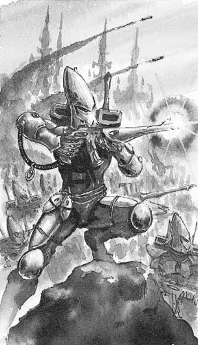

Eldar灵族拥有非常先进的科技，他们不仅能随意无视自然法则，轻松扭曲光线，甚至还能够把你身边的空间撕裂，让你堕入万劫不复的阿鼻地狱。他们是如此强悍以至于很多人认为Eldar的武器都被灌注了巫妖之力。但是对于Eldar人来讲，这些评价无足轻重，因为他们的武器就是诠释Eldar战争艺术的完美工艺品。

==============================================

利刃风暴

Eldar人以使用星镖武器而闻名整个宇宙。这种武器被设计用来向目标倾泻拥有剃刀般锋利边缘的噬骨镖碟。（标准星镖步枪如下图，以及星镖的外观设计）

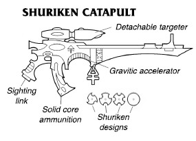

从普通的防身手枪到反装甲火炮，所有星镖武器的工作原理都是一样的：整个武器就是一个高能脉冲加速器，放置在生化塑料弹夹中的弹药在枪膛中会被不断加速直至飞出枪口。因为加速管道一直处于激活状态，所以星镖武器有能力在数秒钟之内向目标激射出上百发弹药。（仅仅是枪的话倒还能理解，但是Eldar还有星镖炮，参见下图，这个是装到大毒蛇运兵车上的，还有蝮蛇车，1。5升级以前他们用的就是，现在变成导弹了）

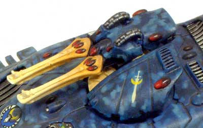

缚灵之网

Eldar拥有一种独特的射网兵器，这是一种由高强度材料编织成的死亡之网。其不仅具有锋利的边缘，还拥有上千度的高温，被瞄准的牺牲者根本不可能逃脱那死亡的拥抱，唯一的下场就是化成血肉模糊的一滩残渣。

（这种兵器可以用来防空，就像捕鸟的网子一样残忍而有效。当然对付没有速度优势的步兵更。。。要是目标趴在地上怎么办？反正被打住的是别想活了）

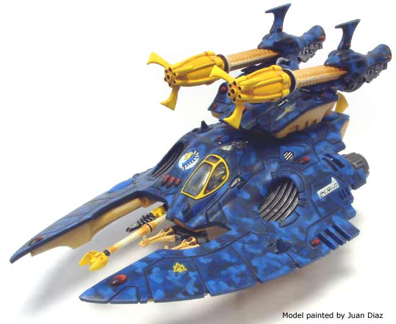

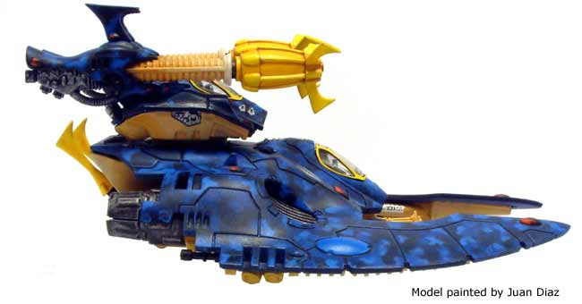

这种武器除了能装载在车辆上之外，还能装载在步兵支援平台上（就是人口出的小车咧）

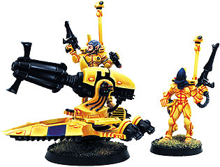

11.24号中午补：

瓦普蜘蛛。。。恩他们用的就素那单兵型号的蛛网枪了，所以能猜到他们为什么有资格能作为高级兵种了-不仅仅是血厚哦~武器也是非常凶狠的。蜘蛛队长用的双联蛛网枪看上去很Q。。他们怎么能在装备臂刀的情况下准确高效的瞄准目标涅？

来图咧

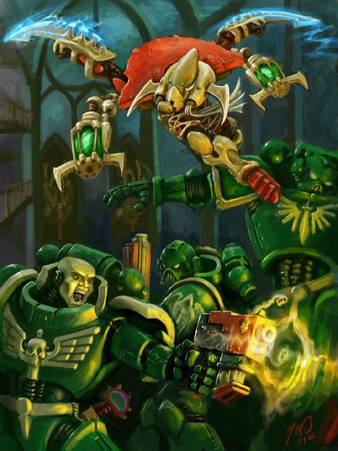

貌似关于蜘蛛队长的插图，他们都是开肉搏上的，鲜见用枪

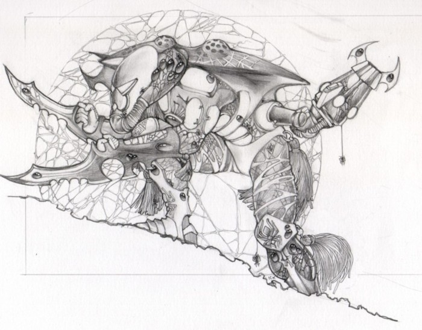

你能分清哪个是胳膊么？

介个。。很可爱的fans蜘蛛同人

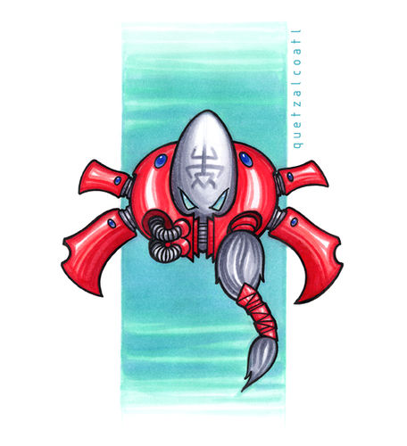

厄运制造者

不同于帝国军队装备的桶式导弹发射器，Eldar导弹系统都是多连装捆绑式设计，有专门的弹药包来进行不同任务需求的选择。（我就不明白。。现在的四版死神明确用的就是reaper launcher,48' S5 AP3 Heavy2的武器，看上去就是步兵+轻车辆通吃的武器。。但是游戏中死神还是只能打小兵哦 残念）

这个是大毒蛇车上的

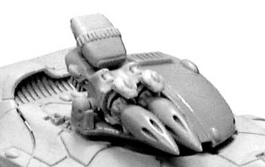

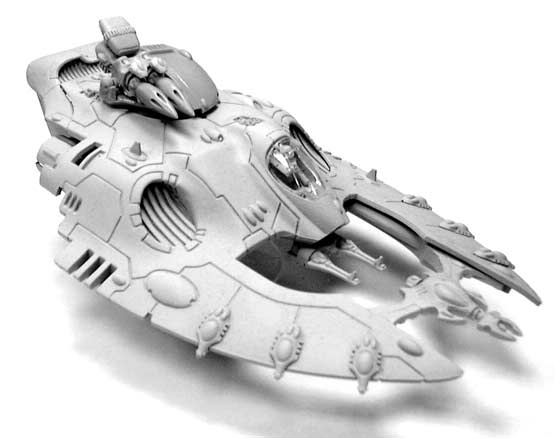

新版本死神，虽然秃了一点但比起3版不只是帅了一点点。。

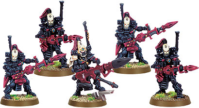

星神之怒

帝国的技术人员们自认为拥有离子武器的全部技术并以行家自居，事实上Eldar才是完全掌握了离子武器的低调高手。对Eldar人来说人类对于他们的效率低下的离子武器粗俗而自大的理解以及人类对离子技术不成熟的使用方式（使用会过热自爆的武器用于战争，屠杀。。。或者自杀。。。嗯，Eldar人如何更高效的利用离子技术涅？）简直就是白痴行为。和人类的武器相比，Eldar人的星辰炮没有那么多的瑕疵，因为他们的离子反应发生器居然是以太阳光为加热源的，而且星辰炮还拥有复杂细密的电子散热板来保证其时时刻刻都处于安全温度（不会自爆的离子武器。。这个比起帝国的武器来说强太多了，不晓得和tau人的比较怎么样）

这个就是星辰炮了

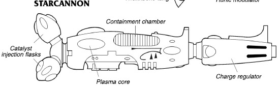

装甲车上携带的例子

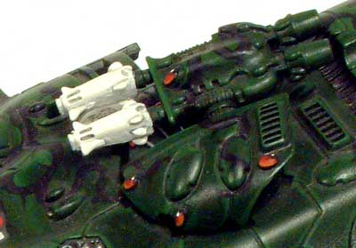

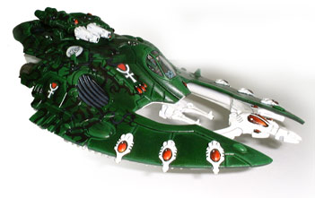

补充，支援平台上携带的例子

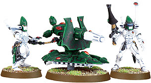

光芒之矛

Eldar激光武器使用天然纯净的水晶来有效地过滤，聚集激光束以达到最佳的杀伤效果。很多Eldar人认为他们的激光武器是最优雅的艺术品，甚至有些Eldar武器工匠认为这些武器最美丽的时刻就是攒射出致命光芒的一刻。

最经典的eldar激光武器莫过这些闪矛骑士，引用战锤中文网的解释如下：“闪矛小队是少见的专家，他们能够在敌人发觉前发起攻击，用激光长矛制造死亡。”别看他们拿的只是“长矛”，这长矛可是火鹰坦克的主炮哦~

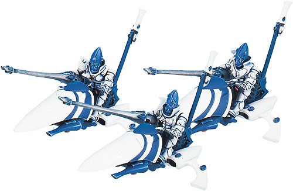

请注意，最左边的骑士是个女兵哦~

再看看火鹰的炮，貌似要大一点

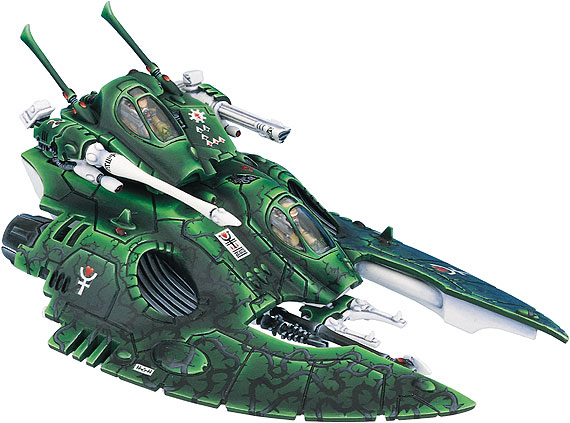

但是火鹰是突出射程而牺牲了威力的。

这个是2联闪矛炮台

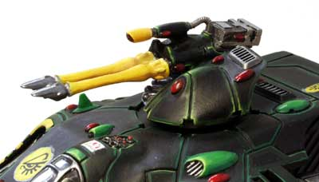

还有一种联装激光炮

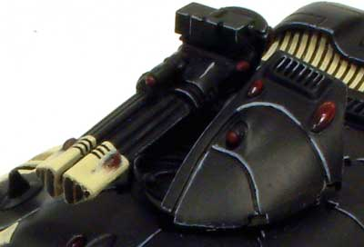

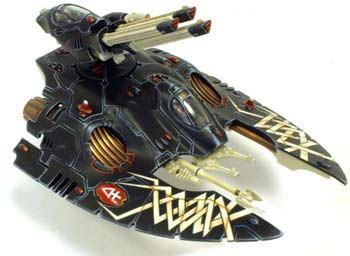

泰坦携带的大家伙

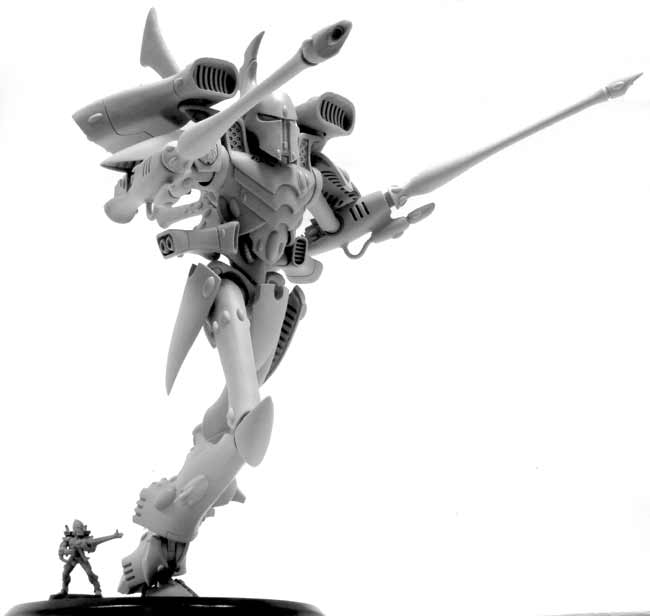

巨蝎重坦携带的也是类似的配置

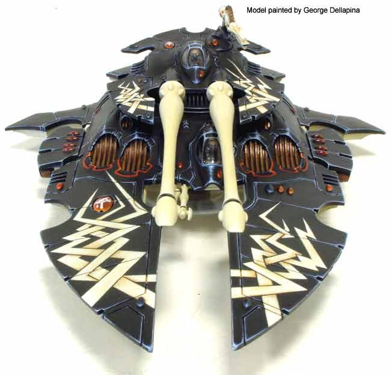

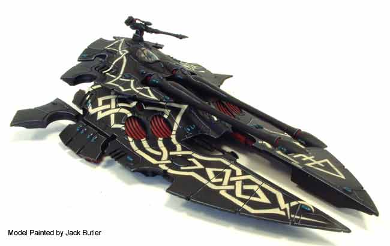

漂亮的红色

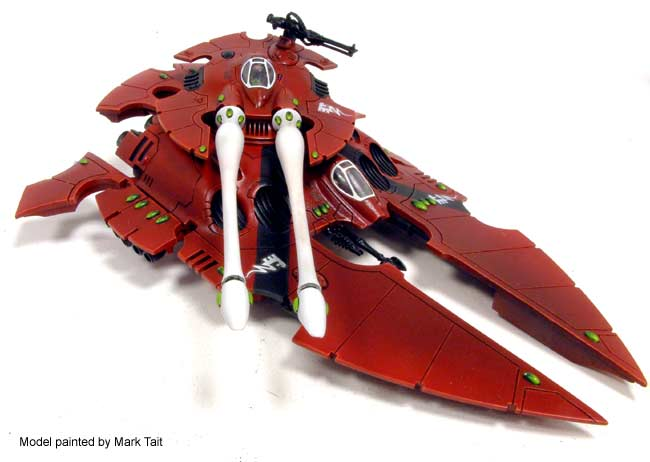

战行者机器人是火力输出多面手

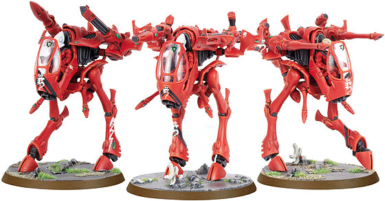

从左到右分别是Eldar导弹，联装激光炮，星辰离子跑，星镖重炮和两门闪矛激光炮

异度空间

Eldar军械库中最凶险的兵器莫过于那些能够把受害者轰入异位面的空间撕裂者，D加浓和灵冥炮都是使用这种空间跳跃技术研制的兵器。它们能够撕裂现实空间，制造一个连接异世界的虫洞（是这样么？），如果目标没有被完全送入异位面，那么它/他/她就会被虫洞强大的引力给撕得七零八落，永世不的超生（这句是我编的）。

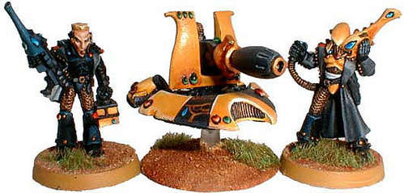

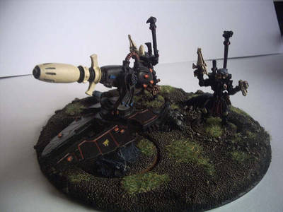

样子挺难看的，但是鬼怪般的威力让所有人都不能小瞧它。]

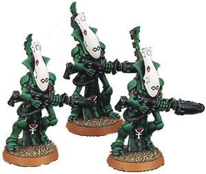

冥者守卫的外形在本版中没有改动，或许是GW觉得他们已经够帅了？

死亡之触

Eldar世界使用的近战兵器和他们使用的枪炮一样致命。Eldar人不仅装备了拥有锋利的锯齿和轻巧而强力马达的锯剑，同时还拥有大量能量武器，刀剑长柄，美丽而危险。至于离子手雷等等更是将敢于和Eldar近战的敌人送入万劫不复的阿鼻地狱（这个词藻是不是用过一次了？）。

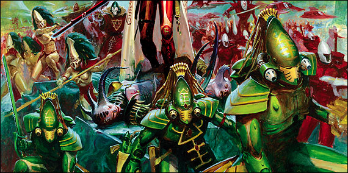

著名的突击蝎，也是本次新版codex的封面，背景上有大司教手持的能量剑，和新版的女妖。（明显的是一个女妖主较，手持能量长柄武器-高阶督军的赶猪棒，嗯，是处决者啦）

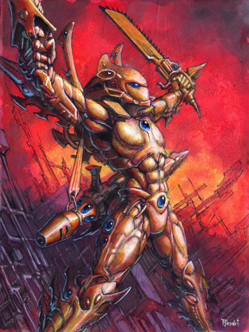

他是谁？装备了一套近战武器和一件双手射击武器 ，穿的貌似是守护者的衣服但是头盔像是老板本突击蝎的，嗯，莫要深究了，这只是同人作品。

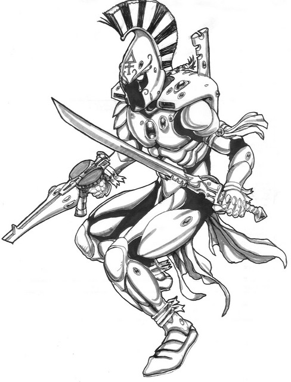

还是同人，不过这个比较贴切，画得是复仇者。 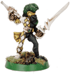

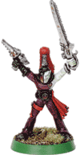

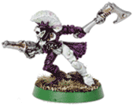

老版本的小丑，装备的不同的近战武器。

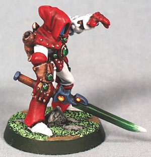

shdowseer，小丑中的灵能者

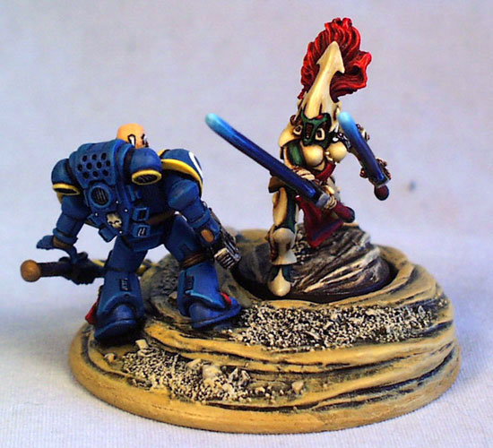

少见的双持女妖砍SM，她使用的是MirrorSwords 哥们吓的锯剑也掉了。 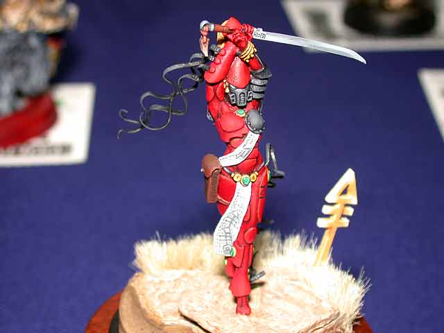

再来一张女妖特写

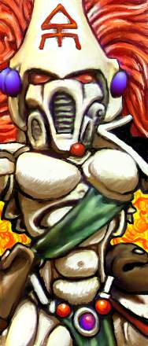

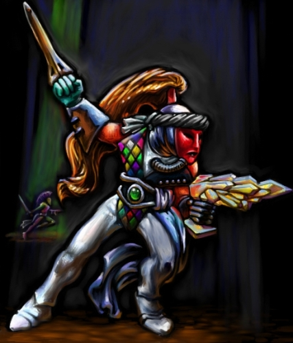

这个小丑拿的是小丑之吻，能让被害者化为血肉粥的残忍兵器。

嗯，目前看起来我这个贴子是娱乐性大于知识性，大家见谅阿。
