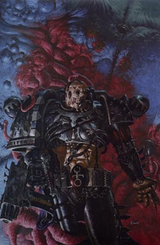
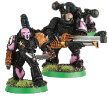
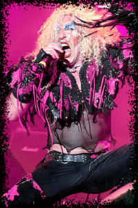
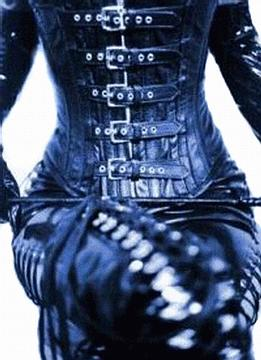
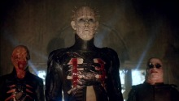
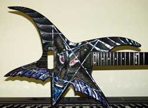
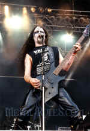
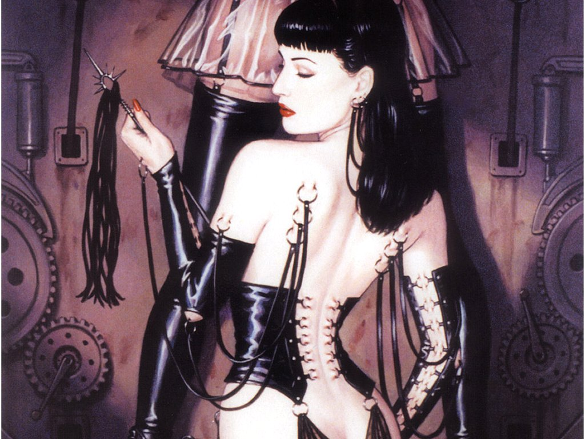

# 闲话Emperor's Children的外形风格[原创]

闲话Emperor's Children的外形风格[原创]

fulgrim

闲话Emperor's Children的外形风格

很多人不理解Emperor's Children奇怪的外形风格，怎么也不明白一个风格黑暗严肃的游戏中邪恶的阵营中竟然有一群穿着粉红盔甲的家伙，觉得可笑，甚至觉得很gay. 其实稍微了解他们背景的人可能就不会觉得奇怪了，如果你还理解这背后的设计理念，你可能甚至会觉得相当有趣。

Emperor's Children的粉红色：

Emperor's Children在投奔Chaos之前是唯一一个对艺术特别热衷的团，曾经请来大批艺术家为他们设计制造建筑，并装饰盔甲，武器，Emperor's Children外表是在内战之前星际站队中最华丽的。Slaanesh神在后来让Emperor's Children成为了他（她）的信徒。 Slaanesh是放纵王子，伟大的堕落的欢愉之神，崇尚一切欲望和各式各样的欢乐。粉红色在这一点上也反映了这种纵欲的意识，粉红，是肉体的颜色，性爱的颜色，更是欲望的颜色。粉红色放在盔甲上赤裸裸的反映了Emperor's Children对肉体欲望的无限崇拜。粉红色的设计不仅来自于这一对于颜色感知的大概念，也源自于一些具体的东西，比如很早期的一些华丽金属乐队的扮相，典型的是twisted sisters. 主唱Dee sinder一身粉红加黑皮革的中性而又疯狂的扮相就是Emperor's Children外形设计的灵感来源之一。

Emperor's Children的黑皮革：

Emperor's Children的盔甲上除了有粉红色，还有与其形成强烈对比的黑皮革。黑皮革比粉红更好理解，你可以说是一种拜物欲(fetish)的体现,可以说受到摇滚乐服装的影响，这些理解都是关联的。黑皮革在emperor's children身上首相让人联想到他们的拜物欲，对于施虐和受虐的爱好。黑皮革在西方的拜物欲和虐待狂与受虐狂（Sadism & Masochism ，即sm）中一直扮演了重要地位，身着皮衣，皮扣，各种皮质虐具的的男女因为各种常人难以理解的原因疯狂的投身其中，在全身被紧绷的皮革覆盖，戴上防毒面然后做爱这种难以让人理解的场景在sm中不足为奇。Emperor's Children这只精神疯狂的虐待狂大军穿上皮革非常合适的反映了他们肮脏的欲望，折磨和痛苦转化为的狂喜也被皮革所体现出来。典型的灵感来源就是hellraiser这部系列电影。hellraiser中形态各异的僧侣无不是折磨和痛苦的代表，他们身上折磨的印记和折磨人的手段千奇百怪，但服装清一色都是经绷的皮装，看看pinhead, chater这些充斥着痛苦却又热爱着痛苦的扭曲角色，不难理解Emperor's Children为什么与黑皮革结缘。

Emperor's Children的音波武器：

这个比较好理解，看看金属乐，想想吉他，然后再看Emperor's Children的天性就不难看出为什么这是最适合表达本质他们的武器。Emperor's Children对乐趣的追求已经大大超出了常人理解的范围，也成为了一种很难达到的对极限的追求，Emperor's Children需要每时每刻都对感官有刺激才能激发他们战斗的欲望，他们的音乐-巨大的噪音已经是必不可少的东西，噪音越大他们才能更加兴奋。金属乐中各种极端的部分如死亡金属，黑金属，碾核都可以看作这种设计灵感的来源。尤其是其中最最极端的一些乐队，音乐近乎于噪音，但对于资深fans却是极品，同理对于Emperor's Children来说噪音就是仙乐，是精神兴奋剂，没有噪音便没有激情，噪音越大才能更好的填补他们因为欲望畸形膨胀而同样膨胀的空虚。

Emperor's Children的虐具：

身体上的自残能从warhammer 40k中很多角色身上看到，作为这一个游戏的风格并不奇怪。Emperor's Children自然是对自残最热衷了，从他们身上能看到各种莫名其妙的带有虐具意象的物品，这个在上面提到了，再包括一些铁链，穿刺...在一些亚文化中也也不少见，只不过Emperor's Children的显得有些登峰造极罢了，“痛并快乐着”这句话用在他们身上完全合适。

这么多奇怪矛盾的元素集合在Emperor's Children的身上让他们成了一堆怪异的组合体，成了Chaos里最据特色和争议的一只力量，不管你喜欢他们与否，Emperor's Children总是独一无二的，如果你是warhammer 40k玩家 + 变态狂 + 天才艺术家 + 色情狂，恭喜你，你能在Emperor's Children这里找到归宿,For the dark prince! ^^
