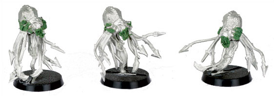
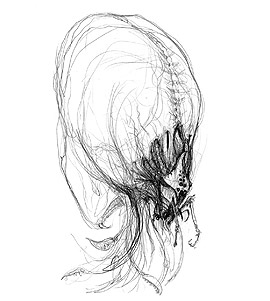

# 奴役者ENSLAVERS

曾见有人问过关于ED的制造者的灾星，于是在此翻译了一份

[liberator](http://game.ali213.net/profile-uid-1537692.html)

奴役者ENSLAVERS

这种在银河的不同角落被叫做Psyrens, Krell, dominators 或 puppeteers的怪异生物，对于人类而言还是完全的谜。它们拥有实体身躯，却在亚空间度过至少一部分生命周期，而当来到物质界时，它们对任何活物都是个严重的威胁。关于奴役者的描述非常少，而且很零碎，但所有描述都提到这种生物有球状（或锥状）的身躯和蔓生的触须，并且能悬浮在地面之上3米的空中。那些触须可以用来操作物体或是攀爬，它的身躯可以随意变色，但通常的目击报告都是皮革般的棕色，以及发白，带点粉红色的触须。

在人类的概念里很难说奴役者是否有智慧，它们似乎可以理性地行事，并且可以为它们的行为做出明智的决定。然而即使能够与其它种族沟通，它们也从未如此尝试过，况且它们从不使用任何形式的工具或装备。（它们的）所有体力工作都是由被精神控制的奴隶完成的，它们的名字也由此而来。奴役者的牺牲品们完全成为了异族意志下的傀儡，可以毫不犹豫地执行哪怕是自杀性的命令。

奴役者在Immaterium（非物质界？还是就叫亚空间？）的湍流中旅行，被活物发散的灵能所吸引。最强的（灵能）放射来自无保护的灵能者，奴役者在数十光年之外就可以探测到他们。一旦找到一个灵能宿主，奴役者就可以与之建立一个精神联结，并伴随着一些恶心的变异。而宿主在一段时间之后会被扭曲变形，成为一个活的亚空间传送门，一个由糜烂的血肉组成的脉动的拱门，使奴役者得以通过它进入物质界。一旦奴役者来到一个世界，就会寻找并转变更多的灵能者以便越来越多的奴役者得以出现。一旦奴役者的感染开始，将极难被阻止。

奴役者

WS        BS        S        T        W        I        A        Ld      Sv

奴役者        3        3        5        5        3        4        1        10    6+

点数/模型: 25

在游戏中使用奴役者

最简单的使用奴役者的方法就是用来代替HQ以表示一支被奴役的军队。又或者在多个玩家的游戏中将奴役者作为通过奴役对方士兵危害各方势力的完美“未知势力”。

部队大小: 1-3个奴役者

特殊规则

深入打击：奴役者总是可以选择留在预备队中，通过“深入打击”规则进入战斗，即使是在不允许深入打击规则的任务中。直到进入战场之前，奴役者不能为奴役池（Enslavement pool…我对桌面规则基本一窍不通，丢人了不要笑…）贡献骰数。

奴役

奴役者获得一个用于精神控制的骰数池（dice pool）。每个奴役者贡献1点（1 dice）。奴役者可以将贡献骰增加到最大5D6，每D6额外支付15分。

骰数（投骰）用于控制被奴役的单位，或是精神控制新的单位！骰数池如下使用：在奴役者的回合里它分配骰数来使用已奴役的单位。任何剩余的骰数可以被用于尝试控制敌对的单位，在奴役者的回合或者敌人的回合都可以。在下一个奴役者的回合开始时骰数池被重新充满，除了留给单位以显示他们有被永久奴役的危险的骰数。（见下面）

例外：在战锤40000的宇宙中有很多很多生物和存在可以宣称免于奴役。然而，奴役者似乎可以用它们不可阻挡的灵能诡计与纯粹的精神力量的结合控制任何东西，因为这些（略显苍白无力的）原因，所有单位都是潜在的被奴役者，甚至包括车辆、太空骷髅、泰伦虫族、恶魔等等等等...没有领导力属性的单位看作领导力10。奴役者被看作灵能者，但它们的奴役投骰不能被任何已知方式抵消，比如灵能面具或是守护符文。（Enslavers count as psykers but their Enslavement dice cannot be countered by any known means, such as psychic hoods or Runes of Warding.术语翻译不准请见谅...）

控制被奴役单位：

被奴役者需要每回合一点骰数以便做任何事情，两点可以将他们完全控制。只有一点的被奴役单位需要投骰（就是投D6）并用下表决定行为：

1-3只能移动或射击，不能突击（assault）但如果已经在近战则可以战斗。

4-6可以正常移动，射击或突击。

没有分配任何骰数的被奴役单位被困惑，并开始回复他们的意识，他们在自己的回合不会做任何事情，甚至不会在近战中反击，尽管他们的武器技巧（WS）不受影响。被奴役单位始终处于无畏（fearless）状态，所以他们自动通过士气检定，并且不会被压制。

奴役新单位：

奴役新单位需要分配骰数到他们头上并投骰对抗他们的领导力。最多可以给每个敌人单位分配三点，并且最近的奴役者与目标间距离每超过24英寸就损失一点（例如24—47英寸-1点，48—71英寸-2点，72英寸或更远就不可能控制了）。投骰可以在任何时候进行，但必须在奴役者的回合开始前就分配好。（翻译得不太清楚，总之意思就是你可以从每回合最大控制投骰次数中最多取3次来控制一个单位，而且可能还要用最多两次来加大控制距离）

投骰结果及作用如下：

等于领导力：目标困惑并不能进行任何行动，在奴役者的回合不会有任何效果，但在敌人的回合，这个单位不会在回合剩下的时间里做任何事情，也不会在近战中反击。在近战中每投出一个6，对手都必须从单位中移走一个模型——某些个体被控制并试图杀死其他单位成员，只有被别人杀死，自杀性行为或类似情况才能获得自由。

超过领导力1点：奴役者可以让单位移动，这可以使他们在奴役者的回合至多额外移动6英寸。单位可以被移动到对他们来说危险或是困难的地形，但不能是不可通过的。如果在对手回合投出这个结果则当作等于领导力的情况。

超过领导力2点：奴役者可以在自己回合让单位如上移动或是射击，射击瞄准最近的单位，无论敌友。如果在对手回合投出这个结果则当作等于领导力的情况。

超过领导力3+：奴役者可以让单位移动或射击并突击至多6英寸，等效于在奴役者的回合控制这个单位。如果在对手回合投出这个结果则当作等于领导力的情况。

永久奴役：每次一个单位被奴役者影响，都会从骰数池里带走一点（就是前面说的不会在下一轮重新充满的部分）。一旦总计带走3点，这个单位就会被完全奴役，从此作为奴役者军队的一部分。同时累计带走的骰数都会重新还给奴役者的点数池。

心智控制：你离奴役者越近，奴役者的能力影响越大。离奴役者6英寸之内时单位承受领导力-2惩罚，12英尺内-1。灵能者在任何距离都受到-1惩罚。

灵能鞭击：在近战中，奴役者可以把未使用的控制骰作为额外攻击来展现灵能鞭击的效果。一个奴役者不能在攻击中使用多于它们能贡献给骰数池的骰数。奴役者的近战攻击无视装甲保护。

这个模型是用史古革的模型加上孢子雷的触手和利卡特的钩尖做的。

