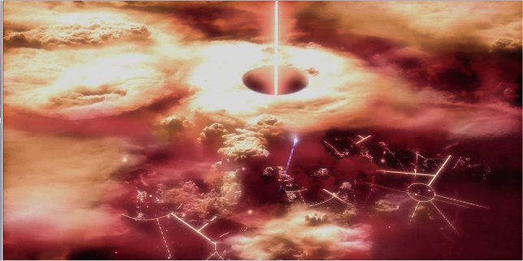
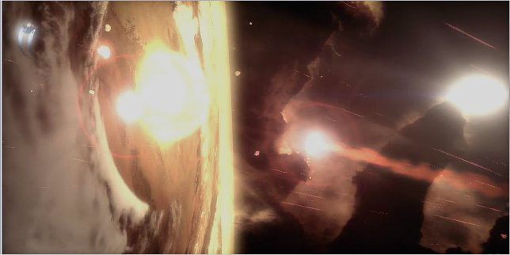
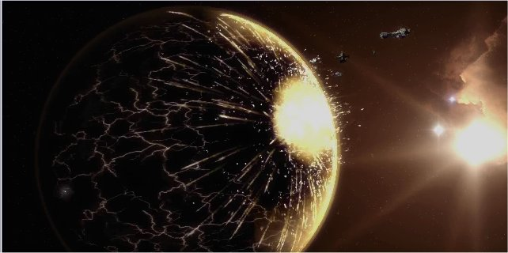

# 灭绝令

> barbarrossa

灭绝令是人类帝国签署摧毁单个行星生物圈的攻击指令。

灭绝令通常是作为一种最后的解决手段。当坚守或者夺回一个行星的代价过为高昂，或者整个行星都被浑沌侵染，处于叛乱状态。灭绝令很少被用于帝国重要行星或者有丰富产出的行星。只有帝国的高级将领，例如战帅（司战，warmaster）或者数量有限的审判官有权利签署灭绝令。

灭绝令可以通过多种方式执行。最为常用的是帝国海军常规火力的轨道轰炸。但是有时为了特殊的目的，例如摧毁行星表面的生物或者摧毁地壳中的深层工事，也会使用病毒炸弹或者旋风鱼雷。
例子：灭绝令的执行（选自FPS游戏火战士）

1。多鲁玛IV（Dolumar IV）在帝国，钛帝国和浑沌的战争后，被作为灭绝令的执行对象。 轨道战舰用强有力的集中火力攻击（lance strike），将浑沌侵染的神庙化为灰烬。

2。旋风鱼雷随即发射，将浑沌侵染的痕迹完全抹去。

3。最后，神庙的所在地被帝国舰队用直接火力轰炸，以撕裂地壳
还有特殊的方式，例如13次黑暗远征时，行星统帅尤萨克.E.古瑞德（Lord Castellan Ursarkar E. Creed，卡迪安帝国卫军的领导，军衔位于Lord Commander Militant of the Imperial Guard; (Lord Commander Militant)， Lord General Militant，Lord Marshal之下，是拥有Lord头衔最低的军衔，似乎是一个帝国卫军征兵世界的统帅）就曾经下令将监狱行星圣约斯曼的希望（St. Josmane's Hope）上的巨型反应堆过载，因为浑沌军队马上就要攻占此行星。反应堆融化时产生的巨大爆炸将整个行星撕裂。

一些极少使用的武器也会用于灭绝令，专门用于摧毁没有大气或者没有有机物的行星（后者大多数是太空骷髅的墓穴世界）。这类特型鱼雷通常装有两级弹头。第一级弹头产生高温等离子体，穿透地壳和地幔，使得剩下来的鱼雷可以穿过刚刚钻出的洞直抵核心。第二级弹头是改进后的旋风鱼雷。第二级弹头爆炸后将使核心处于不稳定态。通常情况下足以摧毁整个行星。

[www.SonicBBS.com](http://sonicbbs.eastday.com/)
