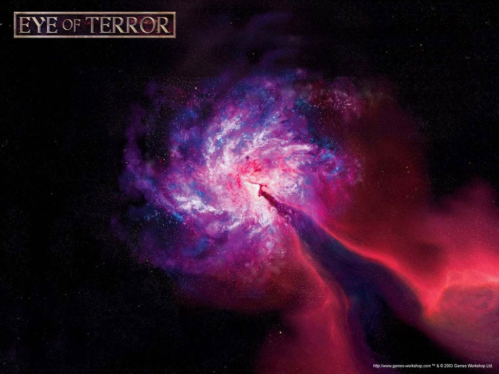

# 恐惧之眼

我族曾经纵容于对享乐的追逐；就因为我们如此的不顾一切，自从那场因此而起的堕落之后，就使我族永无宁日。纵使我族其如梦般的伟业曾倾覆宇宙，扑灭群星；但如今我族亦仅是如忽隐忽灭之残影，勉强留在存在的边缘。我族之眼，满怀忿恨地注视着猩红之月；群星密布之苍穹亦不曾蒙蔽我眼。我等大敌诞生之处，蠢动着恶魔野心之全部恶意，为我族过去一切所为、以为我族将来透射出其阴影。每一根命运之股线，每一份如尼之伟力，皆引导我至此时此地。毋庸置疑，于上古之Crone Worlds之中，最终之战等待着我。自从Mon-Keigh之民自相残杀[注1]，其身为先知之躯体倒于其反逆之子之后，此种争斗不再有过，然而此时我正步步趋向于此种争斗，不可能再有他途。仰观群星，仿被Mon-Keigh之血所染红；纵使其征战无关于我，反倒甚为乐见其互相毁灭，然而我深知逃避我之此战，只能陷我族于无可挽回之灭亡之中。既然我之所见尽皆黑暗，我亦不会对我之命运有所畏惧。

Eldrad Ulthran ―― 创造世界Ulthwe先知

卡迪安之门（ Cadian Gate ）的历史

通向恐惧之眼的传送门

要想完整地理解卡迪安的人们以及他们的生活方式，就有必要回到一万年前的那个已经仅存于传说之中的血雨腥风的时代，同时也是 Horus（贺拉斯）叛变的那个时候。在那个英雄的时代，皇帝与他的后代――各个基因原体们，在星海之中齐心协力，开疆拓土。每一个基因原体都统领着一个军团的皇帝最优秀的战士，在不计其数的战斗之中将人类的世界从异星人、混沌以及各色可怕的敌人的手中解放出来；而这些经过基因改造以强化的战士，便是所谓的星际战士。每一个基因原体都是超人的存在，人中之神；然而就像凡人一样，他们也不能超脱于猜忌、忿恨与虚荣。而这，正是战帅Horus，皇帝最宠信的儿子，也是月影之狼的基因原体的命运。

混沌不为人知而慢慢地腐蚀了Horus，直到他深陷其中为止，他都没有发觉他正在向邪恶堕落。Horus自有其本事操纵他人以实现自己的目的，他把整整一半的军团拉下了水，并带领着他们背叛皇帝。随着满怀敌意的爆发，事情开始变得清晰起来，就是叛乱要比原先任何人所能预料的都要严重。一个团接着一个团的帝国卫队倒向Horus，机械神教的执行委员会因叛乱而分裂，整个泰坦军团也因为混沌诸神的亵渎之力而高举叛旗。Horus无情地发动攻击，将那些往日称兄道弟的星际战士们驱赶在面前。不久Horus的攻势已经撕开皇帝的疆域；他的战舰击败了太阳系舰队，摧毁了月球的防御体系。地球已经毫无防御的展现在他前面。

混沌大军――叛乱的星际战士、步履蹒跚的变异人和异教徒不计其数――踏上了地球那神圣的土地。惨烈的战斗持续了好几个星期，战死者数以百万。每一处地方皇帝的部队都在被迫后退，他们贮存土地战斗着，使得帝国皇宫的大厅尸积如山。最终叛军突破了最后的防线，看来好像大局已定。Horus是一位战略的大师，但这一次他犯了致命的错误：获悉皇帝的援军黑暗天使以及太空野狼已经逼近，他必须尽速结束对皇宫的围攻。他让他的坐舰驶进低空轨道，降下护盾。究竟这只是不顾后果的赌博或者是他的人性的表现已经不得而知，但是面对着这样的大好时机，皇帝不可能错失与Horus的较量的机会。

皇帝和两位最忠诚的基因原体――血天使的 Sanguinius 和帝国职权的 Rogal Dorn ，以及最可信赖的战士，传送进了Horus的旗舰中。他们发现了一个不像是出自人类之手的造物，因为混沌的力量而变得扭曲。恶魔的法师把船上的皇帝的战士分隔开来；当皇帝最终与Horus面对面时，他看见那位战帅者正站在 Sanguinius 破碎的尸体旁。皇帝与Horus用每一种不可想象的方式战斗――物理上的，精神上的，还是灵力上的――他们的脚下，那个因战争而千疮百孔的星球便是胜者的奖品。战斗很漫长，但最终皇帝还是打败了Horus，虽然那也已经超出了他作为人类的极限。因为这场搏斗，皇帝的身体也差不多要崩溃了。Rogal Dorn 发现了伤痕累累的皇帝，把他送回地球，把他安置在金色王座之中，以维持他的生命。

失败了的叛军因为Horus之死而崩溃，他们从地球，那个被证明已是他们无缘之地，夺路而逃，溃不成军。有些忠于皇帝的部队重新集结，进行追击，不过大多数还是留下来以巩固这伟大的胜利。为数众多的叛乱分子被处死，但叛乱的军团的主力逃进了被称为恐惧之眼的宇宙空间，在那里，现实与疯狂混乱，亚空间的能量直接涌入现实空间形成旋转着的大漩涡。在这里，混沌诸神主宰着无数星球，使之扭曲适应其自身的邪恶。亦正是此地，叛乱的军团摆脱了追兵，由亚空间风暴将此地与银河系隔绝开来。

恐惧之眼的每一个世界都是恶魔的世界，会因为统治此地的混沌诸神及强大的众恶魔王子的一个奇怪的念头而扭曲变异。叛乱的军团重新集结，酝酿着憎恨，计划着终有一天能够对曾经挫败他们的人施以猛烈的报复。在恐惧之眼中，时间的流逝与外界不同。同样是在地球战斗的那些叛徒，在此地依旧为了各自的残暴的神而战。他们为了证明自己的地位自相残杀；当亚空间风暴有足够长时间的平静时，他们也会出来洗掠帝国的领土，与帝国的军队对垒。每当此时，恐惧之眼周围的地区便会被重兵把守，以抵抗他们的侵略。其中方位最为森严的即是卡迪安，镇守着通向恐惧之眼的其中一条要道的要塞世界，卡迪安之门。

要塞卡迪安

卡迪安位于进出恐惧之眼的一条要道上，是帝国最关键的战略要点之一。当然也有其他通路，但是都不如卡迪安之门可靠，而无论任何规模的部队要想从恐惧之眼中出发都必须经过此地。此地格外平静的原因尚且未知，但大多数人都认为这是由于著名卡迪安方尖碑（ Pylon ）的缘故。这些神秘的黑色巨石遍布于卡迪安，自从人类到卡迪安拓殖以来，其来源依然未能知晓。

卡迪安本身是个荒凉的行星，毫无生气，终年狂风大作，各种求生的本领在非常小的时候便已要学会，只有最强壮的人才能活到成年。冷风吹越宽广而支离破碎的平原；军队在这里进行实弹演习，每一天不进行训练便是浪费了的一天。每一座城市，或者称为 Kasr，都是一座要塞，里面的每一条街道、每一栋建筑都是由最优秀的军方工程师所精心设计的。每一个卡迪安人从会走路开始就被传授战士的技能，因此被全银河系的指挥官们所赏识搜寻。这个星球孕育着身体强壮、意志坚定的战士，卡迪安团也因其荣誉和战斗精神而得到人们的莫大敬意。从很小的时候开始，卡迪安人便可以闭着眼睛分解武器，战术条令则是比读写更早地开始讲授。有十分之一的士兵不论能力或者功绩而被内地的卫队招募过去，不过一些最好的士兵一直在卡迪安服役，卡迪安行星防卫军的士兵在帝国之中也是最为出色而纯熟的战士。

――――――――――――――――――――――――――――――――――

“我有好一阵子在挡风玻璃外隐隐看到方尖碑了，现在 Fischig 绕着它，差点就要吻到那黑色的石头了。风就好像是方尖碑的饰带那样，风声尖啸，盖过了涡轮的轰鸣。

“方尖碑非常巨大，有500米高，250米宽，平滑的黑石的上表面被用精致的技艺加工出孔洞和其他圆边的开口，大小不超过一个人头。风就是通过这些250米长的小孔道，而发出如此的尖啸声的。

“孔道也不是直的。他们在方尖碑内迂回曲折，就像虫蛀的隧道一样。机械神教的法师曾企图放探测器进去，描绘出里面的通道，但大多有去无回。

“我们停靠得更高一些，准备从另一条路上走，这时我可以沿着停靠地点看见60公里以外的另一座方尖碑。卡迪安上已知遍布着有5810座方尖碑，另外还有2000多座已经部分损毁，或是被埋于瓦砾之下。

“没有两座的设计是完全相同的。每一座都是精确的500米高，地下则沉入250米深。在人类来到此地之前它们就已经存在。尚未知到建造的方法。用尽我们种族的每一种方法，它们都是毫无动静，但是许多人认为，正是它们的存在，解释了激烈的亚空间能量流之所以沉寂，使得卡迪安成为通向 Ocularis Terrbus 的唯一平静而可以通行的路线。”

――摘自Dan Abnett 小说《 Malleus 》，谨由黑图书馆引用

“自从我在122卡迪安团以来，我所受的对于我的任务所进行的训练，跟我在帝国军需部所受的那种大多连队所进行的普通训练不同。首先令我感到惊讶的是，我在基本训练程序的同伴相当年轻，比起我要远远年轻得多，年纪最大的恐怕只有14岁。我早就听过卡迪安人很小就开始训练了，但老实说，我还是大吃一惊了，虽然还是比不上因为这些年轻人所展示出来的能力水平而产生的惊讶。一开始我很生气，因为要我和小孩子一起训练；但当我目睹他们对武器的熟练技能之后，就明白为什么了。

“要和卡迪安人一起行动，我还有很多专门的东西要学，尤其强调耐力和全身的力量。我以前呆在 Chimera 的圆顶蓬上太久了，因此第一天的训练比起我以往经历的任何战斗都要艰苦。但我决定要守住我的地位的荣誉，不能接受任何失败。很快地，3个月之后，我可以背着夸张的负重，又跑又跳，穿过极远的距离战斗。这种行为需要非同一般的决心，而在卡迪安团的任何一名军人都不会是一种选择。作为新到任的政委，我必须做到两倍的优秀，以此来赢得士兵的尊敬。

“很快对于我来说是无疑的，卡迪安士兵会很自然的试探他们眼中的圈外人并超越他。这种犹如岛国居民式的天性，是我在122团时所要克服的众多障碍之一。但如果你懂得如何与卡迪安人相处的话，他们将会是所有我曾与之分享荣誉的团队之中，最强，也是有着最彻底的纪律的。”

――摘自Kotarian Verhek 政委的回忆录，41纪963年分配至卡迪安122团

――――――――――――――――――――――――――――――――――

正如许多防区级的冲突，哥特（Gothic）战争开始得十分缓慢，零零星星，看起来无关紧要，顶多只是劫掠几个小哨站了事（参见《 The Arx Raid 》）。在 Athena 防区发现遭受了疾病打击的漂流船只，还看见混沌的船只 Plagueclaw 在一起，而星际间航路的通讯者们也报告，亚空间出现了令人不安的扰动。恐慌和混乱蔓延开来，宗教狂热分子则站出来，相信是皇帝――祝福其圣名――对他们感到不悦。歇斯底里传遍了整个区，在许多地区秩序完全崩溃。帝国海军“偶然”在宇宙港里丢失了几艘船，随后便被指责管理不善――于我而言实在是太过方便的解释。在对 Arx 袭扰的三年后，掠夺者（ Despoiler ）的军队到了。

Abaddon的舰队袭击了十多个帝国基地，并派出 Gothic 级战列舰巡弋。混沌战船的攻击遍及 Gothic 防区，而首个对 Abaddon 的真实意图的暗示，便是其出现在 Rebo 星系：神秘的黑石要塞中有一个环绕着第五行星。这一大批来历不明的建筑被整改为 Gothic 级战列舰的基地，很快他就开始了对这些陷落的基地令人恐惧的运用。

Abaddon 的舰队有着前所未见的毁灭性武器，被称为行星毁灭者（ Planet Killer ）。其名字并不仅仅是因为其建造者的傲慢，凭 Abaddon 在 Savaven 的 Cardianal 世界所展示的恐怖也理所应当获此名号。Savaven 的毁灭，依然有着足够的力量使得 Savaven 的轨道司令官 Jeremiab Soldagen 惊颤不已。他描述到大陆分裂，天空燃烧，星球变成碎片，使得严肃地对待其报告很有必要。一个小时内1400万人死亡，其余波对帝国士气之影响无法估量；许多世界――尽管很不幸地不是全部――赶在行星毁灭者到来之前匆忙进行撤离。

另一个黑石落在 Brinaga。在 Fularis II，Abaddon 正准备引发这些古代建筑的真正威力。关于事情的准确情报非常的概略性，但证据全都指向从黑石要塞所发射出来的巨大能量束，这些能量束洗刷着 Fularis II 的表面，剥去其大气层，使其表面变成贫瘠的岩质平原。

帝国军队在该防区不断进行战斗，从 Hammerbead Deeps 到 Cyclops Cluster，极力想阻止混沌舰队。在41纪151年之初，海军上将 Ravensburg 爵士与敌军交战，结果在 Gethsemane 进行一番激战后，得以全灭一支相当规模的混沌舰队。灵族的战船也有参与此次战斗；尽管许多历史学者认为其作用微不足道，然而我的研究指出――尤其是由于 Leoten Sember 船长和他的战船，Lord Solar Macharius――灵族在战争的后期曾经有相当大程度的参与。（见《 Warp Gates 》）

这场大捷激励了帝国海军，同时亚空间风暴对 Gothic 防区的隔绝有所减弱，临近防区的战舰终于可以增援海军上将那支几乎耗尽了的舰队。Abaddon 利用自 Tarantis 幸而得的全部能量，将能量汇集点置于正准备进入该防区的船只，企图消灭 Ravensburg 的增援。结合了这些力量，黑石引起了 Tarantis 的爆炸，杀死了一切还留在那个星系的活物。

战争的最终一战在 Schindelgeist，也就是黑石五号漂浮于其深处的地方打响。海军上将 Ravensburg 与灵族设下陷阱，在一场真正壮烈的三天时间的战斗里消灭掉 Abaddon 最大的舰队。出于恶意，Abaddon 也想摧毁那里的恒星，假如不是 Flame of Purity 号的船长 Abridal 的牺牲，胜利也就成为空谈而已了。Abaddon 被击败，但是带着捕获的两座黑石逃脱了，尽管有迹象表明它们已经被摧毁。不过，很不幸的，这恐怕只是一厢情愿：正因为这些有着难以估量的力量的宝物的最终下落仍然未知，我担心帝国最后还是会懊悔他们的损失的。

上图：Schindelgeist 大捷

蔓延的死亡

随着第41纪末尾的到来，有迹象表明 Abaddon 那长久以来令人惊忧不已的攻击又要来了，最初的迹象便是在周边地区从亚空间出来了一望无际的船只。所有的船只都在向各个防区的核心星系集中；而且，虽然如此大规模的舰队很罕见，但并不是没有先例。星系防卫舰队纷纷出动拦截，阻止其到达有人定居的星球。Adepteus Astartes 的船只装载了力所能及的部分，但数量实在有限。星际战士发现他们是被扭曲而携带有疾病的恶梦，覆盖着各种坏死的行为和有毒的污秽。最终，每艘这样的船都被鱼雷和舰队重炮所摧毁，但某种意义上这已经太迟了。

就在 Dauntless 级巡洋舰 Duke Lurstophan 的船长 Roark 报告在 Urthwart 星系外沿见到混沌的 Plagueclaw 级船只的同一天，在帝国海军船员内以一种不可能是巧合的一致，同时爆发了严重的瘟疫。疾病在区域内的帝国海军内蔓延，适于执勤的船只的数目以指数下降，同时更多的船体从亚空间出现，向着重要战略星球汇集。邻近子防区的船只赶到摧毁了这些船体，一只小规模的特别舰队则被组建起来，受命于海军上将 Quarren。这支舰队急速驶离港口，追猎 Plagueclaw 级，不过他们碰到的是远远麻烦得多的东西。在 Frenerax 星云的阴影之中，由 Nurgle 的传令官 Typhus [注2]自己的旗舰 Terminus Est 所率领的一支混沌的战船部队伏击了这支舰队。战斗短暂而血腥：几艘帝国的船只被鱼雷的齐射击伤，其余则被从卑鄙的登陆舰上放出的卑劣而带病的生物所蹂躏。海军上将 Quarren 逃过一劫，近乎完美地重新集结进行反击，从这个陷阱之中突围。Typhus 并不追击，因此 Quarren 的舰队主力才能勉强回到港口。Frenerax 之战是一场代价惨重的灾难，但更糟的还在后头。

在到 Belis Corona 的回程中，数千的乘员病倒、死去，只有在星系的驾驶员帮助之下这支舰队才能安全地入港。但如果说 Belis Corona 的情况很糟的话，那其他地方就更糟了。就像在 Belis Corona 一样，许多带病的船体躲过了防御网，使那些船员病倒的同样的传染病像野火一般在 Cadian 和 Agripinaa 防区传染开来。在 Subiaco Diablo 的 Hive 世界被证明是这种未知的疾病绝佳的繁殖地，Officio Medicae 派出的官员迅速进行隔离，但已经有数百万人罹难。一个月之内有十多个其他的星球报告了这种疾病的病例，恐慌散布开来，邻近地区的来往停止以防止更进一步的感染扩散。

随着疾病的传播，启示派开始开始在各个受疾病折磨的星球出现，布道宣称这是皇帝的天谴降临于他们身上，作为对他们的恶行与不义的罪孽的惩戒。只有信仰能宽恕不信教的诅咒；在恐惧之眼周围的世界，每一条街道都挤满了在受鞭笞的信徒。这些狂热信徒持续的健康为他们的信仰添加了一层光芒，无数的人们纷涌而来聆听他们那煽动性的话语。瘟疫继续蔓延，在 Subiaco Diablo 则展现了这场瘟疫的真正恐怖之处。令这些星球的居民震惊和憎恶的是深埋在烧为灰烬的平原下的众多坟墓拱起裂开，在瘟疫中死去的人们的尸体从被撒了石灰的地下爬了出来。迅即上百万步履蹒跚的僵尸向居住区进发，在其中横行，袭击已经虚弱无力的居民。

几个月之内，瘟疫僵尸从遍布 Belis Corona 和 Agripinaa 防区的几十个世界的坟墓中爬出来，帝国军队也被扩充到这些令人憎恶之物中，狂热的鞭笞教徒们则在误导之下焚烧卫生免疫机构，试图以此遏止瘟疫。因为如此之大规模的传染病，这些地区的帝国海军陷入了瘫痪之中，对于在 Subiaco Diablo 星系的边缘出现并涌向帝国领空的混沌舰队毫无准备。Nurgle 的传令官，旅行者、亡者护卫 Typhus 来到此地，收获他的瘟疫的果实，没有人能站稳来抵挡他。

掠夺者 Abaddon 的黑暗十字军

掠夺者 Abaddon，其名字为千个世界所诅咒的大异教徒，率领着月影之狼的第一连，曾经就像任何人一样忠诚而勇敢。皇帝后来为表彰 Horus 的军团，赦令其更名为 Horus 之子。但叛乱爆发后，很显然 Abaddon 的忠诚仅仅是对那位战帅而言。Abaddon 在战争中战斗在最前线，疯狂的将曾经与其同在皇帝之名下征战的人撕成碎片。Abaddon 是 Horus 最欣赏的战士，有传言他其实是 Horus 克隆出来的儿子。在叛乱的最终之战来临时，他正在战帅的战船的另一边，但他感受到了 Horus 死亡时穿过亚空间的共鸣的冲击，他痛苦的尖叫驱使他陷入凡人永远也不会体验到的疯狂之中。他杀上舰桥，找到了他所敬爱的战帅的尸体，从其手腕上取下了雷电之爪，据为己有。

尽管本能的每一声嘶嚎都是要 Abaddon 报仇，但他知道他剩下的部队不足以赢得那天的战斗。Abaddon 取得战船的控制权，领导了向恐惧之眼的撤退；他掌握了 Horus 之子，并重新命名为黑暗军团。Abaddon 消失在恐惧之眼中，进入了黑暗传说的领域。数十年之后他重新出现，冲锋在从恐惧之眼中蜂拥而出的大军的前头，击溃守军，侵入到帝国领空之中。Abaddon 曾一度即将突破恐惧之眼周边的防御，仅仅是靠着几支星际战士战团和泰坦军团的合力，才最终顶住了 Abaddon 的第一次黑暗十字军入侵。

自从那一天之后，又分别发生了11次黑暗十字军入侵，从小规模破袭战，到防区级的冲突。在 El`Phanor 世界，那位掠夺者灭绝了 Kromarch 一族；在 Mackan 则激起了血天使永久的仇恨――他屠戮他们的战士，亵渎他们的血肉。在 Uralan 的寂静之塔下，Abaddon 在一位金色皮肤的陌生人指引之下取得了恶魔之剑 Drach`nyen。凭着这受诅咒之物，他在将 Gothic 地区拖入战争中之前，就已经在恐惧之眼中为他自己建立了一个充满恶魔般的邪恶的国度。虽然又一次帝国取得了胜利，但胜利的代价十分高昂，而且两座黑石要塞――建成于古代，但已被长久地遗忘的强力武器――也被那位毁灭者带走了。至于其他数不胜数的侵扰，因为偶然、分散而不被称之为黑暗十字军，则一直困扰着 Cadian 防区，以致在这些最邪恶的异教徒一息尚存之时都休想有所减缓。

现在，可怕的预兆逐渐显露，即使最昏庸之人，也能看出在恐惧之眼周围地区发生的攻击的模式。在占卜中，塔罗牌里的皇帝这张力量型的牌通常都代表着战争和死亡，而星际间的灵力通讯者们则报告了可怕的景象：从天而降的血雨淹没了这个人类的帝国。甚至连灵族，这个冷漠而无情的异族，曾警告过那位伟大的团结者的崛起，因为恐惧之眼周围的严重的混乱，也在 Abaddon 的领导面前放下宿怨。各种恩怨，例如蚕食者与帝皇之子自从在 Skalathrax 的战斗之后的恩怨都被放在一边，而银河战团和记仇者之间甚至也实现了某种不安的和平。根深蒂固的诅咒和仇债被一笔勾销，一支自从 Horus 叛变之后就再也没看见过的军队被召集起来，准备像闪电一般击向帝国。

――――――――――――――――――――――――――――――――――

网中的战争

Niadien 的心在蹦蹦地直跳，但还是得按捺住自己的激动。在如此靠近战神王座之间的地方保持镇静十分困难，在战斗的前夜也很是疑问，但在先知面前表现出这种不得体的表情并无益处。Eldrad Ulthran 在先知的水晶圆屋里点名叫他来这里，他实在是很好奇，因为他并不是先知而只是战士；不过他很不耐烦，想要返回训练之中。Niadien 把头盔夹在手肘上，柔软的灵骨盔甲很自然地附在他身上，它以前的穿着者的灵魂在催促着他去战斗。他隐约想起那时候他舍弃诗人 Niadien 的生活而成为 Striking Scorpion 的军官的Niadien，但那是很久以前的事情了，在眼下，很可能和自古以来的敌人发生战斗的时候，这些想法转瞬即逝。创造世界的灵骨带着攻击性而脉动着，因为渴望战斗，每一个灵族都充满了勉强压制住的暴力的冲动。战神即将苏醒，他那暴力和血腥的睡梦充斥着 Ulthwe 的每一个角落。

“是那位血手之神在呼唤着你，是不是，Niadien？”在他身后一个柔和的声音说道。他调转身去，手下意识的伸向自己的剑，但他看到了那位庄重的先知后随之释然。Eldrad Ulthran 倚着雕刻精美的手杖，沿着圆屋内发着柔和的光芒的水晶树吃力地走来。Niadien 看到他的皮肤透明而坚硬，肉体散发出水晶般的光晕。

Niadien 微微点了一下头。“是的，我可以感受得到他的热量在我的血管里燃烧。对战争的呼唤恰是我所无法拒绝的。”

“我知道，”Eldrad 缓缓地说道，“那是你所选择的道路。拒绝他，就好比在走着只有一个出口的路。”

Eldrad 在一棵被高大的水晶树旁停下。那棵树雕刻得甚为精美，脉络之间闪耀着耀眼的光芒，在枝叶深处露出着一张平和的面容。

“如今是我民之黑暗时刻，Niadien，”Eldrad 开口了。“被称为掠夺者之人已经备好大军，而 Mon-Keigh 并不听取我的警告。”

“这与我们何干，Ulthran 阁下？”Niadien 咆哮着，“如果 Mon-Keigh 上的人像自取灭亡，就由得他们好了。Ulthwe 绝不会那样的！”

先知点了点头。“平常我会同意你所言，但 Niadien，现在那里还有别的军队在活动。Yngir 的银色战士们回来了。”

“那些操纵死尸的家伙？这么久之后？”

“是的。他们想摧毁 Talismans of Vauls [注3]。如果没有了这些，我们在对抗星之众神时将毫无胜算。”

“我们必须抢在他们落入毁灭者手中之前就从 Mon-Keigh 那里夺回来。”Niadien 说道，话语之中难掩其忿恨。

“的确，”Eldrad 赞同到。“但是 Jackal之神的远见远及时间之初，甚至在我身后事之后。其将 Gothic 防区隔绝开来，我们却无力阻止。然则 Niadien，事情不仅止于此。Red Cyclops 的巫师 Ahriman，破坏了传送门，并带来了他的无魂之战士，以及古代的魔法之力。”

Niadien 一想到会有混沌的走狗出现在灵族神圣的殿堂中，吓得缩了一下。如此的侮辱不可能被被容忍，他作为战士的精神对傲慢自负的 Mon-Keigh 的鲁莽而燃烧起莫名的怒火。

“他在寻找黑图书馆，以及其中所蕴含之古代知识。不可令其得之，因其中之秘密不可被公之于世，甚至是我族亦如此。”

“我只要还有一口气，他就不会找得到。”Niadien 非常自信。“我的突击部队已经集结，传送门也已经准备好。只要您一声令下，我们就出发。让我们上战场吧，Ulthran 阁下！”

“稍安毋躁，Niadien，稍安毋躁。”Eldrad 一边安慰着他，一边凝望着先辈们所留下的水晶树陷入了沉思。先知的思绪又回到了大堕落之时。“黑暗一族也已察觉传送门被毁的事，正群起而备战。他们为挽救 Commorragh 的黄昏之城所作之努力终究会是徒劳，而其所造成之杀戮只会使局势更为恶化。其中还有一人，极想我之死亡，而全然不顾此举之于其民即然灭亡，一如之于我民。”

“那您想要我干什么，Ulthran 阁下？”

Eldrad 转过身来，把手放在 Niadien 的护肩上，只感受到一股在 Niadien 之前所有穿过这件盔甲的军官对暴力的渴求，只能在战斗中才能释放这一份迫切。

“我们必须唤醒战神 Kaela Mensha Khaine，Niadien。我们需要其力量，以及其现世时之狂暴，以赢得将至之战争。我曾预见过各种的未来，都必然通向这一点；而所有的未来，战神都将在我们身边。”

Niadien 在领会到即将发生的事情之后，心中充满了骄傲。

“我召你前来即为此事。”Eldrad 十分哀伤地说着，从腰间的一个小袋子里掏出一个灵骨做的花环。

“你已被选中，Niadien。你将会成为王子[注4]。”

――――――――――――――――――――――――――――――――――

掠夺者的第十三次黑暗十字军

就在被当作不信皇帝的诅咒的瘟疫横扫 Belis Corona 和 Agripinaa 地区的帝国世界之时，布道鼓吹抛弃皇帝的教诲的邪教徒多了起来。他们指责受害者的病痛是对其软弱的惩罚，宣称只有火与痛楚的净化方能得到治疗的方法，而他们很乐意提供这两种处方。在 Malin`s Reach 和 Lelithar，帝国的法规完全崩溃，官方束手无策，任凭狂信徒和大嚷大叫的煽动者驱赶着暴民们陷入对破坏和自残的狂乱之中。海军设施和帝国统治的标志被公然袭击，几个星期后在许多偏远地区，暴徒们实际上接管了官方的统治。

如此大范围的流血和狂热也传到了亚空间。亚空间风暴的大漩涡扩展到了卡迪安星系的边沿，位于 Partox 的星际间灵力通讯者报告了一幅恐怖的景象：大地在燃烧，所见皆是残缺的肢体。这类的事件不断发生，遍及整个防区，直到在 Belisar 的灵力通讯者的密室――正好在 Teriax 的居民区的正上方的尖顶上――发生惨剧。就在常规的聚灵会的时候，灵力通讯者中的长者突然抽筋，他的肉体迸射出灵力的能量。紧急亚空间隔离闸和护盾都迅速投放指出事点，但已经迟了一步，无法控制的能量流涌入物质世界，一场大型的灵力爆炸将螺旋形的居住区的顶上九层瞬间蒸发掉。

各种迹象都无可置疑，一切都在指向一场更为恐怖的灾难。对皇帝这张塔罗牌的解读得出的是惨淡的凶兆；而各种可怕的征兆也不断涌现。当中大多被证实是无中生有，但谣言盖过了事实，恐惧和偏执使得所有人震惊和歇斯底里。从 Ophelia VII 的 Synod Ministra 派出 Frateris 教会的成员，忏悔者，布道者，枢机主教，意图提供冷静，理智而权威的指引，但广泛的恐慌使得他们的声音大多都并未被听见。而在困扰帝国的人民的恐慌之中，几乎被掩埋在其他的恐怖和血腥之下的，就是未知的袭扰者袭击了 Dentor 外围的农业世界。一艘运送农用机械的货船的船员发现了这一暴行。整个社区的人像牲口一样被屠杀，地面都被烧焦了。没有东西被拿走；没有任何动机可以确定。对此无计可施，结果报告被其他一直困扰着该地区官方的更为紧迫的事情给压在下面了。

至于卡迪安本身，受命调查古代方尖碑的专家们则有了新的，但也令人不安的进展。这些不久前还毫无动静的方尖碑，以几乎不能察觉的幅度开始共振。研究组立刻被排除进行调查，但他们的报告只带来了不安。微细的裂纹沿着方尖碑先前无法被穿透的表面生长，全部都以着与 Gellar 力场――保护在穿越亚空间的星际飞船的不可见能量场――相似的幅度在共振着。方尖碑在努力抑制住亚空间风暴大漩涡，但却缓慢然而确实的在破坏着自己。

蜕变

但是就如在 Dentor 的野蛮的袭击，更多血淋淋的袭扰报告被传回司令部。Sarlax 和 Amistel 星系孤立的殖民点相继失陷与神秘的袭扰者之手，一次比一次血腥。海军的巡逻队打算警戒 Amistel 防区的东部边界，但他们也实在腾不出多余的资源。

接下来的又一次袭击，则是针对在 Malin`s Reach 的帝国研究机构。第31驱逐舰中队（Deathbringers）在驶出 Demios Binary 时遭到不明的伏击而被歼灭。

救援的船队恢复了当时的影像，在模糊的图像重视忽视堕落的星际战士的船只袭击了 Cobra 级驱逐舰，内部记录尽管残缺不全，却显示穿遮蓝金相间的盔甲的人员登舰屠杀乘员。鉴于攻击持续，海军把所有的船都拉回了港口，而战术中心则辨认出这一系列的攻击，从东部的子防区一路无情的杀向内地，矛头直指卡迪安。

在 Agripinaa 的海军撤退到基地后，更多的灾难降临在被围困的帝国军队上。在 Lelithar，一个有影响力的人物从那些胡言乱语的邪教徒和狂信者中崛起，宣称他就是皇帝的声音。作为一名有着可怕的技巧的演说者，这名神秘人物用他富有激情的演说、无比的狂热鼓动民众，去攻击诸如空港与设防的军事基地等尚在帝国手中的设施。数十艘船和全部的武器库都被皇帝之声的追随者捕获，带上了太空。他的信徒遍布整个防区，Yayor、Amistel、Albitem也有出现，甚至连在 Bar-el的监狱中也有他的信众。皇帝之声的邪教既有破坏，也刺激了衰弱的帝国重新有所生机：银河教会的布道者和传教士也在受影响的地区活动，谴责反帝国的邪教。帝国的信仰就如烈火中复活的凤凰，在皇帝之声的追随者和皇帝忠诚的仆人之间爆发了激烈的战斗。一如在这些地区信仰被破坏，虔诚的宣示也重新举行。帝国的刺客和杀手被派出想要了结这个异教的领袖，不过都是有去无回。仅仅是一次和一名单独的 Vindicare 的杀手一次含糊不清的通信，给出了一条皇帝之声的身分的线索：戴着兜帽，拿着一把剑和一对精致的手枪。

卡迪安叛乱

尽管在恐惧之眼周边地区，帝国的统治土崩瓦解，卡迪安依然是被严格掌控的中心地区。为了迎击频率和规模与日俱增的混沌的活动，军方高层下令所有的突击部队集中于卡迪安。Tyrok 增建数百个登陆场，基层则受命供给从 Holn、Helotas、Fremas 而来的部队。在被公认为最强的 Volscani 团到来之前，就有上百万的士兵云集于此地了。大批空降船把 Leviathan 的指挥部给投下至卡迪安的土地上，当高层准备接受新抵达的团的致敬时，Volscani 团露出了他们真正的颜色：从建筑物那么大的运输车上展开的旗帜上赫然出现的是大不敬的混沌徽记。他们的各种火力齐开，摧毁了 Primus 总督 Marus Porelska 的指挥车。Volscani 的部队杀进登陆场，向等候在那的卡迪安人攻击，以他们那种出了名的凶狠和手腕大肆杀戮。

空港周围的激战持续了一个多小时，但在场有众多守军，结果显而易见。Volscani 的部队最终被消灭，但帝国方也伤亡惨重。Primus 的总督和大部分高级军官阵亡，卡迪安的指挥机构艰难的维持着秩序秩序。当最后一股抵抗被消灭后，Castellian 爵士，Ursarkar Creed，接管了一片混乱的卡迪安部队，迅速的重建了指挥体系，控制了随之而来的暴行。Ursarkar Creed 在 Tyrok 血腥的战场战斗之时，Secundus 总督最信任的顾问倒在了 Vazan 的要塞的最深处，他的尸体浮肿，以卡迪安的幸存者们相当熟悉的方式腐烂。Kasrkin 的反应相当迅速，但对于 Vazan 的部队还是迟了一步。一个小时之内，整座要塞被宣布为不洁，被永远封存。

暴风前的平静

无疑来自恐惧之眼的一场大型入侵将至，新上任的 Primus 总督 Ursarkar Creed 下令卡迪安的部队开始全力准备，加强防御工事，屯驻弹药、备件、粮食和饮水，并以最高级别向卡迪安防区以外的地区请求紧急军事军事援助。几天之后，太空野狼和其他几个星际战士的战团回复的公文称，保证会派出战士和海军部队参战。周边数十个地区的政府面对威胁，在如此一致的组织下以前所未闻的反应速度征召各自的队伍。帝国军队开始集结，但至少要好几周――如果不是几个月的话――才能集结到足够的兵力。此外，一份未经确认的报告从 Gothic 级巡洋舰 Abridal`s Glory 的船长 Urquarn 发出，称一座要塞化的修道院从地基上浮了起来，不过该舰上的乘员大多都因长途执勤而感染了瘟疫，他的报告被一位过度劳累的乘员在恍惚之中给撤销了。

此外，在恐惧之眼的边沿巡逻的 Cobra 中队多次汇报，目击到灵族船只，但海军并没有与这些异星人交火，因为他们的速度转眼间就使他们驶离武器的射程之外。舰队的司令官起初对这些报告有所警觉，但看起来灵族的船只与其交战更宁愿离开继续飞行，没有任何报告提到两军有所交火。对灵族放弃的世界的匆忙的调查发现不同寻常的动静，这些奇怪而异形，作为亚空间通道的建筑物，就在最近被永久的封印了。灵族舍弃这些世界，封印他们珍贵的亚空间通道的原因，只是先前几个月中出现的数百宗神秘事件之一，但眼下并无资源以全面调查。

就在卡迪安军队在为不可避免的攻击作准备时，未知的袭扰者侵袭了 Tabor 和 Ulthor 星系，但这次帝国海军以就位进行反击。三个中队的 Cobra 级驱逐舰协同 Lunar 级巡洋舰 Goliath 追击攻击者直至 Faberius 狭道，经过一场激战，重创 Styx 级巡洋舰 Darklood。这次交火损失了大多数的 Cobra，Goliath 也严重受损，但最终还是确认了攻击者的身份。Darklood 下属于午夜主教――一支全是杀戮成性的屠夫的战团――的领导者 Tarraq Darklood，战团当中最恶毒的刽子手之一。在帝国的增援能够抵达之前，超大规模的混沌战船在远处出现，帝国幸存的舰只被迫撤退，蹒跚着驶进了 Aurent 附近较为安全的港口。

风暴终起

作为对环恐惧之眼地区不间断的监视的一部分，人们迫切想知悉哪里将会是第一波攻击开始的地方，所以把一些训练有素的卡迪安特种部队派出前往大漩涡调查。灵力者们预测地点将会是在已遭受沉重打击的 Urthwart，据信有一支庞大的部队在此地集结。Urthwart 是已经被混沌所攻下的世界，人民尽皆被奴役，用以向黑暗之神献祭。特种部队的人在 Urthwart 没发现活口，只有死尸，以及一些躲藏起来、感染了不信的诅咒的瘟疫僵尸。正当他们准备撤退之时，从他们在轨道上的母船传来杂乱的通信，意谓从恐惧之眼出来了无数的船只，正在向 Urthwart 进发。卡迪安的战士们直奔回空降舱，试图返回母船，但已经来不及了。帝国的船只被击成重伤，其余则被迫脱离战斗，逃回卡迪安。他们则被扔在了 Urthwart，只能眼睁睁的看着向他们逼近的硕大无朋的主力舰：行星毁灭者。

被命运所遗忘了的卡迪安人，对于行星毁灭者那超乎想象的力量束手无策。行星毁灭者释放出毁灭性的能量束，击穿行星的地壳，深入至岩石底下。大地裂开，地心爆炸，Urthwart 破碎而成四处飞溅的岩块。Urthwart 上的死难者的哀嚎在亚空间回响，掀起一股股侵蚀现实空间的风暴，远及一千光年的所有通信都听到了这股死亡的哀嚎。就在 Urthwart 崩溃的同时，一支由上百艘战船和运输船组成的混沌舰队离开恐惧之眼的深处，直指卡迪安。带病的 Plagueclaw 和 Terminus Est，以及大批瘟疫船的小船队在 Subico Diablo 星系出现，向着饱受瘟疫蹂躏的地区挺进。在混沌的舰队旁边，由 Despoiler 级战列舰 Merciless Death 和 Fortress of Agony 护卫着的，是两座改装过而隐藏起来的黑石要塞。尽管它们一度被帝国作为海军基地来使用，但如今就像扭曲变异了的大教堂，为了鲜血和死亡而服务混沌。

预先得到 Belisar 上幸存灵力通讯者的警告的海军巡逻队，赶在被腐蚀的舰队涌来之前逃脱，极力想从邻近地区取得援助。因为防区间禁止通行的命令依然有效，海军的船长们被迫与卫生部的官僚主义艰难地搏斗，以免这些官员阻挠他们把生病的船员拖去服兵役，为此又浪费了宝贵的时间。能召集的船只都集中在 Ormantep 星系，受命于 Pulaski 海军上将，已经准备好拼死一战，用他们的生命去为卡迪安的守卫者们争取尽可能多的时间。与以往的舰队战不同，这次不再需要猜测敌军可能的进军地点。混沌的舰队显而易见想把帝国海军给全部歼灭，两支舰队最终在 Ilthirium 小行星带――一个富含矿物的小行星地带，Ormantep 地区都在此开采矿产――交锋。

战斗伊始，忠于帝国的舰队尽管在数量上远占劣势，他们依然恪守着帝国海军光辉的传统――勇气，光荣与坚毅。甫一接阵，十多艘船便被一波接一波的鱼雷和 Doomfire 轰炸机的连续轰炸击成重伤，但舰队的其余船只始终在坚持战斗。正当双方互相混杂，战斗变成了惨烈的近距离肉搏战，各自都遭受了巨大的损伤之际，混沌舰队的一部分从主战场脱离，绕过了正在全力交战的帝国海军，驶向 Agripinaa 防区。两支舰队在长时间的血战中不断给对方施以沉重的打击；Pulaski 海军上将的旗舰 Honour and Duty 毁于光粒子引擎灾难性的爆炸，看起来已是了无希望。正当帝国的守卫者们准备为了皇帝而就义之际，本来占领了拦截阵位的几艘混沌战舰突然爆炸。原来是 Agripinaa 战列舰队的战舰把混沌军打了个措手不及。新赶到的援军由海军上将 Quarren 率领，为被围困的海军杀出了一条血路，才得以勉强撤退至 Demios Binary。

Quarren 挽救了舰队的残余，但如此一来就给混沌的分舰队给让出了大路，使后者得以顺利穿过 Agripinaa 防区的防线。Agripinaa 防区门户大开，疾病之神带病的追随者们只遇到微弱的抵抗――甚至没有抵抗――就到达了各个星球的卫星轨道上。迅即在 Agripinaa，还有 Belis Corona 子防区的世界充塞着地狱般的景象：烂泥，恐惧，以及战争这个挥之不去的梦魇。在 Amistel Majoris，抢在 Drookien Fen 的守卫队发现对行星的空降作战并增援正在备战的防卫部队之前，Nurgle 那些受诅咒的瘟疫战士已经成功登陆并成批地屠杀地方上的防卫队。瘟疫夺走了无数人的性命，这些曾经生机盎然的富饶之地转瞬变成满目疮痍，尸体横陈的荒原，每个弹坑都堆叠着一层层的尸体。Pertaj 上校精心指挥了出色的防御，以一系列巧妙的堑壕工事阻截敌军，陷其于致命的火力网之中。可惜上校没能活着看到他的防御体系发挥作用，因为瘟疫早在战争的首次大规模交火之前就夺走了他的性命。呼啸狮鹫的星际战士勉力奋战，护送着 Legio Astorum 的船只突破了混沌的封锁，以指挥对进犯者首次进击的防御。只有穿有受到祝福的动力装甲的星际战士，以及泰坦，才能在毒气遍布的战场上幸存下来；Adeptus Astartes [注5] 的战士平常所操练的闪击战在这种瘟疫肆虐的前线则让位给了粘滞不前的堑壕战。双方都不断把兵力投入到这个绞肉机中，谁也不愿把这个星球拱手让给对方。

在 Lelithar，也就是皇帝之声的发源地，Jouran Dragoons 的帝国卫队士兵，与 Legio Ignatum 的泰坦一道，在 Gorgosa 着陆，向失陷的帝国宫殿展开围攻；据说皇帝之声的行动指挥部就在那里。各支部队的联合围攻对 Lelithar 造成了严重的破坏，由于平民对帝国军队起而抵抗，造成了大量的伤亡。由于有 Death Spectres 战团的援助，围城战在继续无情地碾碎抵抗，毫无悬念可言。

瘟疫横扫各个世界，因为瘟疫的缘故而倒下的士兵与倒在敌人枪下的士兵一样多。在太空，海军上将 Quarren 率领着残余的舰队边打边撤退至卡迪安，配合三个环绕在卫星轨道上的 Ramilies 级星际要塞，采取了防御的态势。混沌的舰队向卡迪安继续前进，只是在 Demios Binary 停了一下，把整个世界清洗成一块寸草不生的岩石。炽热的电弧把星球给剃了精光，仅仅是一个小时就杀死了上百万的帝国臣民，摧毁了每一座建筑物。混沌的船队迅速地摧毁了 Mariatus 太阳系――卡迪安星系最外围的行星所在――的星球轨道防御体系，数百的空降船随即投下大量的 Volscani Cataphracts 的叛军，袭击了采矿点的前哨点，从防守的卡迪安第23团手上夺去了重要的矿石精炼厂。

混沌叛军在此地建立了一个前进基地，从此地向全星系发动攻击。叛教的星际战士向 St.Josmane`s Hope 发动第一波进攻时，这座军事监狱的囚犯向守卫群起攻击，很快监狱就陷落了。在这座大洲级规模的监狱到处都发生了激烈而野蛮的肉搏战，每一名看守都给自己留了一枚子弹，以免自己落入这些疯狂的囚犯手中。这些囚犯起初把叛军当作是解放者加以欢迎，但很快就惊恐地明白了为什么他们能活下来：要么作为混沌舰队的奴隶，要么就是被抓去服兵役。敌军的船只遍布卡迪安星系，尽管偶然有一两艘被神出鬼没的灵族船只干掉，但混沌的主力舰队依然直截地指向卡迪安。

海军上将 Quarren 已经勉力而为，但混沌的舰队势不可挡，三天的激战后他手上的船要么被重创，要么就被击沉。逃得掉的船都逃回 Kantrael 的铸造世界，以图及时重整军力以扭转局势，但他们的数量实在太少了。一整座 Ramilies 级星际要塞落入敌手，其余两座在敌军能牢固地掌握它们之前就使反应堆过负荷运作而自爆。肃清卡迪安周边的星域后，卫星轨道炮向星球表面炮轰，令地面防御工事一个接一个沉默。数百艘运输船进入了卫星轨道，放出一群群的空降船，急速地穿过行星的外大气层。

对卡迪安的侵攻开始了。

――――――――――――――――――――――――――――――――――

谨寄：Nemesis Tessera，Xenos Ordo，审判官 Goreden 阁下

发自：Clearance Omicron，Integrator Kieras

主题：千疮之子的 Ahriman

优先级：极高，要求立即行动

抵达时间：41纪999年

信函格式：电传

灵力传送人：Chima Lomas

当天感想：智慧乃恐惧之肇始

尊敬的审判官阁下，请容在下自我介绍。在下是 Ferdan Kieras，人间之神皇帝陛下的一名忠仆，审判官 Czevak 阁下以前的一名学生。能以在下的调查能力，为光荣的审判官服务近五个十年，搜集情报以及执行其他更为机密的、涉及异星人的任务，既是在下的光荣，也是在下所极于乐为之事。作为在下信仰的明证，谨向阁下提议，恳请阁下会见 Nemesis Tessera 的生化委员会，详加调查此函所附带的基因序列数据。但还请暂且回到此公文主题。

在下以异常沉重的心情向阁下提起在下的导师失踪的事件。在下深恐其已遭不测，而据导师指令，若然发生此等事件，在下应联系阁下，以求指引。长久以来，在下的导师一直忧虑千疮之子的 Ahriman 知悉其下落，以迫使其告知由灵族传授的秘密知识。为清楚说明此事之可怕，在下必须向阁下透露本应被保守的秘密。

在下确信阁下必定早已知晓，Ahriman 曾经是千疮之子战团的智库馆长，在其基因原体，赤红之 Magnus 的庇护下，习得众多巫术之道。长此以往，其对亵渎神灵的魔法之掌握几乎等同于那位独眼的基因原体，而其对禁忌学识之追求使其无可救赎地堕落了。千疮之子也被腐蚀，然则 Ahriman 深知此战团不久便将沦落至与语无伦次之怪物相差无几。其于是施展名为 Rubric of Ahriman 的魔法以图挽救其军团，然则魔法之威力超出其预料，对千疮之子产生了毁灭性的影响。只有掌握有巫术之力者才能承受其力量，余则肉体粉碎，灵魂被封印于动力盔甲之内，成为与战斗机器无异之物。因其背叛，Magnus 将其驱逐，自此 Ahriman 便四处寻求更为强力之宝物，以求增进对亚空间的理解。

其中一个其始终无法得手之知识来源就是黑图书馆，由灵族所收集的古代秘密的宝库，藏匿于一处隐蔽的地点，并不为人类所知。惟有心灵纯净，精神坚韧，足以理解此等令人敬畏之知识之人方可进入此地，汲取其智慧。在下的导师即是其中一人。Ahriman 长久以来一直在寻找审判官 Czevak 阁下，以求从其精神中得知黑图书馆的下落，但凭借心计与机巧，在下的导师才得以逃脱其追踪。然而近期事态的发展，使在下相信那位恐怖的巫师已经找到了在下的导师。在下所雇用的一名学者，曾经接触过 Ordo Malleus 关于 Ahriman 的机密文件，近期发现已经身亡，而对其进行精神追查，得知杀手不会是别人，正是 Ahriman 本人。又有一连串其他的事件，初看之下似乎并无关连，但经过仔细的调查，全部都有着隐匿的联系，指向同一个罪恶的结论。导师与在下最后联系时，身处名为 Sentinel World 之星域，在下正准备对此处展开调查。在下本应先进行更深入的调查才作此结论，但以在下愚见，千疮之子的 Ahriman 已经诱捕了审判官 Czevak 阁下。

倘若事态真如在下所言，在下斗胆敦促阁下动用一切可能之力量处理此事，派出一切可能集结的兵力追捕此异教巫师，以阻止其遂行其穷凶极恶之图谋。

深盼阁下之援助。

Integrator Kieras

――――――――

（译者按：此段为信笺旁的批文）

祝福仁慈的皇帝，黑图书馆之秘密被红之独眼巨人所开启！审判官 Czevak 纵使因邪恶之异型生物而罹遭不幸，亦较之落入其掌控之中为佳。我将调动第34 Budrunite 来复枪团，并提请铁拳战士的战团长调用其战士以作支援。

但愿还来得及。

――――――――――――――――――――――――――――――――――

注1：先知Eldrad早就预见到Mon-Keigh星上的帝国卫队已经被混沌所感染，将会自相残杀。

注2：Typhus 有着瘟疫和疾病之神 Nurgle（台译乐高）的刻印，满身是病毒，是叛乱的军团亡者护卫（Death Guard）的指挥官。

注3：Talismans of Vauls，灵族对黑石要塞（ Black Stone Fortress ）的称呼。

注4：灵族的战神盖恩（Khaine）曾经与太空骷髅的神拥夜者（Night Bringer）打过，身体被打成碎片飞散于宇宙之中。每个创造世界都保留了一部分，在必要的时候会召唤Khaine重新在世界上出现，作为祭品的就是所谓的王子。（并非什么政治上的统治者）

注5：贺拉斯叛乱（Horus Heresy）之后，极限战士的基因原体Roboute Guilliman主持了Codex Astartes计划，把原有的星际战士军团（Legion）加以分离缩小，成为一个个人数上要少得多（大约1000人）的战团（Chapter），以防止权力的过度集中，重新引发叛乱。Adeptus Astartes 即是新的星际战士的管理机构。
