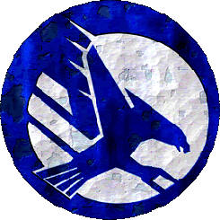

# 尝试自己设定的SM军团背景历史~完工

尝试自己设定的SM军团背景历史~完工

蓝鹰圣骑

终于完成了全部的内容,最新补充的战团装备特点等资料在21楼,目前就发表那么多了,感谢大家的支持,希望能尽快申请到锤子区的头衔与勋章哇^0^

=.=把GDI的标志PS成蓝色.....会不会被西木头告侵权啊

以下为正文了

---------===============----------

蓝鹰军团(Blue Eagles)是服侍帝王的众多星际战团中相当年轻的一支,但他们的身影却频繁的出现在人类帝国最激烈的战场上,将帝王的荣耀带给与他们并肩作战的战士,以及将帝王的怒火宣泄在敌人头上.

蓝鹰军团的起源要追溯到贺露斯叛乱后的第六个千年,当时极限战团的第一连在帝国广阔疆域的南方,欧米迦-安塞隆星域的主行星利伯帝星球上遭到混沌星际战士帝王之子战团的突袭,极限战士的战列巡洋舰被混沌舰队逼退到星系边缘,而地面上的星际战士独力抗敌损失惨重,最后包括极限战团第一连传奇连长尤利撒斯在内的幸存极限战士被迫撤退到一座名为鹰爪山的山峰上,数倍于自己的混沌手足将他们团团围住.

极限战士们无一不清楚的记得,他们敬爱的父亲罗保特-基里曼就是在与堕落的帝王之子战斗中身受恶毒重伤,被放入静态力场.然而,尽管极限第一连的战士战技娴熟,信念坚定,但面对与混沌恶魔为伍,具有压倒性优势的敌人时依然力不从心.极限战团的战团长卡尔斯纽曼闻讯亲率军队赶来救援,但也是远水解不了近渴,眼看光荣的极限战士第一连就要造到灭顶之灾,当地的行星防卫军却成为了他们的救星.这些装备着各式改装武器的战士从战场的一侧突然出现,以精确而猛烈的突袭攻向混沌军队,攻击行动是如此的致命而猛烈,竟然成功将一心只想着如何玩弄星际战士的帝王之子部队打了个措手不及.被围困的极限战士立刻抓住这个机会,在连队长尤里撒斯的领导下,满腔怒火的极限战士终结者部队冲入混沌军队中,直取帝王之子混沌领主的首级,失去了统帅的混沌军团开始退缩,最终在极限战士和当地行星防卫军的联合打击下,帝王之子撤离了星球,逃入亚空间的黑暗之中.

尤里撒斯连队长对于行星防卫军的援救深感谢意,同时他也对当地非正规军队能有如此强大的战斗力惊讶不已,他会见了利伯蒂行星防卫军司令官华伦斯上校,向上校表达了他的谢意,并且了解了关于这支军队,以及这整个星系上所发生的事.会面后尤里撒斯连队长对利伯帝的情况非常感兴趣,并且决定向战团长提交一个十分大胆的建议.

极限战团的战团长卡尔斯纽曼抵达利伯帝后,尤里撒斯立刻向他提交了关于以利伯帝当地防卫军为基础建立新星际战团的提议.这让卡尔斯纽曼颇为意外,但是在听取了第一连连长的报告后,他也承认对这个提案非常感兴趣.

安塞隆星系与利伯帝星球的历史

欧米迦-安塞隆星系位于帝国辽阔版图的南偏东方向,这个星系距离神圣地球并不十分遥远,但是却偏离星图主平面很远,也就是说这个星系在平面星图上接近帝国中心,实际上却因为三维距离上的偏差而与中心差距遥远.这个比较特殊的情况所造成的后果是,人们往往认为这个星系因为靠近帝国中心所以是&quot;安全的&quot;,并且想当然认为这个星系拥有良好的行星防卫力量,但事实上,安塞隆星系远离其他的帝国核心星域,行星的防卫力量也近乎为零,这里没有驻守正规的帝国防卫军,而是由当地殖民政府自主组建的类似民兵组织的行星防卫军.

但是很幸运的,在安塞隆的历史上,有非常长的一段历史都是充满了和平与宁静,甚至在贺露斯叛乱的混沌黑潮中,安塞隆星系也奇迹般的逃过了混沌的侵蚀,依然过着天堂般的美好生活.

......直到帝王之子的出现.

那究竟是哪一年已经无从考证,在贺露斯叛乱中被打散逃入混沌之眼的混沌星际战士屡屡出没在帝国的各个角落,终于,他们中最可恶最恶毒的一支军团发现了安塞隆这个世外桃源,从此也揭开了安塞隆星系长达数千年的灾难.

欧米迦-安塞隆星系中有三颗适合人类居住的人类殖民地,即星系首府利伯帝(Liberty),人口位居第二的行星富饶星,以及一个相对较小的行星哈里玛.

其中星系首府利伯帝是最大也是人口最多的行星,这里的气候条件与地球十分相似,行星表面60%的部分被海水覆盖,剩下的40%陆地主要是平缓的山脉与丘陵,行星自转周期为18.4个小时,温差基本在零下40度到零上20度之间,可以说是一个非常适合人类居住的星球.行星上绝大多数人生活在名为自由之都的蜂巢城市中,与一般的行星总督体制不同,利伯帝星球上使用的是非常罕见的议会制度,由人们推举代表组成的利伯帝议会代替行星总督行使权力,向帝王及帝国总管庭负责.这样的体制下,人们的生活变得非常舒适,议会中总有能代表人们利益说话的议员,因此利伯帝以及其他两个星球上生活的人们可以说生活的非常自由而轻松,相比其他帝国殖民地的高压统治,安塞隆星系简直就是天堂.

因为缺少重工业所需要的矿产资源,安塞隆星系无法发展重型铸造业,而只拥有发达的轻工业与农业.大概也正是因为这个原因,帝国也才更加忽视了这个偏远星系的管理与命运.轻松的生活环境使得当地人都充满了对自由的向往,人们认为自由是帝王赐予他们的礼物,必须无条件的得到保证,因此就连当地的行星防卫军,也是由自愿参加的年轻人组成,而这些颇有些娇生惯养的贵公子,即便是在军队里也不忘维护自己的&quot;自由权&quot;,其结果就是整个军队的素质纪律低下的惊人.而因为缺乏重工业生产军火,星系又常年处在和平中,军队的武器装备基本上只保证了最基本的供给,尤其是装甲部队,自从混沌军团叛乱之后几乎就没有更新过军队中的装甲车辆,以至于在之后的战事刚开始时,这些所谓的&quot;装甲部队&quot;竟然需要当地人用民用车辆牵引.

以一个从来没有受到过战火侵略的世界来说,或许军队的存在与质量并不重要,事实上,如果不是因为混沌军团的突然到来,安塞隆星系可能依然会保持着与世无争的悠闲状况

噩梦的开始

在帝国历史上最黑暗的叛乱结束整整两个千年的时间里，居住在欧米迦-安塞隆星系的人依旧享受着平静与自由的美好生活，他们仅仅有从其他星系传来的消息中了解到这次的灾难是多么的可怕，然而，所谓的百闻不如一见，当这次传言中代表着黑暗与死亡的混沌恶魔从亚空间中突然出现在安塞隆人眼前时，他们才发现之前无论多么夸张的传说都言不为过。

安塞隆人几乎是立刻就意识他们松懈的态度与涣散的军队将给他们带来永远的悔恨。伴随着突然而成的亚空间风暴，疯狂的侵略者从星系边缘出现，接着迅速靠近了人口位居第二的富饶星，在他们庞大而恐怖的战舰上镌刻着曾经代表辉煌的帝王之子徽记，浑身散发着混沌雾气的巨人战士乘坐被装饰成恶魔的各种装甲单位降落在富饶星上，开始毁灭他们见到的任何东西。

安塞隆星系孱弱的行星防御力量在战争警报拉响后甚至来不及给每个战士发一把枪，防卫军的小战舰试图抵抗混沌军团，却在徒劳无谓的留下数十艘残骸后被打散到星系边缘的星云团中。富饶星上的情况就更加凄惨了，尽管帝王之子的部队因为一路的烧杀毁灭推进速度十分缓慢，守卫富饶星主城市涅明顿的防卫军仍然来不及凑集哪怕一个团的武装力量。而他们的装甲部队，大多是一些老旧的奇美拉战车，因为长年缺乏维护，油料管堵塞或是发动机点火器失效的情况随处可见，以至于人们不得不用民用的重拖车将装甲车辆拖入战斗位置……这样的情况下战斗，结果可想而知。帝王之子的军队几乎没遇到什么抵抗就进入巨大的蜂巢型都市中，开始了骇人听闻的屠杀与破坏，无数的人被反复无常的混沌战士随手杀死，更多的人则被帝王之子抓为奴隶带入恐惧之眼。噩梦般的一周的过后，富饶星上近十三亿人口只剩下不到三成的人还在地狱中挣扎求生，其中绝大多数幸存者已经堕落为混沌的信徒，整日疯狂追随极乐邪神四处宣泄，曾经的富饶星再也不“富饶”，从此人们将这颗充满死亡与混沌的星球称为“悲恸”。

在富饶星沦为地狱的时候，身处星系另一头的利伯帝星上的人民日日生活在恐惧之中，只能一边紧盯悲恸星上的悲剧，一边向帝王祈祷。混沌军团大摇大摆离开星系之后，利伯帝人不仅不感到死里逃生的喜悦，反而是陷入了前所未有的悲痛之中，利伯帝人致力维护的自由，在混沌的铁蹄下不堪一击，自由之都巨大的城市中到处都有绝望悲恸的哭喊声，原本熙熙攘攘的行星议会沉默一片，每天都有骚乱或自杀事件爆发。

在混沌入侵中毫无作为的行星防卫军成为人们一切指责的中心，那些曾经为了士兵自由权呐喊的政客此时又毫不留情的开始攻击防卫军的素质低下。一向标榜自由与荣耀的军队此刻已无任何荣誉可言，身受巨大压力的军队内部终于开始发生变革，从军官到士兵，整顿纪律加强训练取代了本来的自由权争论，行星议会在防卫军指挥官的要求下通过了全新的军购计划，但是因为亚空间风暴依然时不时袭击安塞隆星系，从帝国铸造世界订购的物资总是难以抵达，为了弥补装备的缺乏，当地工业系统进行了大规模的调整，经过改造后的利伯帝工业基本具备了生产轻型武器的能力，经过长时间的生产调整之后，当地生产的枪械已经可以与帝国铸造世界生产的枪械相比，甚至更加出色。不过重型装甲部队方面，由于始终缺乏资源与物资，防卫军只能将枪械武器安装在经过改装的警用车辆上，以勉强替代军用车辆的作用，为了适应车辆薄弱装甲的缺陷，利伯帝防卫军在发展中开始更多的使用突袭战术，充分利用车辆的运送能力与突破能力，避免进行大规模的正面对抗。

然而，不管利伯帝人如何努力弥补他们曾经的错误，在面对宇宙中最残酷的混沌邪神之力时，他们的努力终究是要付之东流。

帝国历733.M35，这是一个对于利伯帝人来说绝不会忘记的时间，就在这一年，混沌的帝王之子军团再次大规模入侵安塞隆星系，几乎击溃了利伯帝人所有的希望与梦想。

伴随着一支由超过100艘混沌战舰组成的庞大舰队从亚空间中出现，死亡与混沌再次直指安塞隆星系，由于帝国内四处都有部队告急，只具有轻工业生产能力的安塞隆星系也被帝国高层无奈的划为自生自灭的星系之一，面对混沌军团的大规模入侵，利伯帝行星防卫军开始努力组建他们的坚固防御工事，希望能由自己的努力换得对邪神的胜利。

帝王之子的部队同时向利伯帝与哈里玛两颗星球发起了攻击，与之前无数次掠袭战不同的是，这一次，混沌的攻击不再是旁击侧敲，根据记载，超过整整四个混沌军团连队被投入到对安塞隆的战争中。整整持续了两周的血腥战斗，天空都被染成了疯狂的血色，最终，哈里玛星上空还是被帝王之子那腐坏的金黄色彻底污染了。难以接受又一个悲恸星事实的利伯帝人近似疯狂的反击着降落在利伯帝星上的混沌军团，他们精确而狂热的突袭竟然成功地将本来数量就不多的帝王之子部队赶出了利伯帝星。紧接着，在行星防卫军首席指挥官的率领下，利伯帝百分之八十的军队不顾少量反对者的警告，乘坐民用运输船改装的运兵船赶往支援他们的水深火热中的邻居。狡猾的帝王之子在利伯帝人成功登陆后几乎是立刻就撤退回了太空的舰队中，已经杀昏了头的安塞隆人甚至真的以为他们已经获得了胜利，就在他们大声赞美帝王之时，帝王之子舰队中恐怖的巨型舰炮开始充能而放出白炽化的高亮，充满高热离子的冲击光束扑向满目疮痍的哈里玛星，在瞬间点燃大气层，剧烈的燃烧摧毁了一切形式的生命，残酷的帝王之子舰队继续发狂似的向这颗可怜的行星宣泄他们怨恨的恶魔之火。

雏鹰的诞生

利伯帝人再一次亲眼目睹了自己的邻居在混沌压倒一切的力量前化为尘土的悲剧，就在帝王之子的军队带着数十亿人的生命心满意足离开之后，利伯帝再一次进入濒临崩溃的境地，这些高傲的自由子民终于明白了他们的力量在邪神面前是多么的弱小，所谓的自由、荣耀、忠诚、梦想……在压倒性的力量面前，始终只是一纸空谈。此刻的利伯帝人，失去了他们最后一个可以互相搀扶的邻居，失去了几乎全部的军事力量，现在，如果他们还失去他们仅存的梦想，安塞隆星系恐怕也不再会有什么未来可言了。（想必帝王之子多次留下利伯帝人的性命，估计也是为了充分享受人们痛苦挣扎的过程。）

就在这最危机的时刻，一个名为布鲁斯-依格尔的英雄站了出来，他在自由之都高耸的议会大厦顶层对全利伯帝人发表了一篇让历史铭记的演说，他在巨大蜂巢都市的顶端高呼“梦想永远不会湮灭（Dreams never fall.）”唤起人们内心的希望，在这次演说后，本来近乎崩溃的人们再一次直面残酷的命运站直了身，人们开始重建家园，以及他们光荣的军队，依格尔挑起了新行星防卫军首席指挥官的重担，在他的竭力努力下，利伯帝通过了“强征议案”，即每一个家庭都要将他们最强壮的儿子送入行星防卫军，同时强调防卫军的职责是维护人民的自由与军队的荣耀，为了达成这个目的，军队可以在必要的时候凌驾于自由法案之上。尽管有人对依格尔对于自由权的践踏心怀不满，但相比残酷的现实，或许再不会有什么更糟糕的事了。

除了大力加强训练与军备物资的筹集，依格尔在对之前长年战争中积累的资料分析后，认为利伯帝军队除非能接受更多的真枪实弹的训练，否则在下一次面对混沌军团时还是会不堪一击，“混沌绝不会留给你学习的机会”，为了达成这个目的，依格尔将他的目光投向了星系的另一端，已经堕落成完全混沌地狱的悲恸星。在他就任行星首席指挥官的时间里，他组织了11次对悲恸星的远征，远征的效果是显而易见的，士兵们开始像一名真正的战士那样投入战斗，为帝王的荣耀与行星的自由而奋战，而在依格尔神秘失踪于第11次悲恸远征之后，他的后继者们也继承了他的意志，将悲恸远征融入到军队的训练体系中。

于是在此之后的近1000年间，利伯帝人依靠他们对梦想与希望的坚定信念，独力抵抗着混沌军团的侵略，在出色的训练与近乎完美的战术支持下，自由的子民奇迹般地在这个被帝国遗忘的险恶角落生存了下来，而他们光荣的行星防卫军，也被赋予了“蓝鹰军团”的称号，蓝色代表着天空与自由，鹰代表着力量与荣耀，一只展翅俯冲锐爪前伸的蓝色雄鹰成为军团的徽记，伴随着这只飞鹰军团的是无数英雄般的战斗故事，在混沌的魔爪下，蓝色的战鹰永不低头

并肩作战

尽管帝国对于安塞隆星系对待的自生自灭政策给利伯帝人造成了难以想象的创伤，但是利伯帝人，特别是利伯帝行星防卫军对于神圣帝王的忠诚是不容质疑的，行星议会切实地履行着他们对帝国的职责，每当帝国运输船队偶尔到达利伯帝星时，当地人民总是如实地上缴帝国的税款与物资货物，数千年来从没间断过，尽管有时星球会遭到混沌的掠夺，利伯帝人还是尽他们最大的可能向帝王敬献他们的力量。

逐渐地，帝国高层开始注意到这个偏远却异常稳定的星系，而星际战士中最强大的一支，极限战团也开始注意到他们堕落的兄弟在这个星系频繁的活动，为了进一步调查帝王之子在欧米迦-安塞隆星系的目的，极限战团的卡尔斯纽曼战团长在接到帝王之子再次侵攻安塞隆的报告后，迅速将他麾下最优秀的极限第一连派往当地。

利伯帝人在帝国历600.M36，独力面对帝王之子一千年来最猛烈的攻击，近三个连队的混沌星际战士强大的攻势将利伯帝人压缩进他们最后的要塞，行星首府自由之都，行星防卫军将他们全部的力量都投入到了城市要塞的攻防战之中，给混沌军团造成了巨大的损失，但依然难以彻底扭转战场的局势，混沌的军队开始逐渐靠近利伯帝人最后的生存之地。

或许是帝王在庇护他们忠诚的子民，正当利伯帝人开始失去信心时，极限战团第一连终于抵达了战场，由传奇连长尤里撒斯率领的极限战士终结者部队通过深入打击进入战场，给了帝王之子部队沉重的一击。但是显然尤里撒斯没有预料到帝王之子手中的预备队是如此的强大，在极限第一连进入战场后不久，帝王之子便向行星表面投下了两个连队的增援部队。缺少重装备武器与补给的极限战士逐渐发现他们已经处于劣势之中，迫不得已之下，尤里撒斯连长带领他的兄弟们从混沌军团的阵地中杀出一条血路，退守到高耸的鹰爪山上。这是一座海拔1500多米的山峰，地形易守难攻，幸存的极限战士在山峰上草草建立了防御阵地，但缺乏支援的现实是残酷的，帝王之子的部队一刻不停的利用恶魔引擎机甲向山上倾泄炮弹，以削弱星际战士的力量。

混沌军团突然间的攻击方向转变给了利伯帝人喘息的机会，时任行星防卫军指挥官的华伦斯重新集结了军队，迅速击溃还围困着自由城的混沌杂鱼。此时的极限战士第一连已经被迫撤退到了鹰爪山上，华伦斯与防卫军的高级军官们筹划了一个突袭敌人的计划，以缓解星际战士的压力，为了能达到突袭的最佳效果，军官们进行了长达三个小时的不间断会议，他们精确的计算了各种可能的情况，完成的作战计划几乎包含了每一个细微环节，然后又是一个小时的准备工作，待到战斗开始时，每一个参与到计划中的士兵都详细了解了他们的任务。

预料中的战斗打响了，行星防卫军乘坐他们改装的轻型战斗车，从三个位置突入混沌军团的包围阵地，尽管他们的武器很难给穿着动力盔甲的混沌星际战士造成什么严重伤害，却足以打乱帝王之子的防卫体系，就如同三把并不锋利，却力道十足的匕首插入帝王之子混沌领主所在的阵地中。一直处于防御状态的极限战士立刻注意到战场上的这个变化，尤里撒斯连长果断的率领极限终结者战士突入一片混乱的帝王之子阵地中，找到了帝王之子的混沌领主并由尤里撒斯亲自将之击杀。丧失了指挥官的混沌军团开始退缩，最后帝王之子的太空舰队不得不顶着极限战团舰队的炮火，将地面部队撤出行星，仓皇逃入附近的亚空间风暴之中。

蓝鹰军团

利伯帝星上的战斗结束后，极限第一连连长尤里撒斯与随后抵达的极限战团团长卡尔斯纽曼都对当地防卫军的表现给予了极高的评价，在了解了安塞隆令人悲伤的历史，以及利伯帝人与混沌叛徒数千年的战斗之后，极限战士的领导者一致认为当地特殊环境造就下的战士，具备成为光荣的星际战士的资质。卡尔斯纽曼战团长随即给机械神教、帝国军部以及审判庭发送了推荐报告，并且承诺将会帮助新战团的组建过程。由于有了极限战士的推荐与指导保证，机械神教的高阶主教们也很快通过了以利伯帝星为母星建立新星际战团的计划，短短几年的时间里，数名携带着星际战士基因种子的机械主教抵达了利伯帝星，而极限战团也应允他们的诺言，将他们资深的战团牧师艾布拉姆斯留在利伯星上，指导新战团的建立，后来牧师艾布拉姆斯也成为了蓝鹰军团的第一任首席牧师。

第一批新组建的星际战士基本都是从当地行星防卫军中挑选出来的勇士，他们曾经克服了种种令人难以想象的困难，而现在他们将再次面对改造手术的巨大危险。令人安慰的时，包括防卫军首席指挥官华伦斯在内的绝大多数战士都挺过了手术的煎熬，在帝国历636.M36的七月份，新星际战团的第一个连队成功组建，华伦斯成为军团的第一任战团长，为了纪念利伯帝行星防卫军数千年来的斗争与努力，这个新的战团被命名为“蓝鹰军团”。

蓝鹰军团在之后的100年间接受来自帝国各星系的兵源，不断完善他们的建制，但是利伯帝当地人还是在军团成员的挑选过程中占到了绝对的多数，直到帝国第36个千年中的742年，在第二任战团长努萨伊的手中，蓝鹰军团完成了他们的建团工作，由十个连队共1002人组成的星际战士军团正式加入帝国的花名册，从此拉开了蓝色战鹰数千年为帝王而战的序幕。

军团的作战特点

蓝鹰军团是一支非常善于突袭进攻的部队，同时在防御战中也有相当的经验。

蓝鹰军团最擅长的工作是针对行星的突袭作战，一般情况下，战团的战斗巡洋舰会首先进入低轨道进行一波次的轨道轰炸，同时放出数个侦察小队，进行实地的侦察活动，在接下来的数天内这个步骤可能反复进行数十次，直到战团的指挥官认为已经收集到足够多的情况为止，紧接着是指挥官与智库馆长等军官的紧张会议，在会议中将制订出一套完善的进攻计划，这个计划往往会涵盖从第一支部队次进攻到最后一支部队撤退的方方面面的问题。

在确定了作战计划后，战团的进攻准备就算是完成了，接下去将是一连串猛烈的地面袭击与空中打击，就如同一头已经窥视猎物许久的猎鹰的俯冲攻击，在突袭战斗中，战团会大量利用空投仓与雷鹰战机将部队投放到星球中早已确定的目标地点，这些经过精确计算的登陆点往往都是对于敌人来说最致命的死穴，蓝鹰军团的地面部队抵达目的地后就会展开猛烈而精确的攻击，直到将敌人击溃或是暂时撤退回太空战舰，以等待下一波攻势。事实上，蓝鹰军团在攻击过程中经常会反复调遣部队，将战场中的部队撤回，稍做整顿后又立刻投入下一轮突袭中，这样的战术往往会让敌人摸不清头脑，而每一次来自空中的突袭都毫无疑问将是对敌人沉重的打击。在数波次的反复俯冲攻击过程中，战团指挥系统会不停的收集现实资料，以不断修正之前的作战计划，确保计划本身是可靠而完善的。

最后，当地面上的敌人已经在不断的精确打击下精疲力竭后，战团会最后一次性派出他们全部的战斗力量，进行最后的猛烈进攻，迅速消灭敌人结束战斗。在这样的战术指导下，蓝鹰军团的损失往往很小，而星际战士的敌人则常常会恼羞成怒却又无处可咬，最终从内部产生裂痕降低战斗力，而一直在如同鹰眼般监视着战场一举一动的蓝鹰军团又会立刻抓住这个突破口，展开针对这一弱点的攻击，进一步削弱敌人的力量。

而在防御战当中，依靠蓝鹰军团长久以来形成的智慧优势，战团会充分利用他们的每一组火力，构建一个经过精确估算的防御体系，面对这个防御战线时，他们的敌人根本找不到火力的死角，巨大的损失过后往往一无所获，而且还不得不提防战鹰们的突然冲出防线的袭击，在历史上，还几乎没有蓝鹰军团的防线被敌人突破的事例。

不过有得必有失，蓝鹰军团的战术特点也给他们带来了不少的麻烦。首先最明显的就是战团在快速作战时很容易出现问题，由于战团的每一名士兵都已经习惯了在一个完整作战计划框架内作战，因此在缺少了战斗计划的情况，战团的战斗力会大打折扣。尽管长时间的训练与积累，使得蓝鹰军团的战士们已经拥有了超越绝大多数其他星际战士的思维反应速度，但他们追求完美的性格总是会让他们在某些关键时刻显得优柔寡断，试图考虑每一个可能的情况而难以迅速展开行动。

第二个比较重大的缺陷在于他们对于伤亡总有一些顾忌。作为侍卫帝王的最优秀战士，星际战士从不惧怕死亡，蓝鹰军团也不例外，不过他们对于战况的理解与很多帝国指挥官都有所不同，在蓝鹰们看来，不必要的损失是愚蠢的，每当战团在战斗中遭遇到预料之外的强烈抵抗时，战团指挥官们更多倾向于将部队暂时得撤下战场，因为“总会有其他某个地方更能发挥作用”，这也是蓝鹰军团在战斗中反复展开俯冲攻击的指导思想。本来说这样的考虑无可争议，但在某些时刻，尤其是与其他帝国军团共同作战时，战团在遭遇强敌后随意撤退的行为常常令其他帝国指挥官非常不满，甚至连同是星际战士的黑色圣堂战团都曾经指责蓝鹰军团的撤退是“胆小懦弱……令帝王蒙羞的行为”，针对来自各方的指责，蓝鹰军团会奋起反击利用自己一连串辉煌的胜利回击对方的指责，但不可否认的是，在一些特殊的需要付出大量牺牲的情况下，蓝鹰军团或多或少会产生一些不利的因素。

最后一个缺陷来自于他们的基因，这也可能是蓝鹰军团最危险的问题。由于某些不得而知的原因，军团的基因种子中出现了一个非常细微，但足以令人担忧的变异，没有人知道这些突变是在机械神教的基因种子库中就已经出现，还是在军团的发展中产生的。人们唯一知道的是，在这个不安定因素的影响下，蓝鹰军团的战士在战斗中可能突然间陷入难以自拔的暴怒中，这些疯狂的战士会在一瞬间爆发出可怕的力量，毁灭他遇上的任何敌人……甚至自己人，这样的惨剧是否发生过并无证据，因为战团将有关这个基因缺陷的所有问题都当做最高机密存入了战团智库，即便是机械神教的高阶主教也不能随意查阅这些资料。但毫无疑问的是，帝国审判庭内已经有一部分人开始注意到蓝鹰军团的这个不安定因素，如果有一天这个基因缺陷有可能扩大到难以挽回的地步，审判庭可能会考虑提前采取一些必要的措施涉入其中……不过目前为止，一切都还很正常，战团依然会战斗在对帝王敌人降下惩罚的第一线。

战团总部要塞

蓝鹰军团自组建起就一直以他们的母星利伯帝为战团的家，在利伯帝行星，战团的前身——利伯帝行星防卫军与极限战团曾经并肩战斗过的鹰爪山峰顶，战团的机械神甫建立起一座巨大、华丽而坚固的修道院要塞，这座被命名为“鹰羽”的巨大要塞成为战团的总部修道院，新招募的战士将在这里接受训练，成为正式的战团一员后加入十个连队中的一支，投入到为帝王而战的神圣战争中。

修道院最显眼的部分莫过于其华丽的要塞大门，在要塞的南北两个方位处，各有一对高过百米的巨型雄鹰雕塑，这四座雕塑是由战团的智者们穷其智慧与艺术灵感制造，并在之后的几千年间被不断的修饰，以达到近乎完美的艺术境界。每座雕塑都被塑造成一头正在俯冲的苍鹰，锋利的鹰爪向前伸出，收拢在身后的双翼朝向要塞中央的主塔，在两座雕塑的中央就是要塞坚固的钛合金门，门上同样有着无数华丽的浮雕，代表着战团在无数次征战中取得的荣耀。任何一位到过鹰羽要塞的参观者都会为这充满力量与荣耀的华丽雕塑而倾倒，一位曾经在第48个千年参观过鹰羽要塞的帝国审判官在他的日记中写到，“要塞的南北两个大门是要塞仅有的出入口，从战略角度而言这是一个明智的决定，因为建筑所处的地形非常易于在任何可能的敌人靠近前给予其巨大的损失……特别令人难忘的是构成大门的两座巨型雕塑……我认为这（雕塑）正是该战团展现帝王无上荣耀的出众方式。”

与帝国内其他要塞常常采用的复合式城墙设计不同，鹰羽要塞只有一道防御主墙，但是这一座主墙却是凝聚着蓝鹰军团无数智慧与努力的结晶，在巨大而看似只有装饰作用的外墙上，隐藏着无数的防御火力点，在数千年的不断完善中，这些火力点被巧妙的与城墙上的浮雕花纹结合在一起，据说就连蓝鹰战团自己的战士都很少能知道这些隐秘火力点的位置和精确数量。而城墙坚固的复合式金属外壳更是每一寸都受到过历届战团牧师的祝福，成为一堵不可逾越的神圣之墙。

战团的建制

蓝鹰军团目前共有十个完整的战斗连队，其中六个连队在外以帝王之名四处征战，另外三个连队驻留在利伯帝星上，这九个战斗连队轮流负责在外征战与守卫维护他们的母星，比较特殊的是战团第七连，这支连队一般不外出征战，而是作为战团最后的保留预备队，永远驻守在安塞隆星系。事实上，在战团第七连刚刚建立时，这支部队就对星系内的混沌行星悲恸星发动过一次强大的攻势，并且在那颗充满腐败与亵渎的行星上建立起一个隐蔽的前线基地，从此这里就成为蓝鹰军团招收与训练新成员的试炼场，每一名希望加入或是刚刚加入战团的年轻士兵，都会被投放到这个充满危险的星球上，以这个小前线营地为据点进行艰苦卓绝的磨练，以测试他们是否已经够资格成为光荣的蓝鹰军团的一员。

战团的建制完全遵照神圣的阿斯塔特法典，比较特殊的只有两点，一个是战团的侦察部队，一个是指挥部的设置。

由于蓝鹰军团非常注重于情报的收集分析工作，因此与一般的星际战团相比，战团的侦察部队往往比一般配员来的要大，装备技术也更先进，一个完整的“鹰眼”侦察小队配员有7人，其中5人主要负责利用各种侦察设备收集情报，剩下的2人负责即时向指挥部发送情报。一般情况下，蓝鹰军团的侦察小队不会冒险涉入战斗的直接对抗中。

当大量的情报被传回指挥部后，同样需要一个足够强大的智囊团将资料解剖分析，依此并制订出精确的计划。为了达到这个目的，蓝鹰军团的每一个连队都拥有一个战略指挥部，这个指挥部一般由包括连队长、智库馆长在内的6名军官组成，战团的战术手册上规定，连队在战斗中应该保留最少3名军官在连队战略指挥部内，以充分发挥战团的战斗效率。

战团的装备特点

蓝鹰军团的战术特色决定了他们的装备特点。为了发动快速有效的突袭，战团的各个连队都大量装备了各型突击载具，但是这里有一个令人疑惑的问题，尽管战团的行动方式需要他们使用大量的高速突击载具，但是战团的战士们却普遍存在一个奇怪的观点——他们认为缺乏足够保护的载具是不完美的，因此很多蓝鹰军团的战士都不愿意使用战斗摩托或是悬浮突击艇，他们宁愿挤在狭窄的犀牛运输车内也拒绝乘坐缺乏装甲保护的突击摩托进入战斗，也因为这个原因，蓝鹰军团的轻型突击载具小队反而在各星际战团中属于比较少的。为了弥补这个奇怪的缺点，战团装备了数量巨大的犀牛、长须鲸运兵车，以及尽可能多的兰德掠袭者战车。

而为了达到理想中的空中突袭效果，战团在高频率地利用空投仓将部队突入战场外，还装备了大量的雷鹰运输机，依靠这些可靠的重型飞行单位，蓝鹰军团得以按照预想中的计划使部队自由出入战场，当然，为了保证雷鹰运输机的安全，战团在一开始的战斗计划中就会着重处理地面的敌对防空火力，对于需要不断俯冲攻击的战鹰们来说，一个良好的飞行条件是非常重要的。

另外一个比较特别之处，在于蓝鹰军团比较注重终结者装甲的使用，在有些战斗条件下，对地面的大规模空中突袭往往会遇上相当大的风险，在这样的情况下，战团最保险也最有效的作战手段就是依靠终结者精英部队的深入打击能力，从亚空间的隧道中瞬间进入战场的终结者部队经常扮演着蓝色死神的角色，仿佛战鹰致命的利爪瞬间将敌人撕成碎片。

在武器选择方面，蓝鹰军团的战士比较偏爱轻武器，但这并不表示战团不注重重火力的作用，在更多的情况下，战团高速的突袭常常令他们的敌人措手不及，即使是轻武器的火力也能给敌人造成巨大的伤害；同时，战团频繁的调动也令重武器的部署比较的困难。因此蓝鹰军团更多使用的是部队可以比较容易携带的武器，而一些沉重迟缓的武器尽管有装备，却少有派上战场的机会，尤其是炮击单位，比如旋风支援战车一般只有在防御作战中才会被战团展开使用。

在有些情况下，蓝鹰军团的突袭是如此的靠近敌人心脏，以至于敌人常会震惊的发现星际战士的空投仓竟然就落在他们集结地的空隙处，而高吼着帝王之名的战士从空投仓中一出现就挥舞着给他们带来死亡的战刃。在平日的艰苦训练中，蓝鹰军团的战士十分注重他们的格斗技巧，在近身的肉搏战中，蓝鹰军团的战士往往比他们的敌人有更多的优势。与其他以肉搏战著名的战团比如太空野狼部队不同的是，蓝色的战鹰在格斗中更加注重技巧与攻击时机的把握，而不是更强的力量或更快的攻击速度，因此蓝鹰军团的战士们偏爱挥舞速度快而精确的剑类、拳套类武器，而不太适合使用沉重却杀伤力巨大的战斧或战锤。

（不过很有意思的是，蓝鹰军团最著名的武器一直是一把上古战锤，这是极限战团第一连连长尤里撒斯，在利伯帝的战斗中从一名帝王之子混沌领主手中抢来的武器，为了答谢利伯帝防卫军的援助而送给了后来成为蓝鹰军团第一任战团长的华伦斯指挥官。这把威力无比的上古神器曾一度是蓝鹰军团战团长的荣誉武器，但是在第三十八千年的一次悲剧般的战斗中，包括战团长、首席牧师在内的蓝鹰第一连在与混沌军团的战斗中全军覆没，这柄荣耀的武器也遗失了整整一百年，之后才被战团的智库馆长重新发掘出来，从此这把武器被运回战团母星，永久封存于鹰羽要塞的军团大厅中。）

战团战吼

为了自由与荣耀!  For Freedom And Honor!
