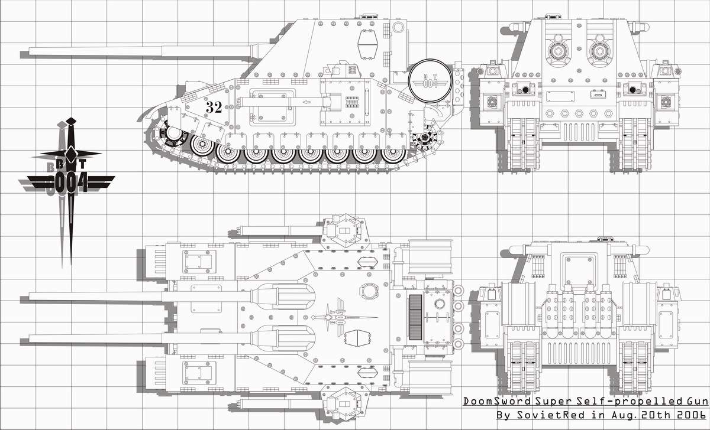
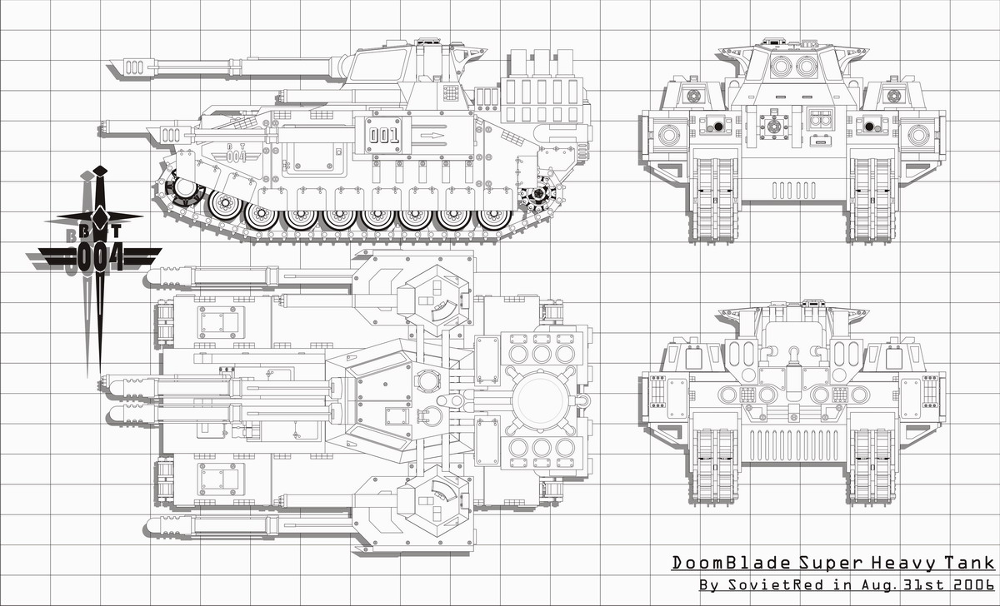
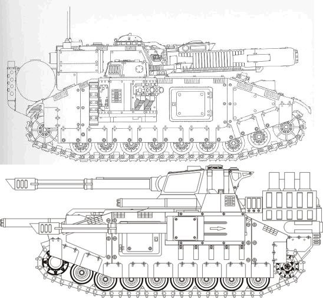

# [原创]DoomSword and DoomBlade

[原创]DoomSword&DoomBlade

sovietred

一段时间内中毒太深，所以画了两个……

DoomSword

设计目的：远程火力压制 近距离火力支援

战斗全重：388t

全长/车体长：19.5m/14m

全宽/车体宽：9.35m/6.83

全高（至车顶）：6.88m

乘员：8人：驾驶员/车长/炮长/主炮手/副炮手*2/

机械工程师（左炮塔手）/通信工程师（右炮塔手）

动力：活塞式发动机

最大公路速度：28km/h 最大越野速度：20km/h

主要武器：2*超级地震炮 14发榴弹 6发燃烧弹 可以发射核炮弹

次要武器：2*爆弹机枪 1000发 2*加特林激光炮 无限

DoomBlade

设计目的：超重型主战坦克

战斗全重：391t

全长/车体长：15.6/14.2m

全宽/车体宽：9.68m/6.83

全高（至车顶）：6.49m

乘员：9人：驾驶员/车长/炮长/左炮手/右炮长/政委（前激光炮手）/

核工程师（前机枪手）/机械工程师（左炮塔手）/通信工程师（右炮塔手）

动力：小型核裂变发动机

最大公路速度：45km/h 最大越野速度：32km/h

主要武器：4*加强型粉碎者火炮 85发炮弹

次要武器：2*爆弹机枪 1000发 3*加特林激光炮 无限

一张DoomBlade和StromBlade的对比

下面是YY的背景……

德尔塔维斯核子近卫军（derteivos nuke guard army)-德尔塔维斯共和国（repulic of derteivos）

概述：

德尔塔维斯星系远离帝国的中心和边境，整个星系由8颗行星组成，其中有4颗星球勉强可以居住人类，整体气候为恶劣的冰雪天气，星球表面被冰雪覆盖并拥有大量核辐射，基本没有动植物，氧气主要靠化学药品合成，食物主要以来氧气大棚进行生产，主要食物为速冻包子。人口约为5亿。

德尔塔维斯主要出产三种产品和资源：一种类似石油的液体燃料、超重型坦克和裂变核反应堆。

德尔塔维斯因为蕴涵大量的裂变原料而成为帝国的核动力技术开发中心，经过近千年的殖民、开发和研究，德尔塔维斯上的铸造世界已能生产出比帝王毒刃还重的坦克，并且能为他们配备动力强大的小型核子发动机，能够拥有比火星生产的标准帝王毒刃更强的机动性和装甲。但这种核子发动机还是过于庞大和昂贵，所以只有少量型号得以拥有安装此种发动机的殊容，德尔塔维斯的守备部队——前帝国卫队德尔塔维斯核子近卫军的大多数车辆还是使用着传统的动力系统，得益于德尔塔维斯的另一特产，他们的发动机能比帝国的标准装备多输出30%的功率。

分裂：

因为长期处于被半遗忘状态，德尔塔维斯的技术人员大多私下认为他们的成就并非来源于古代遗迹和机械之神，而是应该归功于德尔塔维斯星球殖民者数个世纪来的独立奋斗。他们认为机械之神不过是一个低级神，如果没有动力之神，机械之神不过是一个傀儡。这惹恼了机械神教，他们推动帝国高层通过了对德尔塔维斯星系的禁航令（这意味德尔塔维斯将无法出口他的能源和坦克，而且也无法进口粮食和纺织品），同时向德尔塔维斯星系的总督施压，要求他强硬处理此事，并且审判庭已经开始讨论是只将约占德尔塔维斯10%人口的研究所所在地德尔塔维斯BT004号行星宣布为异端还是干脆将整个星系铲平。

在这种情况下，德尔塔维斯内部发生了分裂，支持研究所的德尔塔维斯第4核子近卫坦克军和总督的德尔塔维斯第3核子近卫军爆发内战，随着第1核子近卫军和第2核子近卫军以及总督直属炮兵师、星系舰队在宣布中立后不久相继倒向BT004，最后内战演变为一场革命，帝国在德尔塔维斯星系的所有直属机构都被彻底摧毁，德尔塔维斯宣布独立，成立德尔塔维斯共和国。

共和国：

首都位于BT001号行星，拥有一个较小的工厂；BT004号上除了研究所还拥有一条裂变反应堆生产线，现在同时成为动力之神的神殿所在地（一口巨大的锅炉），此外相信至少还在两颗无大气层的行星上设立有核动力研究所和裂变原料提炼生产设备；BT006是德尔塔维斯铸造世界所在地，集中了65%的人口；BT007位于星系的最内侧，最靠近恒星RTO，是主要的粮食产地。

最高行政机构为共和国督政府，立法机构为人民议会，动力神教为国教，国家首脑为执政官，由近卫军、教会（研究所）和工业联盟的代表轮流执政，每两年为一任期，遇紧急事态可延长和扩大权力，现任执政官为近卫军的一名少将。

德尔塔维斯核子近卫军：

因为远离边境，所以德尔塔维斯的帝国卫队长期以来更多的是在应付一些核事故（很多是他们自己的）和偶尔传入的小股外族部队。内战后新组建的德尔塔维斯核子近卫军由一个坦克军团、两个机械化合成军团和执政官直属炮兵师、执政官直属超重型坦克师以及星系巡逻舰队、四个星球轨道防卫炮兵师组成，共和国政府正有计划扩大军队规模以应对帝国的镇压部队，他们未来的主要敌人将是帝国卫队、星际战士甚至战斗修女。

德尔塔维斯核子近卫军完全实现了机械化，共和国特产的核动力超重型坦克以营为单位被集中编制于执政官直属超重型坦克师，战时他们将按需要被用于加强其他师的作战能力，而执政官直属炮兵师将被直接用于加强军团的突破能力。其他部队的基本上还是使用帝国的制式装备，相对于其他的帝国卫队，德尔塔维斯核子近卫军的车辆拥有更好的机动性（他们的燃料效率更高），装甲更厚，但因为没有能力生产离子武器和重型激光炮，他们不得不依靠传统的爆炸类武器和大量的中轻型激光武器。同样得益于燃料的高效率，近卫军的火焰类武器威力更大，火焰可以达到更高的温度（火焰呈蓝白色），甚至为大口径火炮配备了凝固燃烧弹。

德尔塔维斯核子近卫军的步兵因为需要背负氧气罐而显的十分笨重，他们同时需要穿着厚重的铅夹层防辐射服，这使得他们更加笨重，基本上脱离机械化部队后就失去机动能力了。

军队中原本忠于帝国的政委全部被清洗，新提拔上来的政委们显得有些年轻和缺乏经验，但他们的狂热程度并不比他们的前任差。
