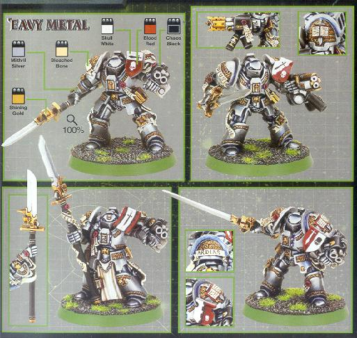

# 灰骑士终结者装甲

灰骑士终结者装甲

兔子半妖

灰骑士终结者装甲

灰骑士的终结者装甲都经过高度的修饰.它们被浓重的巴洛克风格的浮雕花纹装饰着.左肩和右膝上雕刻着标准的终结者徽章,而右肩和左膝上则是灰骑士独有的徽章(插着一把剑的典籍).每个骑士在战斗时都在胸甲内的特别容器里携带着一本战团圣典Libra Daemonicus的副本,里面的内容是关于战斗的仪式.纯净封印遍布装甲的双腿,表示这名骑士不会被来自混沌的力量所污染.

与记录者(Librarian)陆战队的神盾(Aegis)装甲类似,每套装甲都配有一个心能面罩.这个面罩能保护骑士免于心能攻击.

复仇女神武器

&quot;复仇女神&quot;能量武器是灰骑士终结者小组的标准武器.这种类似战戟的武器是能量剑的更为强力和复杂的版本.每把&quot;复仇女神&quot;都是为配合使用者独特的心能力场而专门打造的.&quot;复仇女神&quot;能强化使用者的肉搏能力,使之远凌驾于普通的陆战队员之上.此外,&quot;复仇女神&quot;还巧妙地在柄内装一把短矢枪.

近战

复仇女神是一柄高效的近战武器.与能量剑有相同的能力.

心能点储存

复仇女神拥有储存心能的能力.

心能爆裂

复仇女神可被用于聚集心能以释放心能爆裂.

虽然非常强大,但心能爆裂是在最后关头才能使用的武器.使用心能爆裂需要消耗大量的心能,将对骑士造成巨大的心灵创伤.

传统武器

&quot;复仇女神&quot;柄中的短矢是一种弹药有限的短距离武器.由于科技型的武器对恶魔生物也具备完全的伤害效力,所以短矢为灰骑士提供了重要的远距离战斗武器.短矢为三联装,可以单独开火或同时射击.

短矢可在近战中射击(作为其他的近战攻击的补充),但其他方面都和普通的短矢类似.
