# 大远征时代

> By. chyvalries
> 刚扫的一些锤子图

刚刚扫下的一些图，摘自大远征时代，人类的黄金时代，基因原体亲如兄弟的时代。

在同人女中人气很高的圣吉列斯大人

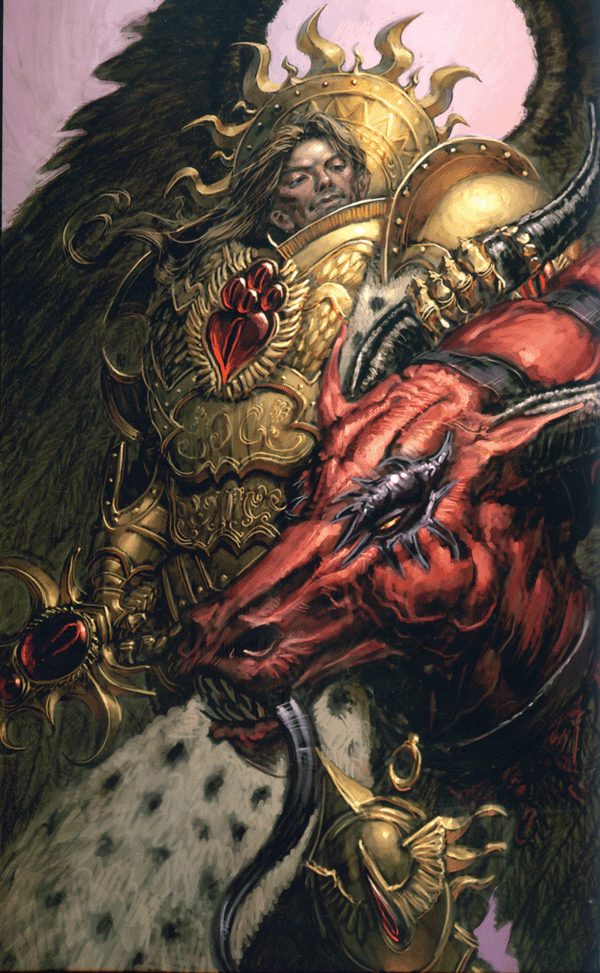

斧头帮的祖师爷安格朗大人

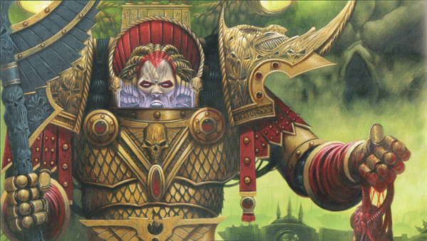

工业污染的受害者莫特利安大人

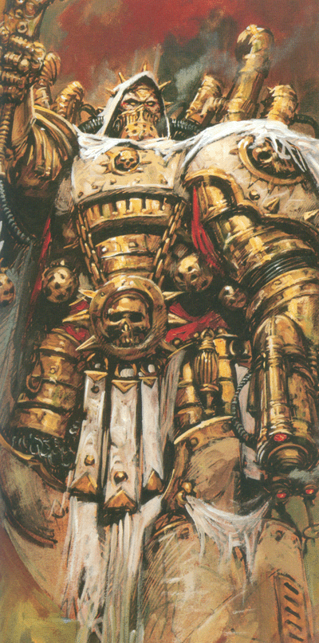

那时候的死亡护卫还是蛮清秀的

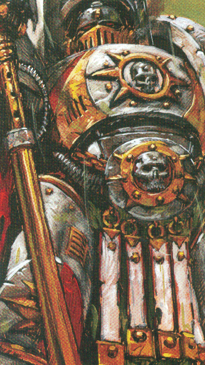

不管什么年头都是蛮人的黎曼鲁斯

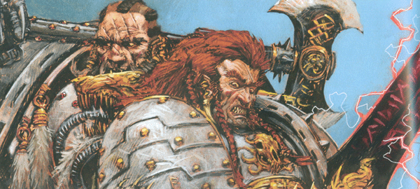

不管那次出场都很倒霉的皇帝之镰

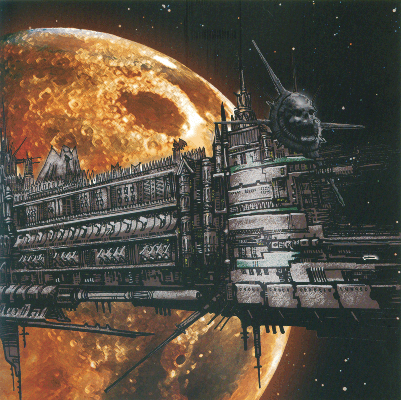

蚕食者的卡恩，那时候还没变成见血就疯的斧头党，不过看上去已经很凶相

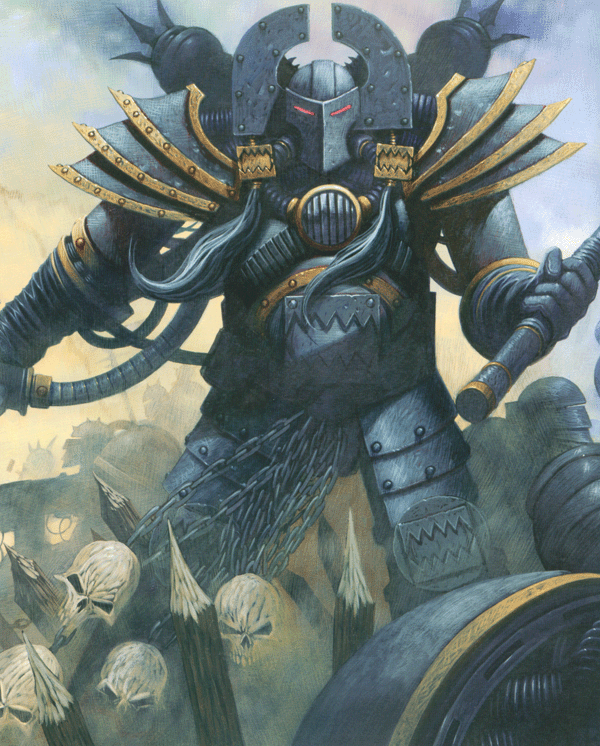

法比乌斯·拜尔，还没变成怪医老头以前的样子

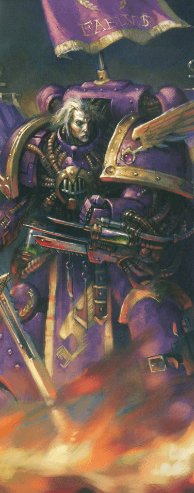

死亡护卫的突击小队

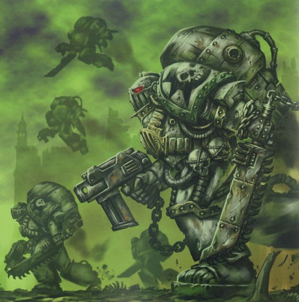

荷大

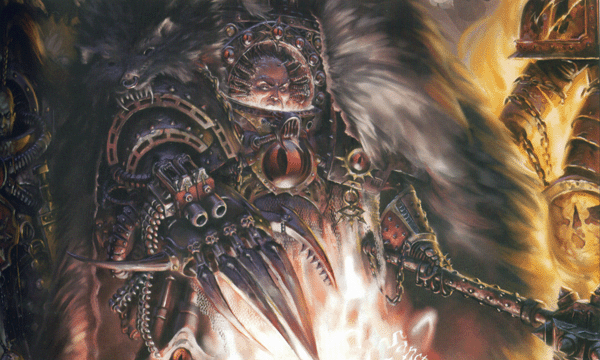

阿巴顿大大

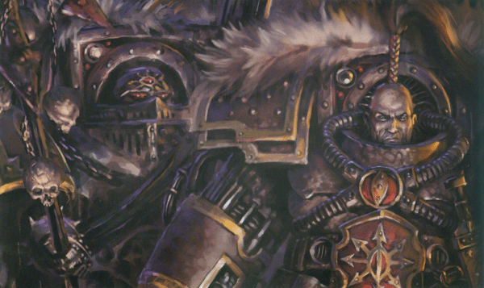

阿里曼大大

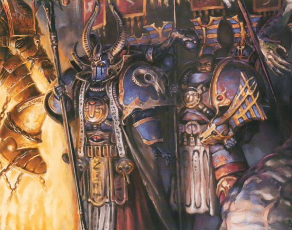

帝王之子的富尔根大大

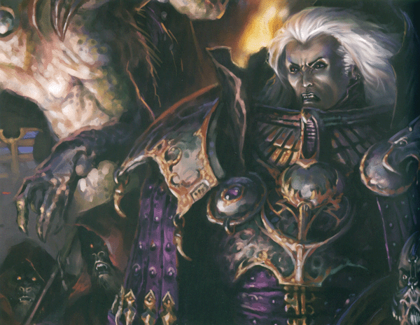

伊思塔万IV大屠杀以后用来当祭品的不知道谁谁

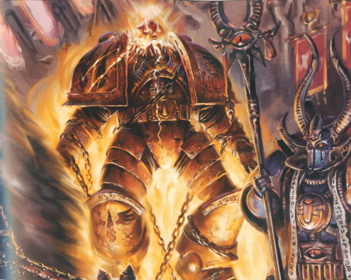

火龙军团的终结者，个人觉得早期型号的终结者更敦实

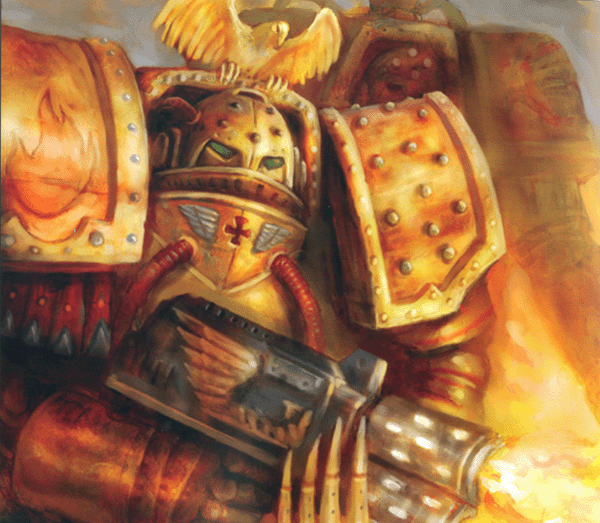

铁拳军团终结者

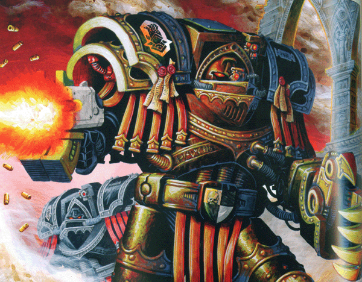

深蓝

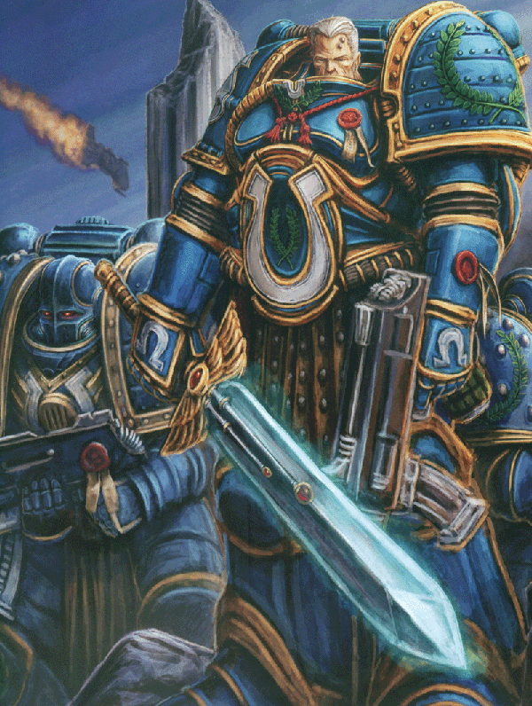

暗夜天使总扛把子

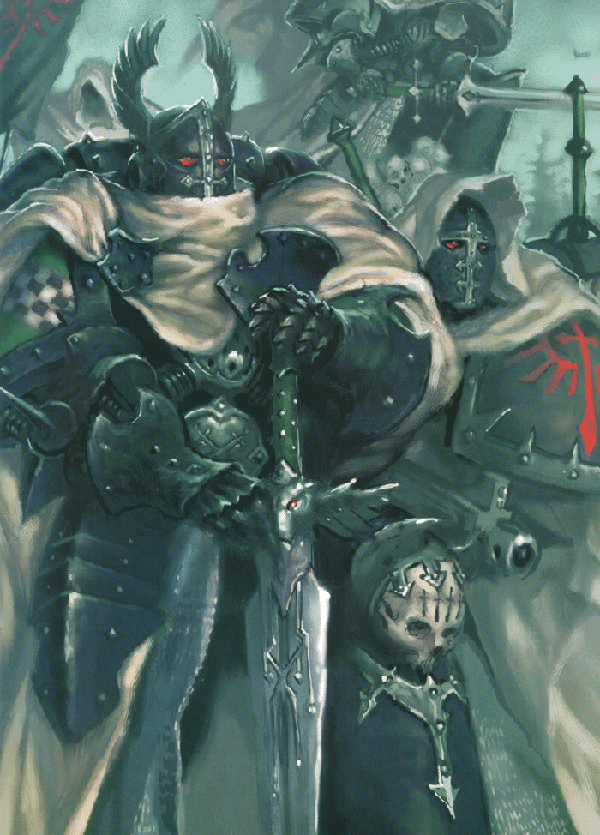

蚕食者的狗狗

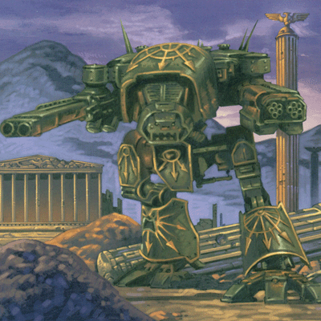

帝王之子的战列旗舰

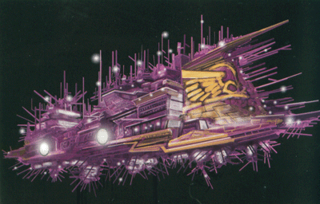

地球宫殿卫队直属的巡洋舰

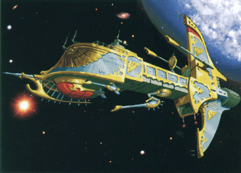