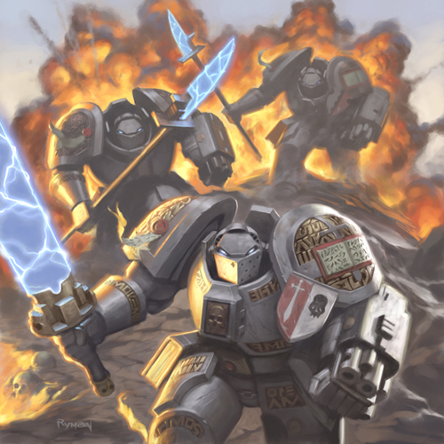

# 灰骑士-by 罗严塔尔

> 罗严塔尔
> http://bbs.stage1st.com/thread-224926-7-1.html

格雷骑士详尽资料

今天我发烧，头晕TT……不过斑竹卖我面子，拖着病体感谢一下

我这次给大家拿来了灰骑士（我愿意翻译成格雷骑士，Grey Knights）的设定资料

出自英文版本WIKI和我找到的一些参考资料。

这次SM在WHDK里表现不佳，有人抱怨Grey Knights实战效果不高。让我来说，的确，Relic这次虽然让格雷骑士进入到了游戏里面，但是却做成了一个Down Grade的版本。大家可以参照资料，格雷骑士是王朝的超精英，一对格雷骑士宰掉一个Daemon Prince完全不在话下才对，这和游戏里的数值相差太远，希望Relic在补丁中能对Grey Knights进行加强。这群Deamon Hunters事实上和Dawn of War里那个审判官Taldor是一个级别的战士才对。

谨以此文送给WH爱好者和真正的格雷骑士。

## Grey Knights （灰骑士；格雷骑士）

### 历史

根据传说，灰骑士部队的组建令由皇帝亲自下达，时期大约是在Horus Heresy（赫拉斯之背叛）和Second Founding（王朝第二次建军）。关于格雷骑士，人们都相信其建立过程和其他二十个星际战士（Space Marines）军团不同，他们的基因来源于一种稀有的途径——这种基因取自皇帝（The Emperor）本人，并且经过基因的调和。

还有另外一种说法是，格雷骑士的基因种子是取自攻城战期间（The Siege of the Emperor’s Palace，见Horus Heresy的讲解）叛军星际战士军团中8名坚持对皇帝效忠的星际战士，经过Malcador the Sigillite的调配而成。当时Malcador受命于皇帝，采集一组拥有忠诚、勇气，有着不可动摇地坚强信念的人的基因种子。被选定的这8名士兵在叛乱期间显示出了无可非议的战斗能力和坚定信念。他们获得了被并列安葬在Primarch（20个建立星际战士军团时候的创始人，是他们提供了所有星际战士军团的基因种子）的荣誉。人们相信皇帝也回应了Malcador，

“Malcador，你做了很好的决断。这8名星际战士的确可以在将来的王朝中担任重要的任务，即使通过另外一种秘密的形式”（Emperor的话）

Chapter 666号资料显示（请参照Codex: Daemon Hunters），格雷骑士永久隶属于审判议会Ordo Malleus支局。格雷骑士团在星际战士军团中是唯一一个掌握着极密的王朝中与Chaos相关的黑暗知识的军团——只有他们知道真正有恶魔（Daemons）的存在，只有他们知道恶魔降临时候的现象，也只有他们装备了最精良的武器，在对付恶魔的最前线战斗，保卫人类的世界不被恶魔入侵。格雷骑士团的教会（Chapter）保持了军中最高的荣誉：从教会建立开始，从来没有一个格雷骑士受到恶魔的诱惑而背叛。

### 组织

由于格雷骑士也同时是机械圣教（日后给出详细资料）的成员，所以通常情况下他们不参与普通星际战士的作战行动。他们跟随审判议会，负责搜寻和消灭一切出现在这个世界上的有关异端Chaos的东西。

每一个合格的新兵都会得到一套神盾盔甲（Aegis，古希腊神话中雅典娜左手的神盾）和一把复仇之矛（Nemesis，古希腊神话中复仇女神手中的神矛），并且被编制到Justicar（审判官之类的意思，可能由来不是英语）的管辖下。这些星级战士（格雷骑士也是星级战士的一员）最高可以晋升到审判官的军衔，并且获得终结者的荣誉。终结者部队的精英士兵可以进而被提升为Brother-Captain（类似于兵团长），或者更高一级的Grand Master。数名格雷骑士可以同时保持Grand Master的军衔，组成一个议事会，指引军团的方向。一如既往的，得到Grand Master军衔的格雷骑士也在审判议会的里层议事会里也占有一个席位。

### 大本营

格雷骑士的根据地坐落在土星的月亮Titan上。Titan同时也是Librarium Daemonica（图书馆，保存各种人类知识的地方）的根据地，那里提供了最详尽的有关恶魔和恶魔学的知识。

虽然Titan是教会的大本营，但是格雷骑士通常分散在银河系各个地方，为了更好的对抗Chaos的攻击。

与绝大多数的常规星际战士军团不同，格雷骑士不受Codex Astartes（关于星际战士行动的指南书）的限制，因为他们特殊的组织形式。由于格雷骑士特殊的招兵体制，每一个战士都会由一个更高级别的战士领导，在一个特别的小队里通过一系列的战斗考验，而不是一开始就被编制到特殊的行动部队去。这些测验小队会从主力部队分离出去，在激光年之远的地方接受训练。因此，每个小队指挥官都在战斗中拥有绝对性的指挥权。

### 招兵体制

考虑到格雷骑士的特殊体制，格雷骑士的新兵将受到被常规星级战士更严酷的考验。格雷骑士团从全银河系招收新兵，并把他们带到Titan接受考验。在那里他们受到最先进的基因强化手术和意念强化手术。并且他们必须通过666次被施压的仪式，以证明他们的能力比最强的常规星级战士都高，足以担负格雷骑士的光荣。通过测试以后，他们还必须消除绝大部分的记忆和人格特征，以保证对于皇帝的绝对忠诚。针对与这种严格的筛选方法，有一种批评就是这使得每一个格雷骑士都有超常的心灵能力，这致使整个格雷骑士团的战士都是心灵攻击者。被教会允许并且通过了这一系列严酷测试的人，会自动被认为是机械圣教会的一员，并且被移植进银色代表着纯洁的盔甲，遮盖住全身。

### 作战方针

大部分战斗都会包含一队格雷骑士和作为支援的Ordo Malleus审判官，或者一支地方的武装力量，如果遇到恶魔力量非常强大的情况，一个格雷骑士团的高级军团长，甚至是Grand Master会带领几队格雷骑士参与战斗。在那种情况下，战术小队（就是格雷骑士团的侦察兵部队）会尝试着先在被Chaos污染的地区建立一个先锋据点，以便终结者部队和更多的格雷骑士主战力量传送到地面来与主要的恶魔作战，将至轰回到虚无世界（Chaos的大本营，与人类世界相对的另外一个世界）去。

对于恶魔和他的喽罗们来讲，格雷骑士出现在战场时简直就是灭顶之灾。格雷骑士与无论比的心灵能力和纯粹的信仰力对Daemonic（我们可以理解成恶魔用来侵蚀人类的一种意念波，非常强大的一种侵蚀）有极强的克制效果，这也使恶魔军团很难维持从虚无世界到人类世界的通道（简而言之，恶魔在格雷骑士到来后几乎无法增援其部队）。也就是说格雷骑士部队在与恶魔部队作战的时候占有极大的优势，但是及其稀有的格雷骑士也始终抱有自己的战术问题——不管他们如何强大，格雷骑士在作战的时候永远面对海量的敌军孤军奋斗，他们必须注重及其迅速的战术移动。

格雷骑士团同样拥有相当数量的传送部队，他们可以直接传送到最险恶的地方作战，这种有着极高风险的战术如果使用得当，常常会一举扭转战局（比如，传到Daemon Lord身边砍死了事）。

以下是英文版本……我实在没有力气翻译了，等我病好了吧。

### Equipment（装备）

As the Grey Knights are an elite chapter engaged in fighting Daemonic infestation, they have access to specialised equipment not available to other Chapters. Among these powerful and arcane items are the Psycannon, a powerful heavy weapon, armed with ritually inscribed silver and blessed 'bolts' which are capable of damaging Daemonkin far more than the standard Bolter. Another heavy weapon used by this chapter is a sanctified incinerator or a heavy flamer which utilizes promethium which is mixed with sacred oils and then is ritually blessed to give it an even greater effect on the daemons that it is used on. In addition, Ordo Malleus Inquisitors and Grey Knight Hero units gain powerful equipment designed to weaken the resolve and skill of warp-spawned foes.

### Nemesis Force weapons

These are sanctified Force weapons, usually taking the form of a sword, halberd or spear, though sometimes a rare nemesis hammer will be utilized by a Grey Knight of incredible strength. Each is consecrated and anointed with sacred oils, psychically charged, and inscribed with religious scripts that are anathema to Daemons. Original Nemesis Force Weapons had Storm Bolters built into the shaft of the weapon, but newer models have the ranged weaponry separate from the Nemesis Force Weapon.

Like all Force weapons available to the psychic warriors of the Imperium, the power of the weapon itself directly corresponds to the psychic talent of the wielder, and as the Grey Knights are some of the greatest psykers of the Imperium, they are truly devastating weapons in their hands.

### Aegis Armour

The suits of powered and Terminator armour worn by the Grey Knights are incredibly well crafted; anointed and inscribed with prayers and wards, ritually consecrated and psychically charged. Working in tandem with the Grey Knights' formidable psychic powers, the Aegis armour protects the wearers from the effects of the Immaterium and the Daemons it spawns. The armor's ritual blessings and psychic resonance also serve to confound the perception of any enemy, resulting in an effect called the Shrouding.

As well as its psychic properties, the armour itself incorporates a 'Stormbolter' pattern weapon - a rare and powerful weapon which, when combined with the skill of the Knights themselves, can be used with equal effectiveness in both ranged and melee combat. When circumstances dictate, the weapon can be loaded with psychically-charged ammunition.

### The Liber Daemonica（真理之书）

A copy of this book, its contents drawn from material taken from the Librarium Daemonica along with the battle-rites of the Grey Knights Chapter, is carried into battle by every single Grey Knight, in a compartment in his chest plate. The book is also represented in Grey Knight iconology, on the chestplate and pauldron of both power armor and tactical dreadnaught terminator armor. It is a symbol of the greatest weapon against the forces of Chaos - an unshakeable faith in the God-Emperor of Mankind.

### Dreadnoughts

Like other Space Marine Chapters, mortally wounded Grey Knights are sometimes placed within the massive battle armor known as a Dreadnought. Unlike other Chapters, however, Grey Knights do not look upon this extension of their life as an honor - all Grey Knights desire to be brought to the crypts underneath the Temple of the Emperor on Titan and laid to rest with their brothers over continuing life inside a machine. As such, Grey Knight Dreadnoughts are extremely rare.

### Ships（格雷骑士搭乘的星舰）

Like other Space Marine chapters, the Grey Knights' primary mode of transportation is the strike cruiser class of ship that is exclusive to the chapters of the Adeptus Astartes. The Grey Knights' ships however are specially modified in several ways. One is the hexagrammic and anti-daemonic wards that are built into the entire ship from bridge to landing struts and every bulkhead in between, similar to those that are placed under the skin of the Grey Knights themselves that lend the ship added protection from the forces of Chaos. Also, the Grey Knights' strike cruisers are equipped with significantly more advanced armour than the ships of other chapters. This is to allow them to close with more powerful foes and reach their destination safely since the Grey Knights have to fight more powerful enemies than the standard Adeptus Astartes chapters. Finally, the landing and drop pod bays are enlarged to be able to delpoy larger numbers of marines faster.

The modifications to their ships are made possible by two factors. The first is their fortress monastery's location in the rings of Saturn, its close proximity to Mars, the greatest forge world in the Imperium of Man, allowing access to technology that was forgotten or is impossible to replicate anywhere else in the Imperium (this could also explain the high quality of all Grey Knights equipment). The other reason is the resources that the Ordo Malleus gives the Grey Knights due to their close working relationship as the Ordo's Chamber Militant.

### Ranks（格雷骑士团的军衔）

The Grey Knight hierarchy, like that of the Dark Angels and Black Templars, is drastically different from Codex-adherent Chapters. The only difference is that the Grey Knights do not have an acknowledged Chapter Master.

? Battle Brother: The standard Grey Knight trooper. Often, battle brothers will serve in standard tactical squads (similar to Space Marine squads) or specialize in either teleport squads or heavy support squads (bearing the incinerator and psycannon, weapons lethal to the daemonic). ? Justicar: Justicars are the leaders of standard tactical squads. Unlike the Grey Knights they lead, they wield power weapons in combat. ? Terminator: Like all Space Marine Chapters, the battle-brothers wearing Terminator armor are the elite of the Grey Knights. In addition to possessing greater armor, they also use psychic powers in combat. They also have the same special weapons options - incinerators and psycannons - as their power armor-wearing battle brothers, except all Terminators wield power weapons. ? Brother-Captain: Usually the leader of a Grey Knight Terminator squad, he may also be the force commander. Like his brethren, he wields a power weapon in combat, and also possesses psychic powers. ? Grand Master: The highest rank attainable by a Grey Knight, a Grand Master is - by virtue of his esteemed rank - a member of the Inner Conclave of the Inquisition. A master daemonslayer, the Grand Master always wears Terminator armor and wields a force weapon in combat, and is also a powerful psyker. Few Daemons have been able to stand against a Grand Master and survive. The death of such a powerful defender of the Emperor's will is always mourned by the Grey Knights and the Ordo Malleus - though no common citizen will ever know of him.

### Appearance（格雷骑士的外观）

The symbol of the Grey Knights Chapter is an open book, with a sword stabbing through it. In all accounts, this remains constant.

However, there are at least two different documented versions of their colours. One portrays the Chapter's Aegis armour as being black, with ornate silver gauntlets, shoulderpads, and decorations. The Chapter symbol is displayed in gold. The second source depicts the Grey Knights as wearing silver Aegis armour, with ornate gold decoration prevalent on many parts of the armour.

In both cases, each individual Marine bears personal heraldry, either on their shoulderpad, or on a small shield positioned over the left shoulder, facing forward. The heraldry designs incorporate black, white and red, with iconography usually made up of swords and skulls. For Grey Knights and Justicars, heraldry often includes squad markings. However, Grey Knights in Terminator armour are permitted to use their own design, with one half typically depicting their own heraldry, and the other half simple battle honour markings.

### Footnotes（补足说明）

1.Though the Grey Knights are &quot;attached&quot; to the Ordo Malleus, they are still a chapter in their own right. They do not answer to the Inquisition and are not obligated to follow any orders given to them. They work with the Ordo Malleus because of their common foe of Chaos (and more specifically daemons) and it is convenient for the two organizations to share resources and work together. The Grey Knights undertake their own missions most of the time and share information gathered with the Inquisition. When the Ordo Malleus has an operation that requires the assistance of the Grey Knights they ask the chapter for a force to aid them. A grand master may attach a strike force led by a brother-captain to an Inquisitor but this is a temporary arrangement that ends with the mission or being recalled by their chapter. Traditionally, however, one Grand Master of the Grey Knights is a member of the Inquisition's Inner Conclave. 2. Though not specifically erased, the new Grey Knight's memories are almost entirely sublimated by the knowledge he gains from ancient teaching machines and the stress of the trials. His former life becomes a mere shadow, a flicker of time before his real life began. 
