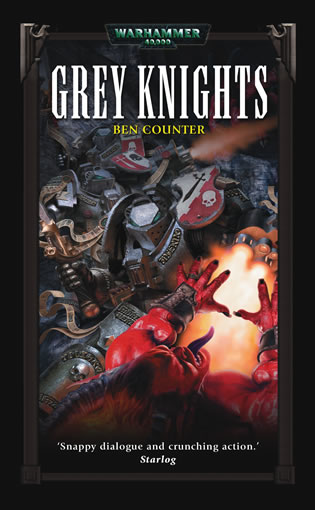
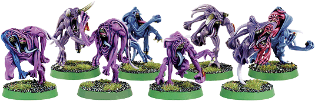
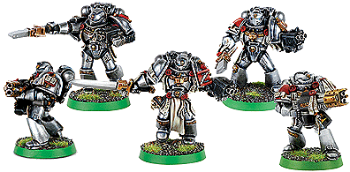
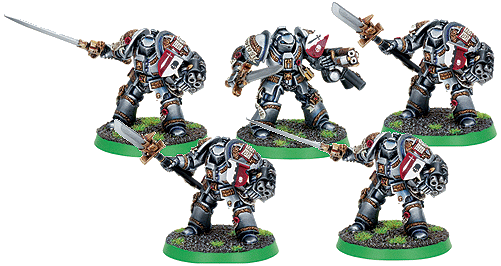

# 【說故事】灰騎士(Grey Knights)

> ADAN

这个故事是GW官方的闇黑图书馆(BlackLibrary)出的小说

在数百年前当时的一位灰骑士大导师(Grnad
Master)跟一只辛烈治的上等恶魔恶战后，将他击杀...送回了CHAOS的WARP空间，而没办法在回到现实的宇宙中...
虽然这只上等恶魔无法在现实宇宙中作乱...但是... 辛烈治可怕之处在于...他是世界的窜改者! 所以这只辛烈治恶魔在无法碰触的恐惧之眼(Eye of Terror)中... 开始筹划他将要再降临现实宇宙的计划... 而当时这位大导师在斩杀这只恶魔后...作了许多防线... 阻止这个恶魔回到现实宇宙再继续扰乱世界... 但是一切的防备计划...却都掌握在这只辛烈治恶魔手中... 每道精密无比的防御计划...都变成他再回到世界的伏笔...
其中有些忠心于帝王的审判者在深入防备计划中也相对的沉浸在CHAOS的世界中... 最后终于无法抵抗CHAOS的诱惑...而变成这只辛烈治恶魔摆布的棋子... 这只辛烈志上等恶魔不只计划要回到世界...更要将当初将他斩杀的灰骑士歼灭!....
位于泰坦卫星的灰色修道院接获来自帝国审判官的命令，这只玩弄世界命运于股掌间的恶魔已经开始企划回到宇宙，要修道院派出重大兵力斩杀这只恶魔，并且特别下令要将数百年前灰骑士大导师斩杀牠的"娜米希司动力长戈(Nemesis
Force Halberd)"带来...该审判长说:只有这把圣剑能再斩杀这只恶魔....
灰色修道院出动有史以来最庞大的灰骑士圣战军团；灰骑士星舰开往审判官所说的星系前去.... 到了该星系..星舰在上空看到了当地已经聚集了数量庞大到不可思议的帝国守卫装甲军团...看起来似乎也是接获审判官命令，为了消灭这只上等恶魔前来的；但是灰骑士军团长史东感到纳闷：消灭上等恶魔不是靠数量庞大的守卫军可以做到的，但是毕竟审判者权力极大，可以调动任何数量的军队来达成有利于帝国的计划，也许这是这位审判者的行事风格吧？

灰骑士星舰据续行往审判官所说的毁坏的辛烈志神殿前去...神殿方圆数公里一片寂静...史东知道只是表面的假象，灰骑士星舰由大气层发射一发贯穿云层雷霆万钧的共振高热波，共振波冲击辛烈志神殿前方广场....马上产生炽热高温，现场如岩浆般的融化....此时空间有点扭曲，广场出现大量的辛烈志惧妖！

 辛烈志惧妖

原来这些辛烈志惧妖躲藏于WARP空间中...保护位于神殿中正在孕育重生的辛烈志上等恶魔... 史东下令全星舰所有灰骑士着装!传送至辛烈志神殿前广场....所有灰骑士毫不犹豫冲入有如海浪般排山倒海而来的辛烈志惧妖群中奋力屠杀！

 灰骑士

史东带着前大导师的圣剑与精英的灰骑士终结者群传送至神殿内部，准备将这只上等恶魔再次除去，史东传送到达神殿内部时，神殿祭坛上方漂浮着一个似有若无发出奇异光芒的巨大之蛹，蛹中孕育着胎动，依稀可见到蛹中卷区的一只巨大恶魔的身躯，史东目光一转，祭坛旁站着一位帝国审判官！就在史东看到审判官时，神殿内空间出现一丝扭曲.....办着吵杂的嘶吼声，大量辛烈志惧妖再度出现冲向史东！史东身后的终结者群冲向前去砍杀这些辛烈志惧妖，审判官回头对他说：快拿圣剑将这只恶魔给杀了吧！

 灰骑士终结者

史东没有迟疑，握住前大导师的圣剑，冲向祭坛！一剑刺穿胎动中的巨蛹！这时空间开始剧烈撼动整个神殿摇晃不已，但是奇怪的事发生了，巨蛹非但没有消失，而且从一开始的似有若无，开始慢慢显现实体，史东察觉有异，而且他心想：外面有上万的辛烈志惧妖群，这位审判官为什么能毫发无伤的进入神殿？审判官嘴叫露出一丝微笑说：成功了！这只辛烈志上等恶魔显现实体....出现在祭坛之上。

(这是个奇怪的理论，有点向正负理论...当初这只上等恶魔被大导师的圣剑砍死封回WARP空间，如果要回到世界必须被当初砍伤他的这把圣剑再砍一次...有点像拉炼拉一次开了...再拉一次就收起来了)

这时神殿外的惧妖已经被消灭而且全部消失.....只留下刚刚奋战的灰骑士们，但是灰骑士们没有喘息的机会，突然剧烈声响！炮击！灰骑士星舰紧急联络史东，刚刚的帝国守卫开始对他们展开全力炮击！

原来这些早已被污染的审判者调动了大量的帝国守卫，告诉他们，这些身穿华丽战甲的战士乃是CHAOS的信众，要尽全力消灭灰骑士...(以帝国守卫的观点...在诺大的宇宙中他们只听过"星际战士"这种特别的战士，很多帝国守卫一辈子都没见过星际战士...只有参予非常大型的战役时才能见到这些星际战士的身影{在设定上..每个星际战士战团的人数只有1000多人}更别说灰骑士了...灰骑士比起星际战士...是更稀少的军种...只有极高阶的审判者.才知道这支部队的存在)帝国守卫们只听从审判者的命令...所以毫不知情的开始对刚刚结束激烈战斗地灰骑士展开猛烈炮击，灰骑士陷入两难，因为他们不能攻击毫不知情的帝国守卫，最后一位极高阶的战斗修女修女长才发现他们攻击的目标是泰坦卫星的特殊部队灰骑士!...紧急叫停...但是已经来不及了...这些牵制之下，这只可怕的窜改者辛烈志恶魔已经完全回到世界...他能力幻法绝顶高超，身行不定，现在的灰骑士群已经无法掌握他将他制服...

眼看这个精于权谋的辛烈治恶魔就要逃走... 却被一位年老而且已经疯掉的审判者在无意间给破坏了...当时灰骑士大导师击杀此恶魔时，这位年老的审判者，还是一个很年轻的审判官，曾经目睹这场战斗...但事后他却疯了，大家都认为是因为这场战斗太过可怕..所以这位审判者才会疯掉...疯掉的他总是喃喃自语的念着一个奇怪的名字，因为所有恶魔都是有名字的...只要能叫出他的名字...这只恶魔能力就会大减甚至消失...所以灰骑士有一本经书叫做"Grimoire
of True Names"就是记载了所有上等恶魔的名字，这时史东想起这件事，对着战斗的神殿上空大喊出这个名字!... 这只身型幻化不定的辛烈志上等恶魔突然痛苦的哀嚎...形体也慢慢的显现....灰骑士群掌握机会一举将这只上等恶魔再度击杀!!...
这只恶魔一消失，在神殿上的审判官才醒来...他才发觉...自己成为了这只恶魔的棋子...
大概就是这样吧... 因为是跟GEORGE口头上的闲聊... 所以亚当加了一堆自己想象的细节 书上确实的内容可能有些出入:p

基本上辛烈志上等恶魔都以鸟头造型为主... 来由大概是考究最著名的上等恶魔--万变魔君吧....
其它辛烈志的恶魔王子大多有大量布匹与鹰翅... 传说中圣血天使的至尊基因原体--圣吉烈斯据说还是胎体时在亚空间时 应该曾遭受到辛烈志的攻击或感染... 所以圣吉烈斯是20个基因原体中唯一拥有鹰翅的人...
圣血天使至尊基因原体圣吉烈斯
顺带一提...在恶魔猎人对抗的诸多邪神中... 最常提到的都是辛烈志信仰的恶魔... 因为恶魔猎人的编制与装备都是为了克制恶魔而打造的... 所以其它信仰的恶魔以力量压制灰骑士都是无效的.... 唯有千变万化的辛烈志可以经常利用权谋与灰骑士周旋... 其中...灰骑士著名的导师--史东 跟万变魔君甚至是死对头... 因此史东遭受万变魔君永远的诅咒 所以史东有两条不利于自己的规则... 1.艰难的命运...辛烈志既然能窜改世界就能窜改史东的运气... 所以当万变魔君在场上时史东的对手可以要求史东重丢一次骰子...
2...只要史东在场上..对手可以付出相同分数招唤万变魔君...不一定限制是chaos的部队...
