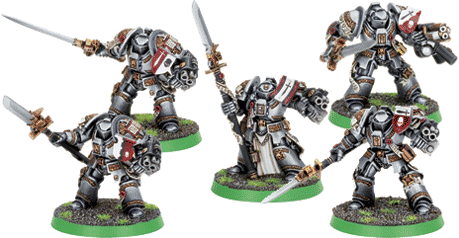

# 灰骑士概述

> 兔子半妖

星际战士中的灰骑士战团的主要职责是作为Ordo Malleus(恶魔审判庭)的战斗主力.而Ordo Malleus则是审判庭手中一支保密的精锐狩魔猎人部队.下面主要介绍战团的终结者小队和他们手中令人畏惧的"复仇女神"能量武器.

独立于其他陆战队战团的灰骑士战团掌握着大量关于恐怖的混沌势力的知识.他们是恶魔审判庭的精锐部队,他们的战斗序列是第666（和现在不一样哦，现在是66，代号666）.根据传统,灰骑士的统领也是审判团的一员.灰骑士们是帝王最虔诚的仆人,他们对那些试图颠覆帝国或者偷窃人类灵魂的敌人恨之入骨,其狂热程度堪比审判团.他们的身体接受严格训练以抗击痛苦和惊慌,他们的思想经过上千次的仪式洗礼以抵御源自亚空间的恐惧,对帝王的虔诚信仰坚定着他们的心灵.

灰骑士战团的成员都被特别地审查以排除那些强大的心能者.大部分骑士根本都不具备任何心能,这样他们就能免于恶魔的附身.然而,剩下的那些,则是极其强大的心能者,他们的心能被认为是强壮和纯净到足以抵御亚空间中的生物.这些紧握着复仇女神能量武器,包裹在战术型无畏装甲中的精锐战士甚至能对抗来自混沌势力的高阶恶魔(Blood Thirster那级的……).

上面一段也和现在的不同

灰骑士的心能者小队通常被训练以小规模的高机动性攻击部队为单位进行活动,典型的基础单位由五人构成.这些小队和必须的支援、运输单位一起被部署在帝国境内的各个战略要点,随时准备前往遭受恶魔威胁的行星.

灰骑士终结者小队可能在某个区域一呆就是十年.虽然对大部分军团来说,"家乡"不过是个遥远的记忆,可是每个灰骑士都希望自己能被安葬在自己所属的堡垒修道院中的教堂之下.

