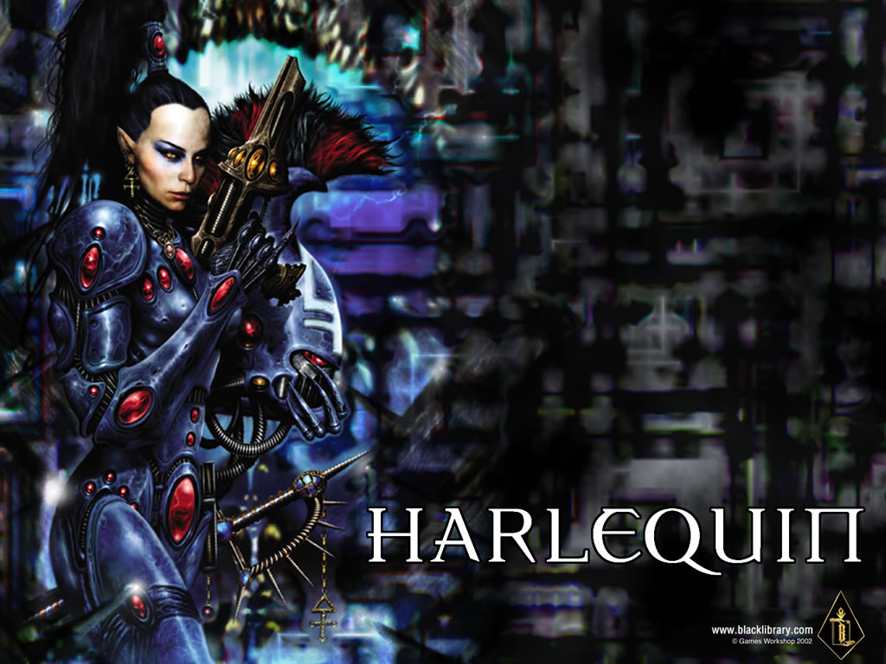

# 丑角 Harlequin

不过有一张ed的，再次看到“小丑”这个词，汗……

强烈建议楼主不要被台湾的翻译误导，harlequin在wh40000中不应该翻译成小丑，简直太侮辱harlequin ed了。这支ed在族内的工作从形式上来说是“跳舞”，但是ed历史和理念都是通过舞蹈来继承的，所以harlequin在ed里就相当于“高级知识分子”。harlequin这个词原本执西方宫廷中演节目供贵族消遣的诗人、小丑和舞者，但是在这里仅仅取其“表演者”之意，而并不带有原来的“杂耍”之意。

后来ed没落，老窝被占，ed分成了几支。其中harlequin一支因为对传统文化继承得最为彻底，同时也最为执迷于ed传统价值观念，因此她们在面对chaos的时候战斗得更加疯狂。因此我建议把harlequin翻译成“执舞者”或者“狂舞者”貌似更加贴切，也是对harlequin的尊重。 

bravo3313 丑角 Harlequin

是从前ELDAR里掌管最复杂的舞蹈和音乐的人,ELDAR的知识和力量是蕴藏在他们的舞蹈里的,所以Harlequin也是ELDAR最强的战士.

他们原本为次元通道的管理者，因为唯一存活的灵族欢笑之神西高奇(Laughing God Cegorach)的抵抗（或是说妥协），得以存活在异次元中，躲过了坠落的毁灭。也正因为如此，混沌势力无法利用异次元通道散布到宇宙去。同时,传说中蕴藏着全宇宙知识的黑图书馆

也是他们守护的~ 
