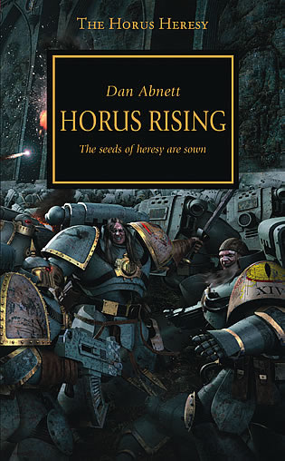
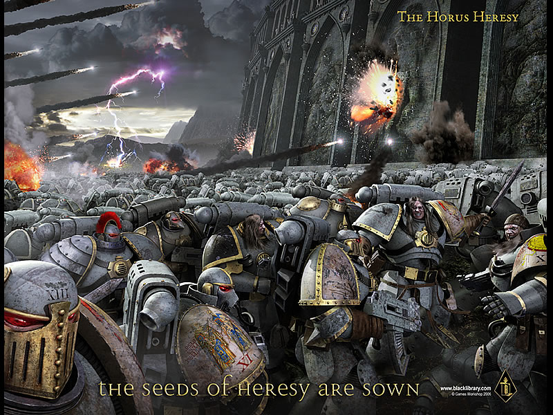
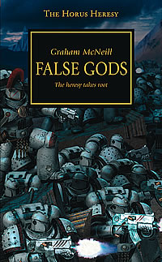
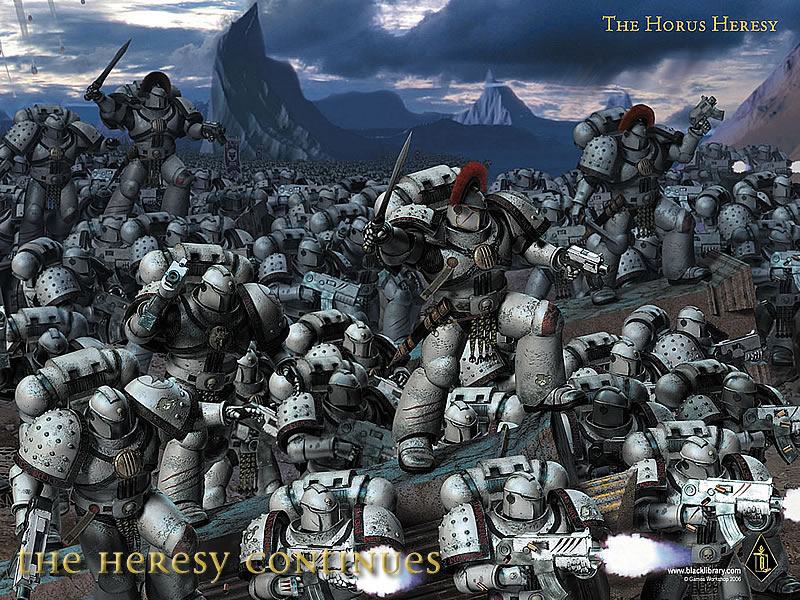
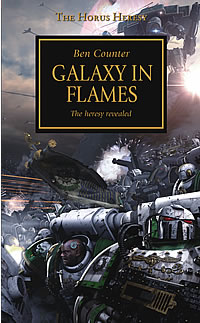
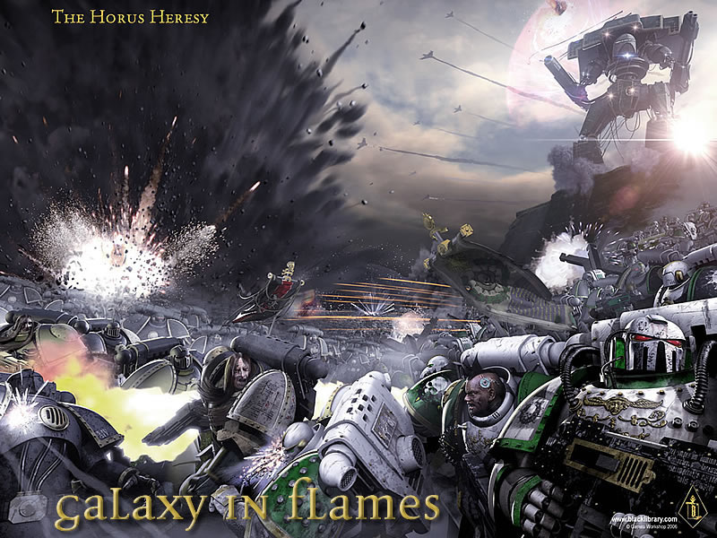
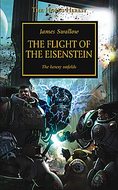
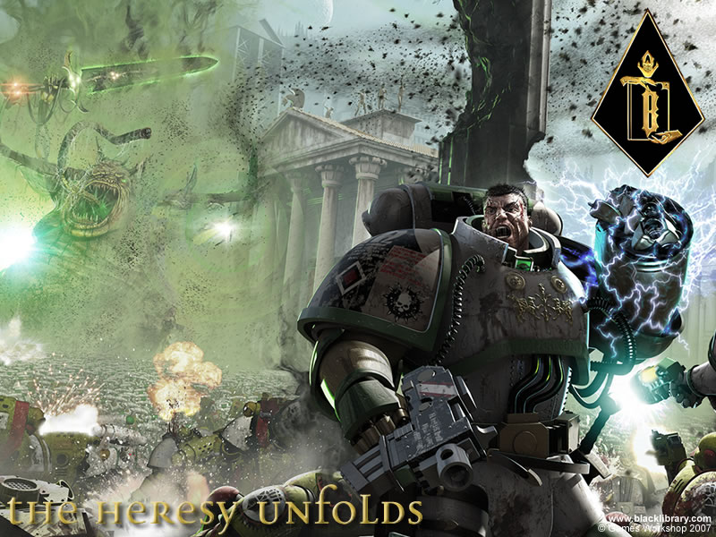
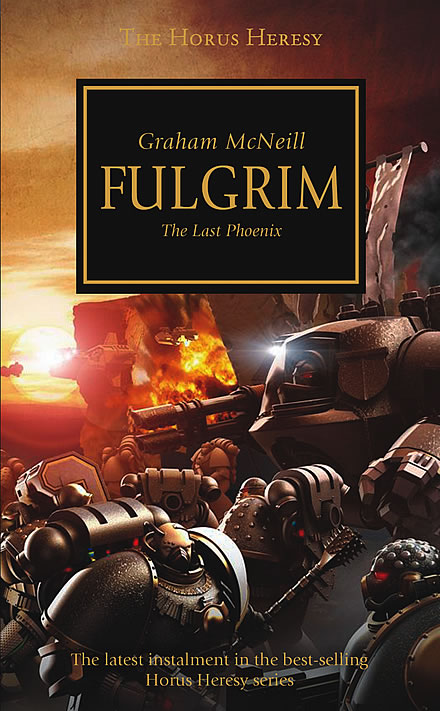

# 【新旧闻】大反乱小说系列

> boltgun
> 抽空添一下人气……

[[toc]]

## 第一部，老何的崛起

小标题——反乱的种子已经播下……

作者DAN ABNETT，是黑图书馆出版阵营里最受欢迎的作者，看到他们的新闻里称，当初黑图书馆的第一次出版，就是他的第一&amp;唯一（冈特的幽灵系列开山作），同时还有一本中古的兽人屠杀者。那时还是99年，几年过后，如今黑图书馆的第200出版次，正是他的冈特系列再版的 建军——冈特系列前几作的合集本。

大家应该对他的冈特系列有所耳闻，如果没有的话，想必也可以在40K的漫画中找到一本叫做独狼的作品，这正是他做的剧本。
而在那部漫画的结尾，我们可以发现，独狼已经有续作的计划了……
同时，还有两部已经连载完毕的40K漫画——审判官和TITAN，也是他作的剧本，最近出了一次小本的合订，再没有任何改编的消息。
另外还有两个审判官相关的系列，以及一个空战小说（双头鹰），而且确定要出接续。

这家伙的一本非40K的小说刚刚上到UK的前50，可以说这个作者还是很有实力的，也是我在40K小说作者里最看好的。

配上封面图的整张

## 第二部，伪神

小标题——反乱的根已长成

作者Graham McNeill，苏格兰人。

他是个短篇作品十分丰富的作者，长篇上则有U团相关的小说一个系列。他的作品中出现的东西都十分具有权威性，可以说这家伙写书基本不用象其他作者那样需要时时去查询资料和设定。

无它，只因这家伙同时是个六年经验的资深GW设计组成员……基本上好多设定就是他参与做的。

封面图

## 第三部，燃烧的银河

小标题——反乱初现

作者Ben Counter，同时也是漫画作家。

同样是40K系列比较重要的作家之一，连载的长篇有魂饮者军团系列（一个被误会然后除名的陆战军团），还有就是那个灰骑士系列。可以说也是BH的作者

## 第四部，艾森斯坦号的航行

小标题——公开反乱

作者James Swallow

进入40K的创作阵营时间不长——我觉得，似乎也就是DOW出来后不久。他的开山作品是关于血天使VS承言者的前后两部曲（就是有3G张开大翅膀做封面的），虽然有人埋怨过里面的人物关系和感觉跟CODEX里比有些别扭，但是我觉得他写得还是很不错的嘛。
后来还有一部关于战斗修女会的——似乎喜欢美型的FANS选择他的作品还不错。

（作品三月上市）

## 第五部，FULGRIM（注：皇帝之子军团的BOSS）

小标题——最后的凤凰

作者，还是写第二部（伪神）的那人。
看标题应该是主要关于F是如何转变的。但根据已知资料，可怜的老F是几个原体里唯一一个被体内的恶魔反噬，失去了自我的一个。在那个作为陷阱的战场上，他面对自己昔日的兄弟，无法下手，正是这时，他体内的恶魔取代了他的意志，占据了他的精神，从此只有恶魔F，而皇帝之子的F一去不复返。
可能，这就是标题里那个凤凰的来历吧。只是重生的凤凰已经成为了恶魔。
（出版日期未宣布）
