---
title: 帝国装甲1 帝国坦克和炮兵1
prev: ../gods.md
next: ./imperial-guard-and-navy-2.md
---

# 帝国装甲1 帝国坦克和炮兵1

> 作者：cybercore/PerfectBlue

为了让各位同好更好的了解战锤40k的背景,今天开始,鄙人将正式开始翻译从Game Work shop发行的战锤桌面游戏规则书 Imperial Armor - Vol 1 Imperial Guard & Imperial Navy 卷中节选的关于该游戏载具部分的介绍,以期让各位朋友们对帝国军的装甲有一个系统,详细的了解.(Vol 1介绍的是帝国防卫军IG,以及帝国海军的部分装备)

我所翻译的文字,以及之前的Tyranid的故事都得到了DOW联盟,以及战锤群的各位朋友的大力支持,在这里要特别感谢Bravo,Crane,HellRack,HOI,小狼,小麦等几位朋友所给予我的帮助和指导,谢谢你们. 

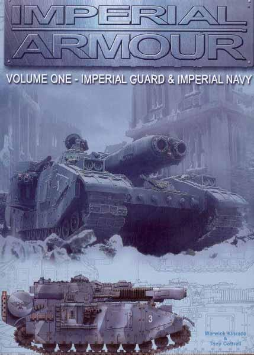

## 第一部分 概述

什么是STC技术?谈到人类帝国的车辆,大家可能都听过STC这个东东了,下面还是介绍一下吧.
在遥远的数千年前,人类终于有了向宇宙中拓展的力量,于是就有了探索,在遥远的星球上建立殖民地,直面陌生的外星文明...对于人类来说,这是一个技术进步和科学探索的黄金时代,甚至40000年以后的人类还在使用那些在黄金时代就已成形的科技.而在科技的帮助下,很可能有一个时代内,人类了解许多技术的根本原理,而且人类这一种族强盛的发展,使得他们统一了银河系.

而这个最为强盛的时代,后世则称之为科技的黑暗时代,除了40000年以后的学识最为出众的少数智者以外,被大多数人所忘却,留下的只是一个神秘的过去,一个充满了传奇的时代.

黑暗时代中,流传最为广泛,最为人所称道的一个传奇就是标准化建造规范(Standard Template Construction,简称STC),这是人类向外殖民过程中针对新殖民地环境和原料有异与地球标准,以及科技资料缺乏造成的社会退化化这样的情况,开发出的一套"万能"科技库,将一切所需科技标准化,模版化,只要有STC的存在,就可以在任何环境下使用任何原料生产人类社会的所需(摘自Boltgun朋友的Landraider介绍)

而在黑暗时代之后的冲突时代中,人类卷入了一系列的可怕战争之中,这些完美的技术结晶就相继的失落,或掩埋在战火的废墟中,至于仍然存在的,有一部分也变得相当的不可靠,甚至还有许多殖民者将其改造的面目全非以满足自己的需要,很长的时间里,STC技术已经完全被人们所遗忘.

当然也有很多的依靠STC技术所创造出来的东西被继承保存了下来,而40000年以后的人们,经过很长的时间,已经遗忘了STC技术的本源,以及创造它们所需要的知识,人类的认知只能停滞不前,帝国唯一能做的事只是依靠仅存的STC复制很久以前存在过的东西罢了

## 第二部分 车辆介绍

说到帝国防卫军的装甲力量,所有人首先想到的肯定就是Leman Russ主战坦克.以号称最忠于帝王的著名的帝国海军陆战队(Space Marine又译作星际战士)领袖的名字所命名的Leman Russ是帝国力量内装备数量最多的坦克,在帝国的各个铸造世界上被大量的生产后,配发到帝国防卫军,以及各个星球的防御部队的手中,形成了各个部队有力的中坚力量,这种坦克可以当之无愧的称之为帝国军队的中流砥柱.

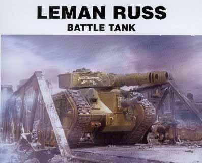

Leman Russ坦克并不是一种复杂的车辆,而且也没有什么先进的火控系统和控制装置,靠着它粗犷的设计,和可靠的性能,它能挺过大多数的激烈战斗,从空气稀薄的高山,泥泞的沼泽到寒冷的极地以及酷热的沙漠.不管穿过漫天的雪幕,肆虐的砂暴,还是茂密的丛林,Leman Russ总是一如既往的前进,它能克服所有大自然所能创造出来的最恶劣的条件坚持战斗.

虽然和帝国那庞大的武器库里的其他装备比较起来,Leman Russ显得缓慢而笨拙,但是,它的发动机却能使用任何你能收集到的燃料,而且车辆的副武器,电子系统以及生命维持系统全部由车辆的内部发电机提供电力.

它的车体和炮塔是由强化的成形钢构件以并不精密的工艺组装起来的,却足以防御敌人的子弹和大部分武器的射击,车辆的装甲主要集中在车体正面,而车体侧面和背后的装甲就相对较薄.这样的头重脚轻的设计可以使发动机在工作时避免过热以及过度疲劳损坏变速箱.

由于这种坦克极易制造,所以各个铸造世界所采用的材料也不尽相同,更使得这种坦克非常的容易进行改造,因此在过去的漫长时间里也有许多变形车的出现,而且它的车体和炮塔也经常的被移做他用.

Leman Russ的车辆乘员通常为四人,如果加装了车体左右两侧的近距离防御Bolter机枪塔则为六人,基于该车简单易用的设计,即使是新手,不用经过战场的锤炼也很容易掌握驾驶技巧.至于车内环境则基本没有舒适性可言了,狭窄,燥热而且充满了噪音,车辆乘员之间的通信基本靠车载的通信设备来完成.

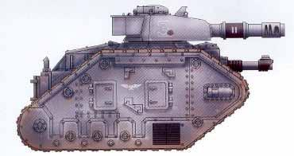

上图就是一辆标准的Leman Russ,隶属帝国防卫军Phyressian第14装甲团,炮塔上的数字3标明这是第三连的坦克.而炮管上的罗马数字II则代表这辆车来自第二中队

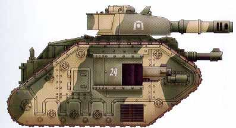

而上图的Leman Russ则隶属卡迪安防卫军第8团,车辆上的迷彩涂装源自卡迪安保卫战,请注意炮塔侧面特殊的"卡迪安之门"标志,以及车体侧面加装的Bolter机枪塔(车体左右各一)

最后介绍一下Leman Russ的几种常见队形

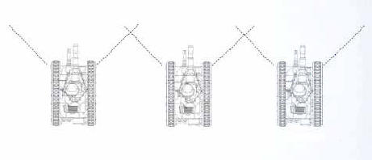

这种阵形一般用于战线防御或者作为其他中队推进时的观测掩护队形.以期发挥其最大的正面火力而完全不考虑侧翼.

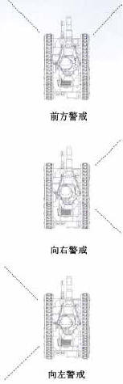

在通过密集地形的时候通常使用的行军队形,队伍的前方,及左,右翼均有车辆警戒,保证了车队的行军速度,一旦和敌军遭遇,而且在地形允许的情况下,车队很快会展开成横队(另外,头车和尾车的位置一般是小队中的车辆轮流担当,负责左右的车辆位置也会视情况而定,一般的来说,小队指挥官的车辆最好的位置是处于车队的中心,而实际上,很多指挥官喜欢让自己的座车处于领队的位置)

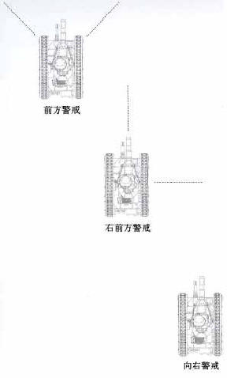

这个队形的侧翼拥有最强的火力,而正前方火力则较弱,这种队形用于保护一个大规模阵形的侧翼(通常是一个团甚至一个旅)通常的情况下,连级的部队在开阔地带推进时也会使用这种队形,或者左梯队(和这种队形的位置刚好相反)又或者是一线推进.而团级部队的阵形中,只有处于最左侧和最右侧的小队会组成这种队形

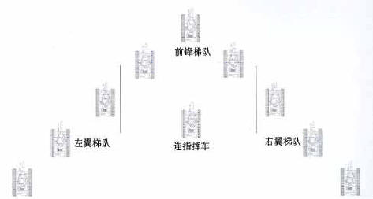

上面这个队形就是连一级的楔形阵形的示意图,而实际上,许多的帝国防卫军指挥官和政委都偏好于加入处于前锋位置的进攻梯队,而火炮和坦克歼击车一类的车辆,一般的指挥官会安排在连指挥车的位置,当然也有将这些车辆单独组成队伍独立运用,对进攻车辆进行支援的情况,另外,队伍中如果编有机械化步兵,他们的运兵车则会被保护在队伍的中央

Leman Russ 性能诸元

- 乘员: 4-6人 车长,炮手,驾驶员,装填手,左右Bolter射手(可选)
- 重量: 60吨
- 车体长度: 7.08米
- 车体宽度: 4.86米
- 车体高度: 4.42米
- 最小转弯半径: 0.45米
- 最高公路行驶速度: 35千米/小时
- 最高越野行驶速度: 21千米/小时
- 主要武装: 突击火炮X1(备弹40发) Bolter机枪(备弹600发)/激光炮X1(弹药无限)
- 副武装: 外挂炮塔Bolter机枪X2 (每部机枪600发)
- 主炮射角: -8至+22度 炮塔360度旋转
- 部分区域装甲厚度: 
    * 炮塔正面 200mm
    * 车体上部 180mm
    * 车体侧面 150mm
    * 火炮防盾 100mm

今天不知道为什么一直连接不上,就偷懒一下吧,介绍一下Leman Russ的几种常见的变形车好了.

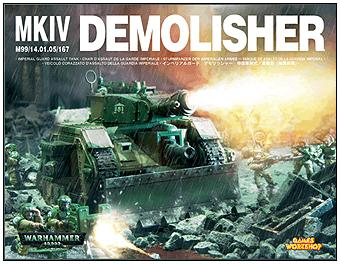

Leman Russ在战场上最常见的变形车就是上图所示的Leman Russ Demolisher了,去掉炮塔上通常装备的突击火炮而改装了一门毁灭者攻坚炮,其他特征和标准Leman Russ完全没有区别,由于改装了火炮且增强了装甲,车辆最高行驶速度有所下降,该型车主要用于前沿步兵支援,破坏敌方工事,属于突击炮或者攻坚坦克的性质

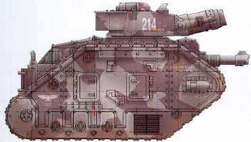

上图为一辆标准的Leman Russ Demolisher,隶属Kovnian"黑骑士"第1装甲团,这辆坦克用的是标准的城市战涂装,注意车体侧面写有该车的名字:专横的胜利者(Imperious Victor)

Leman Russ Demolisher 性能诸元:

- 乘员: 4-6人 车长,炮手,驾驶员,装填手,左右Bolter射手(可选)
- 重量: 62吨
- 车体长度: 7.08米
- 车体宽度: 4.86米
- 车体高度: 4.42米
- 最小转弯半径: 0.45米
- 最高公路行驶速度: 28千米/小时
- 最高越野行驶速度: 17千米/小时
- 主要武装: 毁灭者火炮X1(备弹25发) Bolter机枪(备弹600发)/激光炮X1(弹药无限)
- 副武装: 外挂炮塔Bolter机枪X2 (每部机枪600发)
- 主炮射角: -8至+22度 炮塔360度旋转
- 部分区域装甲厚度: 
    * 炮塔正面 200mm
    * 车体上部 200mm 
    * 车体侧面 180mm
    * 火炮防盾 120mm

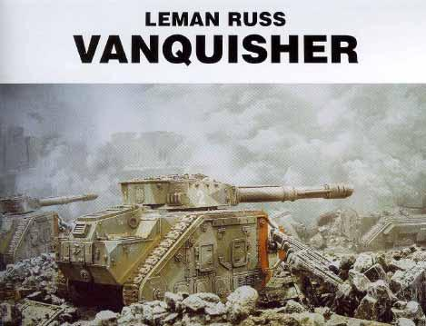

然后让我们来看看一种更加复杂的型号,Leman Russ Vanquisher.这种Leman Russ改型以它所装备的火炮而得名. 

因为这种坦克装备的"粉碎者"火炮近乎完美的设计以及复杂的弹药工作原理,基本上,它所发射的弹药可以穿透任何已知的装甲,甚至泰坦那坚实的装甲,都能被击穿.

由于这种坦克的长身管火炮在制造的时候需要相当完善和精密的工艺,因此,在制造这种火炮的铸造世界Tigrus星球被兽人攻陷以后,这种车辆在帝国军队中变得相当的稀少和珍贵,只有历经战火考验的老资格车组才可能配发这种宝贵的坦克.

当然帝国的技术总部,机械神教一直在尽力尝试在几个指定的铸造世界复制这项宝贵的技术,在克服了许多困难之后,最后只有Gryphonne IV和Stygies VIII这两个星球相继成功的复制了这种坦克.

和Gryphonne IV版本相比,Stygies VIII生产的Vanquisher火炮身管长度略微缩短,膛口初速也略低一些,因此他们缩小了弹药口径并且取消了膛线,甚至设计了精密的减震设备来降低每次火炮发射的后坐力和震动.不过在实际使用报告中发现,虽然改用滑膛炮的设计确实提高了首发命中的精度,但是连续击发射击的精度却没有在减震系统的帮助下得到提高.

有幸装备Vanquisher坦克的帝国防卫军部队对这种坦克给予了极高的评价,它的高命中率,超长射程以及惊人的首发必杀率使得它成为许多指挥官布置反坦克任务时的不二选择,而且帝国的敌人们似乎也意识到了这一点,这使得Vanquisher在战场上出现时总是成为许多敌方坦克和重型火力的优先攻击目标.

在Gryphonne IV和Stygies VIII缓慢的生产下,一些帝国的部队已经进行了少量装备,可以预见,这种坦克的装备数量应该会越来越多.

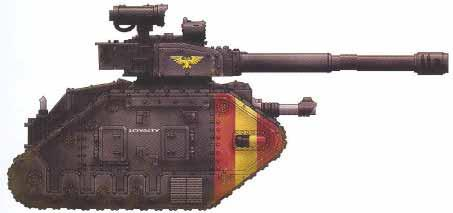

这是一辆标准的Gryphonne IV版本的Vanquisher,少见的黑色涂装标明这是一辆政委坦克,车体上没有识别数字,漆于车体上的该车名字:忠诚(Loyalty),标明这辆车属于第76装甲战斗团(76th Krieg Armoured Regiment)臭名昭著的政委康斯坦丁.加里科.注意炮塔上的金色鹰饰.通常政委的座车可以是任何颜色的,但是大多数帝国政委都偏爱黑色.

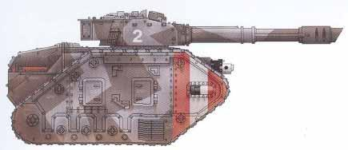

这辆坦克就是Stygies VIII版本的了,而且它使用的是相对其他底盘稍大一些的火星基地版本,这辆车隶属于卡迪安防卫军142装甲团,使用的是第十三次卡迪安保卫战的涂装,红色和白色的条纹表示该车来自该团1连,至于炮塔上的数字标明的是中队或者车辆编号就不清楚了.注意该车的车体武器并不是激光炮,而是一挺Bolter机枪

Leman Russ Vanquisher 性能诸元: (Stygies VIII版本)

- 乘员: 4-6人 车长,炮手,驾驶员,装填手,左右Bolter射手(可选)
- 重量: 63吨
- 车体长度: 7.08米
- 车体宽度: 4.86米
- 车体高度: 4.42米
- 最小转弯半径: 0.45米
- 最高公路行驶速度: 32千米/小时
- 最高越野行驶速度: 19千米/小时
- 主要武装: 粉碎者火炮X1(备弹28发) Bolter机枪(备弹600发)/激光炮X1(弹药无限)
- 副武装: 外挂炮塔Bolter机枪X2 (每部机枪600发)
- 主炮射角: -8至+25度 炮塔360度旋转
- 部分区域装甲厚度:
    * 炮塔正面 200mm
    * 车体上部 180mm
    * 车体侧面 150mm
    * 火炮防盾 100mm

Leman Russ Vanquisher 性能诸元: (Gryphonne IV版本)

- 乘员: 4-6人 车长,炮手,驾驶员,装填手,左右Bolter射手(可选)
- 重量: 63.5吨
- 车体长度: 7.08米
- 车体宽度: 4.86米
- 车体高度: 4.42米
- 最小转弯半径: 0.45米
- 最高公路行驶速度: 30千米/小时
- 最高越野行驶速度: 18千米/小时
- 主要武装: 粉碎者火炮X1(备弹28发) Bolter机枪(备弹600发)/激光炮X1(弹药无限)
- 副武装: 外挂炮塔Bolter机枪X2 (每部机枪600发)
- 主炮射角: -8至+25度 炮塔360度旋转
- 部分区域装甲厚度:
    * 炮塔正面 200mm
    * 车体上部 180mm
    * 车体侧面 150mm
    * 火炮防盾 100mm

由于还有数种Leman Russ的变形车,下面我就简单的进行介绍,详细数据不再赘述,如果有必要,我会在日后的更新中予以补充

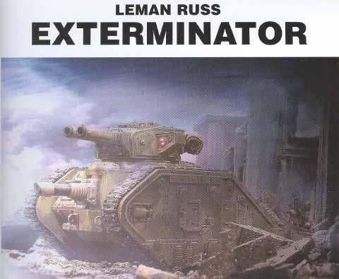

帝国防卫军中相当普遍的一种变形车,炮塔换装双联装机炮,配合车体上增加的Bolter机枪,牺牲了反装甲能力来提高攻击软目标的能力,车身重量的减轻使得最高车速略有增加,因此也常用于侦察任务,而且其极高的射速也能够填补防空武器射击时的火力间歇.

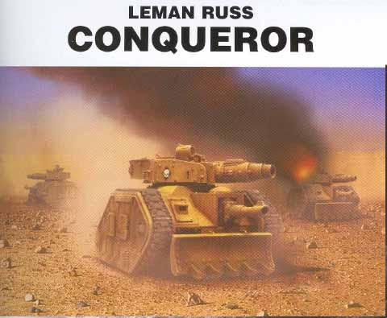

铸造世界Gryphonne IV独有的变形车,大量装备了该星球的Skitarii军团,在原车的基础上更换了口径略小的主炮,一定程度上提高了射击精度,从而也减轻了装填手的工作负担,因此射击速度也有提高,并且增加了车辆的弹药基数,省下的重量改进了车辆的三防系统,加厚了炮塔前部装甲,而且还加装了一挺同轴Bolter机枪.
他们所作出的改造在战斗中被证明是相当出色的,由于弹药基数和装甲的增加,车辆的生存能力和自持力也有一定提高,所以该车也经常用于对敌方战线的强行穿插.

嘿嘿,有没有细心的朋友发现呢?Gryphonne IV就是在第三次虫族入侵时被虫子连泰坦加Skitarii一起撕得粉碎的铸造世界,如果你没有看过,去置顶帖里找找吧~~~

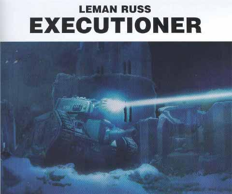

这是一种最早的的Leman Russ变形车之一,随着历史的推移,许多的强大的科技被人们慢慢的遗忘,比如等离子技术.

而Ryza是目前仅存的一个还保有等离子武器生产技术的铸造世界了,所以这种坦克被大量装备了Ryza的Skitarii部队,而帝国的其他部队拥有该车的数量则寥寥无几.

由于技术的缺失,Ryza的科技神甫们也仅仅是复制这种坦克而无法对其作任何真正意义上的改进,使得这种坦克在战斗中显得非常的不稳定,战场上的回馈情况反映这种坦克虽然火力非常强大,但是它的光子燃料电池却无法在战斗中长时间的为武器提供充足的能量,而为电池充电的漫长时间则很容易让指挥官们在激烈的战斗中错过宝贵的战机.

虽然该车在设计中就对乘员设置了双重的保护层,并且车体后部还加装了一个紧急制冷液柜,通过炮塔顶部的两根导管直通主炮.但是实际情况中,一旦出现等离子炮过热的情况,2000度的高温很快就会令车辆发生爆炸,至于紧急制冷液,裸露在外的导管往往在激烈的战斗中很快就会被敌人的轻武器所击伤,完全起不到应有的作用.因此,许多新手在车辆有"出现故障的迹象"的时候便会弃车逃跑,当然,如果有人想弃车而被发现的话,整个车组都要受到军队政委的严厉惩罚.

所以这种坦克在帝国防卫军里面并不受欢迎,多数装备了这种坦克的部队在作战之前都会有五花八门的古老迷信活动来为他们的主炮"赐福".许多老兵则更加愿意使用已经挺过了好几次战斗或者测试的旧炮,而不是新的.这些开这这种坦克历经沙场的老兵们总是乐意被别人说成是"有勇无谋的家伙"或者"疯子",当然,他们也用自己的行动证明了这点.

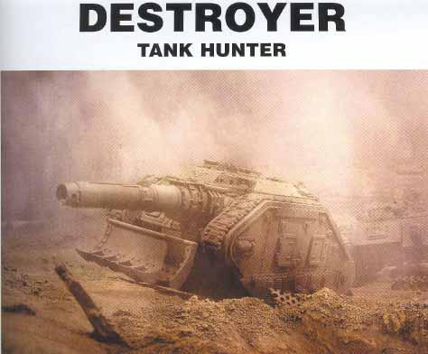

这是一种非常精致的坦克歼击车,曾经被帝国防卫军大量装备,而现在却非常的罕见,而且装备数量还在继续减少.

在它所使用的量产型的Leman Russ底盘上,装备了一门相当优秀的长程激光炮,而这种火炮,在技术大量流失的今天,只有少数的几个铸造世界才能制作,依靠顶级技术神甫们的手工打造和精密的校准,它的命中率也达到了极高的水准.

目前这种车辆只配属特殊建制的反坦克小队,而团级单位能够得到一个小队的这种坦克支援,那就是非常幸运的事情了,而且一旦出现战损,抢救可以修复的此类车辆则必定会成为指挥官的首要目标,即使火炮无法修复,而车体仍然可用的话,一般的情况都会为它装备一门其他的火炮,如Leman Russ的突击炮,或者毁灭者(Demolisher)火炮,甚至有安装粉碎者(Vanquisher)火炮的情况,因此,这种车有很多战地临时改装的型号也并不奇怪.

该车低矮的外形使它成为一种非常优秀的防御武器,通常指挥官会将其部署在想定的伏击阵地上,敌军坦克进入其最大射程后,小队会进行一次2-3发的急促射,然后在敌人发现伏击阵地并开火反制之前迅速转移.这种战术被证明非常的有效,所以装备有该型车的小队总是拥有着所属单位中最高的敌坦克击毁数.

这种车在进攻战上的优势并不明显,没有可以转动的炮塔和行之有效的副武器使得它在对付步兵时总是力不从心,因此进攻作战时,明智的指挥官一般都会安排它们扮演火力支援的角色.

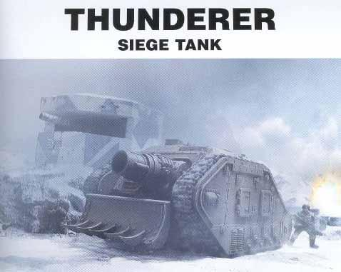

Destoryer的一种典型的战场改型,基于Destroyer火炮基本不可能在战场上修复的特性,手头缺少街巷战车辆的指挥官们就考虑给失去火炮的Destroyer加装一门攻坚炮,强化了车体的装甲,再次投入到战场中去.由于车辆内部空间的问题,改装后的Thunderer只能携带18发弹药,这种硕大的炮弹虽然没有什么精确度可言,但是在近战中其单发能够摧毁一座建筑物或者一辆敌军坦克的威力还是不容忽视的,至少作为一种填补空缺的近战车辆,Thunderer的能力得到了充分的发挥.

今天好冷啊,吃饭完毕下班回来,好戏来了,大家擦亮眼睛吧,多炮塔的粉丝们赶快看过来了...下面介绍的就是帝国的骄傲- 超重型坦克,首先介绍的是,出现在战锤40000:冬季攻势里面的移动堡垒

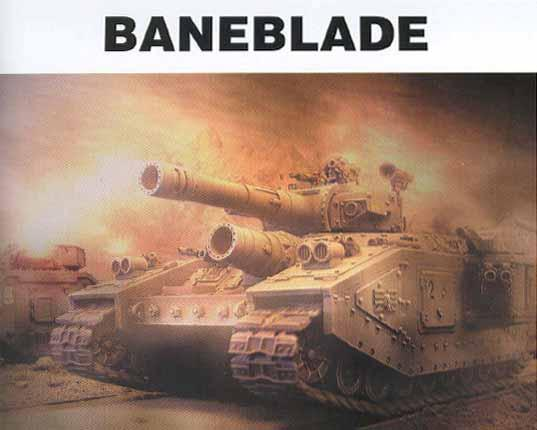

BaneBlade(帝王毒刃)和它的改型几乎可以称得上是还在使用中的最古老的帝国坦克之一,在神奇的STC技术的缔造下,这种外形庞大,装甲厚重而且火力凶猛的移动要塞可以当之无愧的获得"皇帝的骄傲"的美称.在制造这种庞然大物的过程中还使用到了许多几乎失传的精密上古科技设备及技术,鉴于科技流失严重,这些宝贵的STC数据也仅仅由屈指可数的几个受到机械神眷顾的铸造世界分别掌管,所以除了几个幸运的铸造世界以外,大部分的BaneBlade是直接由帝国科技的心脏,机械神教的总部 - 火星制造的.

据一些学者称,在过去,曾经有许多整个的师级编制的这种坦克在皇帝的麾下服役.而如今,一个军级编制的帝国部队能配发到三辆编制的一个BaneBlade小队就非常的罕见了.通常,幸运的部队会得到一辆BaneBlade宝贵的支援.这是因为由于这样强大的移动堡垒出现在战场上以后,除了它巨大的破坏力和生存能力以外,看到这样的钢铁巨兽能够和自己并肩战斗,对于士兵们作战的士气也是一个极大的鼓舞.所以,关于配发这种坦克的声音总是源源不断,而要提高生产数量或者速度则因为工艺的绝对复杂,几乎是完全不可能的.

基于以上的原因,过去的数千年来,所谓的BaneBlade的"赝品"也有所增加.这些后来生产出来的坦克,在那些急于得到大宗的军队订单和贸易保护协定的铸造世界被一辆一辆的开下生产线,而这些产品,并不像火星基地或者另外几个优秀的铸造世界一样,集成了所有能够集成上车的STC技术.

比较典型的例子就是,真正的BaneBlade使用的炮弹都是威力强大的火箭全膛增程底排弹;而所谓的"第二代BaneBlade"(火星基地的技术神甫对于这些仿造品的称呼)使用的则是普通的大口径炮弹.另外,真正的BaneBlade在车体上安置的那一门悉心调整过的改良型毁灭者(Demolisher)攻坚炮能够在车辆行进时进行真正精确而极具毁灭性的攻击(译注:该炮使用的也是火箭增程底排弹,通常的攻坚炮在150-200米开外就没有精确这个说法了);而那些"第二代产品"往往是装个一门普通攻坚炮或者干脆装一门Leman Russ的突击火炮了事.除了以上这些区别以外,真正的BaneBlade的即便是内部车体构架也经过数道特殊的强化和装甲化工艺,同时它还有着更强大的发动机,更有效率的变速箱,更先进的通讯系统以及战场数据引擎,即使是所有的备用系统,也远比那些所谓的第二代产品优秀的多.

这种情况之下,很多指挥官可能会觉得无所适从,不过有一个确定方法能够让指挥官鉴定自己麾下的BaneBlade是否为原装正货-在每一辆使用真正的STC技术制造的BaneBlade组装完毕,而且经过机械神的赐福以后,都会在火星的技术神殿内留下该车独一无二的生产编号以及车辆名字的一份档案.包括该车参加过的任何大小战斗,车组乘员名单,被击伤历史甚至中弹位置,创口的形状大小以及车辆的修复情况等,都会详实的回馈并记录到这一档案中.所以,其实每个人都能清楚的了解每一辆BaneBlade的命运,只要他明白,该去哪里寻找...

战场上比较常见的真正的BaneBlade有两种,来自铸造世界Lucius和直接来自火星大本营的,请看下面的图.

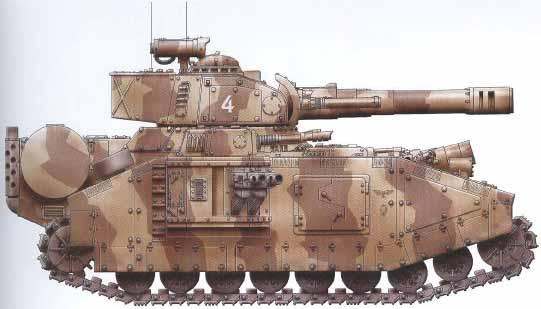

这是一辆标准的Lucius版本的BaneBlade,隶属第13重型坦克战斗连(Krieg 13th Heavy Tank Company),炮塔上的编号表明这是该连的第四辆车,车辆的沙漠涂装源于Galen V星球远征一役,这次战役中该连被编入第28装甲战斗团(Krieg's 28th Armoured Regiment)进行支援.

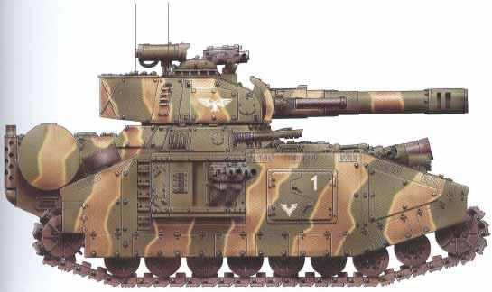

另外一辆Lucius版本的BaneBlade,这辆车来自Tekarn第11重型坦克连,车体侧面的装甲门上的数字1标志这这是该连队的1号车,而装甲门上的战役徽章则说明此车参加过Denkari小行星上的讨伐兽人战役

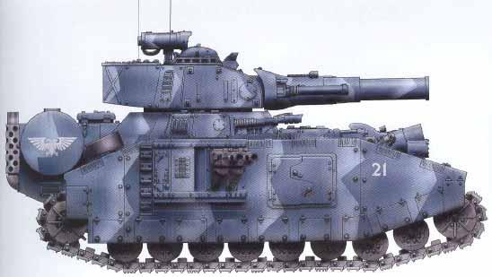

火星基地版本的BaneBlade,该车来自"忠诚的帝皇之盾"(Emperor's Loyal Shield) - 第1重型坦克战斗连(Krieg 1st Heavy Tank Company),该连下辖两个中队,此车为第二中队指挥车,这种蓝色涂装源自殖民星球Radnar的清除基因盗取者一役.

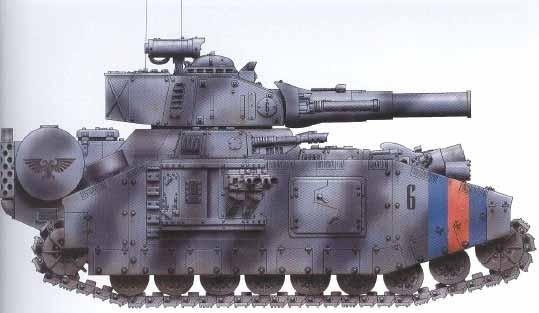

这辆火星基地版本的BaneBlade隶属卡迪安第3重型坦克团,这种城市战迷彩源自殖民星球Vogen的讨伐Khai-Zhan叛军行动,这次行动中第3团参与并掩护了卡迪安帝国防卫军122团的街巷战,这是该团的6号车.

下面再附上一张基本的重型坦克连车辆,人员以及车身编号配置,以供参考,军官职能后为该车车长军衔及姓名.(字体较小,点击图片可放大)

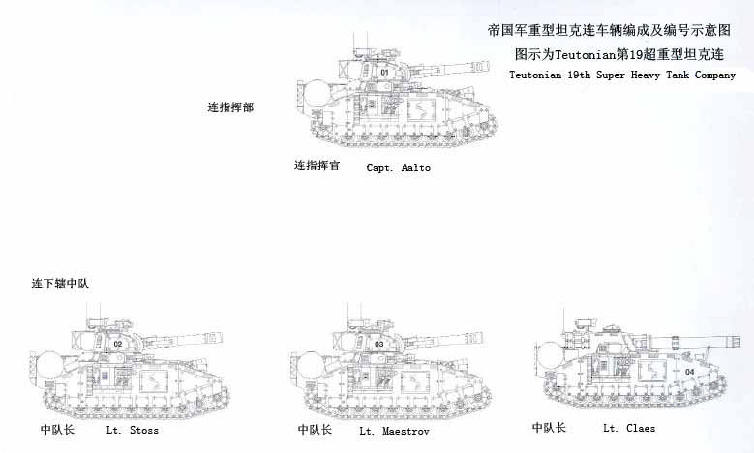

最后附上两张BaneBlade实战中的图片:

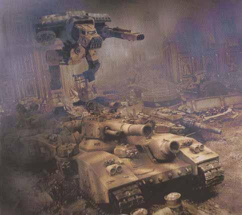

Sallan星球突击战役中被编入Valhallan第8装甲团的一辆BaneBlade,这张照片拍摄于向Sallan防御点突击之前,该车在本次战役中被摧毁,注意其身后的War Hound型泰坦

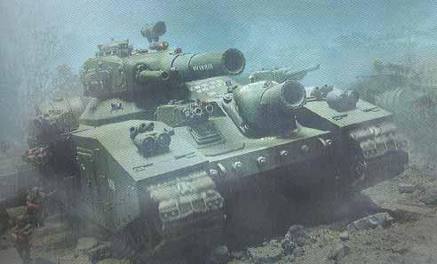

一张BaneBlade的正面特写,展示了它的庞大体积(请对比一下照片左侧的士兵)以及它所装备的大量武器,请注意其主炮和车体前部的攻坚炮炮口外沿一圈细小圆孔,这些小孔是发射火箭底排弹时的气体逃逸口,以防止燃烧的气体灌入车内.

BaneBlade 性能诸元 (Lucius版本)

- 乘员: 10人 车长,炮手(3人),驾驶员,装填手(3人),通信兵,工程师
- 重量: 319吨
- 车体长度: 13.5米
- 车体宽度: 8.4米
- 车体高度: 6.3米
- 最小转弯半径: 1.2米
- 最高公路行驶速度: 25千米/小时
- 最高越野行驶速度: 18千米/小时
- 主要武装: 增程大型火炮X1(备弹22发) 改良型毁灭者攻坚炮X1(备弹18发)
- 副武装: 炮塔同轴机炮X1(备弹300发) 激光炮X2(弹药无限) BolterX6(备弹4000发)
- 主炮射角: -2至+28度 炮塔360度旋转 攻坚炮左右共6度,无俯仰角调整
- 部分区域装甲厚度:
    * 炮塔正面 220mm
    * 车体上部 210mm
    * 车体侧面 190mm
    * 火炮防盾 180mm

BaneBlade 性能诸元 (火星基地版本)

- 乘员: 10人 车长,炮手(3人),驾驶员,装填手(3人),通信兵,工程师
- 重量: 316吨
- 车体长度: 13.5米
- 车体宽度: 8.4米
- 车体高度: 6.3米
- 最小转弯半径: 1.2米
- 最高公路行驶速度: 25千米/小时
- 最高越野行驶速度: 18千米/小时
- 主要武装: 增程大型火炮X1(备弹22发) 改良型毁灭者攻坚炮X1(备弹18发)
- 副武装: 炮塔同轴机炮X1(备弹300发) 激光炮X2(弹药无限) BolterX6(备弹4000发)
- 主炮射角: -2至+28度 炮塔360度旋转 攻坚炮左右共6度,无俯仰角调整
- 部分区域装甲厚度:
    * 炮塔正面 220mm
    * 车体上部 200mm
    * 车体侧面 180mm
    * 火炮防盾 180mm

特别注意,虽然装甲厚度数值不怎么高,但是BaneBlade用的是STC技术制造的特殊装甲,和Leman Russ的合成钢装甲自然有着天壤之别

上期我们提到了"皇帝的骄傲"-BaneBlade.如果说到了BaneBlade,那么有另外一种坦克就不得不提,这就是号称"泰坦杀手"的...

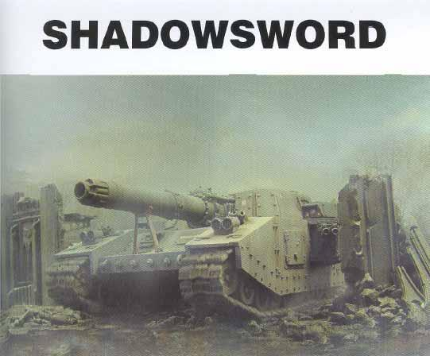

在帝国光辉的历史中,ShadowSword(帝王刃影)总是会坚定而自豪的伴随着BaneBlade(帝王毒刃)一起披荆斩棘,击垮任何敢于挑战皇帝的敌人,作为BandBlade的姐妹车型,只要有BaneBlade出现,就必定能看到ShadowSword的身影.

从ShadowSword的大部分的车体构造以及建造过程中使用的STC技术来看,它和BaneBlade非常相似,当然,ShadowSword的看家法宝也是独一无二的,它最主要的武器是架设在车体上的一门Type 22-S MkIV型"火山"超长程激光炮.由于这门炮每次发射所消耗的超大能量,所以只能由车辆所用的超级STC发动机直接充能.鉴于这个因素,每辆ShadowSword的发动机和火炮都会配有一名专职的经过特殊训练的帝国防卫军工程师,或者帝国技术神甫甚至可能是由机械神教直接派遣的教士来进行维护和操作.而且由于主炮的长度以及重量问题的限制,该车炮塔为固定式,无法旋转,只能进行小范围的微调,确保其命中精度.

当主炮进行射击时,技术神甫就会断开发动机的传动系统,将能量转接到主炮的充能设备上.来自发动机的巨大能量将会源源不断的充入贮能舱,以保证主炮的射击.而只要一次射击,就会消耗掉贮能舱里的所有能量.因此车辆在射击时,必须保持静止状态,这样车辆的射击精度也得到了一定意义上的的保证.当然,贮能舱储满以后车辆可以切换回动力以保持行动状态,如果需要再次充能,那就只能暂时停车了.

ShadowSword设计的主要目标就是造就一辆真正的泰坦歼击车,事实上它的主炮就是泰坦专用的武器,可以轻松的一发就毁掉泰坦的行动能力,加上相对完善的STC技术,所以该车也只有部分拥有强大技术实力的铸造世界才能制造.这种车主要配发那些可能在战场上遭遇敌人泰坦的帝国防卫军部队,以作为对抗敌人泰坦的一种行之有效的手段.

像它的姐妹车BaneBlade一样,由于其相当强大的作战能力,该坦克也出现了供不应求的局面,使得这种坦克的仿造品也层出不穷,那些缺乏技术力量的铸造世界常将主炮换成其他的武器,比如大型等离子炮,激光速射炮或者"第二代BaneBlade"上使用的大型突击火炮等等,车辆外部原配的遥控武器站也被改成有人操作的,而且动力部分,观瞄设备,战场计算机这些设备都有相当程度的缩水.同样,ShadowSword每部车的资料都会详细的登陆在机械神教的神殿中,以备查验.

下面还是让我们来看一下图片

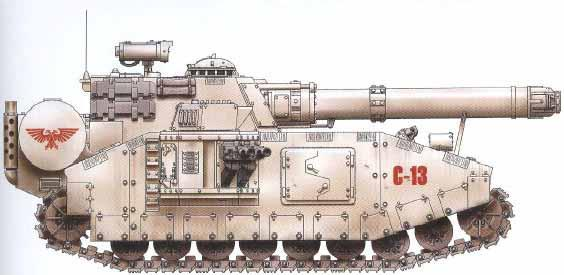

标准的火星基地生产的ShadowSword,这辆车隶属Valhallan第一重型坦克连,协同Valhallan第28装甲团进行作战任务,这是该连的三号车,它采用了和所编入团战斗单位相同的涂装和编号规则,包括车身上的识别编号和红色的双头鹰荣誉徽章.这是训练用涂装.

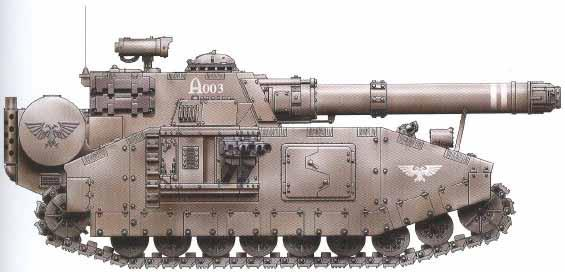

另一辆火星基地版本的ShadowSword,隶属Mordian第三重型坦克连,这是该连的三号车.(该连同时也混编了其他型号的超重型坦克,同时拥有BaneBlade ShadowSword StormBlade,以及数种变形车),请注意该车的炮管上的两道白色标志,这标明该车曾成功击毁过两部泰坦.

附上ShadowSword的内部结构简图

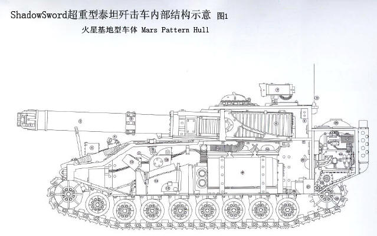

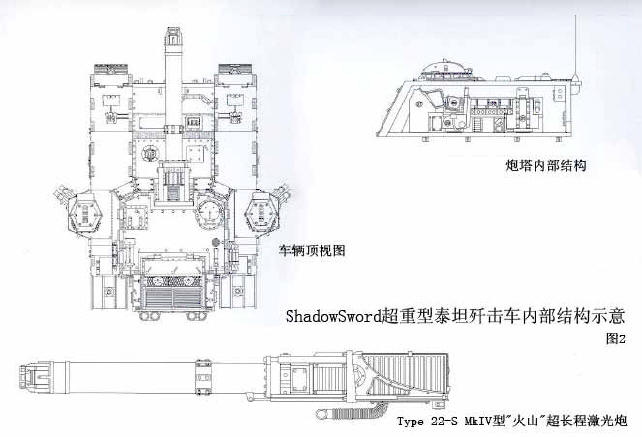

接下来是两张战场照片

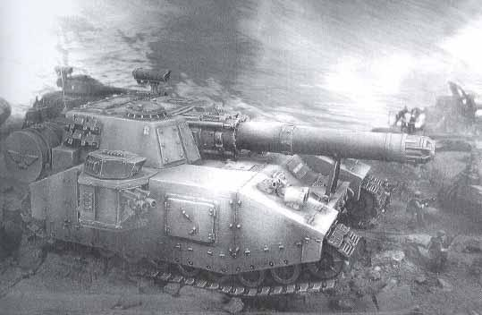

这张照片拍摄地点未知,通过此照片可以清楚的看到ShadowSword的火力配置情况,也可以观察一下车头前部协同推进的步兵和坦克的大小比例,远处正在射击的为已经展开的一个武器平台

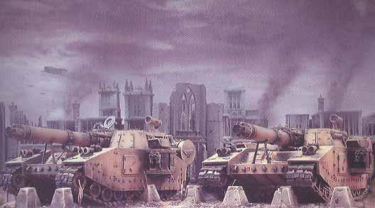

拍摄地点未知,这是一张难得一见的ShadowSword双车编队的照片

ShadowSword 性能诸元 

- 乘员: 6人 车长,主炮手,,驾驶员,遥控武器站射手,通信兵,专属工程师
- 重量: 316吨
- 车体长度: 13.5米
- 车体宽度: 8.4米
- 车体高度: 6.3米
- 最小转弯半径: 1.2米
- 最高公路行驶速度: 25千米/小时
- 最高越野行驶速度: 18千米/小时
- 主要武装: Type 22-S MkIV型"火山"超长程激光炮(弹药无限)
- 副武装: Bolter机枪X4(备弹1600发)
- 主炮射角: -2至+12度 炮塔固定,火炮可微调
- 部分区域装甲厚度:
    * 炮塔正面 220mm
    * 车体上部 220mm
    * 车体侧面 210mm
    * 火炮防盾 200mm

实践证明,半路出家并不一定就是次品,改装出来的产品也有杰作出现,这就是...

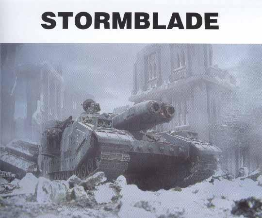

并不是所有的铸造世界都拥有制造ShadowSword所需要的完善技术,所以这些铸造世界的科技神甫们也一直在考虑着制造一种ShadowSword的替代品,来充当泰坦猎杀者的角色.他们放弃了那门极难制造的"火山"超远程激光炮,取而代之的是大型速射激光炮,大型的突击火炮或者其他的泰坦级的武器.在这些改装车辆中,有一种类型的改装相当的成功,而且在战斗中表现出色,这就是在ShadowSword底盘上安装了双联装等离子冲击炮(Plasma Blastgun)的StormBlade(风暴之刃).

StormBlade最初还是在铸造世界Ryza上被开发出来的(毕竟只有他们掌握的等离子技术比较完善).这种坦克和标准的ShadowSword相比,换装了功率略低的发动机,取消了大型贮能舱,也没有超长射程所需要的先进的观瞄系统.节省出来的重量,首先加装了几个为它的主炮充能的大型的光子电池组,其次加装的是大型的散热系统,而取消原装设备而省出来的巨大空间使得它的散热更加有效,加上对乘员额外追加的防护隔离层,这种坦克实际上比它的小兄弟Executioner更加安全可靠,也更有战斗力.另外,车体的侧面和炮塔也因此增加了额外的装甲.

即使是以上的改装,也已经使该车成为一个非常可靠的通用作战平台,而帝国的技术神甫们并没有感到满足,他们拆除了原车必须的先进观瞄设备以后,增加了两个车辆外部的遥控武器站(通常安装一门小型激光炮,车体左右各一),以及炮塔上的一挺同轴机枪,甚至还有来自于BaneBlade(帝王毒刃)的主战坦克火控系统.最后,出现在我们面前的是一辆超重型突击车.它装备的主炮,武器站,Bolter机枪涵盖了远,中,近的所有范围.虽然炮塔无法转动,但是它强大的火力,已经可以满足包括猎杀泰坦之内的大部分任务需要.

当然,作为一种变形车,它的缺点还是有的,由于使用了功率略小的发动机,而车重却丝毫没有减轻,发动机的工作负担就变得很大,所以保养这种坦克很麻烦,也比较频繁一些.而且由于换装了射程相对近一些的主炮,在对泰坦战中,坦克必须开到一个较近的距离才能发挥出和ShadowSword相似的威力,这也使得攻击泰坦变得比较危险.曾经有过为了增加StormBlade的反泰坦能力而在车体上部加装hellion导弹发射舱的例子,结果由于这种导弹威力太大而且太不可靠,在Phyressian第31重型坦克连的三辆坦克毁于导弹殉爆以后,这种改装便再也看不到了.

总的来说,作为一种通用主战坦克的话,StormBlade还是相当成功的,而且相对于它的前身ShadowSword而言,StormBlade的自卫能力和防护也强了很多.大部分的帝国指挥官都很清楚这点.

最后,让我们用一句话做个点评吧:有敌人泰坦的地方,不一定能看到StormBlade;但是有皇帝敌人的装甲部队存在的地方,它一定会出现.

附上一些车体线图

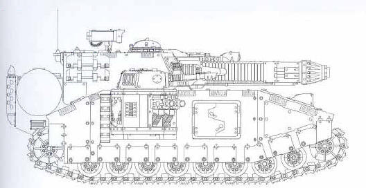

早期的Ryza版本的StormBlade,注意其主炮的样式,(可以和Ryza的Executioner做一个对比)而且这个版本和ShadowSword相比,改动还是不大.基本处于原型车状态.

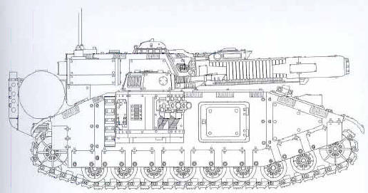

技术力量相对较强的铸造世界Lucius所制造的最终版本,目前使用的最为广泛,即便是外观,也受到帝国各方面的一致好评(嘿嘿,好像包括本论坛的一些家伙)

下面提供的是两种已经列装的Lucius版本的StormBlade的涂装方案

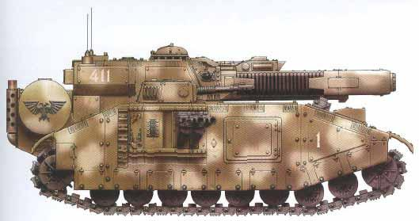

该车隶属于Sarenian第五重型坦克连,在防御Canaan星球的战役中,该连被调遣支援Valhallan第193装甲团,抵达以后就迅速编成为此团的第四个坦克连并投入到战斗中.这辆车是该连第一中队的指挥车.车体的棕色底漆上喷涂了一些白色斑纹,当时雪地战的激烈程度可见一斑.

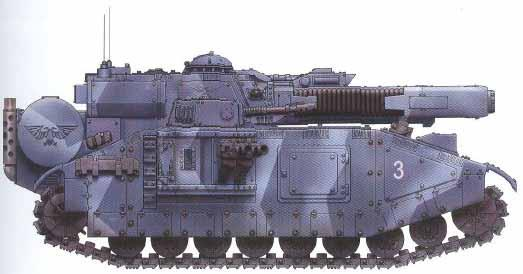

本文标题,也就是本书封面上的StormBlade,
隶属第1重型坦克战斗连,该连混编了数辆BaneBlade和StormBlade.这种蓝色涂装同样源自殖民星球Radnar的清除基因盗取者一役.

再来两张战地照片

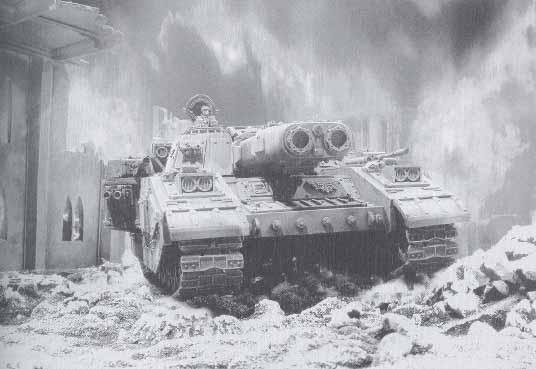

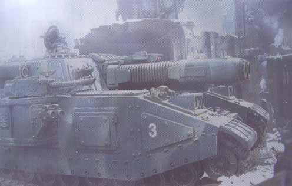

以上两张照片均来自殖民星球Radnar的清除基因盗取者一役.这场战役使得该星球大部分城市被毁,而且很多的居民因为无家可归,加上帝国军的无情镇压而倒戈相向.通过第二张照片我们可以仔细观察StormBlade的武器配置情况.

StormBlade 性能诸元 (Lucius版本)

- 乘员: 6人 车长,主炮手,,驾驶员,遥控武器站射手,通信兵,工程师
- 重量: 310吨
- 车体长度: 13.5米
- 车体宽度: 8.4米
- 车体高度: 6.3米
- 最小转弯半径: 1.2米
- 最高公路行驶速度: 25千米/小时
- 最高越野行驶速度: 18千米/小时
- 主要武装: 双联装等离子冲击炮(Plasma Blastgun) (光子电池充能,可发射16次)
- 副武装: 激光炮X2(弹药无限) Bolter机枪X4(备弹1600发)
- 主炮射角: -2至+12度 炮塔固定,火炮可微调
- 部分区域装甲厚度:
    * 炮塔正面 220mm
    * 车体上部 220mm
    * 车体侧面 210mm
    * 火炮防盾 200mm

话说新三年,旧三年,缝缝补补又三年,雷锋叔叔就是如此,那么作为帝国技术结晶的超重型坦克,如果出现了战损,修整一番,改头换面再次披挂上阵也很正常,那么下面就是...

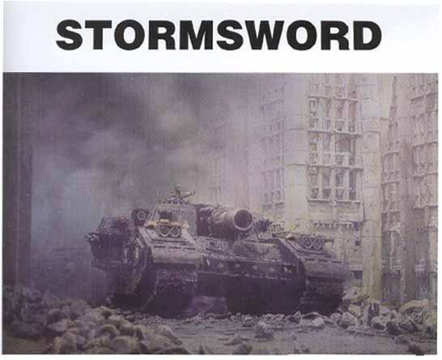

通常的说来,我们所说的StormSword(风暴之剑)都是ShadowSword和StormBlade的战场改造型号.之前的介绍中,大家也可以了解到,制造一门ShadowSword或者StormBlade的主炮是相当困难而且极度耗时的工作,所以这种武器在出现战损以后,前线上的修复是基本不可能的,当然如果底盘完好的话我想没有哪个指挥官会放弃这种集防护和火力于一身的移动要塞.于是前线的帝国技师们就将抢救回来的底盘稍加改造,拆掉已经损坏的武器,装上一些前线能找到的武器装上,一辆新的坦克出现了,那些和它并肩作战的士兵们按照之前重型坦克命名的方式,把它叫做StormSword.

看到ShadowSword,StormBlade或其他的这些倾注了自己的心血的战车被这种所谓的"非官方的前线改装"搞的面目全非,机械神教的神甫们对于总是颇有微词,他们称这种坦克是"非官方版本",而且对这些车辆大修的请求他们总是置若罔闻.当然,帝国的前线指挥官们也不吃这套,在他们眼里,切合实际才是最重要的,战场上一旦有需要,他们也总是会毫不犹豫的下令改装.

改装后的StormSword和它的两个大哥比起来,完全是颠覆原型概念的设计,它既不像ShadowSword和StormBlade那样只进行长距离精确射击,也不像BaneBlade那样是个远中近通吃的多面手.拆掉的主炮位置上装的是一门特殊的大口径攻坚火炮,而且车体遥控武器站只是保留了四挺Bolter机枪,炮塔左右通常装激光炮或者观瞄设备的地方换装了两部双联装火焰喷射器.通过以上的改装,由于攻坚火炮的射程限制,这种坦克已经完全不适合在开阔地形作战,它已经变成一个非常恐怖的街巷战移动堡垒,直接为冲锋陷阵的士兵们提供最为直接的强大火力支援.通常在城市战最为激烈的时候,这种坦克会作为突击的先导,缓慢而致命的碾过城市的废墟,敌人的工事,撞开挡路的墙壁,或者敌人的坦克.

StormSword的攻坚火炮所配备的高爆弹可以轻松的炸开任何遇到的建筑物,敌军工事,或者敌人的坦克.一般的攻坚火炮,射程都是比较近的,而像BaneBlade一样,StormSword的攻坚火炮,也配备了全膛火箭增程弹药,这样不仅打得更远,而且也更准,每当发射时,弹头就会带着180多公斤的特制炸药拖着尾焰呼啸着冲向它的牺牲品,而炮管两侧的排气道则会很快的排出炮弹发射后的大量气体,这也使得它在发射的时候相当的壮观,至于发射后产生的大量烟雾,也为后方友军的推进起到了极好的掩护作用,由于这种特制的弹药相当的巨大,即便是如此的庞大的车体,也只有20发备弹的空间,而且因为弹药相当的沉重,所以战地技师们还特地为StormSword安装了一个简单的自动扬弹机,来减轻装填手的工作负担.即便如此,StormSword的主炮射速还是很难再有提高.至于车体上安装的火焰喷射器,一般用来扫荡敌人防守的建筑物,工事或者废墟,可以逼迫敌人撤向空旷的地形,这样他们就会成为车载Bolter机枪和友军的极好目标.

从改装后的使用情况来看,StormSword已经相当出色的达到了既定的改装目标,也为这种简单改装的车辆在帝国的武器库中赢得了宝贵的一席之地.有部分铸造世界看到了这一点,他们已经开始小批量的生产这种坦克并将其投入到一系列的战斗之中了.

下面是最常见的一种StormSword的战场改型线图:

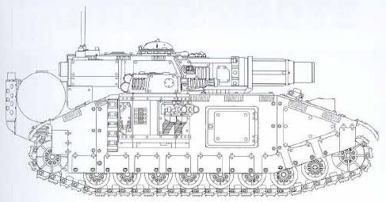

接下来让我们看看两种该车的涂装示意图:

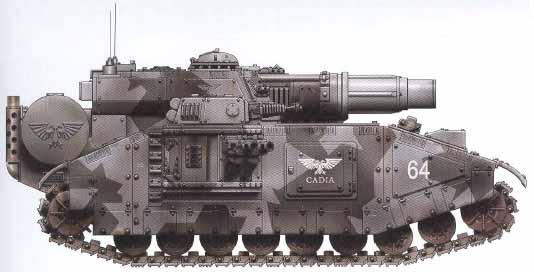

该车隶属卡迪安帝国防卫军第8重型坦克团.根据实际情况,该团的战斗序列中一般编有六辆ShadowSword,所以可以肯定这辆车应该是其中一辆战损后改装的.在第十三次卡迪安保卫战中,该团经历了真正血与火的考验.

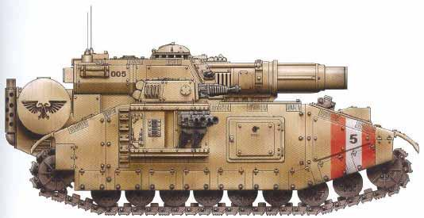

该车隶属第17Tallarn重型坦克连,此连受Tallarn第101装甲团指挥.这是该连的五号车.注意车身上的黑色鹰头荣誉徽章,这标明该车参与了101团对泪之宫殿(Palace of Tears)的第一波次突击.

最后让我们看两张战地照片:

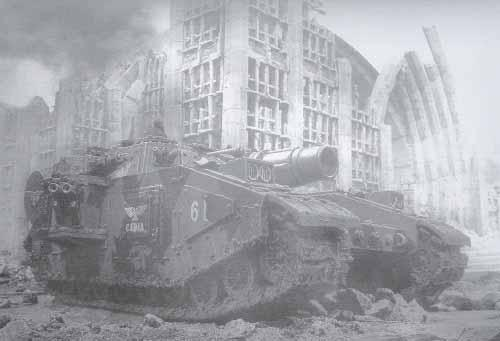

这张照片上的StormSword隶属卡迪安帝国防卫军第12重型坦克团,第六中队的一号车,从照片上看该车正在防守一座帝国神殿,该照片摄于第十三次卡迪安保卫战.

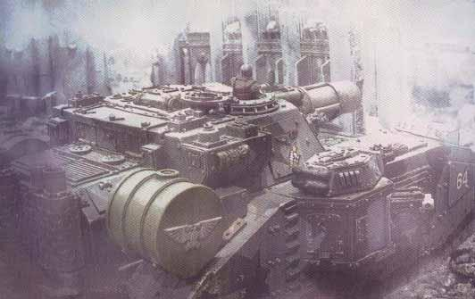

一张罕见的StormSword炮塔背面特写,我们可以清晰的观察到一些车上的细节,该照片同样拍摄于第十三次卡迪安保卫战期间.

StormSword 性能诸元 

- 乘员: 6人 车长,主炮手,,驾驶员,遥控武器站射手,通信兵,装填手
- 重量: 302吨
- 车体长度: 13.5米
- 车体宽度: 8.4米
- 车体高度: 5.85米
- 最小转弯半径: 1.2米
- 最高公路行驶速度: 25千米/小时
- 最高越野行驶速度: 18千米/小时
- 主要武装: 全膛火箭增程攻坚炮(备弹20发)
- 副武装: Bolter机枪X4(备弹2000发) 双联装火焰喷射器X2
- 主炮射角: -2至+12度 炮塔固定,火炮可微调
- 部分区域装甲厚度:
    * 炮塔正面 220mm
    * 车体上部 220mm
    * 车体侧面 210mm
    * 火炮防盾 200mm

至此,帝国的超重型坦克也基本全部介绍完毕,下面是一些轻型车辆,我只着重介绍战锤40000:冬季攻势中出现的几种,其他的就做简介略过,谢谢各位的支持,此后我将放出DOW群友O Mein Engel朋友翻译的帝国坦克英雄的战斗故事,希望各位还能多多支持
