---
title: 帝国装甲1 帝国坦克和炮兵2
prev: ./imperial-guard-and-navy-1.md
next: ./imperial-navy-aircraft.md
---

# 帝国装甲1 帝国坦克和炮兵2

新年开始,我也继续更新了...下面是一个很特别的专题,叫做

"帝国防卫军的底盘"

首先为您送上

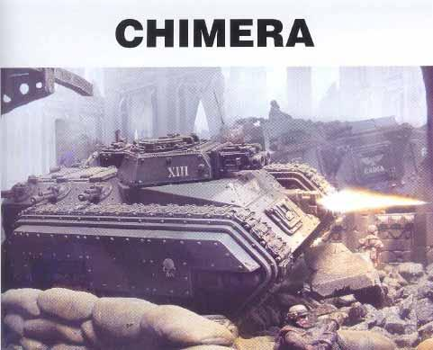

如果有人问,什么车辆在帝国防卫军的武器库中占有绝对的数量优势,那么答案肯定是Chimera(奇美拉).在黑暗时代后数千年的帝国发展史中,这种经济,简单,易于生产和维护,而且具有极高的通用性的底盘以自己的这些特色,成为了帝国防卫军士兵们身边最为可靠的战友之一.

用奇美拉底盘改装的车辆可谓是琳琅满目,从像Basilisk(石化巨蜥),Medusa(美杜莎)这类威力巨大的自行火炮,到伴随步兵们冲锋陷阵的Hellhound(地狱犬)喷火坦克,奇美拉IFV(步兵战车),甚至前线指挥车,战场维修车,装甲抢救车,装甲架桥车...凡是帝国指挥官能想到的车辆,都能找到基于奇美拉底盘的型号.因此,把它叫做"帝国防卫军的底盘"也并不为过.

今天我们首先介绍的是战场上的士兵们最坚定的战友,有着IG(帝国防卫军)出租车外号的奇美拉运兵车.其主要的武装来自于改装自由度较高的炮塔,车体前部的一挺车长用Bolter机枪和乘员舱开设的六个射击孔.

由于各个铸造世界的技术各不相同,因此即便是运兵车,也有着各不相同的改型,最常见的通常是装备有聚束激光炮,速射炮,或者双联装Bolter机枪的这三种型号.另外,用于近战当中,如果地狱犬喷火坦克数量不足的情况下,也会有简单的安装一具双联装喷火器的运兵车加入战斗,以为步兵们提供近距离的火力支援.

通常奇美拉运兵车作为一种装甲部队的伴随前进车辆,负责运送步兵安全抵达前线,以车载步兵支援坦克战斗,当然,车载的武器系统也使得它成为一个难缠的对手.虽然它很脆弱,而且火力也无法和其他帝国坦克相提并论,但是由于帝国防卫军极度的重视其步兵的机动能力,因此没有任何帝国指挥官会轻视奇美拉在战场上所起到的巨大作用,各个铸造世界所获得的大量奇美拉的订单也很好的说明了一切问题.

老规矩了,用图片说话

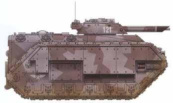

这是一辆很特别的火星基地版本的奇美拉,装备有一门聚束激光炮.该车隶属于第18装甲战斗团,参加过Barbarlus战役,从编号上来看,它来自第一铁拳装甲连二排第一小队

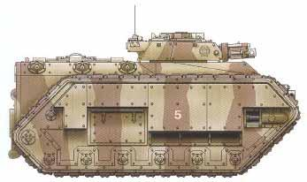

一辆标准的装备有双联装Bolter的Gryphonne IV版本奇美拉,它来自"猎头族"-Mortant第7团,该车是其所属连的第五号车

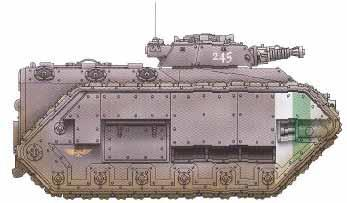

这辆奇美拉装备了一部双联装喷火器,根据车身的灰色涂装推测,该车应该隶属于Mordian第84装甲团

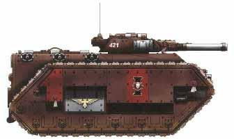

装备了一门速射炮的奇美拉,这辆车独特的涂装来看,它应该是讨异庭帝国监察官Hector Rex近卫部队Storm Trooper的专用车辆,请注意其车身上为了保护乘员和机械圣灵免受异端侵袭而加设的帝皇圣印.

附上一张Gryphonne IV版本的奇美拉的侧面剖视图

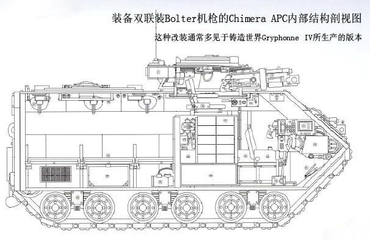

战地照片两张

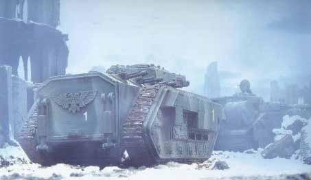

隶属第23机械化步兵战斗团的Gryphonne IV版本奇美拉,该照片摄于殖民星球Radnar的清除基因盗取者一役,请注意其车尾步兵门上的展翅的鹰徽,这个标志只授予以行动向皇帝证明自己的忠诚的部队

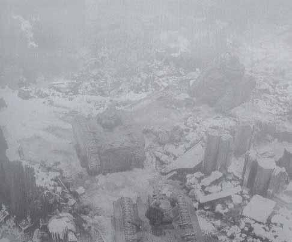
拍摄地点不明,一辆奇美拉正和数辆友军坦克通过一片废墟

由于奇美拉改型较多,这里只给出底盘的基本性能诸元:

乘员: 3人 车长,炮长,,驾驶员
重量: 38吨
车体长度: 6.5米
车体宽度: 5.7米
车体高度: 3.72米
最小转弯半径: 0.45米
最高公路行驶速度: 70千米/小时
最高越野行驶速度: 55千米/小时
炮塔可360度旋转

部分区域装甲厚度:
炮塔正面 150mm
车体上部 150mm
车体侧面 100mm
火炮防盾 无

第三部分 帝国炮兵

3-1 Basilisk

石化蜥蜴自走加农炮

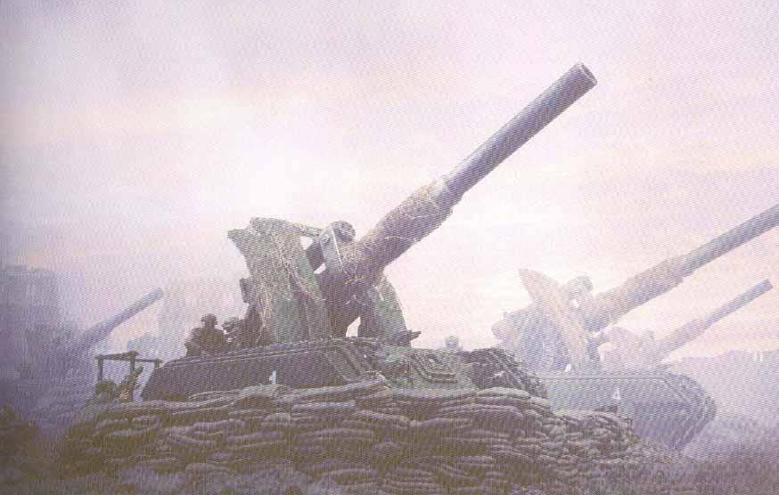
　

石化蜥蜴是帝国军队中最标准的火炮装备。这是一种能够为前线部队提供中远距离火力支援的自走火炮。得益于高机动性的奇美拉地盘和威力强大的地震加农炮，石化蜥蜴成为帝国炮兵中最中坚的部队。尽管一个炮兵团中往往混杂着各种不同用途的火力支援装备，比如蝎尾狮导弹，狮鹫重型自走迫击炮，甚至是重型攻城炮，这些不同的武器都在帝国军人们心中都有着崇高的地位，但是只有那石化蜥蜴是最普通最常见的远程火力输出平台。无论是从那朴实无华的奇美拉底盘来看----一切照搬原样----引擎阿，悬挂系统阿都没有改变过，只有载员舱换成了全开放的战斗室，只有在前方一块大型的火炮护盾提供了些许防护。

 指挥官和驾驶员在车体内部负责指挥和使用一挺爆弹机枪自卫；而炮手和装填手只能呆在露天的炮火平台操纵火炮。装填手负责将沉重的炮弹填入炮膛，然后炮手在指挥官的引导下瞄准目标，发射地震炮。

石化蜥蜴的主要任务是为前线部队提供压制敌人的手段。所以这些炮兵部队往往直接听从一些前线高阶帝国军官的指挥，而这些军官都具有丰富的炮兵打击经验。大多数任务中石化蜥蜴只管把目标区域轰成渣就好了但是有些特殊的任务比如对某区域释放烟雾弹，以及在夜晚对某地释放照明弹等等也都是石化蜥蜴的份内活。

因为其装载的地震加农炮可以轻易摧毁敌人的车辆，据点和建筑物，在某些情况下石化蜥蜴甚至会对目标进行低射角直瞄射击，这样一来它的身份就从加农炮转化为了突击炮，而可怜的目标及其周围很大一片区域都将面临被毁灭的下场。但由于缺少必要的装甲防护以及那危险的开顶式设计，石化蜥蜴注定不能代替其他主战装甲车辆的位置。因为在敌人的重点打击下石化蜥蜴火炮部队很难逃脱被摧毁的厄运，所以一般情况下石化蜥蜴都会紧跟其他装甲部队或者干脆呆在指挥部附近，在重重的保护下对目标倾泻火力。

石化蜥蜴性能储元

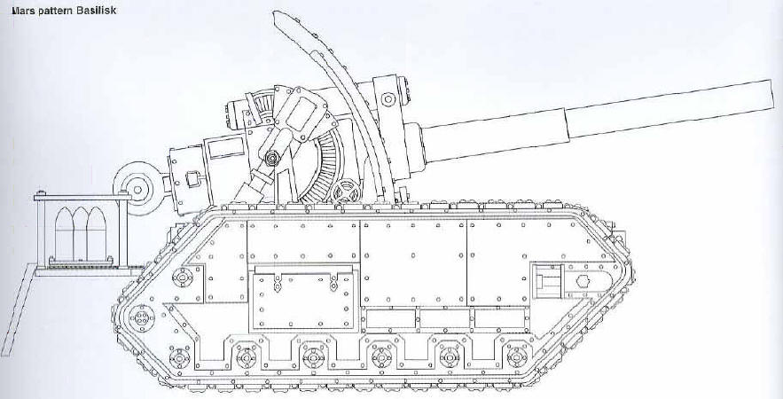
　

车组成员：4人（指挥官，驾驶员，炮手，装填手）
引擎：福尔康16型连轴推力发动机（其实这里被一个章盖住了，我按照大概意思猜测的）
重量：40吨
车长：7.08米
车宽：4.86米
车高：4.38米
转弯半径：0.45米
公路最高速：35KPH
越野最高速：21KPH
主要装备：地震加农炮
次要装备：暴弹机枪
左右射界：3度
高低射角：0度到+59度
主要弹药：20发（炮弹）
次要弹药：300颗（机枪）

装甲：炮塔-无
结构-100mm
车体正面-150mm
其他-火炮防盾-60mm

在Armageddon作战的石化蜥蜴，采用了全包围的炮塔。

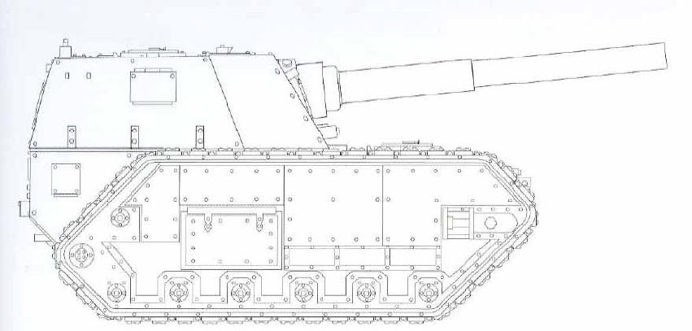

一组3辆石化蜥蜴排成排对目标实施火力压制。

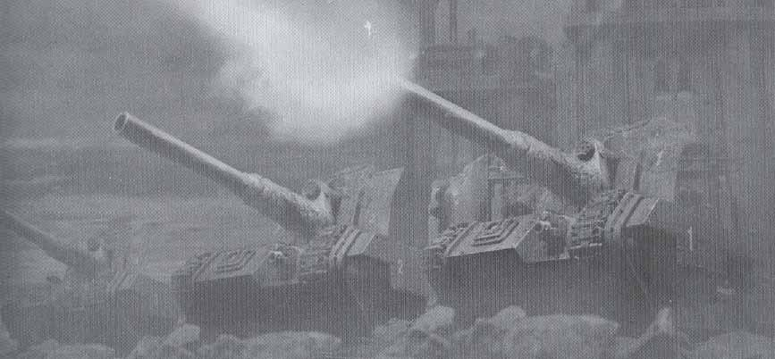

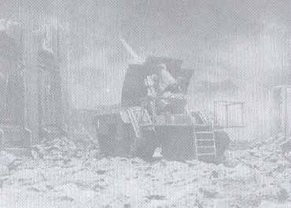

 因为难以看到车组成员，这辆石化蜥蜴很可能已经在巷战中被遗弃了。虽然巷战中地震炮在一定距离内对建筑物中躲藏的敌军具有毁灭性的打击效果，但是敌人的反击也可能是致命的，尤其对于暴露在外的车组成员来说，来自高层建筑中的狙击火力就是那梦魇。

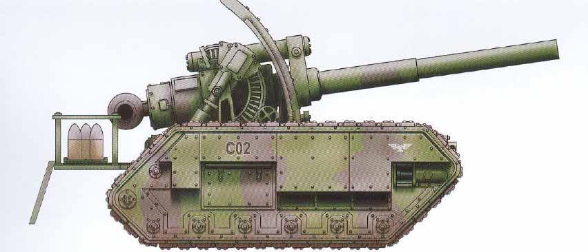
　

帝国桃园军第66桃园装甲团，C组2号车。在ToalⅢ的入侵行动中采用的林地迷彩。

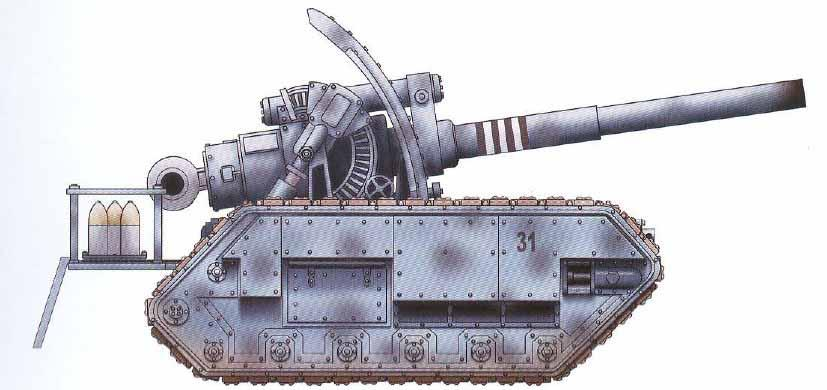

帝国康尼格军第27康尼格装甲团，3组1号车。请注意炮身上的4个击杀标志，这表明该炮参加过至少一次近距离支援作战。

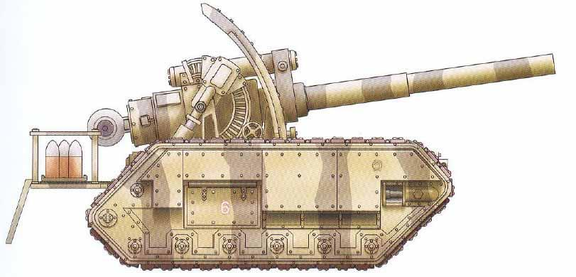

帝国第7迫击炮团的6号车。

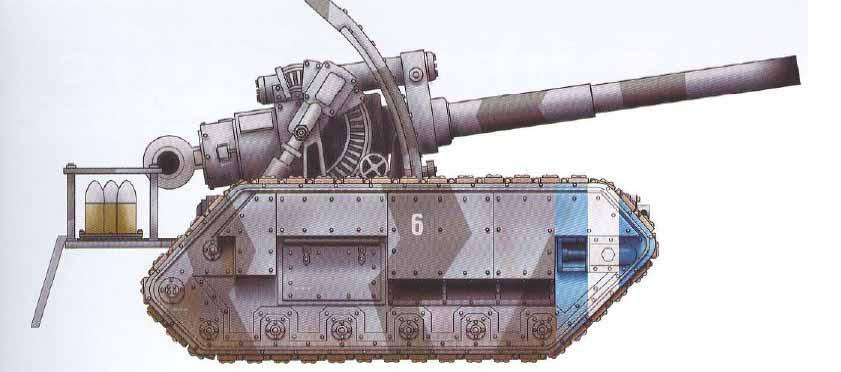

卡迪安142装甲团的石化蜥蜴，在第13次黑暗远征中的涂装；兰色条表示这是该团第二火炮连的车辆。

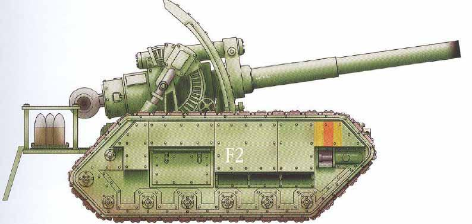

帝国德涅伯军第9德涅伯坦克团F组2号车，被其成员取名为“杀手锏”号。

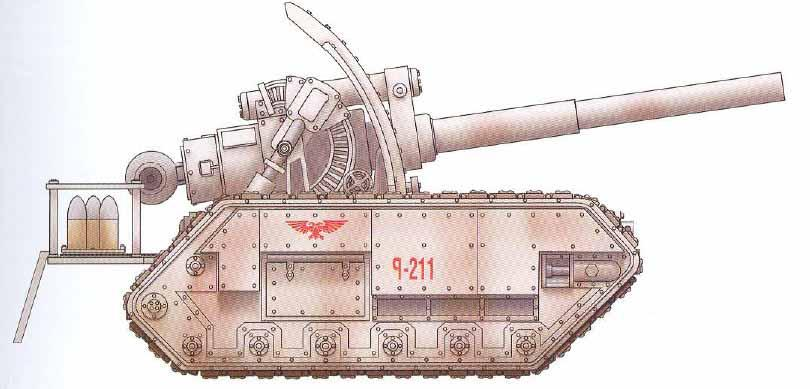

帝国军瓦尔哈拉第28装甲团在BelatisⅣ时第二火炮连第一组的一号车。

\================================================================

3-2 Medusa

美杜沙攻城炮

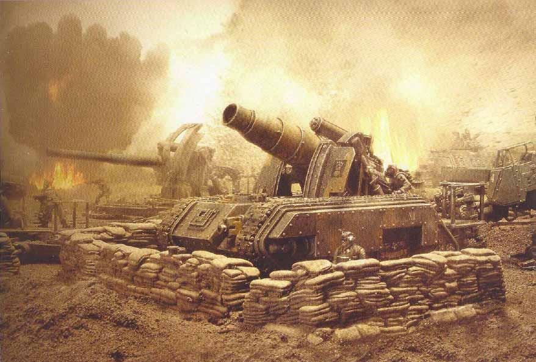

攻城武器在第四十一世纪已经是一种非常普遍的武器。在以往的战斗中由于很多叛军和异教徒选择右高又厚的城墙和掩体作为藏身之处，这迫使帝国开发出一种专门针对这种战术的装备，这种装备几乎是任何城墙和壁垒都无法阻挡的，这就是美杜沙攻城炮。

和把炮弹射过墙的狮鹫重型迫击炮不一样，美杜沙直接把炮弹射到墙上，把一切敢于阻挡的物体都轰成尘渣，然后让步兵部队堂堂正正地从缺口展开进攻。

那些耗时长久的攻城战役往往都是伴随着美杜沙单调乏味的炮击声进行的。她们每天每夜从那些良好保护的掩中向目标发射致命的弹药，无论是在城市内还是在丛林中，只要一个缺口被打开，美杜沙就会轰隆隆地推进往下一个阵地，为进攻部队提供火力支援，一栋楼只需要一颗炮弹就会被崩成瓦砾。于是逐街逐巷，一块一块的城区灰飞烟灭，让敌人找不到丝毫的藏身之处。

美杜沙在帝国中被誉为是老战马，但也被认为在战斗中能做出的表现月来越少以至于不再是一个装甲部队中必备的武器了。对于一个炮兵武器来说她们缺少石化蜥蜴那样的长射程攻击，作为一个装甲单位来说她们没有毁灭者或者雷鸣炮那样厚重的防护，所以大部分的美杜沙都退出服役了，现在只有弥补毁灭者数量上的不足或者在攻城，在丛林中开路，以及破坏敌人坚固阵线的时候美杜沙才能出来露露脸。目前一个装甲团大概会保留一组的美杜沙以备不时之需，但是大多数指挥官都尽力避免把美杜沙作为投入战斗。

有人尝试过让美杜沙去执行其他任务，但是效果并不显著。短射程的炮击使其不能像其他炮兵那样发挥火力，但是伴随步兵前进她们的开放式战斗舱使其成员暴露在敌人近战火力之下，而且由于本身也不是很坚固，所以毁灭者和雷鸣炮其实更适合这样的任务。 美杜沙还有一项缺陷就是她本身缺乏足够的弹药基数，
大口径弹药意味着她只能携带18颗炮弹。在攻城战中由于有充足的弹药供应所以这不算什么大问题，但是在野外美杜沙就不能保持长时间战斗了。

美杜沙攻城炮性能储元

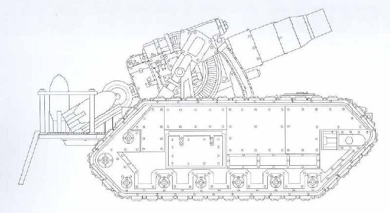

- 车组成员：4人（指挥官，驾驶员，炮手，装填手）
- 引擎：福尔康16型连轴推力发动机（这次没有盖章但是我看不懂。。。和石化蜥蜴一个型号）
- 重量：38吨
- 车长：5.29米
- 车宽：3.78米
- 车高：3.72米
- 转弯半径：0.45米
- 公路最高速：50KPH
- 越野最高速：35KPH
- 主要装备：美杜沙攻城炮
- 次要装备：暴弹机枪
- 左右射界：3度
- 高低射角：0度到+40度
- 主要弹药：18发（炮弹）
- 次要弹药：300颗（机枪）
- 装甲：炮塔-无结构-100mm
- 车体正面-150mm
- 其他-火炮防盾-60mm

美杜沙结构图

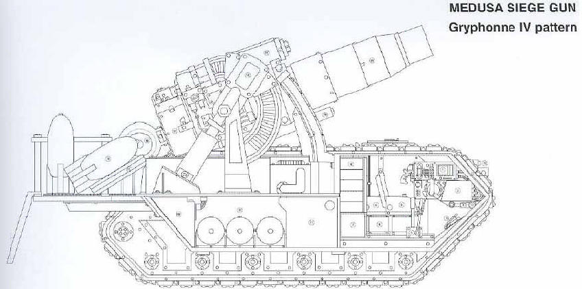

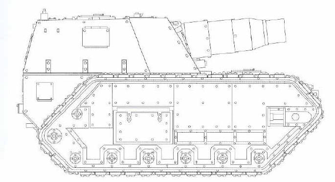

在Armageddon战役中使用全包围护甲的美杜沙。
　
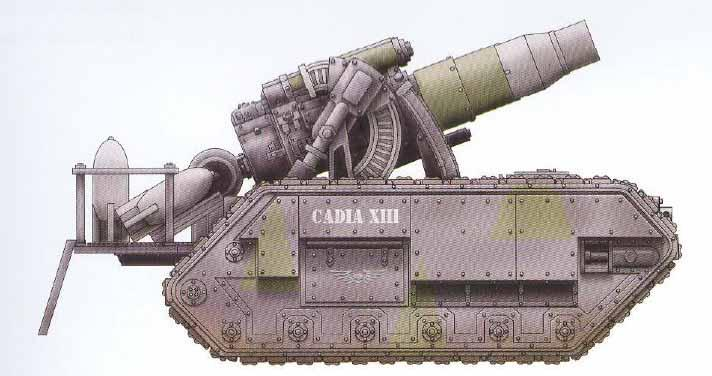

卡迪安第13装甲团使用的美杜沙。这是属于当地卫戍部队的车辆。

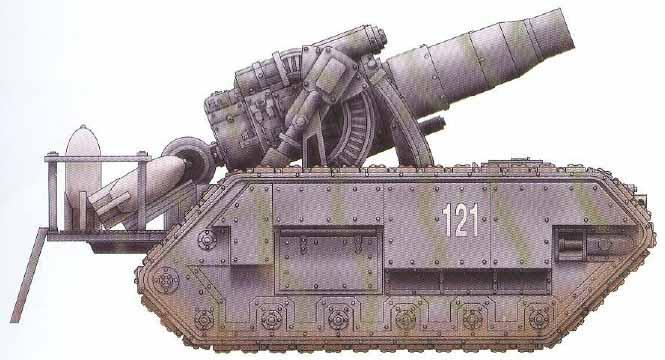

帕拉斯第2装甲团使用的美杜沙。

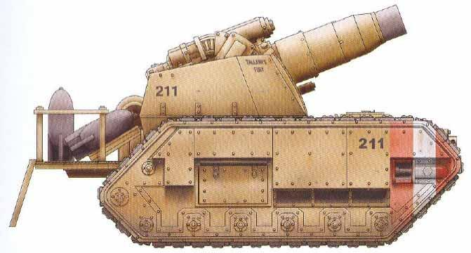

Tallarn101装甲团使用的美杜沙攻城炮。使用了Vanaheim的技术改造了火炮护盾。红色标志说明这是第1连的车辆，但是战术标号却标注成了2。貌似有一段时间101团的1，2连都在使用红色标示。

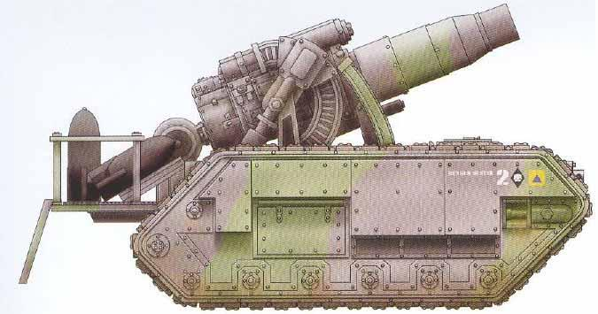

瓦尔哈拉第八兵团在进攻Sallan世界时使用的美杜沙攻城炮。

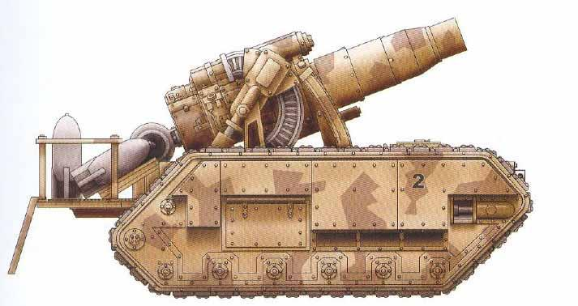

GalanV远征军，Krieg军第28装甲团使用的美杜沙。

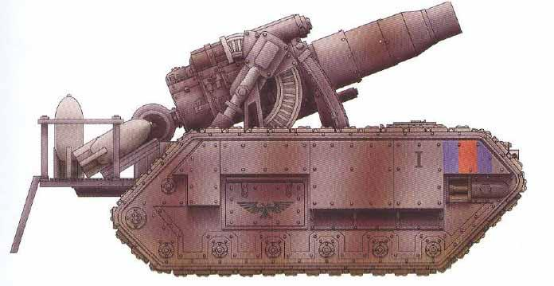

在围攻Vogen城的时候卡迪安122团使用的美杜沙攻城炮。

3-3 Hydra 九头蛇防空坦克

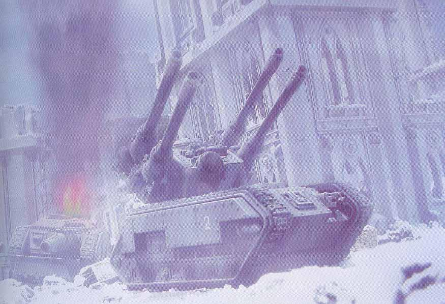

九头蛇防空坦克是一种以奇美拉为底盘，为了帝国军拥有机动性防空措施而研制的一种特殊车辆。这种防空坦克经常部署在在帝国军火炮部队和战略要点来防御一切可能的空中打击。他的4门长身管速射炮能撕裂天空并制造出弹幕来阻拦敌机。九头蛇高度自动化的炮塔装备有能够快速追踪目标的设施，这意味着一旦九头蛇锁定住目标他的火炮就可以持续瞄准而不会出现差错，再加上其凶猛的射速，基本来说可怜的敌机是没有机会逃脱了。

帝国军队在一个团中会独立编成一个九头蛇防空连，但是防空连会和几乎所有部队混编执行任务。这些防空部队存在的意义就是为全团将士提供防空保护，甚至每一辆单独的九头蛇都会被指派去为其战友提供掩护。因为这些防空坦克在团中供不应求，所以指挥官必须认真决定哪些为哪些会受到较大空中威胁的单位指派防空支援。炮兵部队往往都是重点保护对象，因为他们笨重的体型是敌人战机再好不过的目标了，所以甚至在每一个石化蜥蜴小组中都会有九头蛇伴随保护。

如果没有九头蛇的保护在前线作战的坦克部队也是敌人空军的重点照顾对象，这些坦克纵队在行进中都有九头蛇伴随保护。如果实在找不来这些专业防空坦克，那就要使用一些临时改装的奇美拉或者其他车辆来执行防空任务。

指挥部和供给站也是敌人的重点目标，但是这些地方往往都驻扎有足够数量的九头蛇来进行保护。 九头蛇有5名车组人员：驾驶员，指挥官，还有坐在底盘内操控自卫爆弹机枪的通信员，以及在炮塔内负责火炮运转的炮长和装填手。

当空中威胁解除的时候，九头蛇会推进到前线执行攻击地面目标的任务，他强大而凶猛的火力使其可以轻松收割敌人的步兵和轻型装甲车辆。九头蛇高效率的表现无论在帝国军士兵还是在指挥官心中都留下了极其深刻而良好的印象。

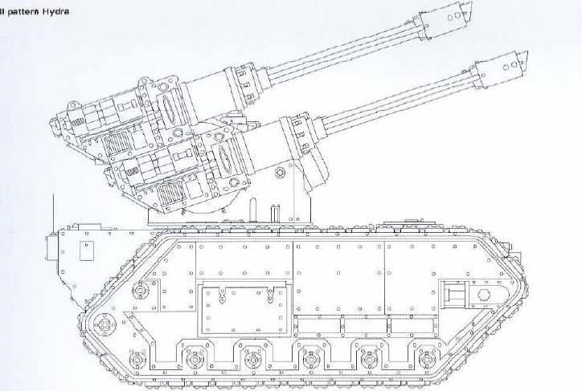

- 九头蛇防空坦克性能储元
- 车组成员：5人（指挥官，驾驶员，炮手，装填手，通信员）
- 引擎：福尔康16型连轴推力发动机
- 重量：38吨
- 车长：5.29米
- 车宽：3.78米
- 车高：5.10米
- 转弯半径：0.45米
- 公路最高速：50KPH
- 越野最高速：35KPH
- 主要装备：4X长身管速射炮
- 次要装备：暴弹机枪
- 左右射界：360度
- 高低射角：0度到+79度
- 主要弹药：600发（炮弹）
- 次要弹药：300颗（机枪）
- 装甲：炮塔-100mm 结构-100mm
- 车体正面-150mm
- 其他-无

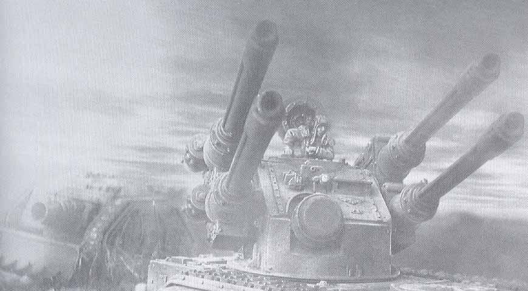

一辆九头蛇的炮手露出炮塔透气，从这个角度可以很清楚的看到4连装速射炮的细节。

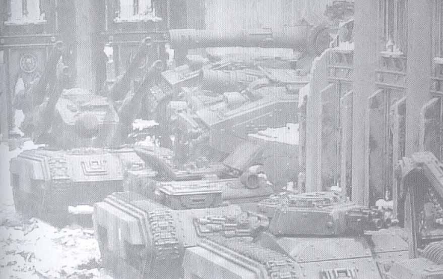

在城镇废墟的街道上，一辆九头蛇为一个装甲车队提供防空掩护。

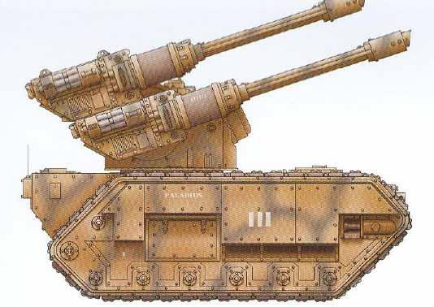

帕拉斯46装甲团防空连使用的九头蛇坦克，注意炮身上的击杀标志。

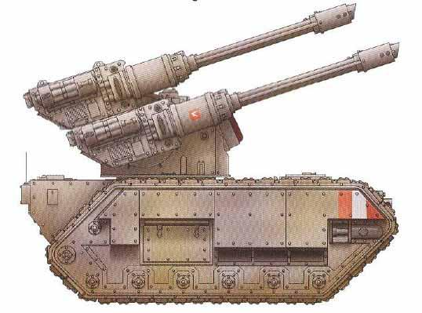

在Armageddon星球作战时钢铁军团第87装甲团使用的九头蛇，车身上的标志是在进攻Acheron时使用的。

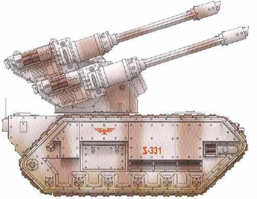

在BelatisⅣ号星球驻扎的瓦尔哈拉第28装甲团使用的九头蛇。

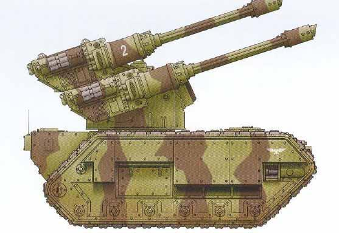

在Hamman世界，驻扎在温带高地的卡迪安迪74装甲团的九头蛇坦克。

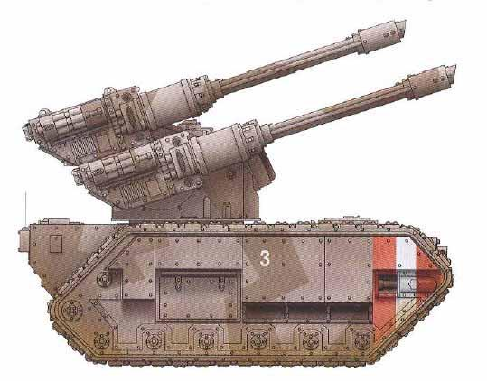

卡迪安142团的九头蛇防空坦克。

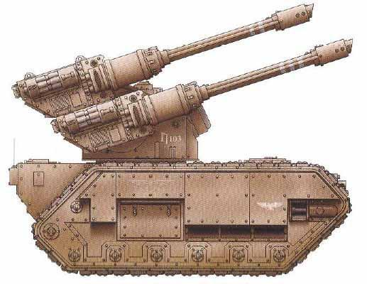

本车所属不明（别BS我。。原文就是这样写的）
