# 帝国装甲1 帝国海军战机

【分享】帝国装甲1 帝国海军战机 [zt]

作者：drydry 

鄙人所学粗浅,趁假期期间翻译一下帝国装甲1的战机部分,平时大家所熟悉的多是地面装备,所以鄙人翻译一些帝国海军的战机来和大家共享. 希望能够做到一天一种机型的介绍.如果有大家觉得不妥的地方鄙人恳请拍砖.

==================================================================

闪电式战机

在解放了Segmentum Obscurus世界12个星球的圣-萨爱恩远征中，闪电式战机的STC技术工艺被探索KarnaKⅡ星球的机械神教探险队重现于天下。这份设计图被立刻呈上到Cypra Mundi的机械大主教们手中。这些老头们跟随着帝王的导言，还有在最老最睿智的科技神甫的建议下，作出决定。设计图所提供的数据是令人兴奋的，所以很快被送到火星备份，于是科技神甫们可以在机械大神的眷顾之下开展了闪电战斗机的研究和制造。在第一架闪电投入在Obscurus舰队服役前，整个蓝图研究，科技试验，整机测试，和谋求机械大神眷顾的过程花费了500年之久。在解决了前掠翼设计上的一些小问题之后，闪电式战机终于有了被认同的身份并可以投入大规模生产，用于支援舰队的航母和巡洋舰。

慢慢的，闪电式的STC技术被散布到处于Bakka和Hydraphur的另外两个主要的海军基地，现在闪电式也和更为常见的霹雳式战机一起共同在Segmentum叛军和Segmentum镇压者的舰队中共同服役。

闪电式战机的主要作用是在战斗中缠住敌机并争夺战场制空权。以轨道舰队或者前线机场作为基地，闪电战机可以承担起拦截或着是护卫掠夺者轰炸机这样的任务。有时候在地面机场的闪电式战机还会执行一些特殊任务比如说攻击敌人地面目标，尽管这不是闪电的主要设计目的，但是在“地狱打击”式导弹空对地导弹的帮助下闪电可以出色的完成任务。

闪电攻击机事实上就是和空战型闪电一样的机型，两者的差别仅仅在于使用了不同的武器组。攻击型的闪电将腹部的航炮移除以减轻重量，同时在机身下加挂导弹挂架，这样能让闪电增挂到6颗地狱打击式导弹。

上述武器搭配仅适用于专门用于对地攻击装甲目标，对帝国军地面部队进行近距离支援的闪电。往往闪电会徘徊在战场上空等候地面帝国军前线指挥官的命令以进行支援作战。一旦需要闪电会直扑目标，并在爬升回巡航高度前对敌人倾泄致命的弹幕射击。

================================================================

感谢c群brave提供的修改意见

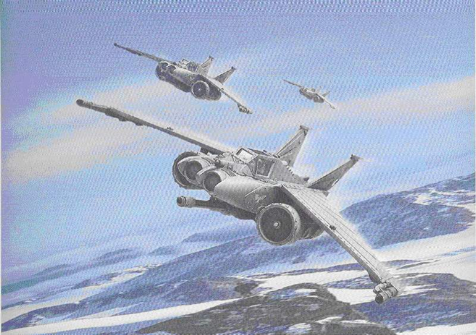

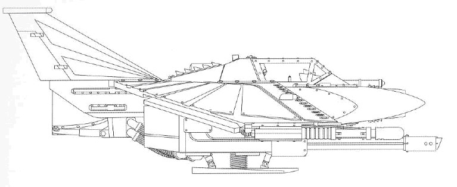

Cypra-Mundi闪电性能诸元

机组成员 1人

动力系统 2xF100-XB涡轮喷气发动机

重量 10吨（空重）

身长 10。8米

翼展 13。75米

高 3。1米（起落架放下高度）

最大时速 2400kph

最高升限 36000米（使用喷气引擎可以达到）

作战半径 8000公里

基本武备 2翼尖激光炮 1机腹长身管航炮

次要武备 4x地狱打击导弹

基本弹药 30射次装能量弹夹

次要弹药 100颗（机腹航炮）

装甲：机身结构45mm

正面 30mm

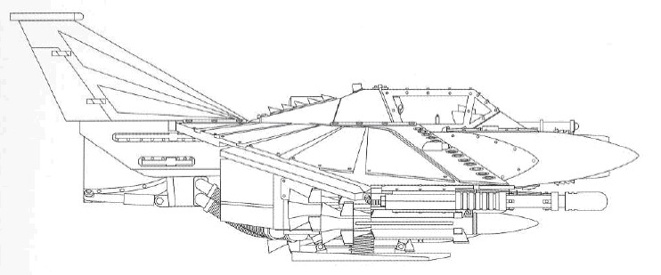

Cypra-Mundi版本的闪电攻击型线图

Cypra-Mundi闪电攻击型性能诸元

机组成员 1人

动力系统 2xF100-XB涡轮喷气发动机

重量 9.8吨（空重）

身长 10。8米

翼展 13。75米

高 3。4米（起落架放下高度）

最大时速 2400kph

最高升限 36000米（使用喷气引擎可以达到）

作战半径 8000公里

基本武备 2翼尖激光炮 次要武备 6x地狱打击导弹

基本弹药 30射次装能量弹夹

次要弹药 N/A

装甲：机身结构45mm

正面 30mm

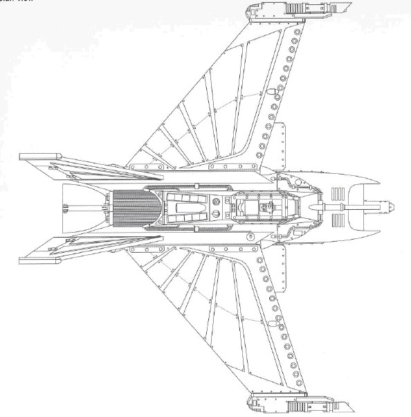

闪电顶视线图

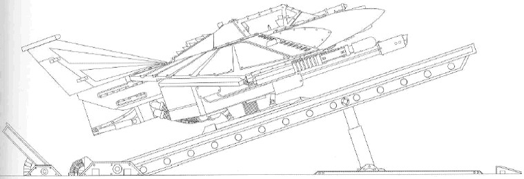

被放置在液压快速发射器上的闪电。这样的发射器使闪电拥有了比垂直起降方式更快的反应速度和加速度。在机场上都会布置有3到4台发射器和严阵以待的机组人员来做为受到攻击后的快速反击力量。霹雳式同样可以使用此种发射方式。

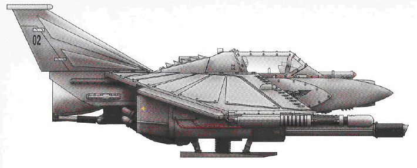

一架属于帝国海军2774战斗机连队，飞龙小队的闪电。这是该连队的2号机，使用标准灰色涂装。

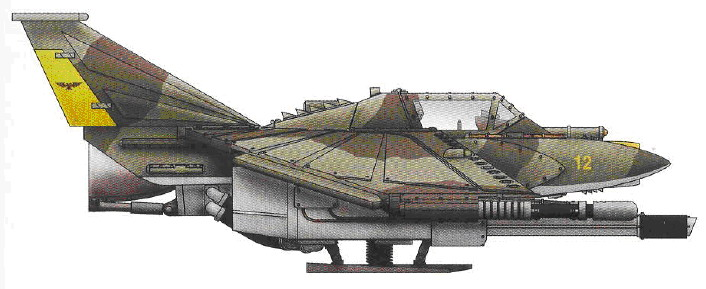

本机隶属于帝国海军3035战斗机连队，火龙小队。是该连队第12号机，使用了对地攻击任务而被涂装成丛林迷彩

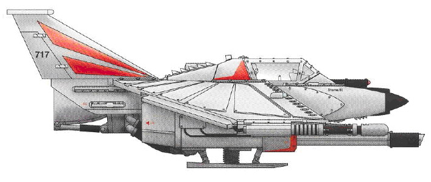

一架帝国海军717战斗机连队，战鹰小队的闪电式战斗机。请注意机头飞行员给爱机的呢称“StormⅢ”

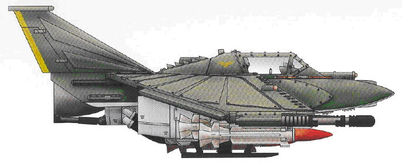

帝国海军2872战斗机连队，雷鸟小队的闪电攻击型。顶部使用标准绿而机腹涂白

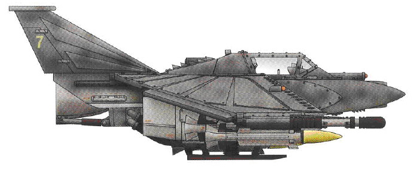

本机隶属于帝国海军484战斗机连队，魔爪小队。城市迷彩涂装。

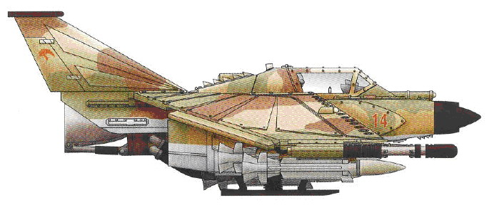

帝国海军1002战斗机连队，红锤小队的闪电攻击型战机。采用温带地区迷彩。

|  |
| --- |
| 霹雳式战斗机 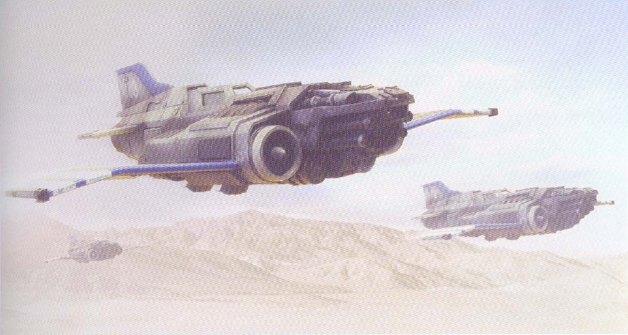 霹雳式战斗机是帝国前线单座重型战斗机，他占据了帝国海军战机中重要的一席。良好的全面装甲保护，不错的速度和灵活的操控性以及强大的机鼻火力和外挂火力使得其深受飞行员们的推崇，也使其为帝国服务了数个世纪之久。 因为机体坚固可靠，霹雳式在战斗中的不二法则就是作为空中优势战斗机在格斗战中击落敌人，或者是以歼灭敌人的轰炸机来保证战场上帝国的地面攻势。霹雳式战机的长处就是对于不同任务的适应性，无论作为高空护航机还是低空战斗轰炸机，夜间战斗机还是侦察机霹雳都能轻松应付。 霹雳的翼下挂点可以携带炸弹，空对地导弹，偶尔还会携带空对空导弹。闪电也可以在外挂架选择携带副油箱以增大作战半径，不过作为战斗机来说闪电本身便具有足够远的航程所以副油箱并不是必备的装备。 机首装备有4门内置航炮和双联激光炮，这也是霹雳前机身看起来臃肿的原因。激光炮主要用于攻击敌人地面车辆而航炮主要用于空中格斗和收割敌人步兵单位。 霹雳战机依靠着高速度，可以获得更佳的爬升率，但是设计上的不足使得他需要更多的维护人员来进行保养。 霹雳和闪电一样，装备有火箭推力引擎，这可以在太空环境下提供战机有限的操纵性，但是这仅仅是为了运输和部署而用，并不能用于战斗，因为霹雳战机并不是真正的太空战机，这个角色交给了帝国“复仇女神”战机去扮演了。这样的火箭发动机可以帮助霹雳从近地太空轨道中直接飞入大气层，同时还可以将在大气层中使用普通喷气引擎的战斗机推向近地轨道中等候的母舰。这种火箭发动机同样可以用于发射架式的快速升空。 帝国海军战机连队数量巨大，通常每个连队有至少10架最多不超过20架战机，但是个别连队的战机数量远大于此。每一个战机连队都有一个传统的昵称，取名往往来自于飞行生物或者是传说中的怪物。在诺大的星系当中，有数千个战机连队驻扎在战舰，太空战和地面基地，尽职尽责地保护帝国的领空。 |

Cypra Mundi版本霹雳侧视线图

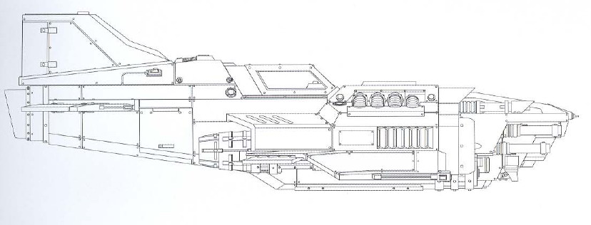

霹雳战机性能诸元

机组成员 1人

动力系统 2xF122v涡轮喷射引擎

重量 14吨（空重）

身长 14.2米

翼展 16.06米

高 3.5米（起落架放下高度）

最大时速 2200kph

最高升限 39000米（使用喷气引擎可以达到）

作战半径 12000公里（大气层内）

基本武备 2x机首激光炮 4x实弹航炮

次要武备 4x地狱打击导弹

4x航空炸弹

基本弹药 30射次装能量弹夹

次要弹药 400颗实弹（机首航炮）

装甲：机身结构45mm

正面 45mm

霹雳顶视线图及外挂弹药

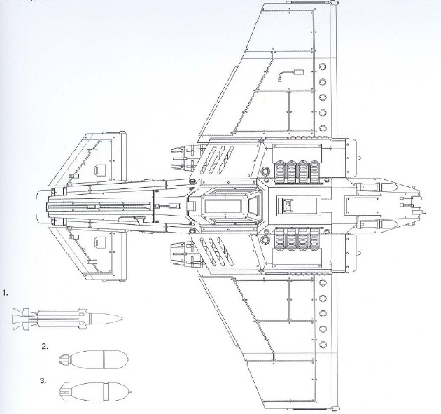

1.火星版本Mk14地狱打击空对地导弹

2.狮鹫Ⅳ型 Mk3 500磅通用炸弹

3.狮鹫Ⅳ型 Mk17燃烧弹

|  |
| --- |
| 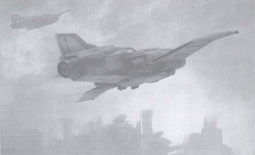 上图:在收复Istenbrak城的战斗中，帝国海军第3494战机连队队的霹雳低空掠过Tempstor军团的泰坦。 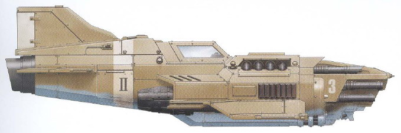 帝国海军490战机连队双足飞龙小队，第二组的第三架霹雳式战机。在第三次Armageddon战争中采取的沙色涂装。 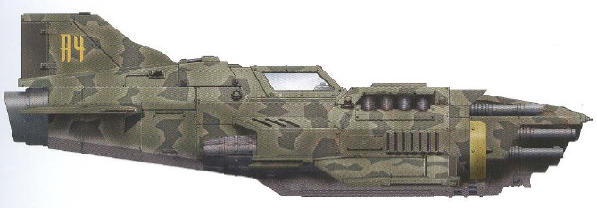 本机隶属于帝国海军3659战机连队，鹞小队。为了适应低空行动而被涂成丛林色。该连队在战役中对敌军造成重大损失，而本机被艾达神族的夜翼战机所击坠. 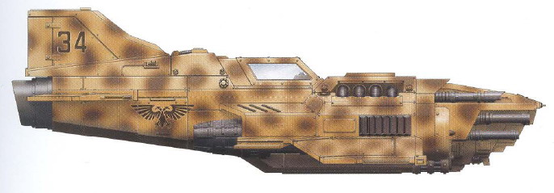 帝国海军83战机连队的霹雳战机，老鹰小队。采用沙漠迷彩。 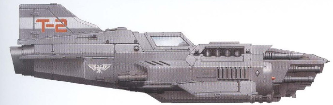 本霹雳隶属于帝国海军386战机连队，猛禽小队。采用标准灰和独具特色的红色装饰。 |
|  |
| --- |
| 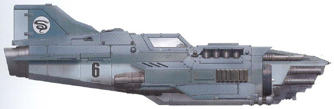 帝国海军1303战机连队，蛇龙小队。连队标志涂装在机尾。采用和海洋星球Tyrama Secundus海水颜色相近的浅兰色。 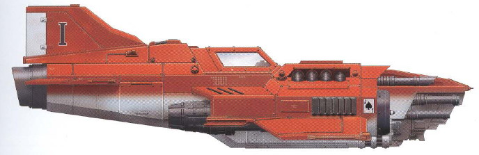 帝国海军672战机连队，飞龙小队的霹雳战机，和一般的作战涂装不同，本机涂装具有浓烈个人色彩（按照驾驶员的要求，而本机驾驶员正是连队长），该驾驶员名叫Richter Dagor-Jarni,一位拥有帝国最高级别王牌殊荣的指挥官。这种明显的涂装是为了将其同其队友区分开来。请注意飞机上的击坠记录和幸运标志。Rynn世界战役中的涂装 |

劫掠者轰炸机

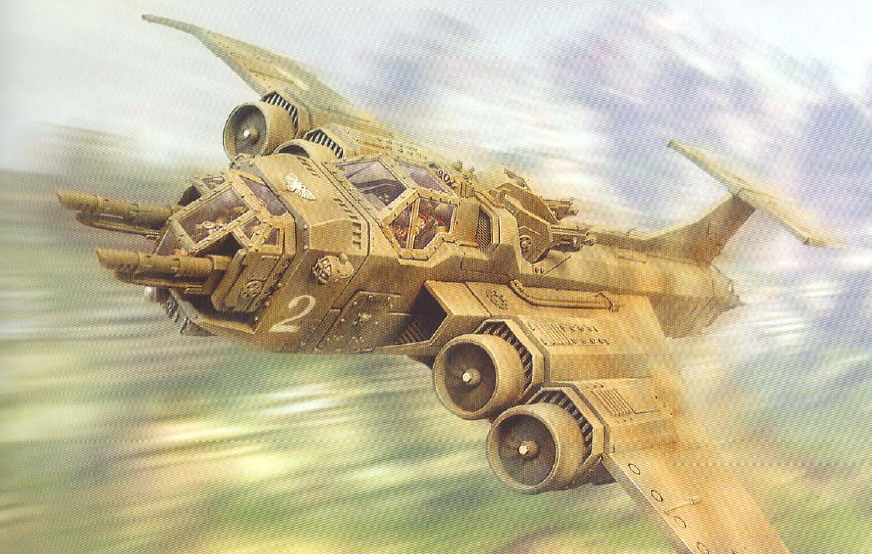

如同所有的帝国战机一样，劫掠者轰炸机部队听命于帝国海军的号令，而不是帝国陆军。他们通常驻扎在近地轨道战舰上，在真空环境中依然具有可操作性。同时随着战役的发展，海军部队也会在地面上也会建立战地机场。得益于劫掠者的长程奔袭能力机场可以建立在远离前线的大后方，为了更安全的远离可能的敌人打击，机场甚至可以建立在另一块大陆版图上！

劫掠者轰炸机具有尚可的速度，超远的作战半径和巨大的载弹量，所以在帝国海军中劫掠者通常可以扮演3种角色。

首先，是战略轰炸机。他们会轰炸敌人后方的城市，太空港，工业中心和后勤供应通道。在这种情况下劫掠者可以飞到敌人防空武器的射程之外进行轰炸作业。同时反战机的任务则交给霹雳式护航战机。

其次，远程奔袭能力赋予劫掠者在敌人后方自由狩猎的能力。此时劫掠者们会飞赴敌人腹地寻找任何有机会攻击的目标，通常目标包括运输车队，燃料库，开阔环境中的敌军士兵等。这类目标常常已事先被空中侦察标定出来，但是由于各种原因不便被帝国地面部队打击到。

然后，劫掠者能够扮演对地攻击，为己方部队提控近距离火力支援的角色，同时也可以帮助地面部队歼灭特定的前线敌军目标。因为要准确的将目标军从地面友军部队中识别出来和极低的飞行高度，这也是目前情况下劫掠者能够承受的最冒险的任务。

战场形势瞬息万变，如何有效识别目标，迅速并清晰的处理战场变化，及时辨别靠近的空中单位所属阵营都给近距离空中支援任务带来了巨大的困难，但是具体到不同的指挥官和作战单位都有自己的解决办法。

有些部队使用火力射击目标引导飞行员轰炸，或者使用彩色烟雾为飞行员标明目标。标准的颜色记号是“红色标示为敌人”，任何在红色烟雾范围下的目标都可以被支援飞机自由攻击。有些军团使用空中管制员来进行空地配合，这些前往陆军的志愿人员一般是愿意为其同志提供准确目标引导的有经验的飞行员。他们乘坐通信车辆，直接带领飞行员给予目标凶狠的打击，此种配合需要更多人员协作。在目标区域被警告的友军部队都会迅速撤退，以防止空中可能掉落的炸弹误伤。然而这种战术同样是种冒险，因为对于地面部队这意味着敌军失去敌军的踪迹。

总的来说劫掠者轰炸机可以胜任他的3种角色，但是载弹量偏低使其难以提供有效的战略轰炸，而且他也缺少适合的对地攻击武器。总而言之，最适合劫掠者轰炸机的角色还是深入敌后进行战场遮断打击。

Cypra Mundi的劫掠者轰炸机线图

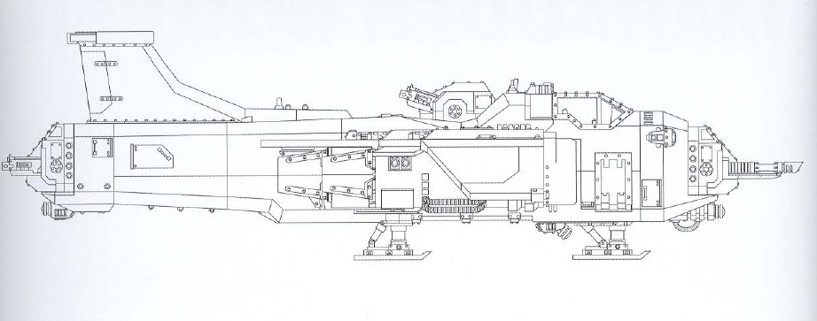

劫掠者轰炸机性能诸元

机组成员 6人（驾驶员，导航员，投弹手，机鼻炮塔枪手，机尾炮塔枪手，背部炮塔枪手）

动力系统 4xJ79-CS喷气引擎

重量 41吨（空重）

身长 19.2米

翼展 21.6米

高 4.8米（起落架放下高度）

最大时速 1800kph

最高升限 41000米（使用喷气引擎可以达到）

作战半径 15000公里（大气层内）

基本武备 2x机首炮塔激光炮 2x机尾炮塔暴弹机枪

2x背部炮塔暴弹机枪

次要武备 6000磅内部挂架

6000磅外部挂架

基本弹药 40射次装能量弹夹

次要弹药 4000颗实弹（暴弹机枪）

装甲：机身结构45mm

正面 30mm

劫掠者轰炸机顶视线图

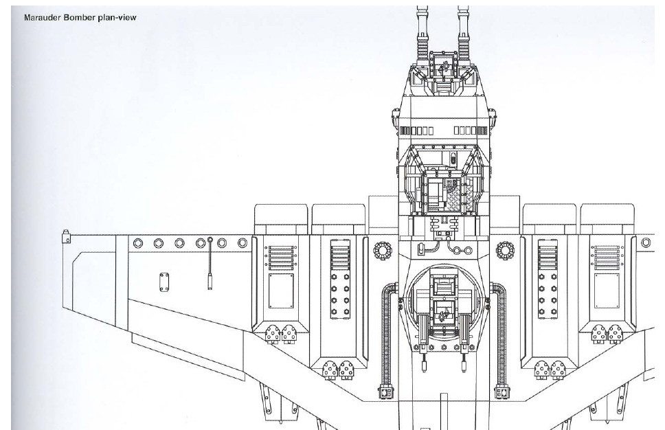

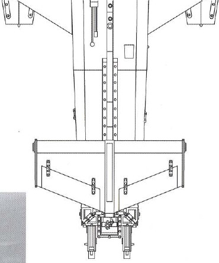

逼近目标！劫掠者轰炸机低空掠过叛军把守的重镇Istenbrak.

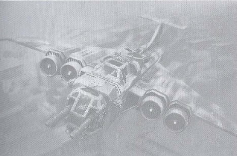

|  |
| --- |
| 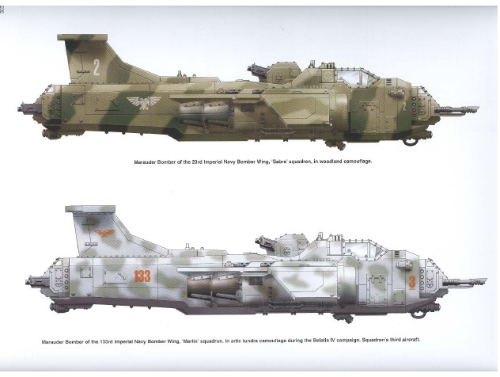 上:帝国海军23轰炸机连队，马刀小队的劫掠者。采用丛林迷彩涂装。 下:帝国海军133轰炸机连队，灰背隼小队的劫掠者。本涂装是该机在Belatis行星第四次战役时采用的极地苔原迷彩。本机为小队的3号机。 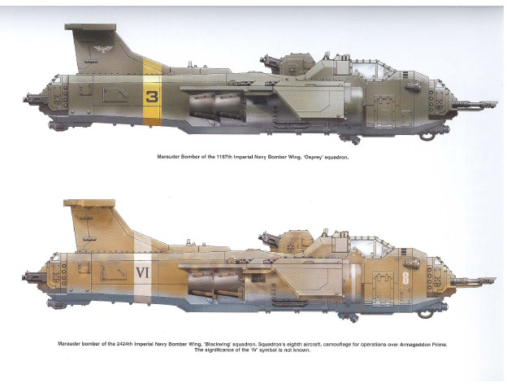 上:帝国海军167轰炸机连队，鱼鹰小队的劫掠者轰炸机。 下:帝国海军2424轰炸机连队，黑翼小队。本机为小队中的第八架飞机，为了哈米多尔顿之春行动所采用的涂装。机身上的Ⅵ标志含义不明。 |
|  |
| --- |
| 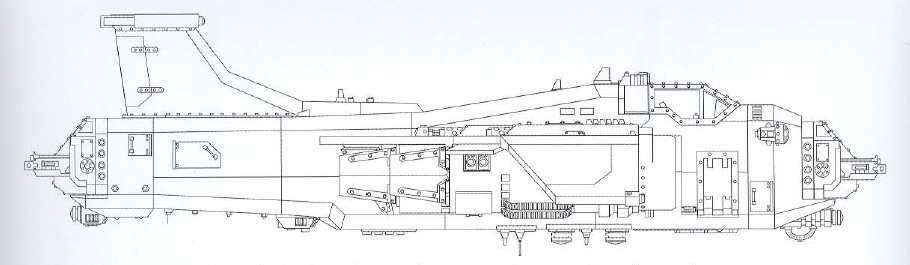 劫掠者轰炸机的一种改进型，用于搜索救援行动。 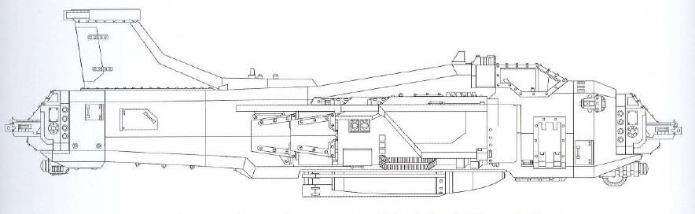 劫掠者轰炸机的一种改进型，机腹可以加挂10000kg的制导炸弹。 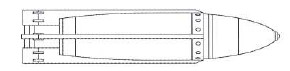 劫掠者所使用的10000kg制导炸弹。 |

劫掠者改进型-歼灭者攻击机

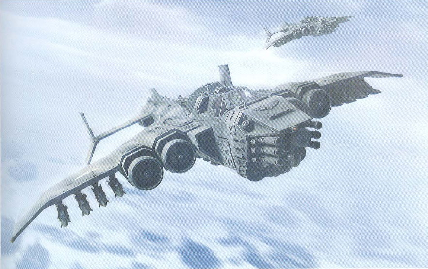

歼灭者是有在战场上主要负责对地打击的掠夺者改进型号，歼灭者特别适合在低空进行火力支援任务，他们去除了机腹的炸弹仓转而在机鼻部为增加了恐怖的6门航炮火力，在这风暴一样的打击中很少能有目标还能幸存下来。翼下可以携带8颗地狱打击导弹。尾部炮塔的暴弹机枪更换成了2门突击炮，这样歼灭者可以在对目标实施完主要攻击，爬升脱离的时候继续对目标实施打击。

歼灭者主要用于对地面部队的近距离支援，他缺乏作为其他用途使用的打击手段，虽然歼灭者依然可以使用导弹和极其有限的炸弹装量深入前线之后打击目标，但是歼灭者数量太过于稀少了，无法承担起任何在此类任务中的耗损。

根据记录显示，最初的改装记录可以追溯到第二次Armageddon战争时期，帝国海军在战斗中经历了严重的损失，也将制空权让给了欧克蛮人。所以残存的帝国海军不得不易靠夜间掩护进行行动。为了避免被敌军发现而采用的低空飞行和打击战术逐渐演变成了今天被大家熟知的歼灭者战机。

改造过程中科技神甫为歼灭者战机加入了寻路/导航传感器，这赋予了歼灭者夜间低空告诉飞行的能力，也使歼灭者能够准确将弹药倾泻在目标头上然后脱离返航。

机场，指挥所和供应中继站都是打击列表中的高价值目标，因为在消灭他们之后可以有效地降低敌人攻势的力度，但不幸的是这些高价值目标往往处于敌人重重包围之中。如果用普通的劫掠者打击这些目标那通常会采用高空轰炸的办法，但是这些英勇的歼灭者机组，这些帝国的精英飞行员们宁愿承担着极高的风险，为了帝国的胜利去精确消灭这些至关重要的目标，把他们炸至一厘一毫。

强大的火力使歼灭者当之无愧的成为了支援地面部队的首选兵器。同时，低空飞行时歼灭者的冲压喷气发动机所发出的怒吼可以有效提升地面友军部队的士气。

歼灭者攻击机侧视线图。

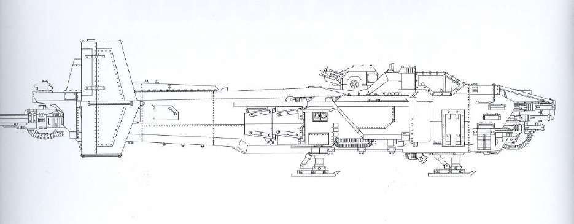

歼灭者攻击机性能诸元

机组成员 6人（驾驶员，导航员，武器操作员，机鼻炮塔枪手，机尾炮塔枪手，背部炮塔枪手）

动力系统 4xJ79-CS喷气引擎

重量 43吨（空重）

身长 19.2米

翼展 21.6米

高 4.8米（起落架放下高度）

最大时速 1800kph

最高升限 41000米（使用喷气引擎可以达到）

作战半径 15000公里（大气层内）

基本武备 6x机首航炮 2x机尾炮塔突击炮

2x背部炮塔暴弹机枪

次要武备 3000磅内部挂架

8x地狱打击导弹

基本弹药 300颗实弹（机首航炮）

次要弹药 2000颗实弹（暴弹机枪和机尾炮塔突击炮）

装甲：机身结构45mm

正面 30mm

歼灭者顶视线图

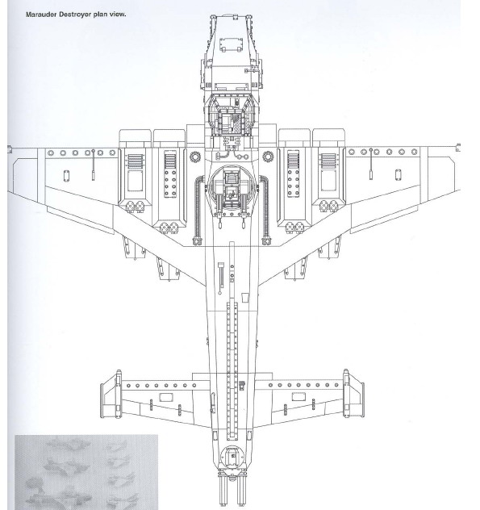

帝国海军机场，停放着整装待发的海军战机

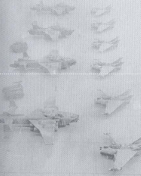

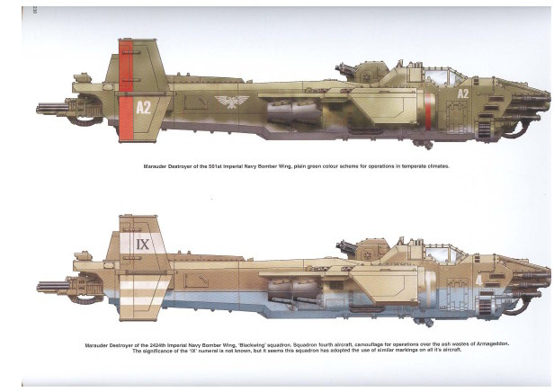

上:帝国海军501轰炸机连队的歼灭者，平原绿涂装。

下:帝国海军2424轰炸机连队，黑翼小队。为了阿玛戈顿之春行动所采用的涂装，机尾Ⅸ标志含义不明，不过看起来该连队战机都有类似的标志。

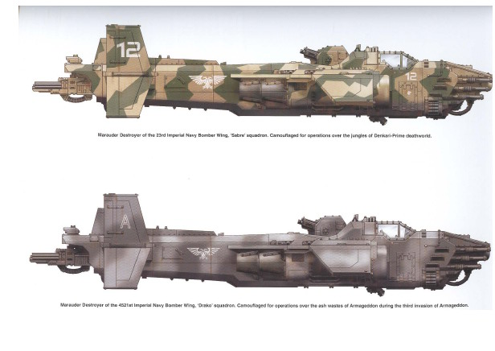

上:帝国海军23轰炸机连队，马刀小队的歼灭者。采用丛林迷彩涂装。

下班:帝国海军4521轰炸机连队，巨龙小队的劫掠者。这是在第三次哈米多尔顿战争时期采用的灰烬式涂装。

==============================================================================================

又一架飞机介绍完毕,说实话我本人在这翻译的过程中确实学到了很多东西,我很高兴能和大家分享这些资料.

这些东西归根到地都是YY出来的,只不过有的设定的确令人乍舌,有人不喜欢也是难免的，我媳妇也对我说：“那一坨铁怎么就飞到天上了呢？这毫无流线感的气动外形还能飞到2000千米每小时？”

不要紧，有人喜欢就好了^_^

女武神空降突击艇

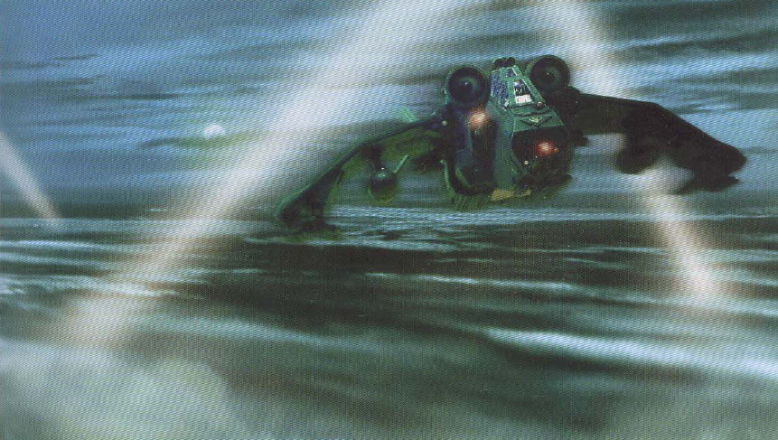

女武神空降突击艇主要用来支援帝国风暴突击队，支援这些帝国守卫中的精英部队进行敌后渗透，偷袭，以及救援和破坏任务都是女武神的份内事。

矢量发动机帮助女武神进行垂直起降，同时赋予她卓越的操控性和过人的滞空能力。女武神是大气层内飞行器，所以不能在太空环境下飞行，同时女武神作为一种作战飞机缺乏像闪电式和霹雳式战机那样的高速度，但是她的盘旋能力能够令帝国风暴突击队实现快速突袭目标并且迅速脱离的战术，而且最难能可贵的是女武神可以平稳降落在一块不开阔的场地上，这为展开行动提供了便利。女武神的突降形式大体上有以下几种。

常规降落：这种方式的降落在敌方领地上不常使用，因为这可能会给女武神带来意想不到的麻烦。

低空投放：女武神会盘旋在两三米高的高度上以方便士兵们跳落到地面上部署。

快速空投：女武神在10到15米的低空快速掠过空投物资或军队。

绳降：女武神悬停在20左右的高度让部队通过绳降的方式到达地面。比快速空投花费时间长，但是非常适用于丛林地形或在不知道确切离地距离上的地形（比如铺盖着厚厚植被的地形或在树梢上。我怕我翻译不清楚呢，事实上也的确如此。）

女武神是一种先进的武器系统，你可以在其中找到很多在陆战队的车辆中才能找到的设备。只有很少一部分铸造世界能够生产这种机器，所以全部的女武神都提供给风暴突击队和帝国守卫空降军比如Elysia和Harakon伞降部队使用。

不仅仅是运送军队，女武神也同坦可以运送装备，比如独眼巨人遥控爆破车和狼蛛警戒炮塔以及其他重型武器装备，但是在装载重型设备的时候女武神必须携带取消翼下挂载的地狱打击导弹来替换副油箱。这样一来女武神就类似一个能飞的起重机了。只有最精锐的帝国飞行员才能获准飞行女武神，这些人同样以此为荣。他们专门接受了如何渗入敌人防线和在夜间，低空飞行的训练。每架女武神都有4名机组成员：飞行员，副驾驶（同时也是火控系统操作员）和两个使用重机枪的舱门射手。

女武神侧视图

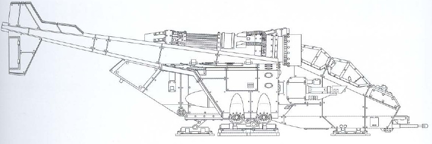

女武神运输机性能诸元

机组成员 4人（驾驶员，导航员，2个舱门武器操作员）

动力系统 2xF75-MVs矢量喷气引擎

重量 33吨（空重）

身长 18.5米

翼展 16.9米

高 4.8米（起落架放下高度）

最大时速 1100kph

最高升限 13000米

作战半径 2000公里（大气层内）

基本武备 机首激光炮台 2x仓门暴弹机枪

次要武备 2x地狱打击导弹

基本弹药 150射次弹夹（机首激光炮）

次要弹药 1000颗实弹（暴弹机枪和机尾炮塔突击炮）

装甲：机身结构75mm

正面 75mm

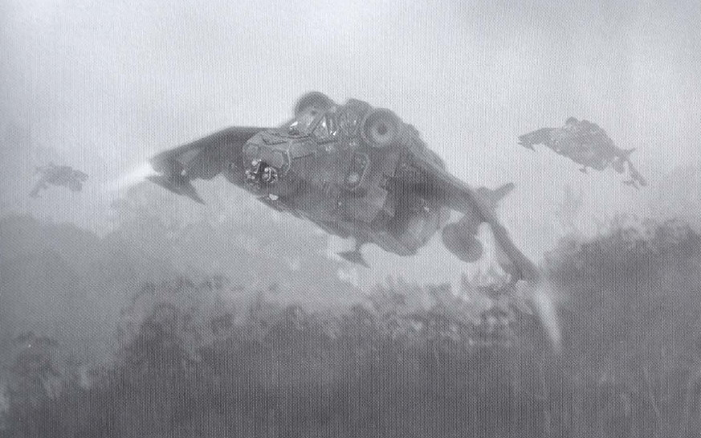

3架女武神在极低空快速接近着陆区

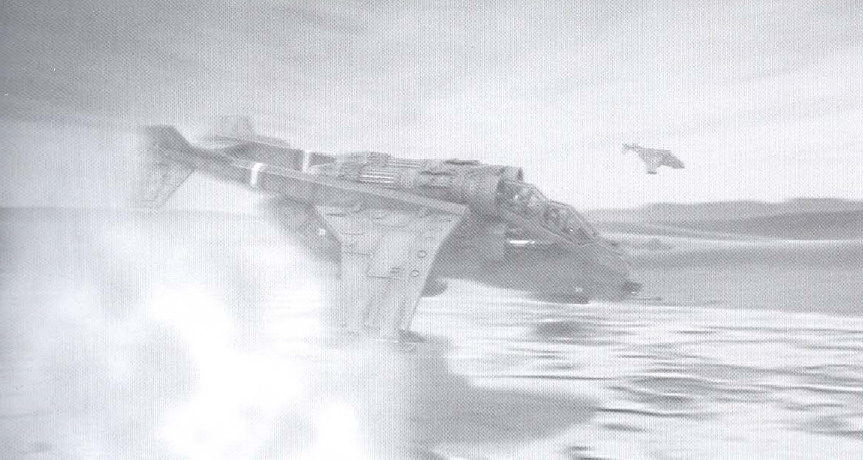

在第十三次黑暗远征中，第二战术连队的2架女武神在Cadia星球掠地飞行。长机飞得如此靠近地面以至于刮起了浓重的土尘，这是一种模仿地面车辆的有效办法。

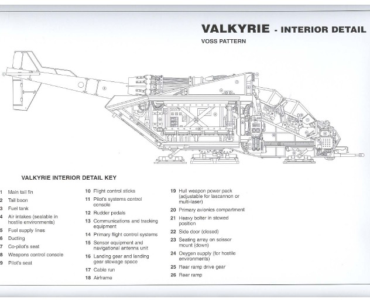

女武神结构图----自己点开看看吧。。。

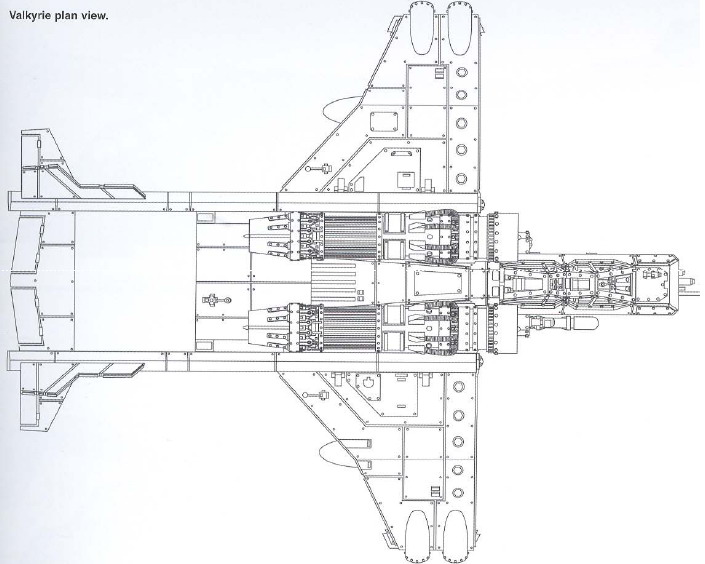

女武神顶视图

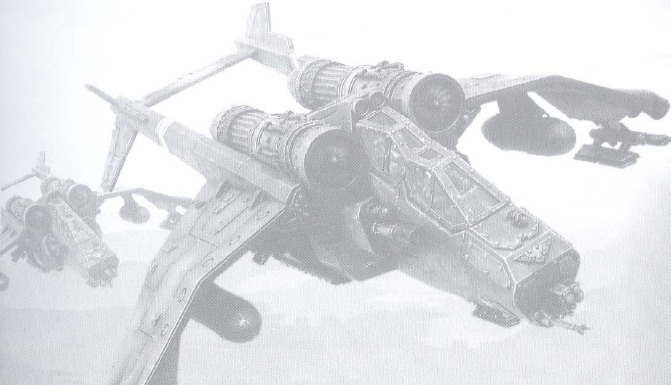

女武神编队扑向着陆区

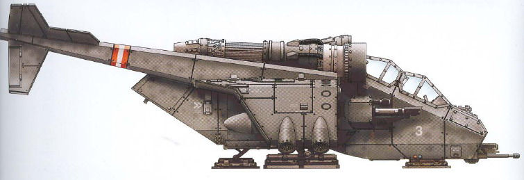

帝国海军第二战术连队的3号机，Cadia防御战时的涂装。

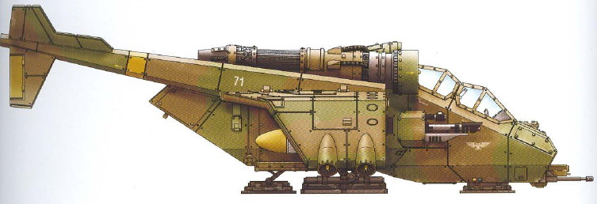

第71海军战术连队在Helion V作战时使用的丛林迷彩。

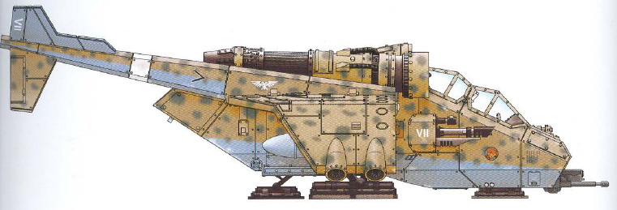

第22Elysian伞降团在YarantⅢ的战役中采用的沙漠迷彩，请注意机头的徽标和战果记录。

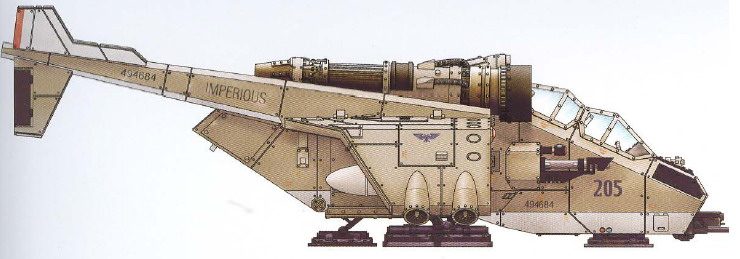

帝国海军205战术连队在海洋星球Tyrama Secundus采用的涂装。本机被其机组成员取名为-强横号。

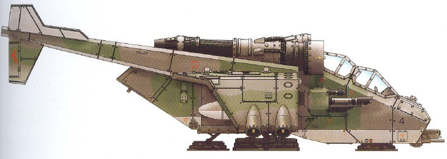

第123海军战术连队的女武神。

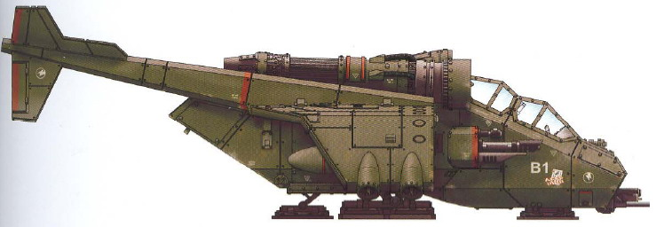

64Elysian伞降团在厄运连连的第五次Ymgarl介入行动中使用的女武神，使用标准绿色涂装。该团团队标志是闪电。尽管本机官方编号是B1,机组成员还是为她取了个呢称-王中王。

==============================================================================================

感谢兔子半妖提的提醒-我采用了中文音译阿玛戈顿来指代Armageddon-具体的介绍在帝国装甲中已经提到过了,我就不多说了.

秃鹰炮艇机

秃鹰和女武神有着非常近的血缘关系，但是用途上大不相同：女武神负责运送军队和装备进入战场；而秃鹰是多用途炮艇机，使用强大的火力搭载替代了运输组件。秃鹰的速度比闪电和霹雳要慢得多，但是却搭载着和其大小不相称的火力系统。秃鹰常常盘旋在战场上空为地面部队提供进距离的火力支援。

秃鹰常常用于支援女武神的作战，使用强大的火力压制让空降部队能够顺利投入战斗。通常每架女武神都能得到一架秃鹰的火力支援，这些秃鹰会尽其所能地倾泻弹药到敌人的头上，保证空投小组的安全。同时秃鹰也要为缺乏反装甲武器的空降部队提供火力支援，所以秃鹰能够携带的武器无所不包：从“地狱打击”级别的空地导弹，到收割步兵用的速射炮和破片火箭弹，还有攻击敌人据点用的各种炸弹，都是秃鹰的常用武备。

一架秃鹰需要两名机组成员，一名驾驶员和一名武器操作员。通常情况下秃鹰在出击的时候会配备各种武备以应付各种突发情况。为了增加航程秃鹰可以选择挂载副油箱，当然这要以减少挂载的武器弹药作为代价。然而对于要护航女武神深入敌后进行突袭任务的秃鹰来说这却是必要的改装。

如同女武神一样，秃鹰也具有良好的操控性：可以在空中悬停，也能在空间狭小的地方降落，还可以为了低空打击敌人目标而在建筑物之间迂回。尽管秃鹰作为大气层内机种不能在太空环境中使用，他们同样是帝国海军战术打击力量中令人敬畏的组成部分。

秃鹰侧视图

秃鹰性能诸元

机组成员 2人（驾驶员，武器操作员）

动力系统 1xF200-Kw4 矢量喷气引擎

重量 9吨（空重）

身长 19.2米

翼展 4.6米

高 4.9米（起落架放下高度）

最大时速 1100kph

最高升限 11000米（使用喷气引擎可以达到）

作战半径 2000公里（大气层内）

基本武备 机首暴弹机枪

次要武备 4个翼下挂点，多种武器搭配选择

基本弹药 200颗实弹（机首航炮）

次要弹药 取决于搭载的武器装备

装甲：机身结构75mm

正面 75mm

秃鹰顶视图以及武器搭配

1．Voss版本多孔火箭发射槽。

2．Voss版本4连装Mk23导弹发射器。

3．Voss版本航炮及弹药吊舱。

4．Phaeton版本激光炮及弹药包吊舱。

5．Mars版本连装激光炮及弹药包吊舱。

帝国海军第二战术连队的5号秃鹰机，采用的是Cadia防御战时的涂装。

Elysian64空降团在厄运连连的第五次Ymgarl干涉行动中使用的秃鹰，使用标准绿色涂装。该团的徽章是个闪电图标。尽管其官方战术编号是C2，机组成员还是昵称她为“攻击鹰”。

第15Elysian空降团第9连第一排的6号秃鹰，担任重武器支援的任务。使用的是YarantⅡ二次战役时的涂装。

帝国海军第81战术连队的秃鹰炮艇机，使用在DolumarⅣ上对抗钛星人时的沙漠迷彩。

第九Elysian空降团在丛林星球Veridian Prime上对抗Kraken虫群的秃鹰。

第33帝国海军战术连队在冰雪世界BelatisⅣ使用的雪地秃鹰。

啊 终于把帝国海军搞完了
