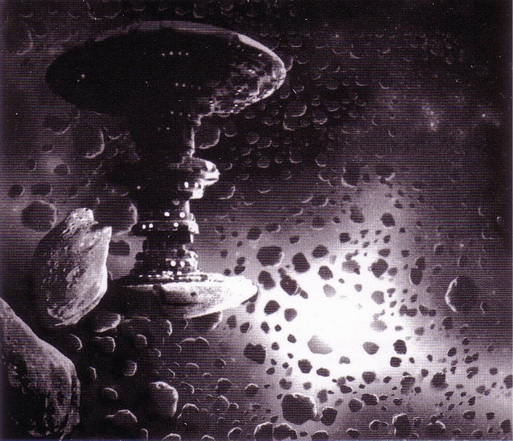
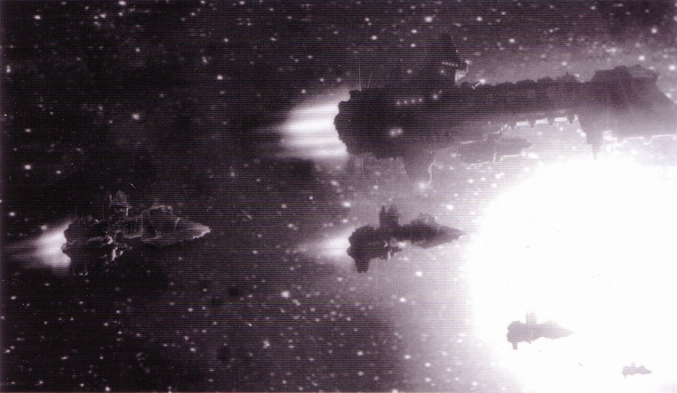
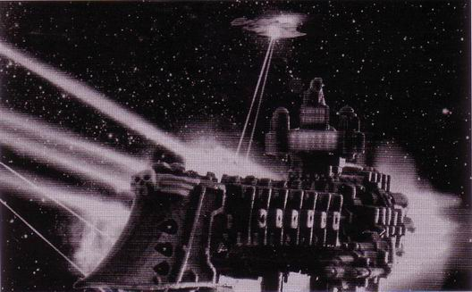

---
title: 塔洛斯战役（第一章）
prev: ./imperial-navy-aircraft.md
next: ./the-battle-of-talos-2.md
---

# 【分享】帝国装甲三——塔洛斯战役（第一章）[zt]

原贴：<http://game.ali213.net/thread-975355-1-1.html>

> 作者：boltgun

塔洛斯战役，对于帝国来说，它本质上是一场为了一个矿产资源而发生的边境战争。在帝国看来，这是一次很不足道的事件，如同帝国中经常发生的日常冲突一样。它并没有牵扯到多少军事资源，更没有办法和卡迪安之门战争，或是第三次末日行星之战那样的大规模战争相比。地球的高领主们不会为了一个塔洛斯费多少神的——如果他们甚至听说过这个地方的话。

相反，对于钛族来说，塔洛斯战役是一场相当严重的冲突。他们没有帝国那样无尽的资源可以消耗，在塔洛斯的部署力量代表着钛族相当部分的实力。尽管钛族一贯有着一个“好人”的形象，但是塔洛斯在他们来说确实是一场富有攻击意图的战争，是一场扩张版图，为他们所谓的“更高利益”所服务的战争。与混沌信徒和泰伦虫族相比，钛族或许看起来更理性一些，但是在为了自己的目标而战斗的时候，他们是无情的。

## 第一章 战争之路

### 威胁之下的帝国

人类帝国是庞大的，它包含着上百万个世界，分布在整个银河的各处。它是人类有史以来最庞大的帝国，看起来，一个人或许会认为帝国是强大的，强大到可以抵抗并击败任何威胁，但事实并不如此。

事实上，帝国正处于没落之中。银河是一个黑暗又充满恐惧的地方，到处是嗜血的外星种族、残忍可怕的势力，甚至那些让人连名字都不愿提起的恐怖存在。时时地被内忧外患滋扰，人类帝国必须时常地为本身的生存而战。维持这庞大帝国运转，并保护着它的，是总部设在地球上的帝国总管庭—— 一个巨大的、结构错综复杂的官僚机构。正是这里，每一个星域，每一个节区，每一个亚节区和每一个星系的政令被下达，机关运做被维持着。这一工作是如此繁复，连总管部本身也无法完全控制运做的每一个走向。在总管庭之内，有着各自机能不同的分支部门，对各自掌管的事务负责。其中最为庞大的机关，当数军需部。这个机构监督着帝国最大的军事武装——帝国卫军的兵员、补给和装备器械的提供。这件事本身意味着惊人的工作份量，帝国卫军是一个估算有着数十亿战斗人员、数百万装甲的组织，它的部队部署遍布在银河的各个驻守区域和战场上。任何一刻，帝国卫军的部队都至少参与着上千场或者上万场战斗，这些战场无一不需要充分的补给。在军需部拼命地满足着这些需要的同时，威胁着帝国的危险依然存在，并每日愈加严重。

在第四十一个千年末尾即将到来之际，新生的恐怖逐渐地显露出征兆来。在那亚空间和现实宇宙相交、混沌邪神的信徒统治着的地带——恐惧之眼中，混沌的大司战、大反乱者、行星的破坏者阿巴登，在制定着新的战争计划，集结着兵力，准备对帝国和帝国的“伪帝”发动一轮新的攻势。一万年的征战，并没有平息阿巴登那被邪神挑动着的、疯狂的复仇欲望。他的第十三次黑色圣战正在恐惧之眼中酝酿着，当阿巴登的风暴爆发之时，那将是有史以来最汹涌的一次入侵。他会把所有的力量释放，目标即是占领卡迪安之门。

卡迪安之门是恐惧之眼中唯一的一条稳定的空间出口，也是在恐惧之眼和帝国的心脏——神圣的地球之间最近的路点。如同他的先师荷鲁斯一样，阿巴登的最终目标，在于推翻神圣皇帝的统治，摧毁帝国。要达成这一目的，他必须攻击地球，而占领卡迪安之门将是重要的一步。

但是卡迪安之门是帝国在神圣地球战略防御上的头等重地。卡迪亚行星是一个被要塞化的行星，是在帝国中最军事化的世界。它是一个重堡垒行星，有成群结队的帝国舰队驻守，卫星轨道上环布着致命的战斗要塞，行星表面上有最为坚固的防御工事，被精锐的卡迪安突击队战士保卫着。卡迪亚星系中的各个行星都有重兵守护，要占领卡迪安之门，需要一场无比浩大的攻势，也将把帝国拖进一场自从远东KRAKEN虫群入侵以来最大的攻防战之中。当阿巴登发起这次进攻的时候，那将是一场需要帝国所有的资源支持才有胜利希望的战争，一场规模难以想象的战争。

这样规模的战争，无法悄然到来，也无法做到奇兵突起。帝国对于恐惧之眼中发生的事并非完全无所知晓。贤哲和预测者在战争到来之前都曾做出可怕的预言和警告，皇帝陛下的塔罗兆示预示了严重的威胁正在逼近。恐惧之眼周边的巡逻增加了，帝国机械会的探察者们向恐惧之眼中发射了无数的无人侦察机，它们深入到敌区的最核心地带，将其中的情况发送回来。这些机器所发现的情报在帝国高层激起了一场地震。二十位地球高领主——帝国的议会，帝国的统治者，他们在皇帝陛下的宫殿中讨论了许久，决定帝国对此将采取的反应和行动。决定是，防御力量必须立即加强，预备力量必须马上建立，武器、弹药和供给源源不断地被运送到前线和防区后的仓库中。星际陆战军军团将随时备战，并部署到相应的位置，以期及时作出战略反击。无论重锤将在哪里落下，帝国卫军必须坚守，然后将邪神的信徒击退。帝国每一支可战之军，必须做好准备，战斗到最后一发子弹，最后一个人，保卫卡迪安之门。

地球的高领主如是决定，于是帝国将如此运行，因为他们代表着神圣皇帝的无上权威，他们的话语即是律法。于是总管庭向军需部下达指示，开始着手准备另一场庞大的战争。

### 锻造世界斯太基司VIII

阿巴登的第十三次黑色圣战间接地影响了整个帝国的每个角落。新的帝国卫军师团需要建立，税目又要增加，又或者，各个锻造世界需要提高生产产量，填补不断增长的军械需求。阿巴登的野心如同投在池塘中的一块石头，激起的涟漓一直扩散到了银河遥远的另一端。

在远终星域——帝国划分银河所形成的五大星域中最大的一个，即使是在这远东的边缘，那份影响依然可以被感觉得到。司太基斯VIII是远终星域中最大的锻造世界之一，帝国机械会最大的研究和生产基地。在生产能力方面，斯太基司VIII名列整个帝国第二，只有机械会的总部火星能够超过。它位于沃尔肯星系，是一颗名为斯太基司的气态巨型行星的第八个卫星，在帝国军备供给方面占有举足轻重的地位。

作为一个锻造世界，斯太基司VIII对总管庭不承担任何税务，而是要为军需部提供帝国卫军所需要的武器、军需和各种器械。对于帝国来说这是一件十分要紧的任务，各个锻造世界的产量被十分严密地监控着，以期能够达到需求预测所列出的水平（这个预测是机械会通过他们的逻辑和一些神秘的方法搞出来的一个指标）。如果锻造世界的产量未能达到这个要求，则很可能意味着不远的将来，战区的弹药和武器的供应严重脱节的情况，而军需部则花费了大量的时间与资源来确保这样的事不会发生。于是，军需处的人员带着总管庭的命令，来到了斯太基司VIII，给他们送去了新的生产指标。一场新的黑色圣战即将到来，意味着更多的帝国卫军师团将被创建，而这些部队需要装备。斯太基司VIII的管理者和军需处的高官一起就新增长的军需进行了长时间的探讨。

这一场争论的整个重点即在于，产量的增加，必须建立在提供更多的原矿石和精练原料的基础上。一个锻造世界的血液是它所消化的各种原材料。斯太基司VIII这样大的生产规模的情况下，庞大数量的原材料和化工原料需要由遍部帝国各处的矿产行星的出产来满足。开拓一个新的原料来源将不会是一件容易的事，军需处的官员匆忙地赶回地球，开始了工作。总管庭的审查员们开始翻阅山堆一样的档案，分门别类地翻查备案的矿产来源，寻找着地区审查员们的批注，搜索着哪里还有可以进一步提高产量的潜力。

塔洛斯行星的名字第一次出现在总管庭官僚机构的眼前，就是在这次的评估和复查之中。塔洛斯是远终星域深处的一颗小小的矿产行星。它在各方面都不甚惹人注意，除了两点：行星上尚没有开发的矿藏生产潜力，和它离正在扩张的外星种族钛族的帝国边界太过接近的距离。军需部组派了一个代表团，携带着三十八千年时期所总结的关于塔洛斯行星的古老资料——正是为此等事态所准备的数据，准备前往视察。代表团中的主审查员尼姆斯.瑞和他下属的一干文员和档案官踏上了去塔洛斯的旅途，他们将负责通知当地的行星总督一个新的生产指标，并尽力协助他达到这个指标。作为军需部的全权代表，如果地方行星总督不愿或不能晚成总管庭下达的新任务，那么瑞有权利在帝国安定和大义的名义下，将总督的位置上换上一个能够完成这个任务的人。

### 军需部的审查团

被指派带领代表团的人是主审查员尼姆斯.瑞，一个军需部高层机关中的一线办事员。同队中的还有一干档案文员和信息密码官。离开了地球之后，他们旅途的第一站将是斯太基司VIII，在那里代表团将接纳一队机械会为本次调查所派遣的代表，其中包括一位大长老金属学家，瑞也需要在那里再次地核对手里的各种数据。考虑到塔洛斯的所处位置，帝国海军特地派遣了两艘护航舰。

塔洛斯的总督第一次得知关于代表团前来的相关事宜时，两艘护航舰和运输船已经到了星系门口了。这是瑞所要求的一项审查策略，没有事先知会行星总督，这样才可以给代表团一个机会观察塔洛斯上矿区最真实的运转情况。

在一次艰苦的亚空间航行之后，三艘船终于平安到达了塔洛斯的轨道上。代表团在瑞的带领下，搭乘着几艘天鹰降落在塔洛斯的唯一城市塔洛金，行星总督和他的官员顾问们在港口举行了欢迎仪式。所有随行人员随即在本地官员的伴随下来到了总督府，在那里，一次正式的会议上，瑞向行星总督交代了总管庭的新任务。

会议结束之后，瑞开始了在矿场的参观，亲自观察开采工作的进行情况，并对矿工进行个人讯问。同时，机械会的代表开始检查起矿石的纯度和质量。

### 第一次调查

行星总督领主奥利斯同意，在军需部的协助下，目前的矿产量是可以提高的，并且满足斯太基司VIII的新原料需求水准这个目标也是可以达到的。他许诺将会在自己的权力之内尽一切可能让新目标达成，并尽力为来访官员们提供一切方便。在审查的开始阶段，他完全没有受到任何怀疑。

直到主审查员瑞开始视察外围矿场的时候，他开始对一些开采工程的走向有了怀疑。首先，在沙漠中到处散布着的废弃矿坑证明了曾经存在的大量开采活动。对于这些，他被告知，无非是矿脉采尽，没有继续开采的价值。在矿主们的说法看来，这些是他们尽心尽力的证据，但是审查员的眼中，看到的却是塔洛斯的矿产潜力被进一步蚕食，或者它的潜力并没有达到第三十八千年时的报告中所说的程度。

瑞的视察继续着，而每一处矿区看起来都在努力工作着，寻找着新的矿脉，将矿石大量地轰碎开采出来。矿石被分类，然后运送到塔罗金的太空港去。塔罗金现有的库存数量惊人，正等待着下一班空舱的运输船的到来，将它们运送出去精练。在表面看来，一切都井井有条，但是瑞开始向事情的深处观察了。

每一处矿区都被要求交出他们的生产量记录——十年甚至二十年的记录。一些矿主拿不出这样的记录，他们的记载并不完全。但是大部分的矿主还是做到了，通过这些记录，瑞开始对近些年塔洛斯生产了多少矿石有了一个大致概念。下一步，他开始翻查新的勘探报告和地理报告，查看关于新的矿脉和这些矿脉的蕴涵量。从这些数据中，他对塔洛斯大概还有多少矿藏剩下有了一个很好的概念。但是这些资料的总和和那份古老的报告中所表明的矿藏量并不相符。基于塔洛斯近年来的生产率，比较斯太基司VIII接收并精练的矿石数量，这中间还剩下的数量应该比所记载的量要大得多。这其中显露出来的差额让瑞担心不已。难道塔洛斯一直在过量生产？如果是这种情况，那么剩余的库存在哪里？塔洛金仓库中的数目根本不足以补上这个差额。或者是斯太基司VIII的数据弄错了？如果是这样，那么机械会的需求预测的数字也可能会因此出现错误，那样的话将意味着未来的补给短缺。瑞决定，暂时先将这些怀疑藏在心底。

瑞花了数个星期在塔洛斯收集了他需要的所有资料，在调查结束时，他已经对事态了解得很清楚了。矿场一直都在过度生产，这些年来，它们一直在出产着比需求量更多的矿石，所有这些矿产都被集中运送到了塔洛金。虽然来自斯太基司VIII的需求一直都很圆满地完成并上交到帐，但是余下的大量宝贵矿石消失在了空气中。因为一直以来并没有出现过什么引起注意的事，以至于这个数量上的问题一直都被忽视了。能从记载和帐目上追查到的线索到这里就结束了。那些消失的矿石到什么地方去了？在离开塔洛斯之前，瑞决定去和总督对质，问问他关于这事的解释。只是看起来，总督本人对此问题应该还没有多少了解。

总督奥利斯果然声明自己对此事一无所知。在他看来，矿产任务被完成的很好，每一次交接运输都很准时，这就够了。他不会亲自过问那些日常的矿务运作，那些事是矿场主们的工作。总督大人的建议是：“去问他们！”

瑞于是就这样做了，他将最大的矿场主们一个个地叫来问讯，让他们解释这些数字的问题。他们没有任何说法，只是推脱，不耐烦，然后继续推脱。他们只是不断地寻找矿脉，然后利用手头上所有的人手将矿石从地里弄出来。一问三不知就是他们的解释。调查毫无进展，瑞开始怀疑这份沉默的背后存在着一个阴谋，他认为事已如此，帝国需要采取更严厉的手段了。

插入塔洛斯概况附录，由KV85和兔子半妖真情奉献

### 塔洛斯行星概览

塔洛斯星系： 4行星（I－IV），其中 1个可居住（塔洛斯II）
尺寸：赤道距离 16000英里
重力：96G
卫星：双月球。
人口：约1200 0000（人类和变种）
旋转速度：1200英里每小时。
气候分级：极端——极度干旱。
对流层组分（地球元素古名称）：氮76％，氧20％，氩2％，臭氧1％，二氧化碳0.2％。
行星总督：Uphir Aulis.Aulis家族第19统治者。

气候：极端炎热到十分炎热。最为寒冷的环境位于极地高海拔山脉，但其寒冷程度仍旧无法成冰，最为炎热区位于沙漠深处。
海岸地区一般均温为摄氏35度（华氏95度），沙漠深处升为摄氏50度（华氏122度）。最低年降水记录少于 1mm。
夜间非常寒冷，少云。蒸发水分主要部分于夜间液化返回地表。

气候区划：塔洛斯被分为四个基本气候区：山脉，干旱沙漠，半干旱沙漠和海洋。流动沙漠和裸岩覆盖行星地表的95％。

最大地区为山脉。低矮山脉高地覆盖行星地表的40％。因为严重侵蚀，他们都不高，但是极度崎岖。山脉地区没有主干道，页没有居民点。这些地方仍旧是未勘探的荒野。

第二大区为干旱沙漠。大沙海中无法居住，也可能埋藏有大量矿产。工程作业的补给在这样严酷的环境——极高的温度，没有水源，高速强风和大沙暴（参见沙魔）的风险——之中是根本不具可行性。沙漠地区绝大部分是尚未勘探的荒野。

集中在海岸周围的半干旱沙漠地区大多为岩石质的不毛之地。在地面高度扬沙强风十分常见。

海洋调节着塔洛斯的极端温度。环绕于小型海洋周围的是半干旱沙漠中的定居区域（见Aestus）。这些区域是行星上水培农民的家乡。

塔洛斯有两片主要海洋，称为Ak-Sai和Em-Sai。这些小型，被陆地包围的海洋是塔洛斯唯一的地表水资源，可能是作为该行星在科技的黑暗时代中，地球改造的一部分，由人工创造。今日，这些海洋已高度碱性化，但是仍通过水处理提供着三分之二人口的水源。

气象：高空气流和“沙魔”
热空气自大沙漠中上升，与极地高原山脉区的冷空气相冲突。压力差在上层大气产生了高速气流。这种气流能够达到极高的速度，最高达400英里／小时。这主宰着塔洛斯的气候。随着空气中的少量水汽液化形成塔洛斯的天空中常见的啸云，在最炎热地区，这些云开始形成局部的风暴云，充满大量水汽。风暴云在随热空气上升。如果它们遭遇其中一条气流，云的顶部开始在强风中旋转。这种旋转力随云体向下辐射，速度越来越快，形成飓风。这些飓风会非常庞大，在塔洛斯的地表上肆虐很多天。吸入大量沙子后，便形成了“沙魔”（当地俗称）。虽然大多数都在沙漠深处自行爆散，但是有时候沙魔毁灭水培农场或者采矿机组。

地球改造：昔日，遥远的过去，塔洛斯是一个死的世界。无法居住的，只有被灼烤的沙漠荒野。在科技的黑暗时代，其矿产财富被发现后，通过引入水源和产生氧气的基因改造植物进行了地球改造。这组中创造了一个可供少量人类生存的环境。

植物和动物：无本土植物。基因改造植物被引进，并在半干旱沙漠地区存活，比如灌木和类仙人掌植物。海中生有有毒海藻，生成了行星上大多数氧气。无任何已记录的本土动物。

经济：大约一千二百万生灵居住于塔洛斯，大多在塔洛斯市市内和周边（Tarokeen），以及环绕小型海洋的半干旱沙漠。塔洛斯市位于Aestus区，那里的众多内陆海是塔洛斯唯一的地表水资源。这些水高度碱化，不过，设在岸边水处理厂可将之转化为饮用水。这一过程受到分散的水培农场的支持，它们可以收集空气中的水蒸气。水培农场通过独占契约向行星总督出售他们的产品。总督和他的官员控制塔洛斯所有的水，换言之，所有生命。

Tarokeen是最大且唯一的都市地区，拥有行星唯一的空港设施。

大多数工人为矿工，长年外出，在沙漠中的矿带和矿场工作。其他主要工业是水处理和水培农业。水培农业工人在大气调控的水培工厂种植食物。矿石运输是另一大型工业，将原矿从沙漠中的矿区运输至城市中的收集点，此后这些矿石被运出行星。短途运输采用人力（正如字面意思，每个劳工背一袋）或者拖拉机牵引的矿车编组的列车。长距运输使用大型货运飞行器。

Ogryn劳动力。

在第38千年，作为行星总督提高生产力行动的一部分，他请求以Jopall的Ogryn殖民地方式输入外面世界的劳动力。几千的壮硕特种人被大规模船运至塔洛斯，在最严酷的沙漠地区的矿区工作。非常强壮坚韧的Ogryn非常适合体力劳动，比如装卸和拖拉矿车。在塔洛斯，Ogryn们仍旧被众多矿区作为劳动力的一部分使用。Administratum实施的最近一次普查表明，大约400年前，估计人口数量为10000的Ogryn散居在这个行星上。

社会：几乎所有贫穷的矿工和劳工在“劳工帮”中工作。较高的科技水平得到保留，许多作业实现了自动化。Ministorum Galaxia missionaries有关基因变异的报告极少。

水源：由于该行星极度干旱，水是塔洛斯的首要资源。水培农场是一项重要产业，与碱化海水处理同样重要。海水通过处理，适于人类使用。所有淡水贸易都被行星总督通过其官员“淡水专员”牢固把持。处理厂位于海岸，通过三道工序净化水源。水培农场广泛分布在Aestuts地区。

主要出口品：铁合金、铅、钒、铼、锰的矿石。

铼

一种高密度的，银白色金属，沸点很高．通常与Ｇａｄｏｌｉｎｉｔｅ和辉铜矿伴生．通常用于和钨一起制造合金．

锰

一种易碎的灰白色金属，产于辉锰矿中——一种黑色的矿物，由锰的一种氧化物构成．用于冶炼一些钢材，比如锰钢或其他的磁化合金．含锰炼１１－１４％的锰钢是一种非常坚硬却又有高可塑性的钢铁，常被用来制造坚固的设备，比如说岩石挖掘机、重型活塞以及火炮身管等．

铅

一种有毒的蓝白色重金属，产于方铅镀之中（一种蓝黑色矿物，主要成分是硫化铅）．拥有高度延展性，其合金常被用于制作Ａｃｃｕｍｕｌａｔｏｒ，电缆外套以及放射物屏障．

钴

一种易碎的坚硬磁性金属，产于辉钴矿中，用于制作抗腐蚀的钢材．

主要的进口产品：食物和水．

食物供给：在有人造大气的巨型封闭式水培种植场里生产．其实大多数建筑都有自己附带的水培种植场，但其中最庞大的水培种植场位于Ｔａｒｏｋｅｅｎ附近的沿海地区．水培种植场满足了居民们８０％的食物需求．而剩下２０％进口于周边的星球．农作物主要是稷和Ｓｏｒｇｈｕｍ类的草本植物，提供了大量的谷物．花生和大豆类的作物提供了蛋白质和其他的营养成分．一些特别的非本地产水果也在此有种植．所有的作物都进化到能适应水源短缺的环境．维生素和蛋白质的另一个来源是藻类和其他浮游生物，在海中被收集后制成被当地人称为Ｋｒｅｍｌ的流体食物．这就是矿工和其他工人的食物．其他的食物、肉类、日常用品和奢侈品必须倚赖进口．而且通常都由社会的高层、官员和矿主所享受．

城市状况：只有一座主要城市．Ｔａｒｏｓ城（Ｔａｒｏｋｅｅｎ）大概拥有４００万人口．它的作用是：集中保存矿石；管理本星球的事务；作为水和食物的以及其他工业产品的分发管理中心．周围的地区水栽培种植场和水处理场以及采矿场的密度高得惊人．其他的大型定居点十分罕见，通常都是在矿石采集点附近建立的城镇．

Ａｅｓｔｕｓ（见地图）
Ｔａｒｏｋｅｅｎ盆地，以及附近海边的人口聚居区被命名为Ａｅｓｔｕｓ．大约是６００万人口的家园．散落的种植场和临时性的采矿设施（诸如Ｔｕｎｇｕｓｔａ采集站，Ｆｏｒｎａｘ，Ｔｙｎｄａｒｉｓ，Ｇａｉｄａｍａｋ，Ｓａｒｙｃｈ采集站，Ｄｅｕｃａｌｉｏｎ和Ｅｒｅｂｕｓ）附近有许多临时性的营地．由于临近海洋并有季风作用的缘故，这里是气候最温和的地区，促使大多数人都在此定居．

其他

Ｉｒａｃｕｎｄａ　Ｉｓｔｈｍｕｓ
Ａｋ－ｓａｉ和Ｅｍ－ｓａｉ之间的狭长地带，Ｔａｒｏｋｅｅｎ城便位于此处．它是Ｔａｒｏｋｅｅｎ盆地的一部分，而且是城市外围最大的人口聚居区．

大沙海

空旷荒芜的沙漠．大沙海中无人居住，也没有道路，只有不停移动的流沙．这里也许埋藏着巨大的矿藏，等待人们去开发．

大熔炉

一块被群山包围的荒漠，只能通过飞行器进入．这里是Ｔａｒｏｓ星上温度最高的地区．

Ｐｈｙｙｒａ山区

一块充斥着戈壁和低矮的山丘的地区．因匪徒横行和潜在的丰富矿藏而闻名．

Ｔａｒｏｓ的已知历史：

皇家档案馆中的记录并没有详细记载Ｔａｒｏｓ的殖民过程．同黑暗时期早期被发现的那些星球一样，没有关于这个星系的详细记载，只知道和银河系东侧的许多其他星系一样，都是在这段时期被发现的

起初Ｔａｒｏｓ是一个死寂的星球，炽热的沙漠和岩石充斥着这个荒芜的世界．这个星球上存在的最高级的生物也就是些微生物．该星球没有地表水，大气中水蒸气含量也十分稀少．空气不适合人类呼吸．总之，这个星球完全不适合居住

不过，早期的探险者们注意到，这个星球近乎没有生命迹象，但是只需要稍加改造，这个星球的生态系统便可以变得适于居住．虽然温度很高（大沙漠中为极高），但并未达到无法定居的程度．大气中还是有一定的水蒸气．更棒的是，它的矿产资源量极其丰富．数量惊人的高价值矿藏就在地表附近，非常利于开采．大气状况稳定，便于人工改造．Ｔａｒｏｓ并非一个无法殖民的星球．

Ｔａｒｏｓ的丰厚矿藏使得改造行动迅速开始．在那黑暗时代，人类的技术和知识使他们足以改造行星的大气和生态系统，使其适于人类居住．改造过程并不是十分的繁琐，因为他们要的不是一个苍翠繁茂溪水遍地的花园般的世界，而是一个能够供人居住及开采矿石的星球．

通过那些已被遗忘的先进科技，他们把这个荒芜的世界改造成了一个人类能居住的星球．当然，这不是在一夜间完成的．改造过程花了近５０００年：水资源被以海洋的方式聚集起来．经过基因改造的植物也被移植到这个星球，来提供宝贵的氧气．通过精心的管理和调控，大气状况得到了改变．这看起来像一个神话：Ｔａｒｏｓ终于可供高等生物生存了．

在皇家档案中首次提到Ｔａｒｏｓ是在Ｍ３０（３００世纪），动荡之年后．那时刚刚崛起的地球帝国四处扩张，将由于战争和亚空间风暴而失去联络的人类殖民地统一到皇帝旗下．一支帝国军队发现了空旷的Ｔａｒｏｓ，以及上面已经退化到石器时代的人类部落．Ｔａｒｏｓ的人口已经暴跌到不足１００万．再过了１０００年后，上面的人类已近乎绝迹．

由于发现了埋藏的矿藏，帝国决定在Ｔａｒｏｓ重新殖民．原来的殖民点被清除．新的殖民者们建起了矿产开采点和星际港口．在帝国统治下的一万年中，Ｔａｒｏｓ的人口增长到１２００万人．在星际港口附近诞生了一个庞大的城市．当然，金属矿开采依旧是这个星球的主要功能．

帝国卫队的征兵情况：

记录显示在帝国统治以来的一万年中（这些数据因为是由人脑保存的，可能不那么准确），Ｔａｒｏｓ上只征募过８个团的士兵加入帝国卫队．塔洛斯第一团在第三次黑暗圣战中被歼灭．塔洛斯第二、三团在Ｓｔ．ｓａｅｎ圣战中被击溃并编入另一个帝国卫队团，事实上已不存在．记录中没有塔洛斯第四、五团的下落．第六团在Ｂａｄｕｎ之战中与兽人激战后被除编，幸存者被编入卡迪安第１５团．第七团在走私者ＦｏｕｌｗａｙＴｏｒ在银河系东侧发动的第三次袭击中失踪．第八团现在作为Ｈｅｌｌｉｏｎ四号行星上的主要守备力量．

其中所有的翻译用语为尊重原翻译者劳动，均使用原翻译者的译法。

### 塔洛斯的密谋

主审查员瑞所不知道的是，他的调查正在揭开一件长达二十年的秘密。审查团的到来在表面看来似乎是受到了很热情的招待，但事实上，他们的的出现，让塔洛斯的高层人员日夜不安。

长久以来，钛族对塔洛斯一直存有相当的兴趣。随着钛帝国的扩张，一个个的恒星系统被它们仔细地观察分析着，寻找着适合殖民的行星。其中很多星球被鉴定挑选出来作为合适的目标，塔洛斯便是其中之一。它有一个可呼吸的大气层，而且，虽然它是一个荒凉的沙漠行星（相对而言，钛族人自己更喜欢高温环境，而不喜欢低温），但是它有一定的水存在，可以维持生命，最重要的是，它蕴涵着丰富的矿物财富。这一点对于新的殖民建设和扩张步骤十分重要。只是有一点：塔洛斯是一个人类帝国的属地，这意味着得到它将十分困难。自从钛族第一次和人类帝国接触之后（在迪瓦兰，一架侦察机被毫不留情地击毁了）钛族人便明白人类是不会轻易放弃任何一个以他们的皇帝之名统治的世界的。任何军事行动都会招来迅速无情的反击，占领塔洛斯，意味着一场大规模战争。以太种姓的领主们讨论认为这样一场战争的所得并不能补偿它的风险。况且，还有其他更容易占领的目标存在。所有关于直接入侵塔洛斯的计划都被驳回，但是塔洛斯并没有被他们忘记。

议会没有动用火氏实施战争计划，而是转向了水氏。如果水的外交专家们的工作做得足够有耐心，足够隐秘，那么外交上能够带来的胜利将是巨大的。一般来说，帝国行星会拒绝和任何外种族做任何形式的接触，水氏认识到，很多行星总督是不能承担被人发现和外种族做任何接触和谈判的。但是，在绝对隐秘的前提下，一些小的协议和小规模的贸易还是可以达成的。商人行会的首领和工商部门的官员头脑都是富有和贪婪的人，一个和勤劳的钛族人做贸易的机会，将提供给他们极大的财富，这样一个机会在远东地带再没有第二次。

一个由最老到最狡猾的水氏外交家带领的代表团出发去面见塔洛斯的一把手，这个团中甚至有其他和钛族私下合作的世界的人类代表。他们带去了钛帝国不会对塔洛斯发动任何军事行动的保证，寻求达成一些小规模的贸易项目——通过交换一部分锰矿，钛帝国可以提供水分净化和循环技术，还有可以培育食物和奢侈品的水耕设备。这些条件可以让在塔洛斯熬日子的社会精英们的生活变得舒服得多。

当钛族的代表团来到塔洛斯的时候，总督犹豫了。他知道和外种族的接触是全面禁止的，但是塔洛斯只是帝国几百万世界其中之一，而小小的一点矿石是不会引起任何注意的。奥利斯总督亲自和矿场主以及商会会长们商谈之后，他们认为这是一次难得的创造外财的机会。帝国的薪金配额已经有几代都没有任何改变了。矿业运转的很好，总管庭也没有多余的注意力来理会，谁会知道、或者在乎有那么一些多余的钒或者锰被开采出来，被卖给了钛族呢？其他地方都这么干发着小财——随着代表团前来的人充分出示了相关的证据，而且，在长远看来，建立一个良好关系或许可以将钛族的扩张方向转移到别处去。

谈判是在二十多年前完成的，于是钛帝国的一只手伸到了塔洛斯的大门之内。买卖合同是从每年小量的锰和钒开始的，但是随着总督和矿场主们发现他们没有被发现之后，交易量一次次地增长起来。总管庭所下达的任务被完成的很好，只是矿场主门开始忙于寻找新的矿脉发掘了。之后的十年中，钛族甚至派过土氏的专家来为此提供过技术和建议。钛族为购买矿石付出的货币是技术和奢侈品，例如来自塔士瓦的宝石，来自奥它的极品水果。塔洛斯的高层人员们通过这些交易变得极其富有。二十年间，钛族在本地的影响越来越大，而总管庭却毫不知情。

在意料之外的军需部代表团到来时，塔洛斯高层的圈内人们变得忧心忡忡，从秘密走私中获益的矿场主们也开始神经紧绷。但是奥利斯总督劝说他们要冷静，他认为代表团到塔洛斯来的目的无非是要完成矿石增产的任务，配合他们做到增产，那么走私的秘密就没有必要会泄露出去，反到是过于卤莽的行动才会将事情泄露，让他们都被逮捕。他认为，谎言、遮掩和一些糊涂帐可以很好地度过这次难关。但是他低估了主审查员瑞的能力。

当情况失控，谎言和掩饰被瑞一步步揭穿的时候，当瑞的怀疑一天天加深的时候，这些走私者们的心情是十分绝望的，甚至有些人打算将整个代表团谋杀，嫁祸给钛族人。总督禁止了这一做法，他认为如果代表团受到了任何损伤，对于他们来说在长期上都是一个灾难。他还是继续将希望寄托在影响瑞的报告上，直到代表团离开为止，他一直都在尽力于捏造假象和谎言。
但是，总督大人并不知道，在远处的太空空间中，一场并不在他力所能及的地方发生一次意外，将把一切揭示……

### 迪纳布事件

同时，与恐惧之眼或者塔洛斯丝毫没有关系，在迪纳布星系——达陌诃边缘的一个广大空旷的区域，帝国海军的巡逻舰队队锐万诺，正在执行一次反海盗巡逻任务。这次任务的内容包括攻击并捕获任何有海盗嫌疑的舰船，顺便略劫出现的钛族舰船。指挥负责人是五艘舰船中无惧级轻巡洋舰（DAUNTLESS CLASS LIGHT CRUISER）领主锐万诺号的船长达里安。巡逻舰队已经航行了几个月，没有丝毫收获，达里安船长正准备返回基地并报告本区域海盗活动极其微弱。这时，位于队列最前方的斯凯瑞编队剑级护航舰（SWORD CLASS FRIGATE）VCS-6号报告探测器上有不明舰船出现。达里安船长认为这有可能是他正在寻找的海盗，于是他开始了一次小心的捕猎。

在迪纳布星系的小行星带中，锐万诺巡逻舰队小心地跟踪着三艘目标，保持着不会被对方发现并可以很好利用小行星的掩护的距离。一直三天，舰队保持着隐蔽跟踪，希望这三艘目标能够将他们带领到一个海盗基地，或者是联络地去，又或者是一个更加有诱惑里的战利品那里。达里安船长的预感是正确的，目标的目的地是在小行星带的边缘，一个小型远程空间设施。舰队接近之后，发现那并不是一个海盗基地，相反，探测器显示这是一个钛族的太空驿站。达里安在达陌诃边缘地带服役良久，曾多次在不同的地区见过这种太空站。但是为什么三艘人类货船会到访一个钛族的太空驿站？达里安船长留下了一艘护航舰继续监察，然后后撤，并向舰队指挥部报告了情况。

在领主锐万诺号离开的时候，留守的护航舰VCS-6观察到，三艘货船在驿站停泊了之后，不一会，一艘钛族的大使级太空船只身离开了。VCS-6继续在小行星带的掩护下，隐藏了自己的身形，观察着。

同时，达里安船长通过星语者发出的汇报也被舰队指挥部收到，但是他们同样对此事没有任何了解。对那三艘货船的描述并没有带来任何帮助。但是不管那三艘船属于谁，船主在串通外种族的罪行是肯定的。于是对巡逻舰队锐万诺的新指令下达了：消灭钛族驿站，捕获三艘货船，俘虏将被带回，将对其进一步审讯。

领主锐万诺号和VCS-6号汇合，所有的船长被知会了新的任务，船员们奔向战斗岗位，攻击即将开始。战斗编队将在小行星群中缓慢接近目标，然后全速接触并攻击，使目标逃脱的机会减低到最小。领主锐万诺号将和空间站交火，同时僚舰将阻击任何企图逃走的目标，并对逃跑的目标加以追击。达里安船长最后命令道：“听我的命令，直线进攻。全速前进，无须怜悯敌人，愿皇帝陛下让他们那叛逆的心腐烂！”

随着那道命令，帝国舰队巨大的电离子引擎轰鸣起来，将战舰带离小行星的掩护，直向驿站扑去。伴随着成功的奇袭，巡逻舰队逼近在驿站前，在近距离释放着所有的侧舷火力。鱼雷和巨炮轰鸣着，驿站在剧烈的爆炸中颤抖。钛族太空站努力还击，但是效果甚微。一艘货船当场被击瘫，另两艘企图脱逃，护航舰编队立即发起追击。看起来奇袭很成功，只是达里安船长自己也得到了一个意外。他的舰桥上的探测观察员紧急报告，更多的钛族舰船正在接近。一队运输舰和卡斯特兰级轻型钛族战舰出现在扫描范围之中。突然之间，一场单方面的偷袭战即将变成一次有分量的舰战。达里安招回了追击舰，整队出发截击钛族的战舰。

“舵轮，将我们列成一排，和敌人贴紧，保持攒射距离。让我们和这队恶狗来场火力对抗，我可以打赌我们要压过他们！”暴躁的老船长算计着己方的火力可以驱逐或是完全消灭敌人，于是下达了新的攻击命令。四艘僚舰紧紧跟随在他后面，领主锐万诺号狠狠地插进了外星人的队形之中，左右侧舷的炮口竭尽打开，猛烈地轰鸣着。钛族的战舰尽力还击，护盾在离子炮和轨道炮的轰炸之下颤抖着。那是一场艰苦的近距离战斗，双方都受到了严重的损伤。剑级护航舰VCS-6号和7号在战斗中瘫痪，领主锐万诺号的引擎严重损坏，多层甲板起火。但是钛族的舰队被击垮了，运输舰四散逃窜而去，只留下一艘瘫痪在原地，两艘卡特兰在领主锐万诺的主武器打击之下也成为了残骸。巡逻舰队赢得了这场战斗，只是，那两艘逃逸的货船完全不见了踪影。

达里安船长召集起劳累但是士气高昂的士官们，命令立即准备登舰队伍，登陆并搜索钛族驿站和剩下来的一艘货船，所有抓获的俘虏将直接交接到他的手上。另一队登舰队伍将登陆钛族瘫痪的运输舰，取得里面所有运送的物资。同时，VCS-8号和9号将营救两艘瘫痪的护航舰上的幸存人员。整理完毕之后，他们将凯旋回归迪纳布星系基地。

钛族遗留下来的运输舰上，帝国官兵们找到的只有空空的货舱，驿站则已经被炮火严重摧残，离去时对它最后一击即可完全破坏这座太空站。而那艘货船上残存的船员，在和帝国士兵短暂交火之后也被悉数抓获。看起来俘虏们并不知道他们运送的货物是什么，他们的航行日志显示，这艘船最后去过的一站是塔洛斯。至于他们为什么要航行至此，船里的货物为什么会被钛族人卸下，他们完全不知，他们声明自己只是在服从上级命令。但是下达命令的人是谁呢？这些俘虏将转交给审判庭处理，在那里，无论怎样的谎言家都会吐露真相。

在凯旋之后，为了表彰达里安船长这一次胜利，他被授予达陌诃骑士会勋章，并提升为巡洋舰色雷斯之锤（按：查询后面资料，色雷斯之锤是一艘月级巡洋舰，记得是轻巡洋舰级别的，但是这里没说，不过月级在巡洋舰里也是没多大的小型号，但是总比轻巡洋舰强多了）的船长。他将“迪纳布事件”的整个过程详细汇报到了舰队指挥部，但是这件事背后隐藏着什么，对帝国海军来说一直是个迷。

迪纳布事件的真相一直无人知晓——直到主审查员瑞在追查遗失的矿产时发现了这份报告。瑞立刻认识到，迪纳布事件，即是他一直在寻找的塔洛斯走私的证据。那三艘货船上装载的是从塔洛斯出发的猛、钒和铼矿石，本应该是运送到斯太基司VIII去精练的。但是中途上，货船被命令转道钛族的驿站，在那里卸下了一部分本矿石，然后被钛族用做他们自己的军事生产上。这肯定不是第一次矿石被交给——看起来，更象是卖给外种族势力。巡逻舰队碰巧地发现了这个钛族驿站和走私事件，给了瑞最重要的军需部需要的证据。无疑，在塔洛斯上存在着一笔隐秘的交易，帝国宝贵的矿产被走私给了外种族势力。瑞十分肯定，总督奥利斯正是这笔交易的核心人物。他表面上看起来是一个忠于帝国的勤恳的地方官，但他的身体里，跳动着一颗黑色的叛国之心。行星总督的所作所为已经亵渎了神圣的帝国大义，对他的回报，只有无情的惩罚。

插图：

TAU的驿站

巡逻舰队

领主锐万诺号的侧舷齐射

### 无情的惩罚

主审查员瑞将他的报告上交给位于地球的军需部部长办公室，将采取的措施会由上层官僚在参阅之后决定。瑞已经完成了调查，只是现在事情已经不再控制在他的手中了。他没有任何权力决定对塔洛斯采取任何行动，只能将他所发现的汇报而已。只有一个审判官才有这样的权力，而瑞只是一个小小的机关官僚而已。

军需部部长办公室的工作量极其庞大，他们审查过滤并分发无数来自下层所属部门承交上来的报告，并要时刻监督子部门的运转。瑞的报告将会花几个月的时间才能交到了真正有相关决定权的人手上，而他的报告，只是几千份的其中之一。

瑞回到了他的日常工作中去。总管庭的官僚齿轮转动得并不快，但是即使是如此缓慢，塔洛斯上所发生的事情也终于被军需部部长办公室所注意。一份揭示着严重背叛帝国大义，并牵扯到私通外种族的报告，将会被十分严肃地对待。瑞被传唤，出席一场听证会，详细说明他的发现。瑞报告说，塔洛斯的情况十分严重，已经无可挽回，而这场密谋叛国的核心人物，就是行星总督。

必须采取行动了，一次快速的、能够利落地解决问题的行动。在地球的高层中迅速达成了共识：塔洛斯的总督将被更换，以另一个值得信任的人取而代之。第一个最明显也是最传统的选择，即是暗杀庭。隐秘地派遣出一名帝国最致命的武器，也许是一位来自凡迪卡院的仆人，用一发位置完美无暇的射击，完结总督的罪恶；或是一位来自卡利丢斯院的特工，渗透到总督最亲近的交往圈子中去，在黑暗中，从他的背后刺下寂静的一刀。但是问题并不仅仅在于总督本人，他一个人的死并不能解决事情的关键。整件事的重点在于，塔洛斯与钛帝国位置上极其接近，很明显，钛帝国对塔洛斯抱有很大的野心。处死总督一个人，并不会打消钛族的野心。必须通过一次行动，发出一个信号：帝国绝不会忍受钛族以任何形式干预塔洛斯的事务。

于是，暗杀庭的选择被另一个更加大胆，更加激烈的计划取代了—— 一次政变。一支武装力量将对行星总督和他的支持势力采取行动，同时向钛族观察者演示自己最大的武力，宣示皇帝陛下的意志。当行动完成之后，这支部队将暂时接替塔洛斯的防务，抵抗任何可能出现的钛族武装反击。能够承担这样任务的军事力量，正是阿斯塔特的战士——星际陆战军。

星际陆战军将会成为神圣皇帝陛下在塔洛斯的无上审判。在达陌诃边区战役中，钛族见识到了人类最优秀的战士的可怕，在塔洛斯的地面上出现一支攻击部队，将传达一个明确的信号：钛帝国想要染指塔洛斯，必须要先面对星际陆战军！

一支星际陆战军军团很快被挑选出来，作为这次行动的最佳选择。于是，一份高等级的机密情报，包含着所有与本此事件相关的信息，附着一封言辞恭敬的请求信，从总管庭办公室签发出去，直送到复仇之子军团的大本营，请求军团长的协助。官方的记载中，后来称这一次行动为：第一次塔洛斯干预行动。

第一章完
