---
title: 塔洛斯战役（第二章）
prev: ./the-battle-of-talos-1.md
next: ./the-battle-of-talos-3.md
---

# 【分享】帝国装甲三——塔洛斯战役（第二章）[zt]

> 作者：boltgun

塔洛斯战役，对于帝国来说，它本质上是一场为了一个矿产资源而发生的边境战争。在帝国看来，这是一次很不足道的事件，如同帝国中经常发生的日常冲突一样。它并没有牵扯到多少军事资源，更没有办法和卡迪安之门战争，或是第三次末日行星之战那样的大规模战争相比。地球的高领主们不会为了一个塔洛斯费多少神的——如果他们甚至听说过这个地方的话。

相反，对于钛族来说，塔洛斯战役是一场相当严重的冲突。他们没有帝国那样无尽的资源可以消耗，在塔洛斯的部署力量代表着钛族相当部分的实力。尽管钛族一贯有着一个“好人”的形象，但是塔洛斯在他们来说确实是一场富有攻击意图的战争，是一场扩张版图，为他们所谓的“更高利益”所服务的战争。与混沌信徒和泰伦虫族相比，钛族或许看起来更理性一些，但是在为了自己的目标而战斗的时候，他们是无情的。 

## 第二章 第一次塔洛斯干预行动

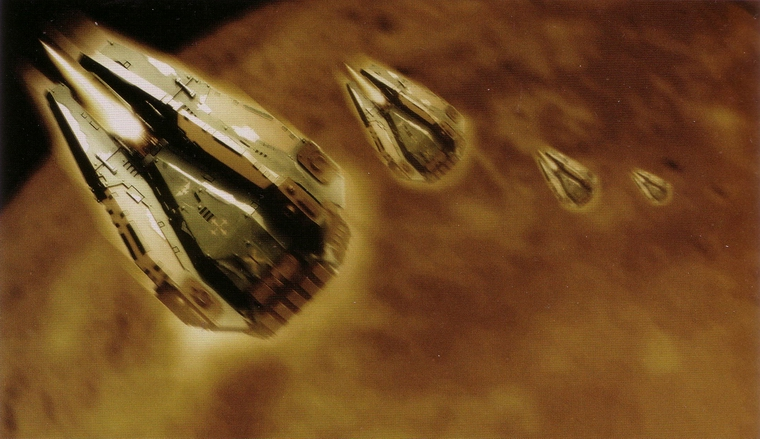

复仇之子的降落舱向塔洛斯地表发射

对总管庭的请求，复仇之子的反应是迅速的。在接待了总管庭的代表之后，军团长召集了所有的连队长，向他们解释了这次的任务。

“各位请听仔细，我们刚刚收到的消息说，塔洛斯系统的总督背叛了他在神圣的帝国大义之下所发的誓言，他私通外种族，将皇帝陛下的神圣统治置于威胁之下。由于以上罪行，他的罪过只能以死亡来惩罚。复仇之子被选中来执行皇帝陛下的正义，我们很荣幸地接受了这一职责。

这一次行动将由第二连和连队长阿玛罗斯负责，让你的战士们准备战斗吧，同袍。你们不会单独奋战，军械长将为装甲准备机魂，第一连和第十连的战士也将助你一臂之力。舰队长官将为你准备好袭击巡洋舰PROXIMA JUSTUS。在明天的日落之时，你将踏上征途，愿亚空间的潮汐将你平安送到塔洛斯，愿皇帝陛下在即将到来的战斗中看护你的灵魂。

你将把他神圣的怒火带到那败类面前，击垮任何抵抗，不要放过任何一个胆敢挡在我们前进道路上的敌人！在塔洛斯宣告这样一个信息：皇帝陛下将坚守此地，永不动摇！现在，让我们一起在我们的战友出征之前，为他做第二次复仇之祈祷。”

第二连迅速地做好了战斗准备。连牧师为失弹枪和动力装甲赐福，沉睡在无畏装甲中的战士哈凯和凯姆被唤醒，他们的无畏机甲被技师战士小心地检测，并确认运转正常。整整一天，军团的大本营处于紧张和忙碌之中，因为第二连的全体官兵和参加协同作战的第一连精英战士，再加上十连的侦察部队，都在准备着自己的装备器械，为出征做最后的集结。

阿玛罗斯连队长和远征部队登上了PROXIMA JUSTUS号袭击巡洋舰，伴随着一艘僚舰，它们以最大速度飞出了恒星星系范围，然后启动了亚空间跳跃引擎。在接下来一个月的航行中，战前分析和训练的时间是十分充足的。塔洛斯干预部队踏上了战斗的道路。

### 计划

在前往塔洛斯系统的途中，阿玛罗斯开始制定战斗计划，并向下属的小队中士讲解战斗情况。任务的目标十分明确，即是锁定并消灭总督奥利斯。在执行过程中，应当尽最大努力展示己方战斗力量。攻击必须迅速、无情、残忍。所有的抵抗必须被消灭。这正是星际陆战军最为擅长的战斗形式。根据总管庭所提供的情报和主审查员瑞的报告，连队长开始计划起战斗的细节来。

首先，他需要定位总督的所在，第一个也是最可能的目标，自然是总督府——他的住所。阿玛罗斯拥有总督府的详细平面图可以用来做袭击规划。如果总督逃逸，或是不在场，则行动进入第二阶段：搜索歼灭。这一阶段将需要重武器与装甲部署到地面，迅速横扫整个市区，其他的可能隐匿地点将被逐个突击。在第二阶段，阿玛罗斯可能需要PROXIMA JUSTUS号降到低轨道高度，借用它功能强大的扫描设备，如果抵抗力量的强度足够强，也可能会需要它的武器施行轨道轰炸。作为展示武力的一部分，他并不介意在必要时将塔洛金市夷为平地，这一行动无疑可以清楚地传递帝国意志的坚定，也可以从一个角度对当地人口造成压力，如果当地人了解到他们所有的痛苦都是因为总督的罪行，那么他们群起反对总督的机会将大为增加，并有可能交代出总督的藏匿之地。这是一个残忍无情的战术，但是阿玛罗斯作为一个星际陆战军战士，他这比常人更为漫长的一生中所接受的教育和意识灌输，让他连眼睛都不会眨一下。唯一对他来说重要的，只有他对皇帝陛下的职责。现在，在他的认识中，在塔洛斯上，已经没有任何一个人是无辜的。

总督府并不是一座单独的建筑，它是一个作为政府机能的小建筑群。这其中，总督的私人住所将是首要的目标。为了达成速度和奇袭要素，阿玛罗斯安排了降落舱登陆，这一次行动将有第二连的所有人手，以及来自第一连的精英战士参与。

首先，六个战术小队中的四个将借助黑暗的掩护，各自建立起一个防御要点。他们可以堆砌出障碍，在关键地点防御，让支援总督府的力量不能马上接近。这一部分将由第一小队的资深队长中士伊尼穆负责指挥。他将指挥这些要点的防御，在受到攻击时，于各个要点之间调整防御人手的部署。不过阿玛罗斯在向伊尼穆交代任务的时候认为，这种情况不大可能发生，因为本次任务的要点就是快速袭击。连队长并没有打算在那里等上足够长的时间以便让敌人集结一支大部队来援。

在各个战术小队和突袭小队的降落舱着陆之前，最先冲击在地表上的应该是死亡之风降落舱——它的舱内运输的是致命的火箭弹，将在着陆之后首先对周围制造出一场无差别的火箭风暴攻击。然后在四个防御点的战术小队之后，是两支突袭小队和余下的两支战术小队，他们将担任攻击总督府内部的任务。一切抵抗将被突袭战士压制突破，这次进攻将由阿玛罗斯本人和陆战军牧师巴罗考带领。

第一连的终结者战士将是最后的审判行刑者，地面部队于总督府内部确认了总督的位置之后，阿玛罗斯连队长将启动传送定位器，将在战舰上待命的终结者传送到确认地点，然后，终结者们利用他们无以伦比的近距离火力最终消灭目标。

在任务成功之后，口令“审判”将在第一时间内发出，然后行动将直接进入撤出阶段。如果口令在作战开始一个小时之后还没有发出，或者另一个口令“恶毒”发出，则意味着目标逃逸或没有出现。口令“恶毒”即是开始任务的第二阶段的命令——搜索歼灭。

在第一阶段中，将有一部分力量作为预备队，这支预备队包括两支重武器小队，两台无畏机甲和侦察小队。他们的主要任务将是支援部队的撤出行动，在其他部队被雷鹰炮艇接应撤离的时候作为防卫总督府的主要力量。

这支预备力量也将被当作遇到任何意料之外的攻击的时候的反击手段，在阿玛罗斯连队长的命令之下，他们将出动截击敌人，以他们的重火力，可以很迅速地对敌人造成严重伤害，给主力部队争取宝贵的时间完成当前任务，或是撤退，或是开始第二阶段行动。

阿玛罗斯连队长的进攻计划有三点优势——虽然这个计划要直接进攻敌人的心脏地带，并只部署120名陆战军战士，并且没有重武器和装甲的配合，更没有预先的轰炸软化敌人防御。

第一点优势，也是最重要的一点优势，就是出其不意。敌人一定已经意识到了会被攻击，但是他们不知道具体会是什么时候，从哪里进攻，怎样进攻。第二点，敌人只是行星防御军，部队质量低下，纪律涣散。并且，以陆战军的标准来看，装备武器极其脆弱。他们的士气应该同样不堪一击，阿玛罗斯预计，在一次突然、快速的打击之下，组织性的反抗将全部被击溃。第三点，是局部集中绝对优势的力量。复仇之子的战士们可以说是部署得相当紧密，并且作为一个行动单位集体行动。敌人将需要花时间在不同的地点集结兵力实行援助，如果这一援兵被有效拖延和阻击，那么完成任务的时间无疑是足够的。任务的成功需要勇敢、精确性和速度，而星际陆战军完全拥有这三项特点。 

附：总督府俯视

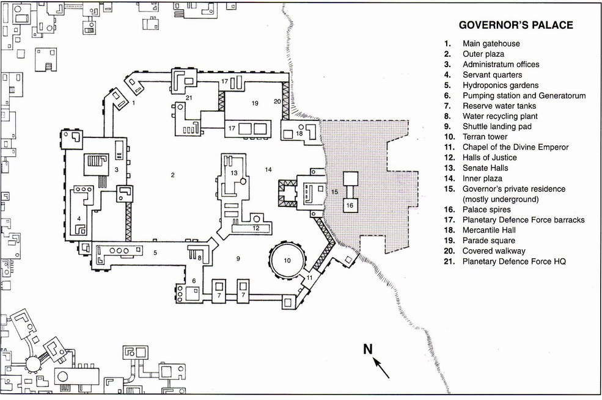

1. 大门门楼
2. 外庭院
3. 政务办公楼
4. 仆人宿舍
5. 水植圆
6. 抽水机房和发电机
7. 后备水箱
8. 水循环设备
9. 穿梭机停降场
10. 高塔（塔洛金最高的建筑，象征着指向神圣地球的高塔）
11. 神圣皇帝的教堂
12. 审判厅（塔洛斯地方的最高法院）
13. 议事厅（总督和他的参谋们商议要事的地方）
14. 内庭院
15. 总督私人住处（大部分结构处于背后的山坡表面之下）
16. 总督府高顶
17. 行星防御军兵营
18. 商部大厅（所有商会聚头的地方）
19. 检阅广场
20. 通路
21. 行星防御军总部

### 总督府的激战

PROXIMA JUSTUS号关闭了亚空间动力引擎，跳出至物质宇宙空间，正是在塔洛斯星系的边缘。它立刻进入战斗状态，以最快的速度向塔洛斯II行星（即是塔洛斯行星）赶去。

绝大部分帝国所属星系都有不同程度的星系防御系统，塔洛斯星系也不例外。这套防御系统可以调动包括地表对轨道导弹武器，还有三艘星系防御监察哨舰。这样的一套武力自然无法对抗一艘厚甲利炮的星际陆战军袭击巡洋舰。虽然三艘哨舰接到了向接近中的陆战军进攻的命令，但是在确定无疑的毁灭面前，三艘战舰的船员无一不选择了阵前倒戈。星际陆战军的战斗能力无人不晓。

一旦到达了卫星轨道，唯一能威胁到PORXIMA JUSTUS的，就只有地表对轨道导弹，但这些武器需要花费时间准备，瞄准和发射。这时复仇之子们应该已经在降落舱中待命了。在向地面发射了降落舱之后，PROXIMA JUSTUS和它的僚舰将后撤至安全距离，直到地面行动结束，或者是在需要时再度接近。

PORXIMA JUSTUS号迅速迫近行星低轨道，阿玛罗斯连队长下达了弹射第一波降落舱的命令，他同时登上了自己的降落舱，将紧跟在第一波之后，带领第二波的降落。

发射过程如同时钟一样精密准确，降落舱一个接着一个地从袭击巡洋舰上发射出去，冲进大气层，反向助推和方向调整助推器不断调整着舱体的下降方向，向着预定的目的坐标直坠而下。

第一台降落舱是一台死风，直接对准着总督的个人居所，它装载着满舱的火箭弹，当它进行全方向攻击之后，四个负责防卫任务的战术小队将得以迅速着陆，占领防御地点。

从总督府的内庭院里看来，天空上划出了一道道燃烧着的流星，那正是降落舱在大气层中急速下降。那遥远的轰鸣声逐渐地越来越响，然后是一阵突发的反向助推器为了最终调整着陆冲击速度而全开喷射的嗡鸣，接着，地面猛地一颤，附近的窗户纷纷碎裂，一阵冲天的尘土被激起。在厚重的灰尘之后，在庭院中央人们看到了一个降落舱的大概形状。一阵短暂的寂静之后，降落舱的几扇舱门随着电子仪器运做的声音解开了封闭，门板开始落下。随着灰尘开始消散，观察者震惊地看清了死风舱内的致命货物。

火箭弹向各个方向喷射出去，总督府在一阵暴风骤雨般的爆炸中颤抖着，石雕一座座地变成了碎粉，附近的人员纷纷抱头逃窜，寻找掩护。轰炸是短暂迅速的，将整个后庭院变成了一个碎片和火焰的地狱。然而这只是开始，火箭弹的攻击让敌人暂时忘记了即将到来的后续降落舱。死风在完成了任务之后便不再有动静，但是反向助推器的轰鸣再次充斥了天空，随着猛烈的冲击，降落舱一个接一个地着陆，象死亡之花一样展开自己的花瓣，释放出身穿动力装甲的巨大身影。在火焰和硝烟中，战士们向自己的任务岗位飞奔而去，总督府之战就这样拉开了序幕。早期的攻击已经将敌人的防御力量震慑住，总督居所只有一队士兵在执行守卫，而且已经被死风的火力压制。一些守卫被开阔地带被轰炸打中，尸体燃烧着，悲惨地躺在庭院已经残破不堪的地面上。总督府的驻留部队已经开始对进攻作出反应，拿起武器从兵营里向攻击方向赶来了。

阿玛罗斯连队长通过头盔的通讯链下达着指令，并向目标迅速前进。在他的前面，突袭小队奔跑着，矢弹手枪上膛，链剑和破片手雷时刻准备着攻击建筑的每个房间。目前已经零散地传来了失弹枪的声音，从死风攻击中幸存下来的守卫试图反击，但是光枪徒劳地闪烁着，不能阻止陆战军的脚步。

随着突袭小队的突破，守卫居所的士兵惨号着倒地死去，复仇之子的无情地将敌人鲜血淋漓的残骸留在了身后。高热爆破装置将装甲门板破坏，陆战军的攻击随之跟进。在看到了外面的情形之后，居所中没有任何人能再鼓起勇气正面对抗闻名的“死亡的天使”，他们纷纷逃进了内室。

阿玛罗斯连队长和他的小队们扫过了一间又一间屋子，用破片手雷和矢弹扫射清理着房间，这样的作战在他们的训练中已经熟悉到成为了他们的第二天性。任何没有及时逃离的人员，都难以逃离死亡的命运。当突袭小队突破了一间密室时，他们发现了一组官员和很多守卫，他们显然认为这里是最安全的场所。守卫明知没有胜算，但是在绝望中，他们开火了。就是这里了，奥利斯总督一定在这之中，因为建筑的其他部分已经被清理完毕。在密室的入口过道中，光枪密集射击着，阿玛罗斯于是启动了传送定位装置。PROXIMA JUSTUS号收到了信号，在战舰的传送室中，五名重装终结者战士正等待着这次召唤。

每名终结者战士都装备着一把暴风矢弹枪（双管矢弹枪），一只动力拳；除了资深中士佛拉斯，他装备着一杆突击机关炮和一只动力链拳——可以切进几乎任何材料的动力武器。传送引擎的巨大能量充斥在传送室内，强光闪烁着。随着机械神甫做了最后的调整，然后向古老仪器的机魂祈祷。他的祈祷没有让人失望。

在一阵令人盲目的闪光之后，终结者战士们消失了，他们穿梭到亚空间，然后伴随着强光，再次出现在远处的总督居所的密室中。

交火在几秒中之内就结束了。突袭机关炮在居所的密室里咆哮，挥洒着弹片，将桌椅和墙壁撕烂。暴风矢弹枪也随之加入了屠杀的行列，将它们的高爆弹头射进一干官员和守卫的身体中。硝烟过后，密室内再没有一个活人，总督奥利斯死亡了。

阿玛罗斯连队长命令医师阿克汀姆在尸体中的DNA与奥利斯家族的DNA记录做复查，这个记录正是总管庭交给复仇之子的情报的一部分。在检查确认之后，本次任务即可宣告成功。同时，突袭小队和终结者战士被部署在防守位置上，与姗姗来迟的营救部队交火。

阿克汀姆医师开始执行自己的职责，他在一具又一具惨不忍睹的尸体上检查过去，但是没有一具能够符合记录。奥利斯总督不在这些人当中。他一定是已经逃逸，或者走了好运，根本就不在这里。阿玛罗斯狠狠地诅咒一句，然后在通讯网中下达了口令“恶毒”——任务目标失败，准备进入第二阶段。 

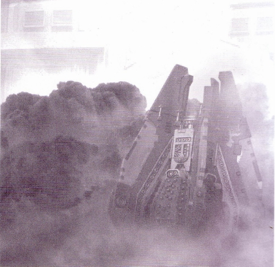

死风降落舱着陆

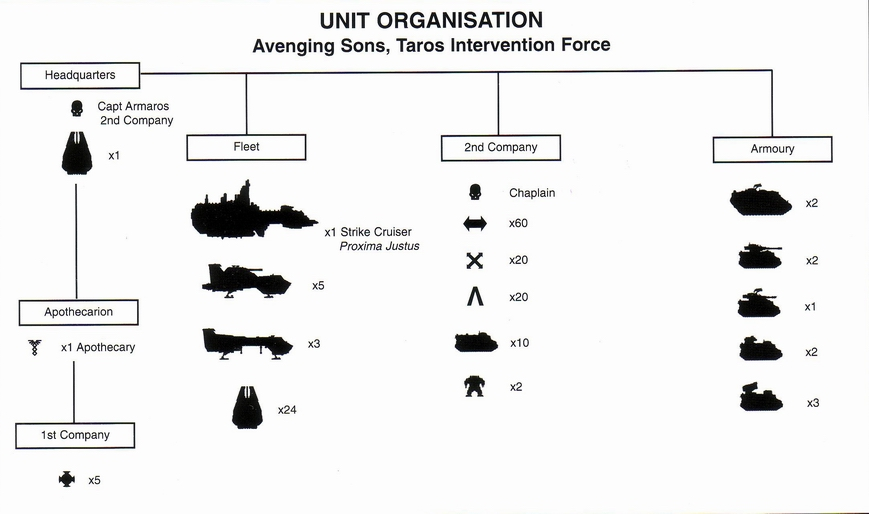

战斗序列结构

- 指挥（HQ）：第二连队长阿玛罗斯
- 专署降落舱一个
- 军医部：
    - 医师一名
- 第一连：
    - 精英五名（终结者）
- 舰队方面：
    - 袭击巡洋舰一艘
    - 雷鹰炮船五艘
    - 雷鹰运输船三艘
    - 降落舱二十四台
- 第二连：
    - 军牧师一名
- 双箭头表示战术小队战士
- 交叉箭头表示突袭小队战士
- 凸形表示重火力小队战士
- 犀牛运输车十辆
- 无畏机甲两台
- 装甲方面
    - 陆地掠袭者两辆
    - 掠食者（毁灭者型）两辆，（泯灭者型）一辆
    - 剃刀鲸两辆（装重矢弹机枪型）
    - 旋风两辆

### 第三防御阵地

同时，在总督府之外，四处防御阵地已经部署完毕，资深中士伊尼穆将他指挥的四个小队很合适地分配在各个阵地上。从着陆以来，这四处的抵抗程度为零，但是这个情况没有坚持得了多久。在几分钟的安静过后，一阵喷气式引擎的声音开始接近。在漆黑的夜空中，一艘钛族的蝠鲼运输机的轮廓隐约从城市的天上飞过。每个防御阵地的战士们立刻握紧了手中的失弹枪，紧张地瞄准着街道。他们并没有等待太久。

阿玛罗斯曾预期会遭遇到一些试图突破防御线来援助总督府的力量，但是并没有想到会来得这么迅速，也并没有想到会遭遇全副武装的钛帝国正规军。从刚才那艘巨大的蝠鲼飞越城市上空时，复仇之子才第一得知钛族军事力量已经到达塔洛斯。很快，双髻鲨悬浮炮艇和重战斗机甲和紧随而来满载烈火战士的魔鱼运输车向第三防御阵地进逼而来——整个猎队的兵力对着陆战军压了上来，迅速前进着，去支援总督府。

第三防御阵地前突然充斥了矢弹枪和脉冲枪的射击，小队用火箭筒发射出一条白色的烟尾线，正击中双髻鲨战车的正面，耀眼的爆炸和轰鸣过后，它的装甲被炸裂烧黑，但是悬浮坦克依然在前进，并且用它那条长长的直轨道炮反击，直穿进建筑里去，将石像和建筑的碎片轰击得四处飞溅。

这场交火可以说是一面倒的形势，但是复仇之子坚定地留守在阵地上，并一次又一次作出强有力的反攻，不肯放弃阵地。伊尼穆中士命令离第三阵地最近的第二阵地的战士们去支援自己的战友。战术小队迅速出发了，在回荡着战斗的炮火声的塔洛金的街道上穿梭着。在第三阵地上，战况急剧恶化。依靠着己方的火力、人数上的双重优势，钛军迅速压近着。在双髻鲨战车和战斗机甲的火力掩护下，烈火战士们一间一间房屋地前进着。战斗情况对于陆战军战士们来说十分激烈，十分艰难，但是尚存的复仇之子们知道他们必须坚守。他们坚守得更久，就会为他们的连队长争取到更多的时间来完成任务。目前已经有几名战士死在了敌人的重火力之下，其他的重伤员则义无返顾地继续战斗着。第三小队的安度拉也在牺牲名单之内，在一发就落在他身边的轨道炮击之后，他的尸体被半掩埋在坍塌的石像和废墟中。

第二小队的到来并没有让战事有实质上的转变。一支钛军猎队的军力还是太过强大了，街道路面完全被火力覆盖着，迫使陆战军战士们退进建筑物的掩护之中。战斗机甲开始了最后的攻势，在背喷射器的推动下，机甲们一路上用喷火器和高熔炮将建筑一座座地犁平。在无法继续这场单向的火力对抗的情况下，第二、三小队的剩余战士被命令脱离战斗，撤回总督府。而第一阵地和第四战地的战士也被招回总督府重新集结，阿玛罗斯将所有的力量集中在一起。在参与了第三阵地的战斗的二十名战士中，已经有十名牺牲，六名重伤，这对伊尼穆的部队来说是严重的损失。而钛帝国军已经突破了外围，只留下小部分人员留守，开始向主要目标——总督府进发了。

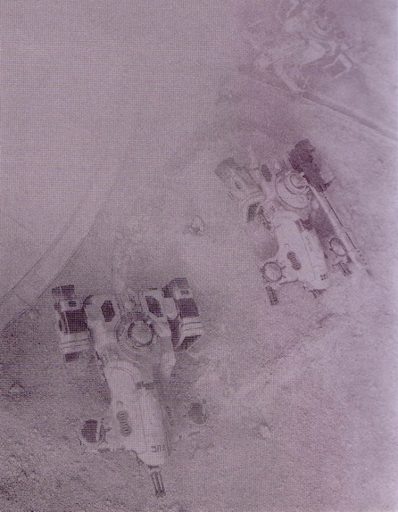

在总督府守防卫战斗的时候一架雷鹰的俯视。中间的那台是架着RAILGUN的双髻鲨，前面和后面的是魔鱼。

### 总督府防卫战斗，第一天

由于在第三防御阵地的交火，已经得知钛军前来的阿玛罗斯开始为防御重新组织手中的力量。奥利斯总督不见踪影，而时间正在迅速流逝。大规模钛帝国军出现在塔洛斯是谁也没有想到，也没有任何准备的。他们迅速的反攻将战场的主动权从复仇之子手中夺了回去，使陆战军们被动进入防御。阿玛罗斯连队长目前最紧要的任务十分明确，就是利用自己手中的部队反击钛军的进攻。行动第二阶段——猎杀总督奥利斯必须延后了。

钛帝国军的下一波攻势伴随着喷射引擎的吼声到来，他们的梭鱼战斗机（按：BARRACUDA，钛军的制空作用战斗机，前鼻装一门离子炮，机翼内置导弹发射口，最大记录在案飞行速度2100公里/小时）在塔洛金上空超低飞行，将一发发的火箭弹射进总督府内。已经被陆战军的攻击蹂躏过的建筑一座座地崩塌，巨大的石像和各种管道在反复地冲击中颤抖迸裂。大火猛然爆发，失去了控制，在建筑群中迅速蔓延开。在这些废墟当中，是穿行着的陆战军战士们，寻找着合适的阵地，准备对抗接下来的强攻。

阿玛罗斯有几点意图：这一次作战将是对战士们的一场艰巨的考验，钛军在数量和火力上都有巨大优势。这一次攻击将是强力又集中一的击。战斗将是致命的近距离作战，在每一座建筑，每一间房屋之中，不过这也将是陆战军的优势，在近战之中，任何一名陆战军战士都可以轻易胜过这些外星人。地面进攻果然在空袭之后到来了。钛军地面部队在建筑中逐渐渗透过来，装备着磁轨步枪的射击手们占据了可以俯视总督府庭院的高点，交火是在脉冲枪对周边小队的射击中开始的。魔鱼运输车上卸下的烈火战士们试图以光子手雷和冲击炮的火力将陆战军从掩护中逼出来。每个小队都各自进行着激烈的战斗。随着钛军一再地发起攻势，陆战军们也一再地将攻势压制回去，在近战中对敌人造成了严重损伤。终结者小队和突袭小队是其中最为忙碌的，他们在一间又一间已经废弃并燃烧着的房间中穿行，反复地向功来的敌人冲击着。链剑和暴风矢弹枪怒吼着，在如此猛烈的反击之下，钛军的前进失去了道路。他们丢下了一地尸体，抛弃了倒在战场上濒死的战士，撤退了。

夜幕降临之后，阿玛罗斯和他的战士们依然牢牢掌握着阵地，但是伤亡数字在增加，补给问题也开始显露出来。阿玛罗斯检查了一下战斗力。弹药，尤其是破片和破甲手雷的剩余已经不多。但是他现在还有大约八十人的可战斗人员，这其中包括了终结者小队和两台无畏机甲。钛军一定也在感受着战斗的伤痛，猎队在陆战军的顽强的防守作战中被狠狠地打击了。在一天的激战之后，战斗终于有了一个停歇。自从降落舱着陆以来，塔洛金第一次没有了枪声和爆炸声在回荡。这一时的寂静，有如双方在再次投入战斗之前所做的一次深呼吸。

这第二个夜晚并不是在没有战斗的情况下度过的。钛军派遣出了几个小部队，借助黑夜的掩护，打算潜行占领优势战斗阵地，但是陆战军有自己的巡逻队伍，三两个战士成一队在废墟中来回巡视。在黑暗中，两方的队伍相遇会引起短暂的射击火光，结果无一不是钛军小队的迅速撤离。

正是现在，星际陆战军的真实战斗能力开始显现。已经是第二个夜晚，而陆战军战士们却不需要象帝国卫军的士兵那样休息睡眠。他们的动力装甲中提供的生理护理和水分足以保持他们时刻保持最佳状态。他们的耐力和卓越的恢复能力意味着在一天一夜的战斗之后，他们仍然如同刚刚着陆时那样，随时可以投入战斗。很多战士身上伤口足以杀死一个普通的人，但是仍然毫无畏惧地战斗着。 

### 第二天

第二天的黎明，天边的一道红色和微弱的火光映照着在黑色天幕下硝烟在塔洛金缓缓升起。除了几次小巡逻队冲突之外，整个一夜没有任何战斗发生。而黎明的到来意味着又一天的战斗开始了。钛军士兵的进攻在昨天证明不可行之后，他们将重武器部署在战场上，开始了第二次的进攻。喷射引擎启动，双髻鲨、魔鱼和战斗机甲开始缓缓前进，随着机蜂的冲击炮在各个建筑之间的掩护，他们开到了射击距离，准备对总督府实行轰炸。看起来钛认为，不能将陆战军逼出掩体的话，就用毁灭性的打击将他们消灭在掩体之中。

对复仇之子来说，现在，战斗已经变成了一场为了生存的拼搏，但是他们还有任务没有完成，于是阿玛罗斯命令战士们继续战斗下去。为了能够继续这场战斗，他需要支援。于是连队长呼叫了PROXIMA JUSTUS，在袭击巡洋舰上，各个机舱里，雷鹰炮艇和运输艇早已等候多时，后者满载着装甲车辆和重武器，只等着出发的命令。但是能够着陆的地点范围实在太过狭小，召唤运输艇被判定是一个不明智的选择。炮艇也做好了对地攻击的准备，但是钛军的梭鱼已经出现在战区的上空，一次对地袭击意味着要冒一次空对空作战的险。目前来看，雷鹰必须为日后的撤离行动而保证安全，只能暂时放在后备力量中。只有在阿玛罗斯的部队遇到最紧急的情况时才会被召唤。

第一天的战斗是激烈的，第二天的战况只有更糟。钛军利用夜晚的时间将遭受了损失的猎队兵力做了充分的增援，现在他们可以将所有力量都投入对陆战军的打击之中了。在第一束光出现之后，梭鱼已经准备就绪，只等对总督府再次轰炸，之后，地面部队将再次进攻。这一次的攻势将来自总督府周围的全方位，而攻击的重点是在大门。只要攻破了这里，那么陆战军的兵力将被分割成一个个小部分，虽然还需要后继的战斗将他们各个消灭，但是到这里战斗的胜利就可以确定了。

如同第一天的战斗一般，梭鱼战斗机将导弹倾泻在废墟中陆战军所在的各个位置上。因为缺少任何形式的防空火力，战士们只有躲藏在掩体之内，等待轰炸结束。在几艘梭鱼的低空轰炸结束，返航装弹之后，地面火力的轰炸开始了。随着标志性的鞭笞音，磁轨炮炮弹轰进建筑，冲击炮的脉冲弹在废墟和墙面上来回扫射着。一连串的重火力冲击着总督府，一发紧接着一发，毫不留情。钛军在保持着距离中对陆战军进行着轰炸。一座又一座的建筑被瞄准，天花板和墙壁崩塌了，炮弹轰进石像，从里面爆炸开来。总督府的建筑被系统性地摧毁的声音震耳欲聋，巨大的烟尘在战场上高高扬起。

在大门对面，两辆双髻鲨慢慢地开过来，偶尔射击炮。在一发又一发炮弹的轰击之下，大门已经崩塌。在门后的重火力小队以火箭筒和光炮还击，但是敌人密集的火力压制让他们无法还击。这种程度的持续打击是连陆战军战士也不能长久承担的。看起来钛军在考验复仇之子的坚韧程度，轰炸从早上一直进行到了下午，而阿玛罗斯除了手头上的步兵配重火力之外，并没有任何可以回应的武器，这是一场完全不平衡的战斗。在没有其他选择的情况下，连队长再次联系了突袭巡洋舰，请求空中支援。雷鹰仍然处于准备出击的状态。这是一次冒险，但是地面上的情况是在不断恶化的。一次雷鹰的对地轰炸计划迅速地制定了，梭鱼战斗机还在战区的上空，但是现在雷鹰必须顶着危险去援助自己地面的战友了。

在巡洋舰上所有的五艘雷鹰炮艇全数起飞，向总督府的方向飞去。这是一支强有力的攻击序列，足以将钛军的地面部队攻势打退。但是首先，雷鹰们必须穿过梭鱼战斗机的截击。

随着雷鹰向着塔洛金急速下降，梭鱼也爬升上来迎击。雷鹰直接俯冲穿过了战斗机群，重矢弹机枪和梭鱼的冲击炮同时怒吼着。尽管脉冲弹一次又一次地冲击着机体，雷鹰编队丝毫没有动摇，紧紧地保持着队形，向着战场飞去，同时信任着自己厚重的钢化陶瓷装甲。梭鱼的攻击没有奏效，雷鹰一直保持着飞行速度，直到降临在塔洛金战场的上空，同时，炮手们已经准备好了主武器的发射。

雷鹰们轰鸣着出现在城市之上，将高压激光炮和主战炮以及重矢弹的火力倾泻在钛军头上。一发又一发制导重磅炸弹甩在总督府外围，轻易地穿进房屋，然后火焰和爆破的碎片充斥了整片区域。市区里成片的建筑现在被剧烈的爆炸蹂躏着，陷入了混乱。现在，毁灭性的爆炸从总督府内转移到了外边，散射着。

这次空袭一定引起了钛军指挥官的担忧，因为在那以后，他们的攻击就只限制在零星的狙击和小规模交火的程度上了。空袭造成的伤亡有多少是无法确认的，但是在雷鹰引擎的轰鸣声渐渐消失之后，钛军撤退了。这是同样是一次短暂的停火，但是却给了阿玛罗斯连队长宝贵的时间来重整防御部署。

而之前在总督府的大门，钛军的攻击最凶猛的地方。那时，双髻鲨和战斗机甲冲锋在前，全速冲过总督府大门的废墟。先头的双髻鲨立刻被激光炮击中，爆出一团黄色的火球。第二辆悬浮坦克在反击中射击杀死了激光炮的炮手，另一发破甲火箭弹射杀了一台战斗机甲。但是在短暂的交火之后，三名剩余的重火力小队战士不得不撤退，在装甲的护卫之下，乘坐魔鱼到来的敌人士兵已经靠了上来。

阿玛罗斯连队长意识到自己正在丢失大门的防守阵地，而且周边阵地也面临着被突破的危险。在万般无奈之下，他调动了终结者小队。在火焰和硝烟之中，精英战士们直冲向了敌人的战斗机甲，正面交火。双方都遭受了可怕的损失，陆战军战士们为每一寸阵地奋战着，但是钛军更猛烈的重型火力是不能阻挡的。三名终结者战士倒下了，同时对方损失了四台战斗机甲。无畏机甲中的战士哈凯和凯姆也加入了战斗行列，用他们的重武器消灭了第二辆双髻鲨坦克，但是随后一发炮弹将凯姆的右腿击断，使他只能无助地瘫痪在地上，被接下来的炮火命中。

正门的争夺战持续了一小时，在陆战军牧师巴罗考的带领下，防御者们英雄一般地战斗着。压力是巨大的，而且，伴随着无畏机甲和终结者战士的损失，再也没有任何后备力量可以投入援助了。矢弹和火箭弹飞射着，将敌人烈火战士前进的脚步阻挡住。但是同时，钛军持续着对周边战地的攻势，使周围阵地上本来可以支援正门战场的战士们不得脱身。

现在，阿玛罗斯意识到他们现在所处的位置是完全没有希望的。钛帝国的军队让他的部队损失惨重，现在减员和弹药不足的问题让他不得不承认，如果他要拯救自己的连队，那么撤退将是他唯一剩下的选择。这让他恼怒不已，但是事实是，塔洛斯上的抵抗力量远远不是他手中的部队能对比的。他完全无法得知敌人的总和兵力，他知道自己的战士可以守卫这里长达数天，直到敌人最终用数量淹没自己，但是为了什么？总督奥利斯现在已经完全不在他所能及的地方了，而复仇之子的部队面临着覆灭的危险。阿玛罗斯需要一场撤退，将他还能够挽救的部队都带走。

废墟中，在一场简单的指挥会议之后，阿玛罗斯向PROXIMA JUSTUS通知了撤退的决定。在夜晚降临的时候，雷鹰将起飞执行撤退任务。各个小队的指挥和临时接替阵亡原指挥的代理指挥们都得到了命令，在夜晚后庭院内，将会有一次撤退行动，雷鹰将一台一台单独地着陆，载人之后再起飞，将他们运送回突袭巡洋舰去。这是一次有难度的行动，必须迅速完成，给外围的钛军最小的时间对撤退做出反应。阿玛罗斯连队长本人将带领后卫部队为撤退行动断后，并将最后一个登机。

插图：

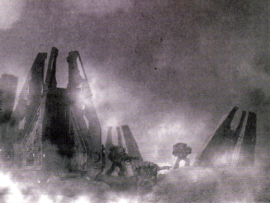

总督府作战时，刚刚登陆的陆站军战士。

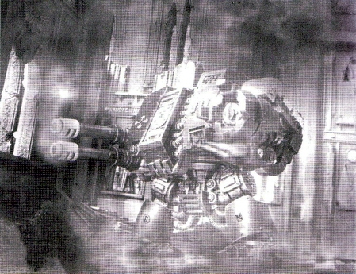

无畏机甲战士凯姆，复仇之子第二连古老时代的战斗英雄，在本次战斗中牺牲。

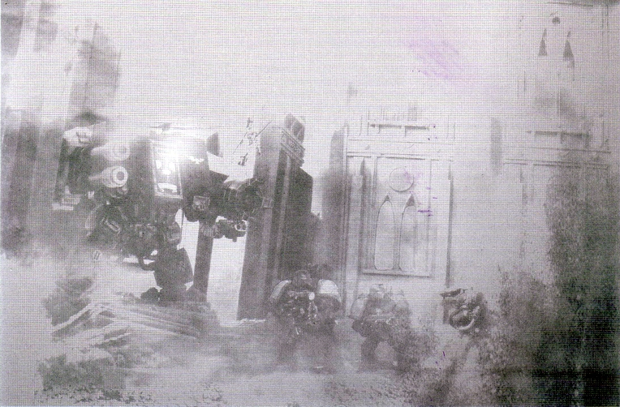

钛军对大门方向激烈进攻中，陆战军战士们死战防守。

按：关于无畏机甲，以及重火力小队和后面将要简单提到的侦察小队士兵。这些兵力是在战斗计划中被阿玛罗斯列为“第一阶段行动中的预备队”。在之前的总督府激战中，他们并没有出现，而是在对抗钛军时突然出现在叙述中，让人有种凭空冒出来的感觉。我也曾经仔细查找是否有再次发射降落舱的记载，但是确认的是，整场战斗只有一次降落舱发射，那就是在战斗开始的时候。并且由于需要巡洋舰靠近卫星轨道，会将它放置在地对轨道打击导弹的射程中，所以整个过程只是快速地进行完事，然后巡洋舰就离开了轨道。就是说，只有一个可能。这个预备队的力量，是在第一次降落舱发射时就一起投放到总督府中去了。作为后备行动力量，他们应该是在远离战斗现场的前庭院中集结。至于为什么在第三阵地遭到打击的时候没有调动他们前去增援，我想一是因为第三防御阵地的伤亡已经很大，而且那个位置不足以继续阻挡钛军的前进，而且无畏机甲并不适合在大街上直接面对磁轨炮，再加上如果让二三队继续监守，让无畏从总督府直接赶去所花的时间内二三队可能已经被淹没了。所以那时撤退到更有防御优势的总督府应该是个正确的决定。

另外，原先的锤头坦克（HAMMERHEAD），在KV85老狼的建议之下，改为双髻鲨坦克，轨道炮（RAILGUN）改为磁轨炮，陆战军的装甲车之一RAZORBACK改为剃刀鲸战车。感觉是比原来好多了，在此感谢KV85。

下面是非帝国人员的hellrack（审判庭调查表明，他是个ELDAR）助力翻的一个附料，帝国仲裁庭在塔洛斯的后事。

如下：

帝国的每个星球都有仲裁总局的分管办公室或者法院，这些家伙既当警察又当法官，专门打 击和惩罚危害帝国的犯罪分子。而在复仇之子登陆塔罗斯之前，塔罗肯市的仲裁局长马季斯 特接到了专线长途电话，命令他配合即将开展的进攻作些小小的同步行动，就是去逮那些富 得流油的矿老板，这些资产阶级本该为帝国好好卖力，但是他们却与总督和钛星人勾结！他 们要受到法律的制裁！要把他们抓起来，下到监里，然后交给星际战士指挥官!

收到这命令马季斯特感到他的办公室情况很不妙，如果总督已经打算背叛帝国，那仲裁局这 种最明显最暴露的帝国权力机构一定会死翘翘，看来随时可能会有炮子儿砸下来了，而仲裁 局的上司们也不晓得星际战士什么时候打过来，只是说：“如果来了的话你就赶快吧！”

哦，但他们总算来了，趁着他们在总督府大打出手的当口，仲裁警察们赶紧出动，到城市周 围的沙漠里去抓矿老板，威风凛的逮捕队身穿黑色防弹衣，手拿散弹枪，腰佩橡皮棍，举着 大盾牌，迅速包围了犯罪分子的藏身之处！但是……他们马上发现面前有大团大团愤怒的矿 工。这些家伙越聚越多，群情激奋，什么命令都不听，他们看起来很热爱他们的矿洞，他们 的工友和他们的老板，于是在每一个矿区都发生了仲裁警察对武装矿工的大乱斗，在无产阶 级的伟大力量面前，政府走狗们灰溜溜的逃走了！于是，矿老板们暂时逃脱了帝国的审判。

大多数的逮捕队还没能回到局里头报到，星际战士们就撤退了，把可怜的马季斯特和他的手 下们扔在了塞满钛星大兵的叛乱星球上，看来他们只有乞求帝皇显灵才能逃过一劫了。

塔罗肯仲裁局在复仇之子撤退后三天受攻击而被摧毁，好像没有生还人员的报道……

PS：里面的发音大概塔罗肯就是上面的塔罗金，大家请自行对照……

### 撤退

在夜晚降临的时候，陆战军的指挥官再一次的统计了自己的力量。可作战部队已经减员至大概四十名战士，一台无畏机甲，几乎不用两架雷鹰炮艇就可以完成装载撤退，其他的炮艇将在上空掩护需要下降的同伴。在重新装载了燃料和弹药之后，雷鹰再次出动了。

阿克汀姆医师开始回收所有能够找到的战士尸体中的基因种腺体，令人遗憾的是，一些战士的尸体已经被深深地埋在了残骸之中。他的工作对于陆战军团来说有着重要的意义，尤其是在承受了严重损失之后，这些腺体对于人员的回复是必不可少的。陆战军牧师巴罗考在已经毫无生气的凯姆的无畏机甲残骸旁为死者进行了祈祷，凯姆曾是连队中伟大的战斗英雄，值得骄傲的战斗机甲，但是现在只是一台被扭曲了的金属和线路组成的棺骸。在第二连队中所有的损失之中，他是最另人惋惜的。

阿玛罗斯连队长指挥着一队不满员的战术小队和剩下的侦察小队作为后卫，命令第一拨人员——包括无畏机甲战士哈凯、陆战军牧师巴罗考和阿克汀姆医师做好登机准备，在第一架雷鹰于着陆点下降之后立即登机。在第一架雷鹰起飞之后，第二拨人员将撤离岗位，在后卫的掩护之下向着陆点移动。整个撤离过程不会超过十分钟，使钛军没有足够的时间组织武力作出反应。

雷鹰的引擎声由远而近，撤离行动也宣告开始。遍体伤痕的幸存者们在遍地残渣和碎玻璃的残骸中穿行着，一架放下了登机门的雷鹰正在着陆点等待着他们，头上，隐约是另外四架飞船的引擎声。无畏战士哈凯是最后一个走上登机门的，而登机门在他经过之后也迅速地合闭。第一架雷鹰向天际冲去，远离了战场。被引擎的噪音惊动的钛军派出了侦察人员，当士兵们小心地接近调查时，发现以往陆战军战士用矢弹阻止他们前进的位置上，已经空空如也。

同时，第二架炮艇也已经着陆，剩余的部队迅速地登机，阿码罗斯也跟在他的后卫队之后，快速向飞船撤离。他最后一个跑上了登机门，狠狠地对关门按扭拍了下去。三重引擎猛地轰响起来，将雷鹰带上了天空。战斗结束了，但是任务失败了。

### 战后

第一次干预行动对于帝国来说是一场严重的转折。钛族军队在两天的战斗中对复仇之子造成了严重的损失，而钛军遭受的具体损失则不得而知，不过可以确认也是相当大的。在战后统计中已经有相当数量的确定击杀，在战场上，也是随处可见钛军悬浮坦克和战斗机甲的残骸。

复仇之子对这一次失败是相当不能接受的。星际陆战军军团一直被光荣地比喻为“人类之盾”，而被外种族侵略军击败这一事实是不会就这样随便揭过的。战士凯姆的血债必须得到偿还。军团基地的大钟为每名牺牲在塔洛斯的战士鸣响着。

在塔洛斯发生的事件，干预部队的失败，被确认的钛帝国军队为了保护塔洛斯行星总督而战斗的报告，这一切都迫使总管庭的官员改变了对塔洛斯问题的态度。一次失败的消息已经足够糟糕了，但是现在看起来钛族已经夺取了一个本处于皇帝陛下统治之下的世界。原本只是一场边境冲突的问题，现在已经发展成了一个严重的威胁。恐惧之眼的周边也许需要帝国的很多资源来应付，但是塔洛斯是不容忽视的。

塔洛斯现在被正式宣布为前帝国统治的反叛世界，一个背叛了皇帝陛下神圣统治的行星。神圣的帝国大义被行星总督奥利斯撕毁。他的行为已经让他不再仅仅是一个罪犯，而是一个叛徒。钛帝国的势力已经驻进了塔洛斯，他们必须被清除出去。总管庭的最高长官签署了一份确认以上事实的文件，这份文件上还列举了奥利斯总督的种种罪名（一共一百条，大部分每条都可以直接处死）。这份文件被称做“塔洛斯判书”，是使对反叛世界塔洛斯采取一次新的、更大的军事行动变为可能的赋权书。

下一次，到来的攻击将不仅仅是一次任务行动规模的星际陆战军部队，下一次将需要皇帝陛下名下所有的武装为反击外种族的野心所提供力量。塔洛斯的侵袭战争拉开了帷幕……

第二章完

插图：

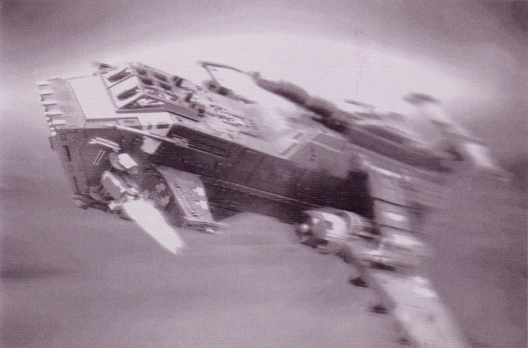

撤退中的雷鹰

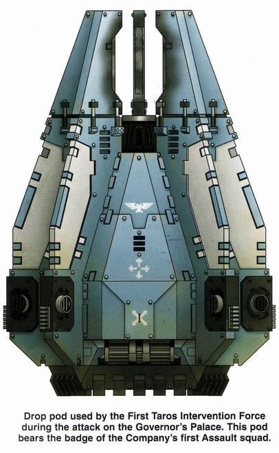

袭击总督府时第一突袭小队使用的降落舱

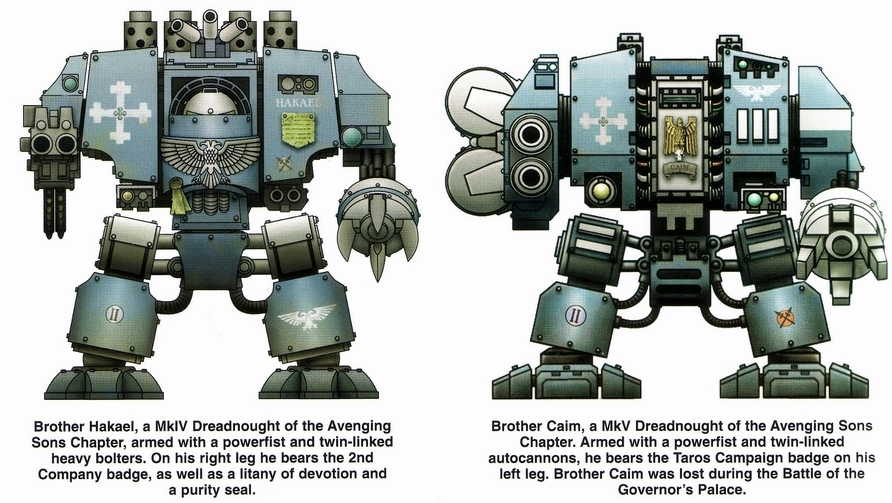

左边是无畏战士哈凯，右边是凯姆。可以说MKV型的凯姆装配的自动炮是宝贵的重火力之一。
