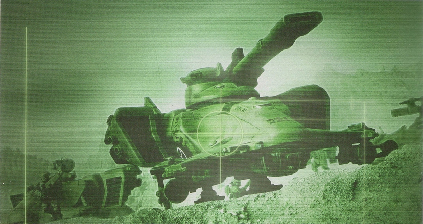
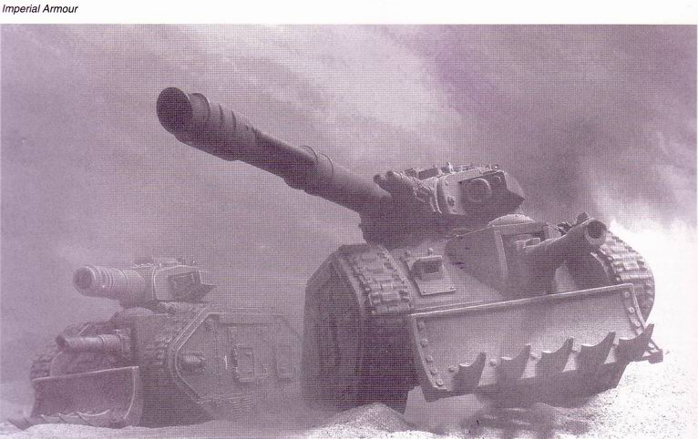
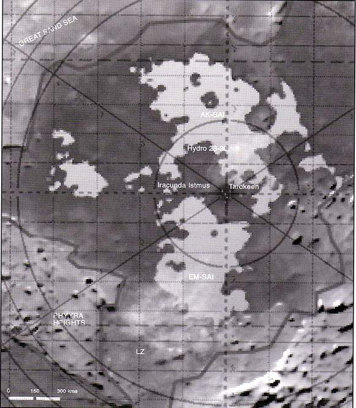

---
title: 塔洛斯战役（第三章）
prev: ./the-battle-of-talos-2.md
next: ./the-battle-of-talos-4.md
---

# 【分享】帝国装甲三——塔洛斯战役（第三章）[zt]

原贴：<http://game.ali213.net/thread-975355-1-1.html>

> 作者：boltgun

塔洛斯战役，对于帝国来说，它本质上是一场为了一个矿产资源而发生的边境战争。在帝国看来，这是一次很不足道的事件，如同帝国中经常发生的日常冲突一样。它并没有牵扯到多少军事资源，更没有办法和卡迪安之门战争，或是第三次末日行星之战那样的大规模战争相比。地球的高领主们不会为了一个塔洛斯费多少神的——如果他们甚至听说过这个地方的话。

相反，对于钛族来说，塔洛斯战役是一场相当严重的冲突。他们没有帝国那样无尽的资源可以消耗，在塔洛斯的部署力量代表着钛族相当部分的实力。尽管钛族一贯有着一个“好人”的形象，但是塔洛斯在他们来说确实是一场富有攻击意图的战争，是一场扩张版图，为他们所谓的“更高利益”所服务的战争。与混沌信徒和泰伦虫族相比，钛族或许看起来更理性一些，但是在为了自己的目标而战斗的时候，他们是无情的。 

## 第三章 大侵攻计划

在战役中，被帝国军的瞄准扫描仪器发现的双髻鲨悬浮坦克

### 高层指挥人员

总管庭的决定是：重新占领塔洛斯行星，对于锻造世界斯太基司VIII持续高效生产是必要的，也同样对其他的小级别依赖性锻造世界的运转有着重要作用。这意味着，现在是论到皇帝陛下所有的仆人们奉献自己的力量来将这颗迷失的行星带回到皇帝的神圣统治和保护之下了。第一步行动，便是指定一位总指挥官来组织、监督这次行动的计划制定。

被选中指挥整个战役、并领导所有行动的人是高级指挥官爵士奥托 伊万 高斯塔夫—— 一个有着长久服役历史，从士官阶级一直升到森严复杂的帝国军队高层的人。高斯塔夫的第一件任务是组建出自己的指挥班底，开始计划进攻。有两个问题被提到了他的面前：他什么时候可以准备完毕对塔洛斯的侵攻，然后，攻击将在哪里开始。他明确地表示，进攻将会尽可能早地发动。在总管庭的标准来说，这句话的代表意思就是今后五年之内的任何时间里。而高斯塔夫自己的意图，则是在一个标准地球年之内就发动进攻。

组建自己的指挥班子不是一个轻松的工作，在帝国的军队高层金字塔里，越是往上，就越是充斥着政治、密谋、欠别人的人情和别人欠下自己的人情，还有个人利益。高斯塔夫能够到达这个位置，毫不例外地树立过几个敌人，也欠下过一些人情——现在该他来偿还的人情。

选择自己的指挥部人选花掉了高斯塔夫几个星期辛苦的研究选择，还有几个星期辛苦的讨价还价和谈判。第一个需要填进来的人选并不是高斯塔夫自己的选择。政委将军毛德 冯 霍洛克将在整场战役中作为高斯塔夫的影子和右手存在。这位高阶督军的的职责是确保部队中所有的军官都能够履行他们自己的职责，或者得到应有的下场。在他自己所拥有的巨大权力之下，冯霍洛克掌握着参与了战役的很多人的生死。

不管是他自己的选择也好，被迫的决定也好，在几个星期之后，高斯塔夫总算是指定了后面列举的一个指挥班子。并不是所有的成员都是他所喜欢的选择，有些人甚至对他来说根本不能信任。很多决定都是由外部的政治因素强行加给他的。现在，将所有的人和条件都组织起来，让它们有效地运转，并带来最终的胜利，就是高斯塔夫的工作了。

高级指挥部的成员将包括：尊驾大长老扎达金 沃尔塔，来自斯太基司VIII的机械会高层代表。舰队提督库图，由卡杜匿安史的上层指定，将指挥整个战争中的舰队。司令官爵士戴 斯道，将总领所有的帝国卫军师团，负责具体的作战计划与指挥。供给主长官尼姆斯 瑞（按：还记得这个人么？把塔洛斯走私这点事挖出来的就是他），一个军需部的官僚人员，他被任命为指挥部的一员相当一部分原因是因为他主导了塔洛斯的那次调查。其他人包括了空战指挥官丹维尔特、幕僚官斯奇亚上校、瓦拉斯主教的指派代表歌茨主祭、档案官斯卡尔。其他的名字也将会陆续加入进来，包括任何将参与这次战役的星际陆战军指挥官，或是哪个泰坦军团的主指挥。

### 战前准备

在任何军事计划开始制定之前，高斯塔夫和他的指挥官们需要了解他们将要面对的是什么。这个指挥部里，除了瑞之外，没有任何一个人在接到任务之前甚至听说过塔洛斯行星，或者是塔洛斯星系。高斯塔夫需要这个行星的资料：气候、人口、工业生产力、统治阶层、地理状况、历史——任何资料。总管庭下属将有大量的研究调查要做了。负责收集资料的是档案官斯卡尔，一个历史档案员出身的总管庭下的官员。斯卡尔本人能够接触到整个区域、乃至横跨帝国各地的档案处，甚至可以查阅位于地球的帝国大档案馆。这些档案处中，上千名档案官、撰补员、档案员和仆工们开始查找起任何关于塔洛斯的信息。在古老的记录中，这个行星的形象和原有人口被编汇出来。从它的税缴水平和本地税款记录里，行星的矿业的大概状况被推测出来。这个行星的人口普查记录又计算出了它的人口增长速率。任何一点关于塔洛斯的情报都不会被认为是无用的。

大长老沃尔塔手下的一队编撰者和记录员也被分配到这一资料整理的任务中来，他们用可以媲美电脑的速度将斯卡尔档案官生产出来的大堆材料分类编档。机械会的半人半机械仆工计算预报着塔洛斯的人口增长、天气概况、气候分布、火山运动、大气层状态、卫星轨道情况。资料的收集一直挖掘到了大圣战时期的材料，甚至连行星的殖民化地表改造可行性勘探报告都找了出来。几百万份的大小资料被收集起来以总结出一份塔洛斯行星的总体情报。卫星的地面扫描照片、语言分析、当地军事行动报告、曾经访问过或者被分配到塔洛斯的早已去世的官员的日记。在人口处还有一份塔洛斯的全人口以及统治家族的基因检查报告，这份材料是在当初为了预防变异和污染而做的检查。还有帝国仲裁庭在塔洛斯的犯罪报告、地理勘探和地震预报。任何可能影响到高斯塔夫决策的信息都被一股脑地收集起来，没有任何遗漏。在计划制定开始之前，为指挥部整理他们所需要的资料所花费的时间一共有六个月之长。

在这六个月之后，在所有能够得到的资料面前，高斯塔夫已经对自己将要面对的战场有了一个很好的了解。他知道那颗行星大概是什么样子，有多少人口，这些人口意味着多少比例的行星防卫军力，他甚至知道在这些年中提供到塔洛斯上的武器数目。他了解塔洛斯能够作到什么程度的军队配置，能够再编多少部队，他甚至有一份犯罪数字预测（很多情况下，罪犯是部队预备兵员的第一大来源）。而他不知道的，就是钛帝国在塔洛斯上的力量。

得到钛帝国军的相关情报是一个很困难的事，这不是机关的文员们能再帮上什么忙的工作了。高斯塔夫将这一份工作交给了他的情报顾问——斯奇亚上校。斯奇亚上校是一名间谍专家，他曾经有过和审判庭提供服务的资历。而钛族人，在他们的“更高利益”理念之下，是一个十分棘手的刺探对象。在钛帝国内部，间谍和情报来源都少得可怜。有一部分人——大部分是商人，他们的忠诚可以被帝国用各种利益收买，但是在钛帝国内的人类，绝大部分却是纯粹的背叛了帝国和皇帝陛下的叛徒。通过收集钛帝国边界上的各个世界的情报，研究过去的军事行动中钛军的军力，斯奇亚上校是可以做一个基于分析的猜测，猜测钛军在塔洛斯上的兵力。但是没有当地的人员和情报的确认，他无法做到比猜测更多。

在情报工作进行的同时，指挥部的其他人员并没有无所事事。军需部的官员开始漫长的建立战争所需部队和补给的工作。

帝国卫军师团需要建立、训练，并从帝国的另一头运送过来，这些没一样是简单的工作。卡迪安周围地区的军队需求量极其巨大，尤其是现在，“异端之瘟疫”还在不断地在恐惧之眼周围蔓延着的时候。帝国卫军也许是一个相当庞大的军事力量，但是实际情况是，对师团的需求量永远比可供驱使的数量要多。

为了应付日益增长的军力紧张，高斯塔夫决定在递交的部队需要申请中，数量超过他的实际需要。他知道自己绝对不可能在最后得到上报的那么多部队数量，但是通过这个过量的请求标准，起码他可以得到尽可能接近自己需要的部队的数量。虽然目前为止他还没有一个确切的数字可以交给军需部，但是他可以通过现在的对敌分析给出一个大概范围，在几个月的继续研究之后，这个范围会渐渐变成一个具体的数字，只是现在，对于军需部来说这个大概范围就可以了，基于这个范围，结构复杂的官僚机构的齿轮开始运转起来，为这次战争做起准备。

### 帝国卫军第4621军团

参加塔洛斯战役的帝国卫军将会整编为第4621军团，由司令官戴斯道指挥。被赋予了“军团总司令”的称号，戴斯道将负责所有在塔洛斯的帝国卫军的行动，第4621军团下属的所有卫军师团的将领和上校们都将听令于他和他的指挥部。

高斯塔夫和戴斯道开始计算起他们心目中赢得这场战争所需要的部队蓝本。帝国卫军也许是一个军力大得不象话的力量，但是目前来说，对于部队的需求一路彪升，卫军也终究不是一个能变出无穷兵力的地方。现在没有任何指挥官能够得到他们想要的足够兵力，高斯塔夫和戴斯道也是一样。戴斯道一开始提出的二十一个师团的想法被高斯塔夫驳回，理由是过于谨慎。实际上，这样数量的部队是不可能在高斯塔夫计划的进攻日期前集结完毕的，高斯塔夫目前受到了不少压力，被要求加速进攻的日程，因为每一天由于塔洛斯的丢失而造成的减产都必须在帝国的其他地方找到新的生产来源。戴斯道无奈地重新考虑起自己的计划，试图给出一个新的数字。

司令官爵士又给出了一个比较中庸的十二个师的方案，这个计划被高斯塔夫接受了，并带到了军需部正式递交。但是军需部将这个计划否决了，最后只给出了最多十个师的方案。就是这十个师，也是在一番艰难的交涉和谈判之后，才说服了军需部的官员们答应了下来。高斯塔夫只有在收到了机械会大长老沃尔塔的保证，发誓说至少会有一个泰坦军团将加入进攻的行列之后，才同意了用十个师团的兵力进行塔洛斯收复战。带着这个保证，高斯塔夫通知戴斯道，考虑到指挥效率，第4621军团将分为两军，第十军和十一军。

在部队的兵力终于被敲定了之后，高斯塔夫和戴斯道终于开始了具体的组建计划。高斯塔夫提出的前提是，这些卫军师团一定要是塔兰出身。根据塔洛斯的自然环境来看，一个塔兰出身（塔兰本身也是一个沙漠为主的行星）的士兵无疑会很快地适应战斗环境。在关系到沙漠求生和用水制度的时候，这些沙漠士兵本身的技术和常识将是最有效的。虽然说大兵和大兵都是一样，无论哪里的卫军士兵在经过锤打之后都可以放进哪一个战斗环境里去，但是直接使用有名的塔兰沙漠骑兵还是最具逻辑性的选择。

但是塔兰本身只是一个世界而已，人口是有限的。大部分已经建立的部队已经被分配到了其他的战场上，简单地直接建立十个新的师团是不可能的，行星上的税率需要不会允许如此大规模的人口抽调。实际上，只有一个新的师团——塔兰第331师将被建立、装配之后被运送过来，而塔洛斯战场将是他们的第一场战斗。其他三个塔兰师团将从目前所属的战场上撤换下来，为塔洛斯的战斗做好准备，只是这三个团都在最近参加了战斗，需要补充人员和装备。第五个师团，塔兰第三装甲师，目前正在巴雷驻防，如果能够及时找到一支替防部队，那么这支部队也将参加到塔洛斯收复战中去。总体来说，4621军团将有半数部队来自塔兰，这些部队构成了军团的第十军。

第十一军将由其他军需部能够提供的帝国卫军师团混合而成，仍然有五个师团需要凑齐，首先是第二十三伊利森空降兵师团，这支部队和4621军团中的其他帝国卫军都有很大的不同，作为一支空中机动部队，他们配备了瓦尔基里（女武神，和银英里的帝国军战斗机一个名字）运输攻击机，这样一支机动力在面对钛军的时候是重要的，钛军的曼塔大型运输机和反重力悬浮坦克、还有他们的机蜂和机甲单位，这些战斗单位的速度快，机动力极强。帝国军的步兵和装甲师团不能奢望可以在机动优越上赶上敌人，有这样一支空中机动部队——虽然作为空降部队装备的火力偏轻，但是给了戴斯道司令一个机会在战略上打破战场平衡的机会。

十一军的第二支部队是由戴斯道亲自点名调派的，他认为从某些角度来将是全区域最有实用性的，撒拉尼安突击工程兵。他们的装备都是近距离战斗武器，一般承担的大部分任务包括碉堡阵地突击、清扫雷区和突破敌人防御阵线。因为人数不多，撒拉尼安工程兵们将不会作为一个单独的师进行作战，而是分成各个排、各个连，分配到4521军团的各个部队中去，而到了将来进攻塔洛金时，他们将担任起最艰巨的巷战主力的角色。

其他将被编进第十一军的部队还包括卡迪安第一百一十四闪击师，一只由司专斯基上校指挥的全机械化部队。然后是宾穆罗克第八龙骑师（按：DRAGOON，编制配备不明，这支部队按资料看后来没上战场。），这支部队在达陌诃边区有着长期对抗钛帝国军的掠袭队的经验。最后一个师团则是最难找到的，很多部队都被认真地考虑过，但是不是被拒绝就是查询之后发现那支部队其实已经不存在了。蔓尼安第十二师被找到并运送来，但是指挥部发现这支部队只剩下了一个加强连的兵力。于是在政委将军冯霍洛克的命令下，这支师团的番号被取消，剩余的兵员被编入了那些塔兰师团中。莫迪安第四十二师也被运送前来准备参加塔洛斯战役，但是不幸遭遇了在远东区游荡的卡肯虫群舰队。高斯塔夫所剩下的准备时间不多了，但是最后一个师团还是迟迟未能集结。最后，第十九克瑞克装甲师被选中了。只是，找到他们目前的所在，然后将新的命令带给他们，再将这支部队带到塔洛斯去无疑需要不少时间，看起来，这最后一师无法参加大战的最初战斗了。

第十军也将有两个连的暴风突击队的增强部队，他们是帝国卫军中的精英特种部队，装备精良，训练有素。这些暴风突击队员将象撒拉尼安突击工程兵一样，被分成小队，分配到各个前线部队中去。

在戴斯道的战略计划中，第十一军将作为第十军的支援部队，塔兰部队将作为战斗的主导部队，也将作为着陆的先锋。第十一军将跟随其后，在战斗开始之后被部署在不同的地面战场上。实际的入侵舰队开始到达塔洛斯星系的时候，将只运载第十军。将着陆战地建立起来并确保其安全，以保后来的第十一军顺利来援的任务着落在了塔兰部队的肩上。一旦第十军完全展开，之后最首要的任务既是确保第二十三伊利森空降兵师团的顺利安顿，使4621军团可以在任何时间攻击任何一个地点。接下来，就应该是卡迪安师团、宾穆罗克龙骑兵，如果赶得上的话，那么还会有克瑞克装甲师。

### 其他战斗部队

帝国卫军并不是帝国唯一的军事力量。当总管庭发起了这次塔罗斯侵袭战时，同样向帝国的其他军事力量发出了请求。总管庭将调动卫军——这场战役的主力，但是帝国存在着其他的部队，而他们同样将履行自己对帝国的职责。

首先是星际陆战军。复仇之子军团已经在塔洛斯上战斗过了，但是他们在承受了严重的损失之后，目前正在恢复自己的力量，他们的对钛族的复仇将要等到以后再说了。另一支可以提供战斗力的军团是猛禽军团，他们愿意出动两个连的兵力和一艘战斗旗舰，这在地面部队和舰队战力上都是相当大的贡献。

然后，机械会大长老扎达金 沃尔塔早已向高斯塔夫保证了一个泰坦军团的加入，但是看起来实现这个允诺比想象中要困难一些。斯太基司VIII锻造世界作为泰坦军团“荣耀”的大本营，本是理所当然的助力来源，但事实是这支军团早已经全部被投入到战场上去了，目前连一个战斗组队都没有可以调派给塔洛斯的战事。沃尔塔陷入了不能履行诺言的难堪境地。最后，他不得不赶去了机械会最核心所在的火星，亲自向机械会的最高领导锻造将军求助，但是他只得到了相当有限的成绩。所有的泰坦战队都已经转移到了卡迪安附近，由于混沌的大侵略即将到来，对这些巨大的战争机器的需求也就日益增长，如果黑色圣战的洪流将冲击卡迪安之门，那么卡迪安之门就是这些钢铁战神们需要出席的岗位。沃尔塔争论说他已经许下了诺言，机械会的诺言是不应当轻易撕毁的。这样，他才得以让一个小小的战队得以从IGNATUM军团那里为他调了过来，这是由主指挥哲耐带领的只有四台战犬泰坦的队伍，和沃尔塔期望得到的战斗力相差甚远，但是对于实现那个对高斯塔夫的诺言，却也是做到了。

同时，军需部也在集结另一支部队为这次战争做着准备，工程人员和战地工人组成的大军。这些非战斗部队的工作在战争的后方，建造工事和各种后勤作业，他们将把前线的卫军士兵从这些累人又消耗时间的劳作中解放出来。

教会也将提供帮助，但是并不是军事上的。瓦拉斯主教反对将教会的军事力量投入到支援塔洛斯战役中去。他本人只出席了第一次最高指挥部的会议，之后就留下了一位他的个人代表——歌茨主祭。瓦拉斯主教明确地表示：他并不赞同这次战役，他认为这是将资源浪费在一场没什么意义的战场上，这些资源，他宁愿花在更好地对付他教区内的异端分子身上。塔洛斯只是一个满是沙子的土球，仅仅有一千二百多万的可怜虫，要知道现在还有战争在人口以十亿记的巢城都市世界上进行着。主教大人认为是机械会的贪婪暗地里将帝国牵扯进来，让管理庭允许了这次战役的。而他对机械教徒和他们那些神秘主义十分不信任。主教大人不会提供任何军事力量，但是他还是会完成自己分内的责任的。牧师和忏悔导师会被分配到各个帝国卫军师团中去，保护士兵们的灵魂；语言会将调来精通钛族语言的专家以备战争需要；医士修女会将尽到战地医务的职责。事实是，只做了这些，教会出的力，实在很小。

枢机处高层里的权力政治游戏，其实是真正影响着瓦拉斯主教决定的关键。在暗地里，一个很有地位和身份的人透漏说，瓦拉斯主教并不是现在的枢机大教司的支持者，而支持这一次战役则会让他看起来在支持枢机大教司最近在宣传的反外种族高潮。对于主教大人来说，比起一千两百万脏兮兮的矿工来，当然会有更重要的事要去考虑。他很有可能在寻求一些教会高层人物的帮助，而这些大人物显然正在做着继任枢机大教司的打算。

### 何时？何地？

高斯塔夫的指挥部已经花了有一年的时间在做资料收集和集结军力，如今，终于到了对具体的进攻做计划的时候了。如何部署召集来的部队，当他们降到地面之后，又如何保证维持他们的补给？对于高斯塔夫来说，他眼下最要紧的就是，花费在做计划和整备的时间越长，那么就越有可能进攻的消息会被泄露出去。一个有足够阶级的叛徒能够接触到这些属于机密的信息，如果将它们卖给钛族人，那么他可以得到一个天价的报酬，外加从此在钛领土内的终生安全保证。而钛帝国的军队如果得到了这样的预先警报之后，必然会在战役开始的时候处于一个更有利的位置。在策划部周围的安全和保密措施必须加强。负责情报工作的斯奇亚上校目前对于向钛帝国渗透一名间谍的工作还是没有任何进展，现在高斯塔夫将他的职责转移到了内部。斯奇亚上校将在指挥部和各个师团中建立一个情报网，专门人士将因为成为他的耳目而有一笔额外的收入。

为了进一步加强保密工作，高斯塔夫命令正在集结的部队暂时不要集中起来，先散布到附近的节区中去，这样看起来就好象是在增援一些小战区一样，而卫军各部队的指挥官们也没有被告知他们最后的目的地，一切只等到最后一刻。希望到了那时，对于敌人来说，再做出反应来已经为时过晚。

基于之前一年的大量前期资料收集，指挥部开始了战斗计划的制定工作。为了满足届时卫军指挥官和戴斯道司令官的要求，有三个条件是必须要考虑分析的。

第一，这次战役需要快速占领一个可运作的太空港，如果在初始攻势中不能完成，也必须在着陆之后的几天之内迅速完成这个目标。一个大型太空港，对于向地面输送源源不断的补给来说是不可或缺的，在战斗开始之后尤其如此。

第二，战役将至少同时部署有三个师团的力量在战场上。这样的兵力才能够保证只有最顽强的抵抗才能与之抗衡，同时也保证了从卫星轨道到地面得以建立一个最有力的桥头堡，可以抵抗敌人任何的即时反击攻势。如果没有一个安全的基地，那么战役将在头几天之内就宣告失败。

第三，水供给。在一个塔洛斯这样的沙漠行星上，水是一个十分宝贵的日常必须品；那里的水一是来自水耕场，一是来自循环使用水。地面部队将会需要一个有保证的大规模供水线，否则战斗人员的战斗效率将无从维持。

这三个目标的占据了计划制定的大部分时间。首先，塔洛斯只有一个太空港，位于它的首都塔洛金内。因此，一个直接袭击塔洛金的计划被提出并考虑了。塔洛金是整个行星的工业和管理中心，如果想要赢得战役的胜利，那么塔洛金无疑是必须要占领的。只要判军势力或者是钛族的部队还占领着塔洛金，那么矿产资源将无法运送出这个行星，战斗也因此必须进行下去。敌人自然也是知道这一点，所以塔洛金和它的腹地伊兰昆达地峡将是整个行星上防御力最强的地点。在这样的防御火力下，一次直接降袭的结果会是一场灾难。在地面等待着的大量敌人将对降落部队造成巨大的威胁，而地面上的对轨道火力也将对舰队造成巨大的威胁。直接接近袭击的方案被认为是过于危险而被否决。

着陆区应该尽可能地接近最终目标以保持补给线不至于太长，但是过近则有过大的敌人反击的危险。那种在行星的另一端降落，然后把所有的人手和武器都运过来的做法被证明是根本不可行的。舰队要保持在轨道上，则谨慎的做法只有降落在离目标尽量近的地区了。至于太空港的问题，这将是着陆之后的最优先任务。而在那之前，整支工程军将建起一座可以承担运载补给任务的着陆站。

然后，制约着攻势兵力的条件在于降落用船和突袭艇的数量。库图提督担任着在战役中组织帝国舰队舰只的任务，为舰队集合足够的着陆舰船是他的职责。这不是一个容易的任务，而且看起来，足够让三个师同时着陆的舰只数量是无法凑齐的。可是不管怎么说，高斯塔夫并不认为这么多的着陆舰只是必要的。三个师团的兵力可以给予帝国军对不同目标同时发起攻击的灵活优势，戴斯道曾和他就这个计划争论过，但是在高斯塔夫的阶级和坚持面前毫无办法。分兵行动意味着放弃了进攻方的优势。就算是塔洛斯已经对这次进攻有所预期（一个很合理的假设），他们必须分兵在所有可能遭受进攻的地区进行防守，这将使塔洛斯地方军和钛军的兵力分散而变得薄弱。高斯塔夫的计划将允许帝国军在一点上集中出绝对优势的兵力。想要一次成功的着陆，那么必须对一个地点尽最大力量打击，打得对方无力还手。虽然分兵的建议确实很有吸引力，即使是作为佯攻来分化敌人兵力。但是分兵的风险在于，容易被敌人在小战斗中分别包围并击败。最终，单着陆地点计划被采用了，首次降下的兵力将是库图提督所能提供的运输能力所及的数量。

进攻的地点仍然需要决定。在汐谷盆地（按：既是资料里的AESTUS，塔洛斯行星唯一有居住地的区域）中的任何一处，城市的北方或是南方都是可行选择。不过城市以北意味着暴露在高温和由大沙海而来的可怕风暴之下。南方的温度则更温和一些，更稳定一些，但是敌人也知道这一点，所以在南方的防备可能会更加有力。高斯塔夫在考虑之后选择了南方。

最后，水的供给问题。这个问题让“着陆于一个没有防御的沙漠地带，承受着没有水供给和高温，还有沙暴和遥远的行军距离”这个选择彻底被抛弃。无论着陆地在哪里，看起来水供给都必须是来自塔洛斯之外，装在厚重的水箱里，大规模地用舰船运输而来。至少在占领任何有效的供给源之前，都要如此解决。一条基本命令将会下达到最基层的士兵那里：在战役过程中，任何水汽提取设备或是水耕场都不得损坏，一经占领必须立即转交由最高指挥部。这样，前线推进部队应该可以稍微解决一点供水需要。但是总的来说，这个比较艰巨的问题并没有特别好的解决方法。塔洛斯行星上的日子不是很好过，本就是因为那里的水过于宝贵。他们只能十分小心地确保有足够的水得以运输到前线，供给所有的地面部队，并携带上额外的蒸馏设备。

插图:

在沙漠中前进的装甲组队，帝国军进攻的主力。

塔洛斯的汐谷盆地（AESTUS）地区，是塔洛斯行星唯一的居住区。整个战役也发生在着一片四百万平方公里的沙漠中。

其中：

- Tarokeen，位于整个地图的中央，是塔洛斯的首都。
- Iracunda Istmus，在塔洛斯西，由两个海夹成的伊兰昆达地峡。
- AK-SAI和EM-SAI，塔洛斯仅有的两个海。
- LZ，就是最后决定的着陆地点了。
- GREAT SEND SEA和PHYYRA HEIGHTS，大沙海和费瑞高地。

这些地点的相关说明，可以参照本章的最后一节中着陆地点选定来对照看，还有第一章中附加的塔洛斯行星本身介绍，也对此有提级。

这是塔洛斯行星，其中正下偏右被深色套住的部分，就是上图中的盆地。

第三章完
