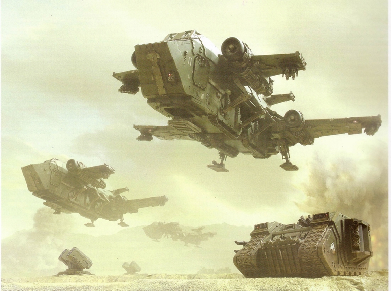
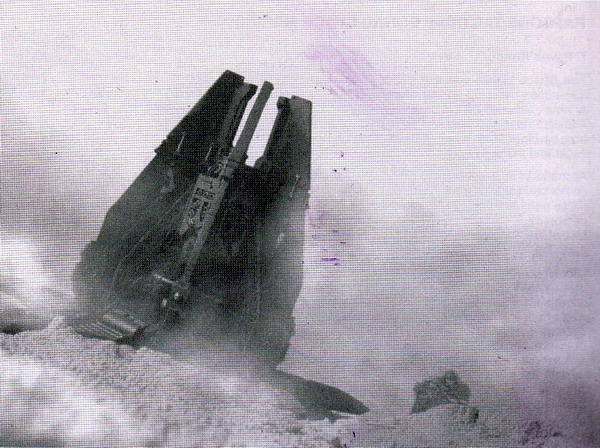
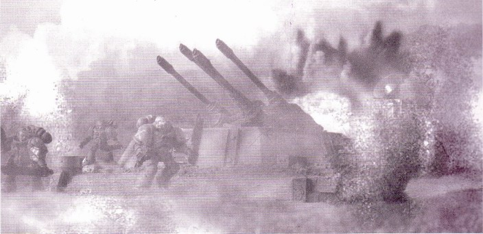
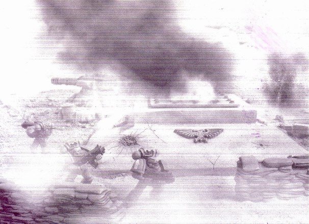

---
title: 塔洛斯战役（第四章）
prev: ./the-battle-of-talos-3.md
next: ./the-battle-of-talos-5.md
---

# 【分享】帝国装甲三——塔洛斯战役（第四章）[zt]

原贴：<http://game.ali213.net/thread-1077095-1-1.html>

> 作者：boltgun

塔洛斯战役，对于帝国来说，它本质上是一场为了一个矿产资源而发生的边境战争。在帝国看来，这是一次很不足道的事件，如同帝国中经常发生的日常冲突一样。它并没有牵扯到多少军事资源，更没有办法和卡迪安之门战争，或是第三次末日行星之战那样的大规模战争相比。地球的高领主们不会为了一个塔洛斯费多少神的——如果他们甚至听说过这个地方的话。

相反，对于钛族来说，塔洛斯战役是一场相当严重的冲突。他们没有帝国那样无尽的资源可以消耗，在塔洛斯的部署力量代表着钛族相当部分的实力。尽管钛族一贯有着一个“好人”的形象，但是塔洛斯在他们来说确实是一场富有攻击意图的战争，是一场扩张版图，为他们所谓的“更高利益”所服务的战争。与混沌信徒和泰伦虫族相比，钛族或许看起来更理性一些，但是在为了自己的目标而战斗的时候，他们是无情的。 

## 第四章 大侵攻

猛禽军团第一次攻势中雷鹰向地面部署重装备和车辆

### 大侵攻

2392998.M41，塔洛斯战役舰队在库图提督的指挥下正式开始存在，库图提督在自己的主舰——领主级战列巡洋舰Righteous Power上生起了指挥旗。六艘同编队舰只以及它们负责保护的运输舰也都开始在主舰周围集结。运输船上满载着卫军的士兵、火炮、车辆和坦克，还有大量的补给，弹药和食物，最多的，还是无数的水。整个舰队花了多于三天的时间集结在集结地，各个战斗和运输舰只都是从不同星系赶过来，最后形成了战役舰队。

各支卫军部队的搭载上船时间被仔细地计划过，以便让所有部队都得以在统一的时间运输到集结地。但是在整支舰队准备好时，只有第十军的部队集合完毕。于是第十一军的部队就将作为第二波攻击，在先头舰队打开了塔洛斯星系大门，并在行星上建立了先头阵地之后进行增援。同样还没有出席的是IGNATUM泰坦军团的战斗组，但是舰队已经不能再拖延时间等候他们了。

早已在集结地等候着的，是组成舰队的队形头列的两艘最大的战舰，战列巡洋舰Righteous Power和猛禽陆战军团旗舰War Talon。这两艘战舰和它们的僚舰，将作为整支舰队的矛尖，在星系中战出一条路来，直奔目标。队形中的另外三艘巡洋舰队列将紧随其后，组成对运输舰的前卫保护阵形，在它们之后将是所有的运输舰和护卫舰、战机。

库图提督作为全舰队的总指挥制定了攻击的方针，他不知道自己在塔洛斯星系将会遭受到什么样的抵抗，但是从他安排的队形来看，他做好了以整个舰队对抗钛族空间抵抗力量的准备，并将利用自己最大的战舰作为队列中更小更脆弱的运输舰的防御。

404998.M41，星语者发送的信号传到了Righteous Power的舰桥上，指示舰队出发。一艘接着一艘，各个舰只启动了它们的主推进器，跟随着旗舰向塔洛斯星系行进。一场计划已久的侵攻终于发动了……

### 塔洛斯星系

在变化无常的亚空间潮汐中航行了三个星期之后，Righteous Power熄灭了它的亚空间动力引擎，从非物质空间中脱离，进入现实。战斗准备的警铃声嗡鸣着，船员们冲向自己的战斗岗位。紧接着它的是War Talon，舰队的先锋到来了。他们没有见到任何迎战的钛舰队，库图提督指挥舰队直奔塔洛斯行星，但是长距离探测没有显示出一艘钛帝国战舰。这一情况被陆战军核实，War Talon上强大的探测仪器也没有找到任何目标。库图提督谨慎地指挥着前进的脚步，保持着警戒，时刻准备迎接任何奇袭，但是终究是没有任何攻击。

先锋线的后面跟随的是巡洋舰阵列，库图提督战术上的主要战斗力量。组成序列的三艘战舰Star of Cassiopeia，Black Duke和Hammer of Thrace加速向自己的预定目的地行进，脱离了舰队队形。由于钛舰队没有出现，几只护航舰组也开始远距离巡航，但是依然没有找到任何敌人的踪迹。也许钛帝国放弃了塔洛斯，将它交给了它自己的命运，不敢面对帝国海军的力量。但是这也可能是一个陷阱。库图提督依然谨慎，但是目前依然是零抵抗的航线，运输舰们已经可以保证安全到达塔洛斯了。

预想中争夺行星低卫星轨道以争取登陆地面部队的战斗根本没有发生，帝国舰队平稳地前进，看起来不会有任何在太空空间阻止帝国军前进的努力了。随着每一分钟的过去，事实越来越清楚了，这里没有任何钛舰队存在。从防卫任务中解放出来之后，War Talon提升了引擎推力向前方快速前进。猛禽的指挥官们迫不及待地要开始他们的登陆战斗了。War Talon和它的僚舰是第一批到达塔洛斯低轨道的舰只，其他舰队成员则保持着安全距离，直到陆战军们完成了他们的行动为止。

### 十号导弹井

猛禽军团为了塔洛斯战争更出动了第六和第三连两个连队，置于连队长奥流斯的指挥之下，并且配有装甲部和军团舰队的相关力量——War Talon号战列旗舰即是配属的战力之一。

猛禽们被分配到的任务是整个着陆行动中最重要的一环。他们将负责将一座地面防御导弹发射井破坏。这座代号“Decima”（第十的意思）的导弹井基地，在地面位置上来说，是唯一能够对舰队的轨道区域产生威胁的防御设施，它被定为猛禽军团的破坏目标。

这套地面防卫导弹网系统，是帝国在塔洛斯建立的主要对外防御武器，十号井就是其中的设施之一。如果它不能被及时消灭，那么这座武器设施将对降落到低轨道向地面运输部队的船只进行攻击。一艘运输舰的损失，即意味着大量帝国卫军士兵的伤亡，这将严重影响着陆行动以及其后的战役结果。这是一个不能冒的风险，卫军的主力部队着陆之前，十号导弹发射井基地必须被消灭。

目标区域将遭受War Talon号上轰炸炮的二百五十发轨道轰炸，但是即使是一座导弹井在轰炸中幸存并且依旧运转，那么一发成功的导弹命中将意味着运输船的损失。这就是说，必须有地面单位前去保证没有任何一座武器能够向舰队开火。如果轰炸破坏了所有的武器设施，那么一切都好，只是除非有地面部队的存在，否则将没有100%的成功保证。毕竟，建造在地下的导弹井是被设计并建造成承受强力轰炸的设施，即使是War Talon上的强力武器，也没法作到直接消灭它内部存放的导弹。总指挥部将十号导弹基地定义为地面上对舰队唯一的、最大的威胁，现在，作为先锋消除这个威胁的责任，落在了猛禽军团的战士肩上。

指挥官们决定十号导弹基地的破坏将由地面部队袭击最终完成，猛禽军团的战士们将是第一拨降落在塔洛斯的帝国部队。奥流斯连队长带领的第三连和将随后支援的第六连将完成消除威胁舰队安全的导弹基地的任务，在这之前，着陆行动将等待。

整个行动将是从轨道到地面的手术式袭击，行动将没有任何装甲车辆支持。行动的目标很简单，不惜一切代价破坏导弹基地。一旦基地被摧毁，行动成功的信号将召唤来军团剩余的着陆船只运载增援部队——包括第六连战士和重装甲武器。一旦着陆完毕，陆战军将准备好下一步的攻击或者对抗敌人向着陆区的反击。

### 情报收集

当任务最后确认时，奥流斯连队长开始收集所有关于行动目标的情报来。从最高指挥部那里，有一份他们早期收集的情报应该可以帮得上忙。

档案官斯卡尔收集到的文件中，其中的一份即是一千年前军需部归档的建设报告。这份文件详细解释了当地工程军建设此导弹基地的过程，其中介绍了这个基地的设备囊括——两口地下发射井，一座指挥堡，两座人员掩体建筑（足够容纳一百人左右的导弹机组和战斗人员），延伸防御公事（简单的雷区和壕沟铁丝网系统），一个装载着大型九头蛇炮塔的对空防御设施，还有其他的一些车辆掩体和仓库。大部分设施都是地下建筑，常规的远程火力很难保证将这些设施完全清除，即使是War Talon号上的轰炸炮也不能保证达到足够的深度。伴随着文件的还有三幅已经有些模糊的图象，这是当时的地方防御军在导弹基地落成后总结的结构说明，通过这份文件的描述和这三幅图象，已经可以大概地描绘出一幅基地的地图了。

只凭着已经成为二手资料的情报去攻击目标是相当冒险的。如果钛族已经将基地的防御加强了，或是增添了新的发射井，到时又将如何？毕竟，参考现实的情况，假设地方总督会如此安排以防御对地面的攻击也不奇怪。奥流斯连队长需要一些他可以信赖的第一手情报。

在将任何战士投入到袭击目标的战场中之前，奥流斯决定先派遣手上能调遣的侦察小队下降到地表去，对目标进行侦测，并上报所有侦察结果。他带领的本次攻击部队中只分配有一个侦察小队，他们将在对地轨道轰炸之前部署到地面去，在保持一定距离之下对导弹基地进行勘探，然后将监视结果向War Talon号上即时汇报，以调整接下来的攻击计划。

### 计划和训练

在War Talon上，奥流斯和连队里的高级士官为了即将到来的战斗准备着。这类袭击战斗可以说是他的战士们训练和经历了一辈子的事，但是具体的进攻计划仍然重要。在旗舰上，具体的热身训练，例如热熔炸弹的爆破装置的使用、火力和移动配合衔接、雷鹰跳落着陆，这些将要应用的战术动作都在一次次地演习着。

奥流斯很清楚地认识到，地面袭击行动的最大威胁，在于防空设施，所以这一目标将被最优先消灭，一架雷鹰被击落意味着三十名战士的损失，这样一个数字很可能将本次任务至于危险之中。在破坏导弹井之前，防空设施必须消灭。

作为一个教典规范的部队，第三连一共有两支突袭小队的战士，他们精通利用喷射跳跃背囊完成各种深入阵线的任务，擅长各种高度的空降行动。一队突袭小队将投入到攻击九头蛇防空炮塔的行动中，他们将作为第一波攻击，在伊吉资深中士的带领下，从高空的雷鹰上跳跃而下进入战斗。一般这样的任务跳跃的高度会适当降低来回避最强部分地面火力，但是由于这次的条件和目标的性质，奥流斯命令雷鹰保持在已知最高九头蛇火力高度以上，这样突袭小队的战士可以得到最大的安全保证。比起在跳落过程中被火力击中的可能，雷鹰被击落或者受损而被迫放弃任务的可能要大多了。

突袭小队将在尽可能靠近目标的地方跳落，迅速扫平一切抵抗力量，将热熔爆破装载在九头蛇炮塔上。突袭小队从雷鹰上跳落的时间在计划中定位为Z小时作为基准。斥候力量将在Z-105分钟投射，Z-102分钟降落到地面，在着陆后侦察小队将有53分钟运动到目标位置、进行观测和汇报结果。

第二波攻击将在Z+6分钟到来，这给伊吉小队长和他的九名突袭小队战士一共6分钟破坏九头蛇炮塔。

第二波攻击将包括主要袭击部队，两架雷鹰搭载着两支战术小队和一支重火力小队，标注为部队B和C，他们将在炮塔阵线之内着陆，直接攻击发射井。第三架雷鹰将搭载着连队长奥流斯的指挥小队、陆战军医师、技师和牧师，并同着连队剩余的两个战术小队一起，紧随着前两架降落，他们将标注为部队D。这支力量将有很大的应变性，如果届时战斗遭遇抵抗比较顽强，他们将作为增援，如果一切进行顺利，这支部队将迅速在基地周围建立起早期防卫圈。而连中最后一支突袭小队将跟随之后的第六连一起部署。

B和C队的任务比较简单，两支战术小队将在重火力小队的掩护之下向两架发射井前进。一旦接近到足够近的距离，他们将在发射井顶部合适位置安置爆破装置，然后撤退到安全距离，由小队长引爆，使发射井顶部崩塌，阻止导弹发射的可能。

当他们的主要目标达成，第三连将清扫基地，将所有抵抗力量清除，并在第六连战士和装甲武器的着陆之前建立起周边防御。总体来说，计划中从Z标准时间开始到任务完成，应该不超过30分钟。

附录：

Z小时计划表

|  时间   |         计划           |
|--------|------------------------------|
| Z -105 | 侦察小队降落舱发射           |
| Z -102 | 侦察小队降落舱着陆           |
| Z -85  | 侦察小队到达观测地点         |
| Z -32  | 轨道轰炸开始                 |
| Z -10  | 所有雷鹰起飞                 |
| Z -2   | 轨道轰炸停止                 |
| Z +0   | A队从雷鹰上跳落              |
| Z +6   | 九头蛇炮塔消灭，B队和C队着陆 |
| Z +9   | D队着陆                      |
| Z +15  | 预计主要目标达成             |
| Z +30  | 预计所有敌人抵抗清除         |
| Z +40  | 第六连着陆开始               |

塔洛斯攻击战中，

星际陆战军战术小队配备

- Mark VII动力装甲，沙漠环境适应设定
- 1x Mark IV “玛凯其”型号失弹枪
- 4x 20发曲型弹匣
- 1x 复合碳素战斗刀
- 2X 14型普用破片手雷
- 2x 7型反坦克破甲手雷
- 1x 槊形爆破引爆（每小队两个）

星际陆战军突袭小队配备
- Mark VII动力装甲，沙漠环境适应设定
- 1x Mark II “玛凯其”型号矢弹手枪
- 4x 10发直型弹匣
- 1x Mark IIIb 链剑
- 1x 复合碳素战斗刀
- 2x 14型普用破片手雷
- 2x 5c型热熔爆破器
- “幽灵”型多方向双推进喷射助推跳跃背囊

侦察小队的降落舱着陆

### 轨道轰炸

随着舰队的先头阵列逐渐接近塔洛斯，War Talon迅速运动到低行星轨道，赶向目标地域上空。轰炸目标早已经锁定，轰炸炮和骑枪炮塔随时准备着开火，只等自转着的行星将目标缓缓送到战舰的火力线上。如果炮手们的运气好的话，那么接下来的攻击就只是简单的收尾工作了。如果真的这么走运，War Talon的舰炮火力确实能够敲掉发射井，如此一来连爆破的力气都可以省下。只是这事十分地不大可能，在如此遥远的距离破坏这样尺寸和掩护下的设施将很困难，而且来自地面的确认仍然必要。

在舰炮做着准备的时候，War Talon的起落甲板和发射舱也被忙碌充斥着。雷鹰炮艇在做起飞准备，燃料加满，所有系统被双重检测。四架猛禽军团的雷鹰做好了攻击塔洛斯的准备。

每个陆战军战士也都做好了战斗准备。他们的动力装甲调整到了沙漠环境状态，99%的水分循环率，最大的散热效率。矢弹枪和重武器在下交到每个战士手中之前都在战舰的射击区试射过。手雷、战斗刀具、额外弹药、链剑和矢弹手枪也下交到每个着甲完毕的战士那里。最后，每个战术小队分配到了两支爆破武器，而引爆器则下发到小队长手中。

在出发之前，所有第三连的战士肩并肩地集合在一起，连队长奥流斯向战士们进行了战前训话。他表示，他们将把皇帝陛下的正义带给那些选择叛离了他的人，而他们将荣耀地作为这场战役中第一次进攻的担任者，今日是他们的骄傲之日。然后，他们在连队军牧师面前单膝跪倒，在他的带领之下进行了战斗前的祈祷礼。

战士们在War Talon的舰炮开始轰鸣时完成了仪式，巨大的震荡回响在甲板之间。当第一发炮击落在塔洛斯的表面上时，正代表着正场战役的正式开始。陆战军战士们迅速地进入了雷鹰的搭载舱内，等待着出发。

### 行星降落

在轰炸开始之前，攻击行动的第一步就已经走了出去。侦察小队的降落舱早已发射到了塔洛斯的地面上。降落舱的着陆过程十分顺利，侦察兵们携带着大型侦测设备和狙击枪，在光学迷彩披风的掩护下于烈日之下来到了目标地区。

到达目的地之后，侦察兵们便将探测设备支架起来，把地面的观察信号直射回War Talon的指战室。早期的情报是正确的，观察到的情况表明确实有两口发射井和一个防空炮塔的存在，但是外围的防御设施却被增设的炮塔加强了。这些重武器将对着陆的雷鹰飞船造成严重威胁，研究了反馈情报的奥流斯对作战计划做了一些调整。

B队战士将放弃原来的发射井目标，改为利用手上的重武器对抗并消灭外围的防御炮塔。三个预备的战术小队将代替B队完成预定任务。这样一来，奥流斯的手中将没有任何预备力量，于是他联系了六连的连队长卡弟斯。卡弟斯的第六连队其时已经做好了提前增援第三连的行动准备，奥流斯要求，六连准备出两个战术小队做好降落舱发射准备，如果地面战况有需要，随时投入战场。

最后一分钟的战术变更已经下达完毕，奥流斯踏上了他搭乘的雷鹰，登机门板在他的身后关闭。计划结束了，现在到了行动的时刻。

在地面上，侦察小队保持着安全的距离观察着轨道轰炸的炮击从天而降，震撼着地面。随着骑枪炮的射击光柱和巨大的爆炸降临在地面上，沙土和烟尘形成的云幕也被搅动起来。这一切维持了正好三十分钟，方圆五公里范围的地面被重火力炸得千疮百孔，而造成的实际伤害，却由于厚重的沙尘而无法观测清楚。

在War Talon上，四架雷鹰收到了允许出击的指示，火箭助推引擎一个接一个地咆哮起来，雷鹰们冲出了起飞甲板，向地面飞去。第一架冲进了塔洛斯大气层的雷鹰是搭载着A队突袭战士的飞船，在运输舱中，十名突袭战士手持矢弹手枪，携带着链剑和热熔炸弹，等待着出击那一刻的来临。

在雷鹰的前鼻还在因为进入大气的摩擦过程热得发红的时候，正前方的登机门板就降落打开了，一股气流猛地冲进舱内。位于最前排的战士向前踏在了门边上，所有的小队成员都启动了喷射推进器，当跳落的命令从他们头盔的通讯器中下达的时候，他们没有丝毫犹豫，战士们两个两个地跨过舱门，跳入下方的天空之中。

跳出的战士们，立刻就被卷入了雷鹰高速飞行残留下来的空气涡流当中，每个人都努力地和气流做着斗争，避免被它的力量影响失去控制。重力的影响最终将他们拉到了低空，跳跃背囊的推进器开始发挥作用，在一百米的高度，推进器开动了极大的喷力缓解战士们的下落速度，这一运做造成了能够让正常人体崩溃的高重力压，但是在动力装甲和自身强大的基因改造体格的支持下，突袭小队的战士们克服了复数重力的压力，利用喷射推进器控制着下降方向，降落在预定着陆地点。从起跳到着陆，整个过程没有超过六秒钟。

### 突袭十号导弹发射基地

当A队的战士们着陆的时候，随之而来的是九头蛇炮塔的猛烈炮击。高爆机关炮弹将沙土炸飞，炮火划出一条条轨迹从战士的身边掠过。防空炮塔的操作手没有办法击中刚才空中的目标，于是等待着，等到战士们落地之后，四条炮管一同怒吼着，将密集的弹幕向他们抛射过去。看来轨道轰炸的火力虽然猛烈，但是基地中大部分的防御设施还是幸存到能够继续运做的程度——两座发射井似乎也还完好。基地中遍布着很多还冒着烟的弹坑，只是轰炸没有造成太多的直接命中。这些巨大的弹坑对于突袭小队的战士们来说是十分有利的掩护。伊吉中士就降落在这样的一个弹坑当中。他降落完毕之后，已经有两位战士为炮火重伤。弹坑虽然提供了掩护，但是目前的时间却不容人，这座炮台必须在其他的雷鹰到来之前被破坏。伊吉集结了小队的战士们，下达了前进的命令，然后带头冲出了弹坑的边缘。重炮毫不留情地发泄着炮弹，九头蛇炮塔的火力十分有压制力，炮击的闪光在沙地上尽情穿梭。随着战士们开始前进，更多的人被击中了，炮弹强大的冲击力使每个被击中的战士纷纷被掀倒在地。伊吉中士是第一个冲到了炮塔近前的人，闪避着炮击，一手持着手枪，另一手牢牢抓着热熔炸弹。他的身边迅速地出现了另外两个战士的身影。伊吉启动了他的热熔炸弹，并将这个磁性的大碟子一手甩上了面前的炮塔。“六秒钟！”他通过通讯大声警告着，同时，其他两名战士也抛出了自己手中的炸弹，飞快地撤离了。

在炮塔中的操作人员很清楚将要到来的是什么，而且听到了热熔炸弹被安装到外壁时那金属和磁性物体吸附时的响动。炮塔的指挥官踢开大门，仓皇逃出了地下掩体，一头扎在不远的沙地上，同时，热熔炸弹按先后顺序爆破了，三重爆炸将炮塔变成了一个火炬。熔化的金属在炮塔内部猛烈地飞射，将所有还在内部的人员杀死，并随后引爆了弹药仓。一次从内部爆发的大爆炸将炮塔撕裂，碎片抛上了天空。伊吉和其他两名战士飞快地离开了爆炸现场，他们的装甲上附着了不少燃烧的金属碎片和爆炸飞射的残片，但是真正能造成伤害的爆炸没有影响到他们。整场任务的第一部分行动于是成功完成了。总体上，一共有三名战士在攻击的过程中受了重伤，而其他被炮弹击中的战士则没有严重受伤，在他们精金打造的装甲的保护下，他们还可以继续下面的战斗。

现在，雷鹰由远处传来的引擎声已经可以听到了，并且越来越清晰。基地的防卫士兵——在地下掩体中从轨道轰炸中幸存下来的士兵们，开始和突袭小队的战士们交火了。起初，这些防卫士兵面对的火力并没有多少，只有环绕在燃烧着的防空炮台前的伊吉和几名战士的手枪射击。但是随着雷鹰的轰鸣接近之后，从上空便淋下了雨点一般的重矢弹机枪射击。雷鹰减速之后，降低高度，伸出着陆支架，还没有真正降落的时候，前方的舱门便已经放了下来，露出了全副武装的战术小队。战士们冲下舱门，向战场冲去，矢弹吼叫着向敌人飞射而去。

地面防御部队的士兵们承受到了足够的压力，有些人选择了溃逃而不是去面对传说中的星际陆战军的怒火。随着爆炸弹头在他们周围到处炸裂，士兵们不是逃走便是被压制在掩体后面。战术小队稳速前进着，同时重火力小队也进入了射击位置。在着陆只有几秒之后，雷鹰便调转过头去，再次飞上了天空，留下了一片尘土。

地下，基地指挥掩体中，操作手们慌乱地进行着导弹的装载进程，试图将它们发射出去。上方的战斗情况十分混乱和不清楚。他们现在在和时间赛跑，指挥所有很明确的目标——停留在低轨道上的War Talon，但是他们是否有足够的时间将导弹发射出去？

压制地面的抵抗相对来说则简单得多。防卫部队在一次十分不平衡的交火之后便再没有发起什么象样的抵抗了。进攻的陆战军战士对防卫军的光枪没什么畏惧，但是，防御炮塔则是另一回事。这些武器被用来对抗地面对基地的攻击，但是它们本身也在基地中扫出一片片的大火。奥流斯指定B队攻击这些防御武器，希望利用重武器小队的火力将它们破坏，现在按照制定的战斗计划，两方开始了强力的火力对射。

同时，C队面对着微弱的抵抗，到达了他们的目标发射井。用战斗刀在围护网墙中砍切出一条通路之后，C队将爆破器材安置到了发射井的顶部，这座设施的命运已经确定了。第二座发射井还在凭依着防卫炮塔抵抗着，但是重武器小队在交火中终于占了上风，破甲火箭弹和光炮击毁了外围炮塔之后，B队也接近了自己的目标。

沙漠在第一座发射井被破坏时的爆炸中震动。槊形爆破炸药将加强的发射井钢铁装甲天顶冲击崩溃，导弹发射口中被破碎的残骸堵塞，任何发射试图都将意味着自杀式的灾难。意识到他们已经输掉了这场赛跑的指挥部人员放弃了自己的岗位，逃窜而去。很快，猛禽军团的战士将冲破掩体的重重封门，将掩体用矢弹的风暴清洗。他们宁愿选择逃跑而不是留下来等死。

十号导弹基地被成功拿下了。第二座发射井也很快跟随了第一座的命运，最后的抵抗力量也纷纷投降或是溃逃了。这是一场激烈而艰难的战斗，但是猛禽军团的伤亡程度十分轻微，一名死亡，五名重伤，十二名轻伤。奥流斯连队长在硝烟处处的战场上向周围看去：死者四处散乱地躺在他们到下的地方，他的陆战军战士们迅速向自己的新岗位移动着，去防御基地的外围。听取了各个位置的战士报告进入防卫之后，他联系了War Talon战舰，指令第六连的登陆开始。

### 后援

猛禽第六连的战士乘着雷鹰炮艇和运输船，降落在基地的中间地带。飞船将人员、车辆和弹药补给悉数卸载下来。他们曾进行了无数次类似的任务，一切都迅速平稳地进行着，没有一点忙乱，陆战军已经做好了后续战斗的准备。他们以无情的速度为侵攻部队打开了战斗的通路，一个只有阿斯塔特的战士们才能够达到的效率。在车辆的驾驶人员们登上自己的坐骑，启动着装甲的机魂时，塔洛斯攻击舰队也开始进入了行星低轨道。

奥流斯连队长和卡弟斯连队长等待着新的命令，他们现在的任务是坚守着陆阵地，并抵抗任何敌人威胁到着陆区的反击力量。他们已经为帝国卫军的运输机清理了道路，现在，他们将作为保护着陆区的盾。

————待续————
