---
title: 塔洛斯战役（第五章）
prev: ./the-battle-of-talos-4.md
next: ./the-battle-of-talos-7.md
---

# 塔洛斯战役第5章：沙漠鏖战

> [kv85](http://game.ali213.net/profile-uid-700385.html)

## 引子

塔洛斯上将先期部署塔兰第17团的各步兵连。许多人认为，精锐突击兵连已针对入侵行动中的先头突击行动，接受了特殊训练，予以应优先部署，但De Stael的参谋部中，持此论点的一派遭到否决。De Stael大元帅意在迅速部署，尽快投入更多兵员、更多重武器、更多车辆和坦克。突击兵连队拥有优秀的步兵，但是缺乏重装备。第17团的Barim-Abas将军自认其的手下拥有高效实行任务所必须的经验、训练和装备。

原定计划要调用大量登陆舰船，一次性投送3个整团的帝国卫军。舰队司令Kotto无法提供完成计划所需的大量舰只。其实，舰队的登陆艇仅够运送一个整团。其他部队不得不依次待命。

在帝国标枪、拳套和铁砧这三艘姊妹运输舰上，塔兰第17团10000多人的部队从泊位进入登陆艇。车辆、设备和补给随同兵员一起登艇。预定第一波着陆的人已携行全套战斗装具；盔甲、手雷、额外弹药、口粮和饮用水等补给品都已下发至各先头步兵连。士兵们摩肩接踵走入巨大登陆艇的肚腹，在黑暗中并肩挤在一起。各连最后登船之人，都是连长。在着陆时，他将第一个离舰。在各主攻连队的队尾都有一名政委，他负责监督队尾，强迫每一个懦夫下船战斗。

三艘运输舰进入低层轨道的同时，舰队护航舰进入巡逻阵位，而较大型的巡洋舰控制周围区域，保护待命的运输舰免遭突袭。正义力量号和先头运输舰一同停留在低层轨道，准备提供轨道轰炸。有好几艘运输艇上搭载了帝国海军登陆分队，由来自正义力量号的海军军官率领。他们将负责在帝国卫军和舰队间保持联系，并在抵抗激烈，需要正义力量号实施炮击时，充当火控小组。De Stael大元帅也搭乘战列巡洋舰，他在舰上统管登陆行动，直到他将司令部转移至地面为止。

穿过大气层时的颠簸结束了，De Stael选择的南端着陆地段看来很是理想。在塔洛斯定居区的沙漠没全无抵抗。满载兵员和设备的登陆舰未遭任何射击。当巨大的登舰门打开，跳板降下，砸入沙砾之中时，塔兰第17团的士兵下船，走向灼热的空气中，走向耀眼的烈日下，结果发现根本没有战斗。四下都不见敌人踪影。登陆继续进行之时，还是一枪未发。帝国卫军先头连队一队一队走下跳板，进入塔洛斯恶毒、干燥的热浪中。在上司军官的呼喝号令下，离舰行动秩序井然，迅速高效。完成着陆后，各连队立即前进，建立防御圈。第一批坦克也在先头步兵之后到达。黎曼鲁斯坦克一辆接一辆隆隆驶下跳板，和士兵一起为新的防御圈建立支撑点。De Stael收到了地面上交的报告：登陆未遭拦截。迄今为止一切平安，可是敌人可能已经作出反应，开始集结，组织反击。他需要抓住这一机会尽快增援；他不知道这一良机将持续多久。塔兰第17团的连队依次着陆，离舰，然后从登陆区开始进军。一旦卸载结束，登陆舰便拔地而起，返回降至底层轨道的其他运输舰的泊位，重复这一过程。塔兰第89团是第二个登陆的团。运输舰重复着第17团登陆的过程。入侵部队得到了立足之地，现在，他们需要更多部队和更多补给来予以巩固。当Ｘ集群的各团开始漫长的轨道——地面大运输时，猛禽战团已完成其登陆行动。第三连和第六连，及其所有车辆已环绕Decima发射井就位。Orelius连长和Kaedes留守于特遣队的狄魔克勒斯型犀牛指挥车边，听取了上交的报告。入侵按计划实行。没有任何接敌报告——暂无而已。

如前所述，猛禽对Decima发射井发动的突击是塔洛斯入侵行动第一天唯一的战斗。看来敌人已被登陆的突然性所制，因而无从应对，各防御部队都未遭到立即反击。第二天可能会遭到期望中的反击，敌人对此不闻不问的时间越久，帝国兵力就越强大，剿灭他们也就越困难。

时间一天天流逝，敌人一个都不见。塔兰第17团掘沙地、堆沙包、修阵地，他们的炮兵连定位完成，黎曼鲁斯坦克半埋入沙中的坦克掩体，而现在，他们又受命实施侦察行动。他们的哨兵机连队和专门挑选的步兵班准备深入周边沙漠，开始远程巡逻，试图找出任何敌人活动和部署的迹象。主要的行动集中于北方，那是将来准备推进的方向。在搜索敌军并上报之外，巡逻队还要提供有关团属部队所面对的地形和推进路线的实用情报。

与此同时，第17团前沿之后，着陆区一片车水马龙的景象。登陆舰来往穿梭，川流不息。哨兵起重机来往奔走，搬运弹药箱和燃料桶。特洛伊型牵引车拖着燃料和运水拖车在舰船和库存点间来回行驶。在各步兵行军纵队中，塔兰步兵和突击兵人数最众，承担着自己战斗装具的重压，还有那可怜的劳工班组，他们衣衫褴褛，带着铁锹和鹤嘴锄。坦克和奇美拉运兵车中队排成整齐的队形隆隆碾过沙漠。De Stael的部署全面展开。

塔洛斯入侵。着陆进度表

- 塔兰第17团
- 塔兰第89团
- 第2378突击兵连队
- 塔兰第三装甲团
- 军需部劳工团组
- 军需部工程团组
- 第386战斗机中队
- 军需部劳工团组
- 第2356突击兵连队
- 塔兰第331团
- 医护牧师修会特遣队
- 第2774战斗机中队
- 第2424轰炸机中队
- 第71战术航空中队
- 塔兰第12装甲团
- 第83战斗机中队
- 第501轰炸机中队
- 第1002战斗机中队

第四天，第一支军需局劳工团组着陆，立即开工建设一座战机机场。第一支帝国海军战斗机中队，第386中队，在色雷斯之锤号舰上等待，一旦空军基地和补给就位，就可转场到地面。这些都是优先执行的任务。新到的帝国海军战斗机中队将大幅提升入侵部队的侦察能力。在沙漠中，他们作战半径辽阔，相对于正在周边沙漠行动的哨兵机或装甲拳班组，他们可以在超远距离上发现敌人部队。

对De Stael而言，着陆行动是组织规划的成功典范。一直令人忧惧的钛族反击一直没有到来。军力展开进展顺利。当然，也有需要解决的问题。拥堵的着陆区内，人员和登陆舰开始迷路，或降落于错误位置。水源供给也成为问题，不过，Svedeg女王号液罐船已进入行星轨道，一天就卸下1000吨淡水。以此速率，还需要20天来彻底卸货。地面人员的需求尚未满足，运送淡水所用登陆舰空间超过预计量，拖慢了整体登陆进度。用于卸货的哨兵起重机短缺，于是De Steal下令调集防御圈上塔兰各团的起重机前往着陆区。副作用在于，塔兰各团必须用人力将补给前送。国防兵们充当着驮兽，将炮弹前送至炮兵阵地，将补给水罐前送至战壕。被摊派了补给任务的各排在烈日下劳作，一箱、一箱、又一箱，不停的搬运。在第一周，这是最令人厌恶的工作，由于敌人没有进攻，这种对战斗兵力的低效运用对第4621军来说不算什么问题。

各种各样的补给正向塔洛斯倾斜而去。燃料、食品、医药补给、通讯设备、沙包（成千上万的）、补充车辆、强袭骑兵中队专用饲料、帐篷——小号、中号、大号的、种类齐全的能量电池、备用牵引链、铁锹、鹤嘴锄、叉车运送的燃料扁罐、长度以英里记的带刺铁丝网、地雷、保险丝、一盒又一盒，不计其数的、金光锃亮的勋章。补给库天天增高，每样东西都被周详归档、记录和仓储。虽然“勇士们”试图强行恢复秩序，但是着陆区仍旧一片混乱。一个突击兵连申请配发新传话仪，但是撬开板条箱后，他们发现送来的是崭新崭新的马鞍子！

登陆行动十分庞大，但是，即使手握三个首批登陆就位的团，De Steal仍旧不急于发动地面进攻。他手下到位的兵员和补给越多，他胜利的绝对几率就越大。将一切送到行星地表整整花去两个星期；整整两个星期热火朝天的大卸货行动；整整两个星期敌人没有一点进攻迹象。对于前线人员而言，这是干等的两星期。这些士兵开始把塔洛斯入侵叫做“书记员的战争”，既暗指De Stael的绰号，也证明着，军中最繁忙的人是补给书记官。

帝国的部队现在在塔洛斯安如泰山，但是，让人大跌眼镜的是，现在还是一枪未发。侦察报告指出了沙漠中的若干敌人活动。钛人的活动踪迹或停留点被发现，但是没有任何直接目击。如果钛族就在那边的沙漠中，那他们正在玩一场耐心坐等的游戏。De Stael的下一任务，就是找到他们，并将他们拖入战斗。

下图：枕戈待旦。塔兰第12装甲团的一辆毒刃坦克抵达塔洛斯。

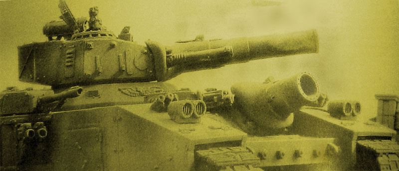

## 沙漠鏖兵 ——塔洛斯战役 第五章

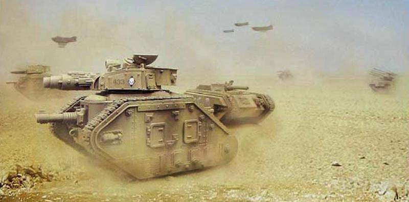

推进中的短暂休整。塔兰第12装甲团某装甲连接听尖兵的最新回报。

### De Stael的地面作战计划

帝国卫军部队建立了稳固的着陆区后，他们并未立即行动。反之，他们环绕登陆区建立了密集的防御圈，开始增补兵力和积蓄补给。这一进程持续了两周。与此同时，塔兰各团派遣哨兵机和步兵长途巡逻队进入沙漠勘查预定进军路线。巡逻队极少遇敌，敌人仍在保存实力，避战不出。一个敌人都没看到。钛人哪里去了？

第二周的部署中，其他帝国卫军团和更多军需局单位登陆。劳工队立即开工建设空军基地，简单平整土地，准备迎接轨道上舰载的帝国海军航空兵登陆部署。第23Elysian伞兵团已抵达，并开始将其3000士兵和180架航空器送达地面的漫长进程。

当一切就位后，Ｘ集群部署完毕，补给品积累量充足，大元帅De Stael可以将其部队从防御状态转入进攻状态了。

经众人议定，地面进攻的目标指向了塔洛金及其星港。次要目标是搜索并处决行星总督，并摧毁塔洛斯上的钛族部队。

塔洛金市坐落于伊拉康达地峡，塔洛金两大主要海洋间的条状陆地。其位置为De Stael的计划造成不小困扰。地面部队只能从东西两面接近城市。伊拉康达地峡东端非常狭窄（宽度小于15公里），对帝国卫军而言，那是一处危险的瓶颈。钛军可以轻松遮断这一推进路线，造成僵局。没有机动空间，只能通过损失惨重的正面强攻突入城市，因此De Stael并不认为他有足够兵力实施这种野猪强推式的消耗战。他决定集中兵力于地峡西端主攻，那里更为开阔，能够发挥帝国卫军的数量和火力优势。

进攻开始前，在正义力量号上召开了一次总指挥部参谋联会。总指挥官Gustavus亲自出席。他强调，如果不在东路施加压力，守敌就可在西端集结重兵，使得任何突破都难以达成。Gustavus认为，需要一支部队将敌人部队引出地峡并牢牢牵制之，至少要使之因为积极的行动而受到威胁。

漫长的讨论后，大家决定，第二路攻击是有必要性的，De Stael依此修改了他的计划。

为完成这一新任务，大元帅请求Orelius连长参与其下一步计划。Orelius的猛禽战团要再次助战，这次是要从着陆区的东路发起一次强有力的装甲突袭，绕过南侧海洋的南端。星际战士的任务目标是牵制钛族部队，并防守伊拉康达东端。星际战士不用全力接敌并发动决定性战斗，而是通过星际战士们实施威胁，只要不长的时间，就能通过引走守军协助北侧主力的推进。

Orelius连长和下属军官极力反对。他的战斗修士们不是用来充场面，当牵制部队的。由于对自己部队在计划中扮演的角色十分不悦，Orelius上尉拒绝了此任务，除非让他的部队参与主线进攻，就是是组成第一波装甲突击的锋线也可，而不是照他的说法，去“充做大战的陪衬”。虽然因Orelius上尉的拒绝，De Stael的计划无法实施，暴跳如雷的Gusavus又不敢冒彻底丢掉珍贵的星际战士盟军的风险，他只好逼着De Stael修订其进攻计划了。

代替星际战士实施东路牵制攻击的职责，落到了新组建的塔兰第331团头上，这是他们建团以来第一次参战。第331这支未曾见血的部队，通过对付狡诈的异型来简单的一窥战争，要比把他们抛入战争前线的熔炉中要来得好。其目标与星际战士所应肩负的一样，但是主要推进方式只能是步行，预计会颇为迟缓。不过，整个团的兵员和坦克行军穿越沙漠，应当会吸引钛军部队向他们运动，离开主力推进的路线。Usfal Hamid上校，331团司令，被De Stael召见，并领回其命令：在东路推进三天，然后建立新的阻击线，切断Em－sai的南部海岸。331团的推进将和主力进攻同日发起，必须勇猛而主动的前进，牵制行动必须能够以假乱真。

先头牵制问题解决了，De Stael开始策划他在北方的主线进攻。应当实施宽正面推进，向北穿过沙漠，然后向东旋转，直指伊拉康达地峡。De Stael并未集中其所有战斗力，而是选择将其分散部署。这似乎不合《帝国战术条例》【Tactica Impriailis】，但是De Stael所得的一切情报都认为钛军人数不足，无法在整个正面阻止他。如果一个地区被钛军所阻滞，那另一路就能长驱直入。总体上，进攻就不会停滞。塔兰各团在宽正面上的并列推进能够保证确实的战果。De Stael野心勃勃的进攻时间表要求塔兰各团每天前进20公里，但他预计在某些前线地段，钛人会固守不退，这些地段的进军自然会因战斗而暂停或迟滞。如果钛人将部队投入单一地段，那么其他地段就能更快速推进。De Stael的参谋们确信，每天平均20公里完全可行，尤其是在塔兰部队能在熟悉的环境中行动时。照此速率，到达塔洛金郊区将需要60天的推进。

进攻时间表制订完成后，De Stael开始召见其后勤军官们。他下令预备60天补给。充足的弹药、食品，和性命攸关的淡水都要大量积存。报表显示，可资利用的库存接近原定量的一半，可以支撑30天，不过，来自轨道上的补给品输送顺利。De Stael决定，30天补给足够发起进攻，其他部分在进攻过程中能够陆续到达。决定命运的时刻来临了。

De Stael的进攻战略中，第4621军的Ｘ集群将担当先头部队。塔兰各步兵团将借助其编制内坦克连和炮兵支援先头步兵排，实施推进。塔兰第12装甲团位于右翼，而第3装甲将留在锋线之后，充当集群的预备队，只在进攻受到迟滞时投入。

自西向东排开，Ｘ集群的阵列如下：塔兰第17团居左，塔兰第89团居中，第12装甲团为右翼。后方第3装甲团跟随。塔兰第331团从东侧进击。隶属ＸＩ集群的帝国卫军其余各团一旦着陆，便转为战略预备队。如果无法攻到塔洛金，De Stael将启用这些单位并制订新的计划。

伊拉康达地峡东端的艰难攻击将由猛禽战团星际战士负责，并得到Ignatum军团的战犬级泰坦和塔兰坦克部队的支援。这一进攻的力度将穿透瓶颈地带，到达塔洛金外围。一旦到达城市外围，De Stael将开始攻城，首先切断水源，然后以ＸＩ集群的新锐团发动总攻。突击塔洛金的详细计划待攻击顺利执行后再定。

对于塔兰数以千计的士兵们而言，这仅是在炎热与荒芜之中，漫长而艰难的跋涉，但他们可以得到坦克支援，他们的炮兵不断前移，将前线纳入射程。帝国海军会从其新建基地增派空中护航和轰炸空袭。钛人会迟滞他们并获得局部胜利，但进攻仍会持续，依靠以其密集兵力隆隆向前碾去。

第一波攻击——走向塔洛金的60个昼夜。

### 第一日

第41千年，998年，514时，De Stael下令，各团指挥官向塔洛金发起长途进击。

进攻开始于漫长的连续炮兵火力准备，覆盖整个前线。迫击炮、主战加农炮、撼地炮和狮鹫臼炮开始猛烈轰击。那情景有如降临的众神将雷霆和闪电抛向塔洛斯。巨响隆隆、大地撼动，烈焰从每个炮口中喷涌而出，混成一片嘈杂。轰雷般的爆破滚过沙漠，伴随着泉涌而出的沙雾和火焰，四处开花。轰击如此密集而迅疾，最终混成同一的嘶吼。一片片烟火射上天空，化为一片英里一英里滚过的爆炸幕墙，扫过沙漠。炮火向前延伸，持续30分钟，然后步兵开始前进。集群的每一门火炮都在极速射击。此次炮击用于削弱和软化敌人最前方阻击部队。跃出掩体的步兵们都能感到大地在颤抖，听到炮弹在哀嚎着、尖啸着掠过头顶。如果敌人就在那里，那他们正遭受猛轰，这让国防兵们信心倍增。这时，就如它开始时一样突然，炮击结束。奇异的死寂在风暴后来临。在他们前方，步兵们在前锋排推进之处只能看到升腾而起的厚实沙雾。

图示De Stael Ｘ集群的攻击计划。三个团（第17团、第89团、第12装甲团）将向着陆区北方形成3个团的正面实施进攻。他们将在第3装甲团支援下突破Iracunda地峡，然后包围塔洛金，等待XI集群的后续进攻。
一个团（第331团）将发起佯攻，从东路推进，他们迂回Em－Sai后从东侧进攻塔洛斯的威胁，可以将钛军引离主攻方向。

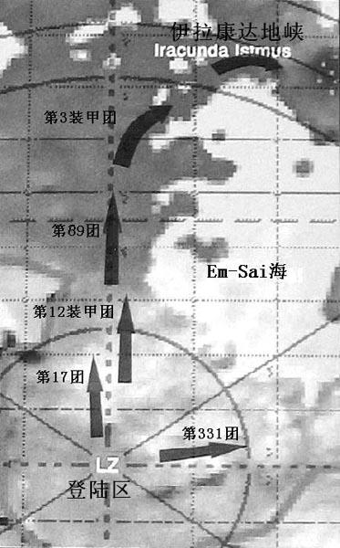

塔兰第17团，进攻梯队

|     梯队    |         配置           |
|-------------|------------------------|
| 第一梯队：侦察预警线 | 步兵侦搜班           |
| 第一梯队：侦察预警线 | 哨兵机侦察中队        |
| 第二梯队：前卫 | 先头步兵排        |
| 第二梯队：前卫 | 坦克班        |
| 第二梯队：前卫 | 火力支援班        |
| 第二梯队：前卫 | 前进观察员        |
| 第三梯队：预备队 | 预备队步兵排        |
| 第三梯队：预备队 | 突击兵班组        |
| 第三梯队：预备队 | 反坦克班        |
| 第四梯队：前线指挥 | 连部        |
| 第四梯队：前线指挥 | 迫击炮班        |
| 第五梯队：炮兵 | 炮兵单位        |
| 第五梯队：炮兵 | 对空防御        |
| 第五梯队：炮兵 | 步兵排（警戒）        |
| 第六梯队：补给 | 团部        |
| 第六梯队：补给 | 补给纵队        |
| 第六梯队：补给 | 哨兵机中队        |
| 第六梯队：补给 | 强袭骑兵（警戒）        |

塔兰炮兵准备开火。他们的炮击将为即将开始的塔洛金进攻行动扫清道路。

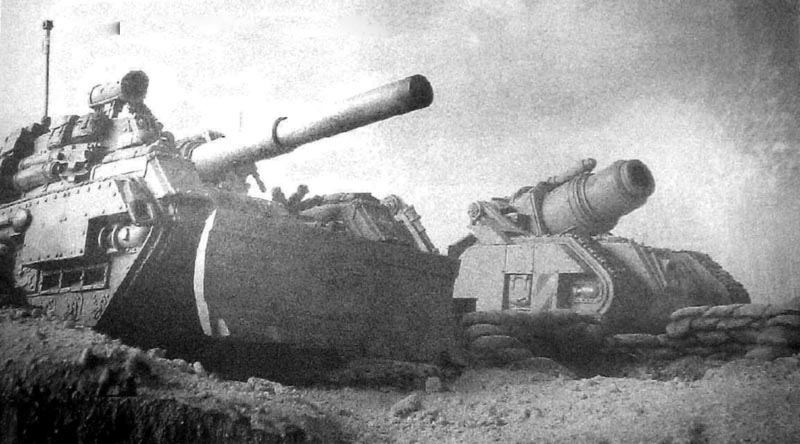

塔兰沙袭兵第17团（战斗序列）

- 团部
- 团参谋部
- 卫生连
- 通讯连
- 侦察中队
- 配属政委
- 配属牧师
- 配属机械神甫
- Ｉ旅
    - 第1步兵连(机械化连)
    - 第2步兵连
    - 第3步兵连
    - 第4步兵连
    - 第5步兵连
    - 第6步兵连
    - 第7步兵连
    - 第8步兵连
    - 第9步兵连
- ＩＩ旅
    - 第10步兵连
    - 第11步兵连
    - 第12步兵连
    - 第13步兵连
    - 第14步兵连
    - 第15步兵连
    - 第16步兵连
    - 第17步兵连
    - 第18步兵连
- ＩＩＩ旅
    - 第19步兵连
    - 第20步兵连
    - 第21步兵连
    - 第22步兵连
    - 第23步兵连
    - 第24步兵连
    - 第25步兵连
    - 第26步兵连
    - 第27步兵连 (训练/替补)
- 团直属单位
    - 第28强袭骑兵连
    - 第29强袭骑兵连
    - 第30强袭骑兵连
    - 第31哨兵机连
    - 第32哨兵机连
    - 第33哨兵机连
    - 第1装甲连
    - 第2装甲连
    - 第3装甲连
- ＩＶ炮兵旅
    - 第1炮兵连 (蛇蜥自行火炮)
    - 第2炮兵连 (蛇蜥自行火炮)
    - 第3炮兵连 (蛇蜥自行火炮)
    - 第4炮兵连 (蛇蜥自行火炮)
    - 第5重装炮兵连 (轰炸型自行攻城臼炮)
    - 第6重装炮兵连 (狮鹫型自行重迫击炮)
    - 第7防空连 (九头蛇防空炮)
    - 第8防空连 (九头蛇防空炮)
    - 配属军需居补给纵队 (31)

前导步兵并肩横列，徐徐前进。他们身旁与背后跟随着坦克。黎曼鲁斯将沙砾碾做沙尘，引擎飞转，向空中吐出阵阵黑烟。每个排各取其进军路线。侦搜线没有任何接敌回报。

前锋抵达了炮击区。那里的弹坑仍在冒烟，一片千疮百孔的景象。沙子被烧黑，石块破碎成卵石，但是没有任何证据表明，开始时的炮击除了空荡荡的沙漠，还击中了别的东西。

部队继续推进，更加深入沙漠，稳步行军整整一个白天后，还是没有任何抵抗的迹象。有些人开始猜测，钛人也许放弃了塔洛斯，战役不过是大游行而已。第一日的黄昏，前进单位完成了预定的20公里。夜幕降临后，火炮被挂接到特洛伊牵引车上，前移到新的发射阵地。推进距离大大超过火炮射程，即使远程撼地炮也达到射程的绝对极限。将各种武器或驾或拖，前送前线，为之挖掘新的发射阵位，从补给库领取新弹药，准备明天战斗的工作持续了整整一夜。

### 第二日

长夜苦寒，正如白日酷暑。短暂的夜晚中，许多帝国国防兵的武器都已覆冰，它们在旭日下迅速消融。第二日是第一日的重演，不过没有大规模火力准备。这样高速的弹药消耗不可能一直持续下去。火炮待机，准备支援任何受到攻击的单位，打击钛军可能用于短期火力袭扰的地点。

随着炮兵和迫击炮再次开火，步兵开始推进。他们士气高涨，迄今为止未曾遭遇抵抗。在晨中时分，一切都变了。

钛人在塔洛斯登陆开始时就在坐等敌人推进。他们的寻路兵班组和隐身服单位在一枪未发前已获得可观成果——他们探清了帝国卫军单位的确切阵位，并向猎队指挥官告警，指出帝国卫军装甲兵的预计进攻路线。猎队指挥官们遵从指挥官（Shas'O）R'myrs的训令，藏身沙海之中，等待前出截击。猎队为沙漠机动战斗中专项配置军械，那里战场开阔，接敌距离极长，非常适合磁轨炮和追踪导弹发挥威力。进攻发起前24小时，经验丰富的隐身小组在夜暗中出没，避开帝国卫军巡逻队，标定了设备和仓储的部署，预报帝国部队已完成进攻准备。钛人在火炮射程内没留半点阵地，但是他们的机械化猎队装备精良，拥有鳐鱼式运兵车【Devilfish】——它们机动灵活，能够及时抓住战机，决定成败。

钛人下定决心，帝国部队进攻的第二天，就是反击之时。帝国卫军步兵和坦克离开了他们的防御圈，将沙包、铁丝网和雷场抛在身后，现在正暴露在旷野中。钛军先要制造伤亡，然后撤回沙漠。预计帝国卫军将会追击。第二天他们会再次被动挨打。

钛族部队在第二天，在整个推进正面发起了短暂交火。塔兰第17团在正午遭到最强硬抵抗。在接近一处被称为通古斯塔站的废弃矿区时，钛人用双髻鲨炮艇和追踪导弹发动打击。

### 通古斯塔站之战

在第二日黎明的第一缕阳光的笼罩下，塔兰第17团全线推进。在军官的指挥下，士兵们飞快跃出散兵坑，坦克引擎点火，缓缓向前碾去。炮兵在新的发射阵地开火，全线打击预定目标。团属的三个装甲连组成了推进的尖锋，一组组黎曼·鲁斯坦克中队行驶在沙地之上。由于缺乏奇美拉运兵车，推进只能采取步行。这也许又是整整一天的缓慢、稳步的进取。

在塔兰步兵和装甲连的混成部队穿越沙漠时，他们遭遇了第一批敌人。一个猎队前出至接敌距离。这些部队在远方寻路兵小组的引导下，高速突进，阻截帝国坦克前锋。更加快速的钛族反重力坦克抢先帝国部队仅仅几分钟，抵达了通古斯塔战接近地。

通古斯塔站遍布建筑、坡道和老旧的矿机，在帝国部队抵达后便被工人们放弃了。那里已经侦察完毕，作为本日进攻准备的一部分，进行炮火轰击。周边地区到处都是蛇蜥炸出的弹坑，就像粉刺和麻点般四下散布。

前导坦克遭遇一个钛人寻路兵单位后，战斗打响了。黎曼鲁斯主战加农炮开火。钛军利用导引光束和追踪导弹还击，立即击毁那部黎曼鲁斯，它猛烈爆燃，乘员们连滚带爬，跳出车舱，跑进沙地。阵位暴露的寻路兵迅速徒步撤退。远处，通古斯塔站的边沿，双髻鲨炮艇出现，磁轨炮开火。像鞭子般噼啪作响的磁轨炮声在空气中回响，填满耳膜。幸存的黎曼·鲁斯开始寻找掩蔽，发射烟雾弹，然后还击，Vanquisher炮和主战加农炮与磁轨炮在致命的远程交火中对决。利用提早占用的装甲车辆各自为战的帝国卫军步兵，在指挥官Kavir中尉的率领下向建筑群前进。

反击先锋。钛军装甲部队前出，阻挡帝国卫军的推进。装备精良，乘坐蝠鲼的猎队降落于沙漠中，实施迟滞性和扰乱性攻击。

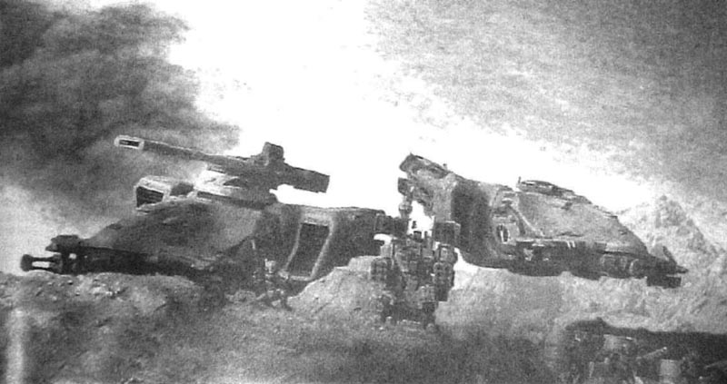

塔兰第12装甲团的黎曼鲁斯Vanquisher坦克，得到一部征服者和一部支援型哨兵机的近距掩护。许多塔兰坦克连混编了黎曼鲁斯变形车，并得到蛇蜥的支援。分派于各先头连队的Vanquisher炮和撼地炮能对钛人占优势的磁轨炮作出立即反击。反之，钛人也懂得了先攻击Vanquisher坦克，对塔兰各坦克指挥连造成严重伤亡。

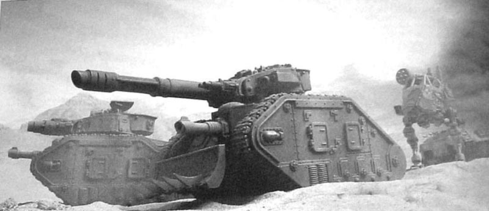

在雷电战斗机的近距离保护下，塔兰第12装甲团黎曼鲁斯坦克在沙漠中待命。

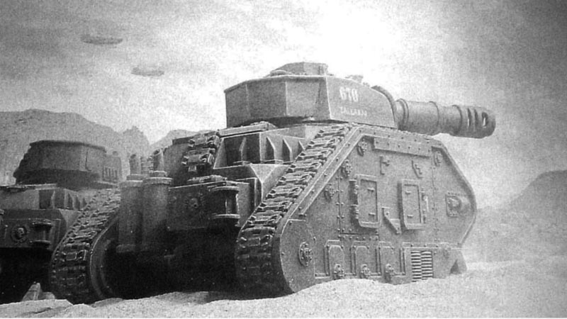

2连1排的士兵们接近了通古斯塔站的外围，遭遇了得到鳐鱼运兵车支援的火战士。猛烈的交火随即爆发。Kavir中尉在进攻中阵亡，他的指挥阵位被危机型机甲的反击突破并歼灭，这些机甲很可能由猎队的Shas'el指挥官亲自带领。没有直接装甲支援，塔兰排火力处于绝对劣势。他们紧急呼叫支援，于是，一个突击兵班组奉命向他们的位置前进。一架雷电式战斗机也前去截击钛族部队。

更多钛军增援部队和一架低空掠袭战场的梭鱼最终将战斗导向钛人所熟悉的节奏。尽管突击兵增援部队乘坐奇美拉及时赶到战场，但被压制的1连损失惨重，不得不狼狈后撤。负责空中支援的雷电战斗机对通古斯塔站实施低空轰炸。已有三辆黎曼鲁斯在沙漠中燃烧，在这一地段，推进整整迟滞了一日。

钛军火力之王。实战证明，磁轨炮在开阔的沙漠中是强大的武器，压过了帝国卫军的主战加农炮，为钛军在坦克大战中夺得了决定性优势。

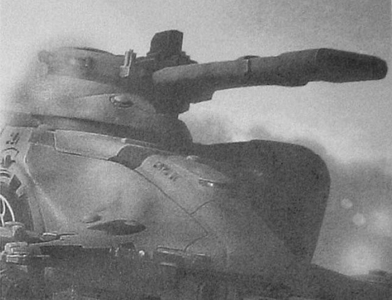

钛军在漫天炮火中进入通古斯塔站。在沙漠中，天光的多轨追踪导弹在战斗中是磁轨炮的有利后援。

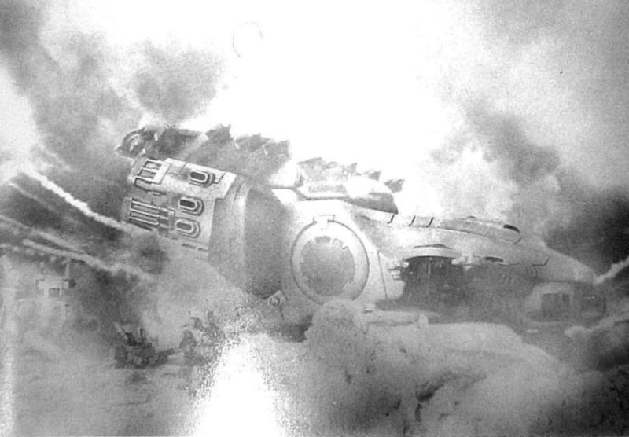

随着帝国国防兵们撤出通古斯塔站，毁灭性的炮兵火力指向建筑群。几个小时内，蛇蜥的炮弹再次轰炸了整个地区。晚上，一支巡逻队受命调查通古斯塔站的废墟。敌人已然撤退重组，只留下一部双髻鲨和一部鳐鱼还在燃烧的残骸。第二天早上，推进继续，2连5排受命进入前卫线，代替疲惫不堪的1连残余部队。那天早上稍后时候，5排谨慎前进，占领了通古斯塔站的废墟，没有遭到任何抵抗。

通古斯塔站不过是接下来的日子里，类似攻击的头一次预演，此类袭击用于削弱敌人前锋部队，并暂时迟滞他们。针对Ｘ集群整个正面，突然而猛烈的袭击，成了每天都在发生的危机。

### 第12装甲团的推进

在右翼，第12装甲团也遭遇了同样问题。双髻鲨和轰击型机甲利用其磁轨炮和机动性，在当地环境中耀武扬威。开阔无遮蔽的战场使得他们可以先于黎曼鲁斯开火，然后迅速机动，避开反击炮火。一旦坦克被击毁，运载支援步兵的奇美拉根本无力反击。乘员们只得依赖于黎曼鲁斯厚重的装甲，但是面对可怕的磁轨炮，这往往无用。磁轨炮预示着厄运的响鞭声成为每个帝国国防兵都厌恶和惧怕的声音。钛人的武器似乎从任何距离都能切开装甲。磁能驱动，超音速飞行的炮弹烧蚀着空气，发出嘶声，噼啪作响。其速度如此惊人，当磁轨炮弹掠过头顶时，距离过近的步兵们会感觉到空气被吸出自己的肺叶。它带起的尾流可以将沙砾扬起，形成由沙尘形成的超速漩涡尾迹，横切沙漠，其速度之快，肉眼根本无法追踪。由于没有掩蔽可以躲避磁轨炮，沙漠战斗中，车辆损失惨重。五天的推进之后，第12装甲团前线连队损失了50％的坦克力量。他们也对敌人造成一些伤亡，但是这是不平衡的交换。替补的坦克尚存一些，但是不足以替换所有损失。团指挥官Ahsa－Bilad上校发现他的坦克连需要额外支援，于是将一线炮兵的蛇蜥向前部署，作为突击炮，而非常规炮兵来运用。过往战例证明，他的炮兵对抗高度机动灵活的目标时，一无是处。这是精明的调动，利用了撼地炮更远的射程，炮兵的帮助拉平了射程差距。但是该团已落后其每天20公里的时间表，而蛇蜥和黎曼鲁斯一样脆弱。

在沙漠战斗开始的日子，典型的坦克遭遇战往往如此进行：前导步兵排成横排并肩前进，由黎曼鲁斯坦克直接支援。坐等他们的一般是一支寻路兵小组，躲藏于乱石之间。他们会用引导光束照准黎曼鲁斯，然后，远在后方的追踪导弹齐射，飞向目标坦克。帝国卫军最先发现的，就是被多发导弹命中，瞬间被毁的坦克。其他坦克会前往增援，但只会撞上悬浮突进的双髻鲨及其磁轨炮击。远距离的交火在双方装甲车辆间爆发，与此同时，帝国卫军步兵开始推进。步兵们会遭到乘坐鳐鱼运兵车赶来的火战士们反击，他们下车战斗，用脉冲步枪远远射击。帝国国防兵们在步兵交火中火力处于下风，不过他们的班属狙击手利用他们射程更远的武器取得了一些战果。随着国防兵们向前推进，伤亡步步递增，现在，他们多半会获得重武器班、迫击炮班组的支援、或者，当前线观察员在场时，可以呼唤重炮。当塔兰军火力到位后，钛军便会登车，在双髻鲨的掩护下立即后撤。战场被弃，留给帝国卫军去占领，但是要付出的代价是坦克和人命。

### 机动和机动反制

大元帅De Stael的参谋部开始分析和掌握钛军采取的战术，并设法反制。首先，寻路兵小组要予以大力猎杀。侦搜班组得到更多哨兵机单位的加强，帮助他们完成新任务。如果清除钛侦察兵，那么长距伏击将难以达成。侦察单位在小型遭遇战中的冲突中，取得些许战果。战果证明，轻型哨兵机在钛军武器的打击下十分脆弱，在此类战斗中损失很多，但是每次侦察兵巡逻队的遭遇，都意味着前方战线可以免遭追踪导弹的伏击。哨兵机的损失，通过坦克及其伴随步兵的幸存，得到了补偿。

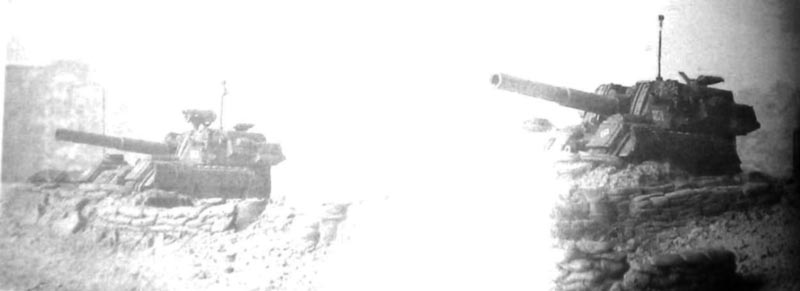

其次，De Stael发掘己方机动力，反制钛军的速度。为得到这样的部队，他开始联系帝国海军。帝国海军战斗机中队的雷电式和闪电式就是问题的答案。如果坦克不能在战斗中对钛人实施决定性打击，那么飞机应该可以。前线空中巡逻架次增加，飞行员获准自由巡航，标定并伺机进攻目标。中队保持战备，准备在前线单位遇敌时紧急升空。他们会赶往前线，用地狱之击导弹的逐次实施毁灭性打击。钛人能够规避他的炮兵，但他们跑不过帝国海军。

随着De Stael的行动战术改进，钛人的战术自然也要跟进。对于指挥官们而言，这是来与往、机动与机动反制、计划与反制计划的战争。帝国海军连日高度活跃于前线，燃气航迹划开蓝天，喷气发动机的轰鸣充斥空中。帝国海军雷电式战斗机开始搜寻地面目标，获得可观战果，相对于地面部队，对钛军造成了更大的伤亡。钛人的反制方式是利增派空军。梭鱼开始在战场各个角落现身，但不承担对地攻击的任务，而是从高空俯冲拦截帝国航空兵。来自伊拉康达地峡远端的梭鱼持续巡逻，掩护地面部队。塔洛斯空战爆发。空中格斗对于势均力敌的双方成了家常便饭。这牵制了帝国海军的人力物力，使之不能尽情对地攻击，而猎队可以再次放开手脚，继续试探性反击。

一组蛇蜥自行火炮位于发射阵地，他们帝国卫军进攻的关键。注意，载有备弹的补给拖车已经到位，为意料之外的行动做好了准备。

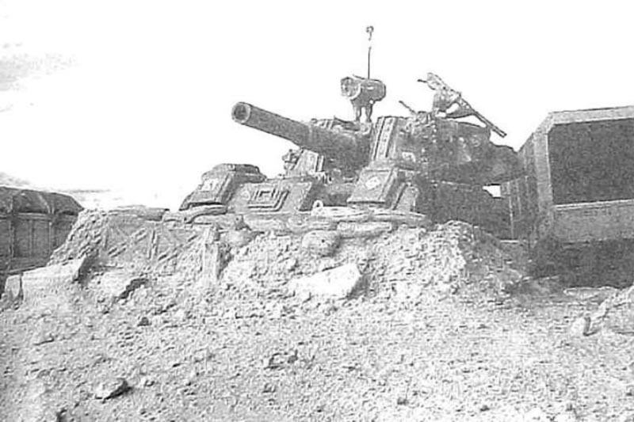

虽然伤亡不小，地面战斗扩大到空战，进攻仍在一步步碾过沙漠。十天后，已经前出了150公里：落后时间表大约30到50公里，但宽大的正面战线仍在一日日前移。

### 强攻费拉高地

战役态势不变，帝国卫军继续北进，但是，就在开始的几周内，推进脚步就放慢了。二十天后，他们大约前进300公里。每个团都回报了补给线问题。护航队未能准时抵达前线，时间一天天过去，燃料无法供应所有车辆。只有补给抵达时，各团才能推进，设法追回损失的时间。水的配给必须通过政委严格执行。这使得进攻行动更加艰难和缓慢。

在漫长前线的左翼，塔兰第17团接近一片台地，其名为费拉高地。这片崎岖的断层带陡坡遍布，将远方的地平线划割得犬牙交错。De Stael司令部下达团部的命令，略微向西转向，占领高地，然后就有机会迂回钛军防御部队主力，为直抵伊拉康达地峡扫清道路。

过去的七日中，塔兰第17团的向费拉高地的推进未遭任何袭扰。钛人没有理会这个在侧翼缓慢行军的团，在进攻开始第二十五天，先导步兵排发现，他们已来到高地乱石密布的陡壁下。

团侦搜班组比主力提前若干日抵达，趁夜徒步登坡。侦察兵开始搜寻穿越乱石滩的最佳路线。多条预定路线已被判别出来，哨兵机单位的第一波试探没有遭到袭击。这种多功能步行机器在陡峭的山区表象良好，但这种地形上，团属支援坦克行动严重受限。

侦搜班组到达时就发现了一些敌人留下的踪迹，但是在行动中，许多士兵被落石所伤（那时，这被归为不幸的事故）。

在较低的坡壁上，他们并未真切确实的目击敌人，也没找到任何踪迹，证明此地敌人兵力不足以威胁进一步的推进。

与此同时，在下面的人类毫不之情之时，钛族的野蛮盟友，克鲁特【Kroot】人，正在高地上埋伏待机。一些克鲁特追踪者冒险外出，监视人类，并制造山崩陷阱，但主力都留在高地上，从未将自己暴露给人类侦察兵。如果他们被发现，就会引来猛烈的当头炮击。大塑型者【Master Shaper】十分聪明，深知在崎岖的多石地带，他凶悍的族人和猎犬占了上风。如果被发现，他的部队会成为猛烈炮火的靶子，这会迫使他撤退。在群山之外无垠的沙漠上，他的部队没多少希望对抗敌人炮火。如果塔兰人的进攻将被阻止，那这里再好不过。

Barim Abas将军下令占领高地。在灼热的高温下，先头连排出发，开始艰难的攀登，侦察班和哨兵机为他们引路。克鲁特人从他们的山洞和藏匿点突现，他们准备十足，渴望搏杀。他们从山上狂奔而下，藏在第一道山脊后。在各个塑型者【Shaper】的领导下，战斗团一同跃起，突然出现在国防兵头顶的山脊上，形成一条嚎叫着的长龙。猎犬在狂吠，Knarloc在嘶吼，克鲁特人向山下冲去。他们在岩石间飞跃，利用冲力杀进下面帝国国防兵人群之中。拼死的搏斗瞬间爆发。一些塔兰单位直接撤退，不去面对嗜血的野人。其他班组寻找掩护，坚守搏斗，然后死于克鲁特人的刀下，或被兽性大发的异星野兽扑咬。

由于前卫排遭到敌人猝不及防的猛烈反击，Barim－Abas将军命令炮兵向第一道山脊开火。在山坡上的前线观察组引导下，迫击炮和撼地炮反复蹂躏着山坡顶端。火焰、浓烟和尘土吞没了山脊。猛烈的炮火为先头各排赢得了足以撤出的时间，幸好克鲁特人也没追击，而是一直藏身于高地上的重重掩蔽之中。

费拉高地之战，塔兰第17团炮兵进入发射阵地。摄于猛烈炮击的间隙，等待弹药补充之时。

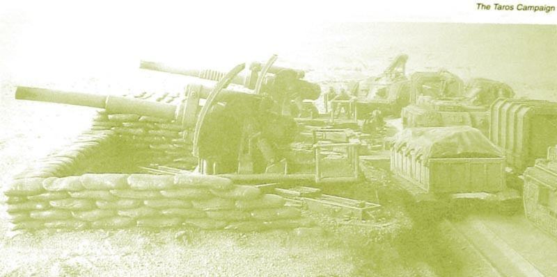

伤痕累累、疲惫不堪的塔兰国防兵被击退了，但是登上费拉高地的战斗才刚刚开始。在接下来的十天，另外三次强攻的险恶坡地的尝试，都以团属部队伤亡惨重，狼狈撤回告终。第四次攻击由Barim－Abas亲率，占领了第一道山脊。第17团的进攻被阻滞。唯一能用来支援他们的预备队，是塔兰第3装甲团，但是，黎曼鲁斯坦克和奇美拉运兵车无法在高地地带有效行动。De Stael明智的拒绝将之投入。在第17团与克鲁特人争夺那片对双方而言都一文不值的贫瘠乱石滩的控制权时，他应该寻找其他突破点。对17团而言，他们推进的终点是在塔洛金。他们已经在沙漠上夺取了350公里。 

### 新的动力

塔兰第17团与克鲁特战斗团陷入争夺费拉高地的鏖战之时，大元帅 De Stael将注意力转向手下另外三个团，准备用他们打破进攻的僵局，攻入Iracunda地峡的山嘴。他命令他的预备队团，塔兰第3装甲团，增援第89团和第12装甲团，为前线增加新锐火力。Hasso Ras－Aziz的第3团被拆分为三个战斗群，A、B和C。A战斗群前出增援第12装甲团，B战斗群增援98团，C战斗群仍为预备队。新加入的坦克为新的进攻注入了活力，而进军效率也同时加快了。

在41千年998年596时，第3装甲师A战斗群先头发起新的进攻。装甲车辆燃油发动机恶臭的浓烟、吱嘎呻吟的履带中，团属第1和第2坦克连的联军重拾活力，奋勇北进。坦克所到之处，沙漠里面尘沙高高扬起，奇美拉和蛇蜥紧随其后。和以前一样，钛人在等待，利用磁轨炮击毁坦克，然后再度后撤。

第三天，Giadamak的庞大采矿系统，映入A战斗群先头部队的眼帘，那里的地面被深层采石场割得支离破碎，高耸的废料堆环绕四周。用磁振望远镜勘查整个地区后，Raz－Aziz将军制订了攻占矿区的计划。

### Giadamak之战

Giadamak是一处巨型矿带，其地面历经几个世纪已然支离破碎，其深层采石场在地上留下巨大裂痕，高高堆砌的废石堆诡异的耸立着。这是冷寂荒芜、尘土飞扬之地，曾是是几千矿工的住处，而步步逼近的坦克纵队迫使大多数人奔命而去。一些死硬的劳工帮立誓留下战斗。四下分散的矿坑、建筑、工件和设备掩藏着守方。而沙漠没有为进攻者提供什么掩蔽。当重型机械铿锵作响碾来之时，这里一片死寂。火战士们扫描南方地平线，搜索着暴露逼近坦克的尘柱。

大元帅 De Stael建议Ras－Aziz将军忽略这片险恶的采矿区，予以绕过，直取Iracunda地峡，争取更大战果，最终孤立该地守军。将军并不认同。他不能让钛族强力部队留在背后。他的前锋部队也许能抵达Iracunda地峡，但是Giadamak守军会借机对其支撑点发起潜在的、毁灭性的反击，扫荡本团薄弱的后方地带。在他看来，矿区必须占领，守军或杀、或俘、或者予以逼退。发起攻击即可为进一步推进扫清道路。这位塔兰的资深将军在De Stael旗舰的舰上简报中表明了这一观点。攻击将在次日拂晓发起。

简报结束，Ras－Aziz将军登上一艘天鹰交通艇，飞回前线指挥所，总领战斗。

当第一缕晨光爬上阴暗的地平线之时，重炮的轰鸣再度响彻沙漠。在黎明的微光下，撼地炮和迫击炮的爆炸在Giadamak四面开花。预备登车的士兵们收拢弹药、口粮和灌满的水壶，缓缓进入攻击发起阵地。团攻击计划十分简明。两个坦克连将包围矿区，从东西两路一同包抄。当两连的坦克前卫回合，矿区便被分割包围，得不到增援。然后步兵出动，利用奇美拉，跟在炮兵的弹幕后突进，然后下车，步行最后几百码的进攻。下车步兵将在运输车辆火力掩护下，通过近战将钛人赶出掩蔽位置。

攻击近战顺利，坦克在左右翼的行动未受任何钛军火力干扰。炮火的轰鸣尚在回响之时，黎曼鲁斯坦克纵队以宽广的弧形正面前进。在中路，奇美拉运兵车并列成行，在撼地炮的弹幕后前进。还剩两百码时，拦阻射击结束，步兵下车冲击，开始夺占目标。步兵接近之时，钛人开火了，用脉冲步枪痛击塔兰人。钛人利用密集交叉火力在他们阵地之前形成了屠杀区。先头塔兰步兵现在深陷其中，士兵们开始一个个地后撤。他们尽力进攻，塔兰士兵们灰头土脸，奔跑、逃窜、匍匐、射击，跃起后又扑倒，被射伤、四处翻滚。脉冲步枪的密集火力可怕异常。没过多久，地上便横七竖八地堆满了死伤士兵。先头进攻的第二连因损失惨重而被击退。他们狼狈后撤，丢下上百尸首。

左图：塔兰装甲拳步兵，在奇美拉运兵车的支援下，在硝烟、流弹和炮火中冲向Giadamak矿区。

在首次冲击以失败告终后，Ras－Aziz将军令一个新锐装甲拳连前调。这次轮到了3连。枪口焰再次从守方阵地喷薄而出，脉冲弹冲刷着沙漠。奇美拉向前开进吸引其火力，连射激光炮嘶叫着，重型矢弹枪怒吼着还击。带队进攻的是Hadid上尉。他自己的奇美拉被脉冲弹击中35次，前装甲最终被击穿，他的驾驶员阵亡。下车的上校重整了他的部下，一马当先冲向目标。奇美拉火力的压制和排迫击炮支援终于奏效，压制了守军，使得塔兰第1排到达了Giadamak边沿。现在开始，就是人各为战的近战了。利用手中刀和手雷，各班在翻腾的烟雾和修饰的机械间悄悄穿行，猎杀掘壕顽抗的守军。

与此同时，迂回的坦克完成了包围圈，仅仅遭遇轻微抵抗。他们占领阵地，准备击退试图突围的钛军，协助深入Giadamak矿坑间的部队。坦克指挥官们可做之事不多，不过，下午正中时分，钛军开始空中撤退。四部逆戟鲸躲在梭鱼的掩护幕墙中从东方进入，掠过头顶，向矿区斜飞急降，然后降落。钛人又要撤退了。

矿坑中的战斗更像巷战，而不是沙漠战斗。炮兵在部队过于接敌过近，搅做一团时不从开火。3个小时之中，战斗有如手榴弹、刀子甚至拳头横飞的黑帮火并。钛人难以支撑这种战斗。猎队指挥官要求撤退。他在这里已取得战果，现在是撤退之时，否则他的部队将被全歼。

逆戟鲸俯冲而至，震波炮扫过沙地，火战士小组在依靠决死抵抗的后卫掩护撤退。他们飞快的登船升空。在他的指挥部，Ras－Aziz在磁振望远镜内看着一部部逆戟鲸升空，向北斜飞而去，九头蛇零星的防空炮火紧随其后，而梭鱼则在其上盘旋。

Giadamak剩下的部队开始扫荡钛军后卫，迅速包围了形容憔悴、伤痕累累、疲劳不堪的异星俘虏。总共俘获63名俘虏。塔兰第3团的损失为332人伤亡，11部车辆被击毁。当晚，68具钛人尸体被堆入一个巨大的墓穴，然后用推土铲填埋。历经一天恶战后的Giadamak，现在变成了四处野火的荒野，点缀着弹坑，遍布着用尽的能量电池、染血的绷带、闷烧的残骸和双方的尸首。

接下来14天的推进每天都遭钛人狙击，前线在A战斗群的引导下，离目标已50不到公里了。但他们也一样开始缺乏坦克、燃料和淡水。

随着前线前推，漫长的补给线感到了压力。Shas'O R'myr的战役计划第二阶段开始收获其战果。动用如此多的单位袭击后方梯队的话，钛军指挥官可能没有足够猎队来阻止进攻，但是帝国卫军因为其自身后勤需求，正在慢慢丧失动力。

### 钛族袭击者

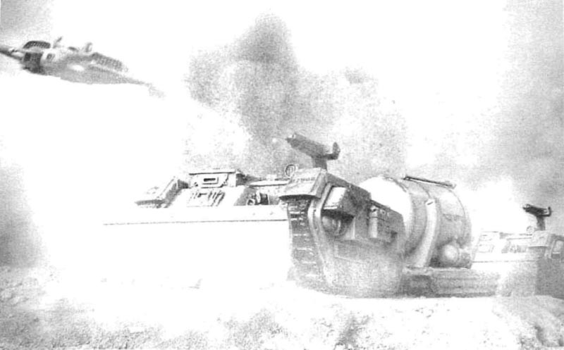

由拖运燃料和淡水拖车的特洛伊牵引车组成的光环XJ21护航队，遭到梭鱼的低空攻击。空军，尤其是梭鱼，在阻截帝国补给线的行动中扮演了重要角色。此图上，一发追踪导弹紧擦目标而过。

第17团在费拉高地战斗，而De Stael调用第3装甲团，为他的进攻补充新血的同时，钛人开始深深渗入敌后。他们战役计划第二阶段开始。

主要在夜间活动的钛军火战士、寻路兵和隐形小组利用逆戟鲸空降进入沙漠，展开呈扇型搜索目标。一夜又一夜，逆戟鲸执行秘密空运任务，空降更多小组，在帝国卫军后方播撒袭击小队，他们受命标定补给线路和库存点、指挥部和机场。一旦找到，就开始策划行动。小组只许对补给线进行伏击。其余寻路兵小组同Tetra速攻艇一起空降，使得他们能够高速赶往新目标。

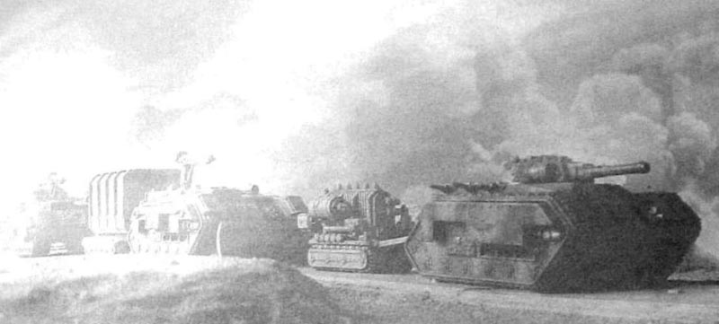

一支由一辆先导奇美拉提供额外警戒的帝国卫军补给护航队，遭到跟踪导弹的打击。钛军战役战略的一部分就是攻击帝国卫军后方梯队。

寻路兵和隐形小组协同行动，攻击由特洛伊牵引车牵引，满载淡水、燃料和弹药的挂车所组成的帝国卫军补给纵队。后方警戒主要由哨兵机中队和强袭骑兵中队承担，他们对抗小巧灵活、武器精良的钛军小组时实效甚微。日复一日、一支又一支护航队遭到伏击。寻路兵们猝然发难、然后撤回沙漠。很快，补给线就布满了伏击中被毁特洛伊和挂车焦黑的残骸，或是马匹慢慢发白的尸骨。警戒得到了强化。装甲拳班组撤出前线战斗，来协助保护脆弱的护航队，但是钛军攻击仍在持续。

一个大型补给库存点在一次一枪未发的夜间袭击中被毁。寻路兵小组从库存点警戒哨眼皮下渗入，悄悄在燃料罐和弹药箱间安设了炸药。黎明将至时，一个庞大的橘黄火球在沙漠中升起，连Leviathon指挥车上的大元帅 De Stael都给吵醒了。黎明时分，烟尘形成的高耸蘑菇云，指示着补给库存点的位置，它不断升向高空，几英里内人人可见。

在640，998年，41千年，补充和补给短缺，向塔洛金发动的进攻暂时搁浅。由第3装甲团A战斗群充当先锋的第12装甲团，几乎到达了Iracunda地峡的山嘴；在其左翼的其他两个步兵团进展并没这么远。17团在费拉高地前受阻，虽然他们获得了少许战果，但是没有任何突破的预兆。89团薄弱地散布于两翼之间。远端的东路上，第331团已抵达Em－sai的南岸，现正掘壕固守，可钛人并未被佯动所欺。

直到现在，塔洛斯空战没脸都在持续，成势均力敌之势，双方都拼力夺得优势。钛军拥有数量优势，但是帝国拥有更多经验。这是双方都无法言败的战斗。除非钛军控制了天空，否则他们的防御战略将面对一个首要问题。如果他们的梭鱼不再掩护猎队，那帝国军将在地面战斗取得优势。猎队将暴露在反复不断的空中攻击之下，被迫依赖天光导弹艇的保护，实战证明，此艇在配合寻路兵小组时，是打击地面目标的有力武器。此外，梭鱼和虎鲨在战役第二阶段扮演着重要角色，用于扫射补给护航队。帝国海军仍在发起令人困扰的战斗，现在，这正是Shas'O R'myr战役计划的最大威胁。急需采取行动来将空战的僵局扭转至对己有利的方向。钛军发动了大胆的袭击来摧毁留在地面上的帝国海军航空兵。

小型隐形小组已嵌入帝国卫军后方地带。此次行动只在夜间执行，意在找到并上报帝国军补给点和护航队路线。他们被严令禁止接敌，只许找出打击部队的潜在攻击目标。他们受到了新指令：他们目前的任务是寻找空军基地。这是眼下优先级最高的目标。

当一支巡逻的隐形小组报告了前线空军基地位置之时，Shas'el K'irri迅速作出响应。他集中最优秀的火战士小组组成一只精英打击部队。他的计划简明，但风险极高。在大胆的夜间袭击中，单架逆戟鲸运载部队，低空飞过沙漠，直达跑道。火战士小组及其支援单位将空降进入，在机蜂和危机战斗服的火力掩护下，用电磁手雷摧毁所有地面飞行器。Shas'el K'irri将亲自领军攻击。在降落后，逆戟鲸将空中盘旋，并直接在机场降落。一旦敌人飞机被摧毁，逆戟鲸降落，小组将撤回逆戟鲸，然后迅速逃离，由低飞的梭鱼来拦阻任何帝国追兵。他们握有突然性，但是一旦空军基地察觉到遇袭，他们会迅速作出反应，发动反击。K'irri警告他挑来的所有Shas'la，生还机会极微。他们深入敌后，一旦些有失误，他们就会被分割包围。不过，不管他们成功与否，这都将在前线产生戏剧性的结果。为了Greater Good，值得冒这风险。

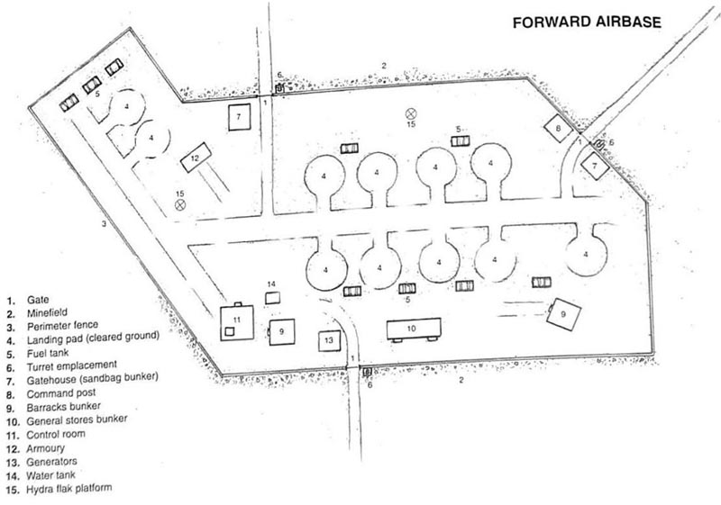

前线空军基地

1. 大门
2. 雷区
3. 环形栅栏
4. 着陆点（平整过的地面）
5. 燃料罐
6. 炮台
7. 门房（沙包地堡）
8. 指挥部
9. 兵营地堡
10. 通用仓储地堡
11. 控制室
12. 军械库
13. 发电机
14. 水罐
15. 九头蛇防空炮台

进攻开始时，一切依计划而行。逆戟鲸将配备黑阳滤镜和干扰模块，使之难以侦测，它超低空掠过沙漠，接近机场。在接近目标的最后阶段，逆戟鲸引起了空军基地防空部队的注意，在九头蛇防空炮开火后，被多次击中。飞抵机场上空口，后闸门降下，士兵们跳出、着陆，然后迅速投入战斗。九头蛇自动炮的曳光点亮夜空之时，火战士小组向停泊着的飞机冲去。Shas'el的危机机甲向九头蛇炮台飞跳，等离子步枪和导弹夹连射多发，让它闭了嘴。在燃烧着九头蛇的火光照耀下，一部用于守卫防御护栏固定型连射激光炮找到了目标，击毁了一部机甲，它的爆炸的火花如雨点般飞溅。

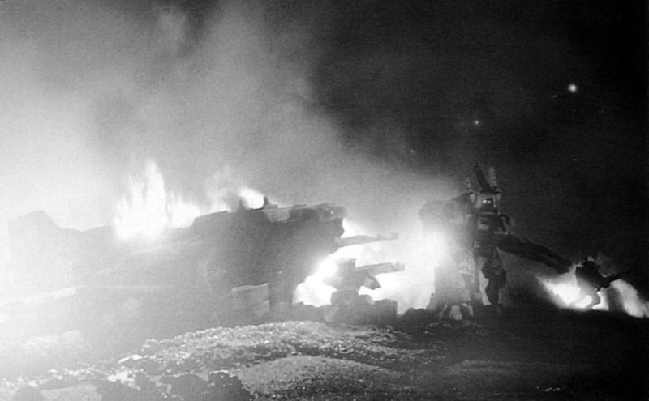

燃烧的雷电战斗机勾勒出的剪影。钛军袭击队在突然袭击中摧毁了六架飞机。他们付出了高昂代价，整个袭击队都在该行动中被俘或被击毙。

卫兵们被枪蜂压制在指挥部中，于是，守备司令部呼叫紧急救援。其他警戒班已经火速来救。第一批到达的是一个哨兵机中队，隶属于空军基地，负责后方警戒任务。混乱的夜战愈演愈烈，脉冲弹和激光步枪的光束在机场上往复穿梭，这时，爆炸的闪光突现，一架又一架飞机开始爆炸。接连不断的六次爆炸，照亮了夜暗，机场上雷电战斗机的驾驶舱喷涌着烈焰和火花。飞机的毁灭并不预示战斗的结束。逆戟鲸在基地上空盘旋，它现在已返回，准备着陆后撤离。这么个庞大的目标自然吸引了守军的大量火力。空降船尽力用自带的震波炮还击，但仍旧因反复中弹而摇摆。一个发动机开始燃烧，使得船只瘫痪，无法升空，火焰逐渐吞没了逆戟鲸，迫使船员弃船。任务目标完成了，可对于参与攻击的钛军小组而言，已无任何逃脱的可能。他们深入敌后，整夜奋战，直达被守军压倒。所有袭击者几乎都已在攻击中阵亡、负伤或被俘，包括Shas'el K'irri。

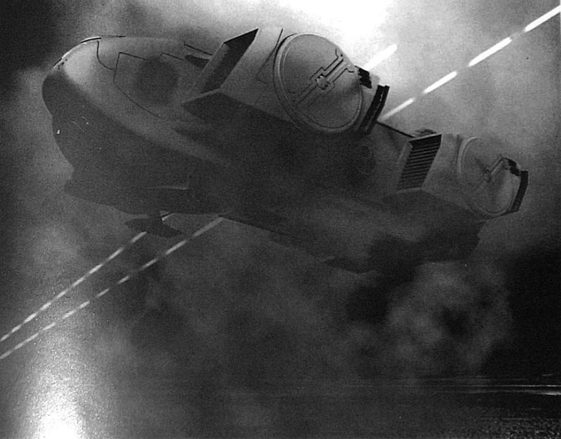

逆戟鲸即将着陆时，夜空被炮火的曳光点亮，稍后，它将在钛人撤退前被击毁。

破晓十分，激烈战斗的结局明朗。六架飞机变成了冒烟的残骸，旁边是九头蛇炮塔、机甲的残骸，以及烧毁的逆戟鲸，火焰仍在被击毁的空降船内舔烧。这是一片浩劫的景象。双方付出的代价都十分惨重。帝国海军战斗机遭到损失，而机场在残骸清楚完毕前无法工作。钛人在攻击中损失了整支袭击小队。这对整场战役意味着什么，是9基地的攻击并不意味着袭击的结束。更多库存点将被寻路兵发现和破坏。护航队不断遭到隐形小组或低空扫射的梭鱼伏击。这是一个意在通过扼断补给线，从而瘫痪前线帝国各团的计划，看来，它已奏效。

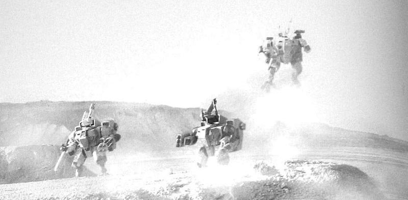

危机降临。危机型机甲利用其跳跃背包迅速穿过沙漠。

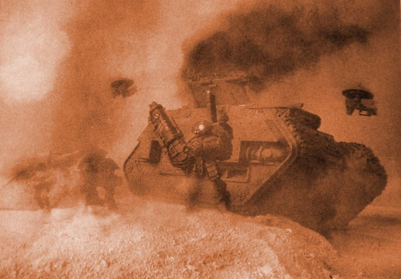

全歼目标！突然伏击之后，钛军侦搜部队将帝国卫军护航队变成了燃烧的残骸。

### 塔洛斯空战

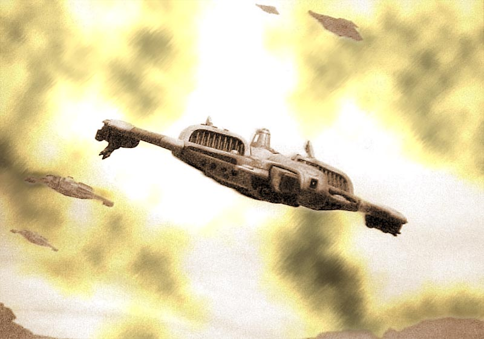

梭鱼为高飞的蝠鲼实施战斗机护航。

钛军日渐扩大的空中优势也困扰着De Stael。显然，钛人在塔洛斯建立了高效的机场网络，采取了小型前进基地隐蔽在沙漠内，大型设施留在塔洛金附近的模式。钛人所集结的飞机数量为止，不过，据空军元帅Denvelt估计，至少有10个中队的规模，可能会有120架梭鱼和40架虎鲨。尽管因帝国海军战斗机而蒙受了损失，钛军中队仍不顾一切实施空降。整体局势并未因钛军对Denvelt的前方空军基地进行的一次袭击，和那六架战斗机的损失而改变。帝国海军共有4个战斗机中队，两个轰炸机中队和一个战术航空中队参加了塔洛斯战役。在其兵力的顶峰（战役开始时），空军元帅Denvelt指挥着78架战斗机，其中多数为雷电型，24架掠夺者轰炸机和18架瓦尔基莉运输机（不包括第23Elysian空降团所属飞机）。战役开始以来，他反复申请，可半点替补都未获得。

各中队开始感到绵延无期的战斗带来的疲劳。除飞机和机组成员的损失外，燃料存量不容乐观，空投弹药即将耗尽。帝国空军基地大多位于遥远后方，接近原着陆区，就在军需局工程和劳工团组受命动工建设之处。随着前线的推进，他们将飞机甩的越来越远，使得滞空时间增长，而在战场的停留时间变短。原定的战斗机基地前移计划已取消。由于钛人的袭击，大家认为，暴露于地面的飞机面对游荡的钛军隐形小组时风险极大。因此，所有空军基地的警戒，都已通过自帝国卫军前线各团撤回部队，得到了强化。

轰炸机中队通过反复空袭，轰炸了塔洛金和伊拉康达地峡，猛轰了城市和疑似的钛军基地。这似乎对钛人没多大效果。在沙漠中打击钛猎队的努力，似乎是大量弹药和微少结果的不平衡交换，而轰炸机因无处不在的梭鱼而蒙受的损失也是一种警告：前两天就折损了5架。总而言之，空战（与地面战斗何其相似）的胜机，正慢慢远离帝王的部队。

由于以上原因，地面上的帝国国防兵们时刻面对着遭梭鱼低空袭击的危险。钛空军在沙漠上低空掠过，只在离子炮开火、导弹和震波炮扫过沙砾，将每个人都逼进脚边掩体时才急速盘旋拉起。补给护航队是重点目标，蒙受了惨重损失。没有增援的帝国海军挣扎着保护他们。在彗星行动开始时，空军元帅Denvelt手下就剩37架战斗机、12架轰炸机和13架瓦尔基莉。替补仍旧没到，而且，再也不会有了。

### 塔洛斯星系之战

537998，41千年，与地面部队协同的钛族舰队，到达了塔洛斯星系，开始扮演它在战役计划中的角色。

他们进入星系之时，帝国海军上将Kotto的入侵舰队正在忙于保护登陆行动和补给队，在塔洛斯星系进进出出，有如工蜂一般。正义力量号留在着陆区上空的同步轨道，而3艘巡洋舰留在外围，占据阵位，形成警戒圈，以此获得最大的感应器覆盖范围，这也能使巡洋舰能在钛族突然发难时作出最快的反应。两艘轻巡洋舰和大多数护航舰为那些组成第2164军生命线的宝贵货船实施近距护航。

星际战士现在并未卷入地面交火，战鹰之爪号已经撤回，巡梭于在星系之中，担当快速反应部队，准备赶往需要她援手的地方，或者在新的行星空降行动开始时返回轨道。

Novem中队的火风暴级护卫舰组成外围警戒线，在太空深处巡逻，担当针对钛族袭击的早期预警哨。

钛族舰队先悄悄溜进了塔洛斯星系，关闭以太引擎，尾随帝国护航舰队缓行。缓慢而安静的钛族舰队要和更强大的帝国战舰玩一场漫长的捉迷藏游戏。

钛族舰队的环绕着他们最新的舰船，一艘监护者级航母，A'Rho，两艘保护者级星舰，Io'Tar和Io'Phi，并得到了四个堡主级和典狱官级中队的加强。这是一支总计有26艘战舰的舰队，但是在直接交火中，它没有任何希望对抗列阵以待的帝国舰队。所以，钛人将会采取打了就跑的方式，袭击护航队，并力图分割帝国舰队，使之成为他们能够对抗并击败的分散小队。

在即将抵达之时，钛族舰队分成了4个舰群，驶向不同方向。主舰群由A'Rho率领，准备直取最深星区，充当诱饵，吸引帝国战舰来追击。同时，两个由保护者级引导的攻击群将打击补给护航队。第4舰群只有一个中队，拥有5艘堡主级，他们将自主行动；他们的任务是制造混乱，独立于那些负责摧毁护航队，和负责引诱帝国战舰穷追猛打的中队之外。

塔洛斯星系，已确认的钛族星舰

- 1艘Vash'ya Or'es El'leath A'Rho（监护者级，A'Rho）
- 3艘Vash'ya Kir'la（典狱官级）
- 1艘Vash'ya Lar'shi'vre Io'tar（保护者级，Io'tar）
- 1艘Vash'ya Lar'shi'vre Io'Phi（保护者级，Io'Phi）
- 5艘Vash'ya Kir'shasvre（堡主级）
- 5艘Vash'ya Kir'shasvre（堡主级）
- 5艘Vash'ya Kir'shasvre（堡主级）
- 5艘Vash'ya Kir'shasvre（堡主级）

火风暴级护卫舰Novem22是第一艘发现钛族舰队的帝国战舰。当它驻扎于太空深处的巡逻路线时，护卫舰的感应器捕捉到了一个未知信号，于是靠近确认。她小心靠近时，突然锁定了四艘护航舰级别的未知战舰。Novem22并未留下搜寻更多更大的船只，她处于绝对劣势。于是，她转向，然后全速返回星系内，像海军上将Kotto报告她的发现。在正义力量号的舰上，Kotto接听了Novem22的Renard 船长因静电干扰而噼啪不断的汇报。钛人终于来了。其规模和舰种他都不知道，但其威胁必须予以制止。Kotto将报告传给了离Novem舰位最近的巡洋舰，月级舰，色雷斯之锤号。

色雷斯之锤接信后立即行动，此后便接到了海军上将Kotto的命令，于重新集结的Novem中队汇合后，前往拦截袭击者，发起战斗。他还被蒙在鼓里，其实，海军上将Kotto已经吞下了诱饵。距离最近的那艘巡洋舰的威胁已经解除，一号保护者级率领钛军攻击舰群全速杀向运兵护航队，阿尔法－4，从塔洛斯归航的4艘运输舰。帝国投枪、铁砧、拳套和莫德王子号由不屈级轻巡洋舰三头猎犬号，及拥有4艘剑级护卫舰德Errant中队周密保护。阿尔法－4护航队正运送ＸＩ集群德一部，不理罗克第8龙骑兵团全团及其补给品，现在正在首次入侵后第一次归航的途中。由于一直未与钛人遭遇，护航队船员认为返航将一帆风顺。它一只脚已经踏到墓穴边上了。色雷斯之锤和Novem中队已经前往追击钛族护航舰，护航队现在完全暴露，凶险重重。

### 运兵护航队阿尔法－4

三首猎犬号舰桥上的Nomura船长第一次发觉钛人的出现，是Io'Tar及其护卫舰队进入感应器搜索范围内之时，他们正杀向护航队。钛人的攻击把轻巡洋舰的舰桥人员打了个措手不及，他们慌忙招架，拉响战斗警报，并向色雷斯之锤请求救援。一切都晚了，那艘月级巡洋舰正领命而去，全速远行。她帮不上忙。

Io'Tar启动她的重力场弹射器，机蜂导弹齐射，向阿尔法－4护航队发起攻击，将疯狂转向，规避导弹锁定得运输舰和护卫舰驱赶得四分五裂。5艘堡主级紧随其后，用船首磁轨炮抵近猛射Errant中队的护卫舰。猝不及防的护卫舰拼尽全力反击，舰炮组轰出硕大的炮弹，尽力射准钛人战舰。在第一轮齐射中，三首猎犬号在向右舷急转时，引擎中弹。一颗机蜂导弹锁定了它，无从规避；它已锁死目标。导弹击穿舰尾后的爆炸扫过整个引擎甲板，将工程师、机仆和海军士兵焚为灰烬。三首猎犬因这次攻击严重受损，主等离子核心严重过热，开始失控，很可能炸毁整舰。Nomura船长下令关停核心，听任自己的战舰如跛子般飘荡，除非钛人炮手大发慈悲，否则它难逃一劫。钛人炮手那天可不会发善心。三首猎犬号被烈焰撕扯着，Nomura船厂下令弃船，而他自己则拒绝了一切解劝，独自留在舰桥。

护航队引导舰失去战斗力后，运输舰四下逃窜避难。黑公爵号巡洋舰受命予以援救，但是路途尚远，无从干涉战局。运输舰改变航向，向赶来的独裁者级巡洋舰靠拢，但它们小小的引擎甩不掉追击的堡主级战舰，敌人四面包围，离子炮和磁轨炮炮塔连连喷出火光，耗空护盾发生器，折断装甲板，贯穿舰体。

在运输舰舱内的布理罗克第8龙骑兵团的士兵无从自保。每当敌人炮火擦过时，他们就会感到船体在翻滚、摇摆。他们听到引擎因全速工作而发出的呻吟，以及运输舰小型舰炮还击的遥远回声。当一艘堡主级掠过她时，帝国铁砧号的舰体中部被击中，一发重力弹射导弹粉碎了装甲薄弱部位，穿入了运载舱。狭窄舰内巨大的爆炸将活人撕碎，将尸首抛出，将大火燃向下层甲板。在那次命中中，几百人死亡，被击中的运输舰掉队，让三分之一的不理罗克团官兵深陷敌阵。然后，莫德王子号要害部中弹，护盾被钛族炮火剥离，一轮磁轨炮齐射穿过舰桥和上层结构之间，将舰桥舰员杀的一个不剩。下面的帝国国防兵还不知道，他们的船没有船长，无人掌舵，孤单飘零。她现在是钛人唾手可得的靶子。

后段的Errant中队勇猛战斗，但是火力远差于Io'Tar。他们奋力炮击，寄希望于来救的黑公爵号。月级巡洋舰的引擎和反应堆功率到达极限，全力去救，可是太晚了。阿尔法－4护航队在突袭中已被歼灭，不理罗克第8龙骑兵团同遭厄运。钛人转向回逃之前，最后一艘运输舰也被猎获并击毁了。黑公爵号尚需几个小时的航程，到达后也只能执行营救行动了。那里除了个别幸存者外，已别无他物值得抢救了。

如恶狼如羊圈般，钛人摧毁了整个护航队。他们可能从未意识到，货舱崩解、舰体解体，无声吼叫着的人们散落而出，飘进完全真空的太空中之时，困在运输舰内成千上万的国防兵死亡。布理罗克第8龙骑兵团，就此不复存在。

被摧毁之前，三首猎犬号发射舰载救生艇，许多艘艇被黑公爵号救起。生还者讲述着将他们击败的那场突然袭击的过程。这是以后许多伏击的首次预演。

阿尔法－4护航队被全歼的可怕消息以及整个帝国卫军团的损失被上报给正义力量号上的海军上将Kotto和塔洛斯上的De Stael大元帅。这对两人都是沉重打击，海军上将Kotto决定制订行计划，发布新命令，强化护航队自卫能力。色雷斯之锤号继续追击监护者级，协助猎杀的请求已发给战鹰之爪。危险的钛人战舰被毁之前，他们绝不停手。仙后座之星号与黑公爵号改变行程，与Invincis、Omna两个中队一同对护航队实施近距保护。钛人不会再找到适于伏击的弱小目标。正义力量号将继续待命，充当海军上将的预备队，准备在需要时随时离开轨道。

布理罗克第8龙骑兵团全团被歼的消息引起Lord Commander Gustavus更大的关注。他立即下令，其他前往塔洛斯的帝国卫军团立即停运，这让De Stael大为不悦。可是，让钛族舰队有机会收获这样荒唐的战果，是Gustaus所不能接受的风险。Krieg第19装甲团正登舰前往塔洛斯，这一行动现已中止。该团受命原地待命，直至新的通知下达为止。海军上将Kotto奉命保护补给线，直至任何团在途中都免遭风险之时。Gustavus对Krieg 19团的命令再没有解除，该团再也没能登上塔洛斯。De Stael的ＸＩ集群就剩三个团：Sarennians，Elysian和卡迪安。

钛人的首次攻击大获全胜，但现在他们要攻击第二支护航队。A'Rho号正在逃跑、牵着两艘帝国主力在整个星系中长途追击。在进入中心耀光区前，她绝不会卷入战斗。

接下来的几周内，Io'Tar号和Io'Phi号继续骚扰护航队，威胁着携带补给帝国大型船只。对艾普西隆－6护航队的攻击中，超重型液罐船Svedeg女王号因机蜂导弹而瘫痪，她珍贵的货物，水和燃料一并遭殃。当补给渐渐告罄时，这对第4621军是巨大的打击。现在，每个护航队都尽力冲出火线；有的成功突围，有的带伤抵达；还有一些护航队的运输舰被全部摧毁。每失去一艘船之时，重如生命的补给品便一同殉葬了。

（注：布理罗克龙骑兵在达摩克勒斯远征中，积累了丰富的对钛作战经验。）

### 猎杀A'Rho号

要猛禽们对地面塔洛斯战斗予以支援的请求，意味着战争之爪号必须放弃她的追猎，而海军上将Kotto只得通令正义力量号加入对A'Rho的追击。Lord Commander Gustavus的决定是：地面部队必须多多依靠星际战士盟军。战争之爪号撤出了猎杀行动，返回塔洛斯轨道，准备在彗星行动期间投送猛禽战士们。她的位置立即由正义力量号接替。旗舰雄壮的引擎缓缓地将古老庄严的战列巡洋舰推离塔洛斯的引力场，海军上将Kotto命令Rymus船长向色雷斯之锤号和Novem中队集结。就如嗅踪的猎犬一般，帝国海军将无情的追猎他们的猎物。

漫长的追赶和多次遭遇后，监护者级战舰A'Rho及其堡主级护航舰终于逃到尽头。她领着追击者们在星系中表演了14天的舞蹈。最终，亡命的钛人星舰及其护航队贴近星系炫目的黄色太阳，穿过水星区，深入厚密的辐射云中。对帝国战舰而言，在此追踪目标十分困难，而那艘钛族大船在两艘帝国主力舰面前全无优势，但这里是她一决胜负的最好战场。塔洛斯周边的舰队行动在这片厚实的辐射尘云中即将达到高潮，闪烁的太阳耀光透过内部耀光区，在密实的云团间微微映出粉红、黄和紫色。

这是个诡异凶险的战场，海军水兵和甲板兵们对于逼近太阳有着许多古老迷信。连续三天马不停蹄的追逐直接冲入了内部耀光区，气温飙升，感应仪器烧毁。随着太阳不断逼近，在视野中越变越大，军官们卷起衬衣袖子，光着膀子的人们在每一层甲板挥汗如雨。最终，它占据了整个眼帘，闪耀着令人目盲的耀光，反应式光子－彩色观测口尽力维持。随着它们步步深入气态云体，舰只全都沐浴在极亮的光线下。直至这时，A'Rho才决定回头一搏。

正义力量号指挥舰桥里，海军上将Kotto正在指挥部的行军床上睡觉，这时，一位年轻少尉面带歉意，叫醒了他。钛军船只已被定位，看来她即将回头应战。战斗迫在眉睫。海军上将连制服都不及穿上，飞奔到主舰桥，指挥战斗，他光着脚板、只穿着内裤和背心。

A'Rho启动了她的前偏转器，发射了典狱官、蝠鲼和梭鱼。钛族护航舰并列为线性阵列，磁轨炮齐鸣。虽然火力占据优势，可对帝国海军而言，胜利并非唾手可得。恒星巨大的耀光正直接照射在他们脸上，他们的感应设备故障频频，钛族舰只变成幽灵般的图样，在感应器显示屏上翩翩起舞。射击那些小型护航舰和轰炸机，有如以巨石轰击飞蚊。帝国舰只开始还击，骑枪炮塔疯狂开火，各船都在机动，使其侧舷火炮发挥威力。色雷斯之锤号险险穿过一片钛军导弹，蝠鲼和梭鱼向她涌上来时，不断轰炸扫射之时，近防炮塔向四面八方倾泻着火光。堡主级护航舰如成群疯狗般杀入战场。他们和Novem中队纠缠不休，火炮四面开花。很快，双方各有两艘船变成漂移的残骸。

正义力量号左舷炮命中了A'Rho的舰首，偏转器吸收这部分能量。回击的炮火扭弯了战列巡洋舰的装甲裙板。一发离子炮在前方骑枪炮塔内爆炸，繁花般的殉暴将之彻底摧毁，杀死了里面所有炮手。色雷斯之锤号紧跟旗舰，炮弹和等离子矢从她的侧舷炮口中如雨点般飞出。A'Rho舰体受伤，她的左舷弹射口中弹瘫痪。伤而未残的钛族战舰拼尽全力搏斗，磁轨炮和离子炮在月级巡洋舰的右舷炸出巨大的伤痕。这艘帝国巡洋舰的甲板深处开始燃烧。

交锋之后，战斗中的首轮交火结束，双方萎蔫而退，估算损伤，舔拭伤口。每艘船都不同程度的受损，色雷斯之锤号最为严重。蝠鲼的攻击瘫痪了她的骑枪阵列，离子炮点燃了下层甲板，她受损严重，80％的过载机动推进器被击毁。两个小时之中，这些庞大星舰小心注视着对方，向厚实的辐射云中漂去。每艘船上的船员都疯狂工作，抢修战伤，控制火势。

战斗中第二轮交火在正义力量号的损管系统工序结束之时立即开始。海军上将因自己的战列巡洋舰还能一战而满意，他命令Rymus船长直取A'Rho号。“装填所有鱼雷管，舰首对正敌人，”他命令到，于是，正义力量号再次逼近她的猎物。

A'Rho以新的，有些许削弱的，由蝠鲼和梭鱼组成攻击波回应敌人的进击。正义力量号的首轮鱼雷被逐个拦截和击毁。没有自己战斗机掩护的帝国舰只暴露于钛人的回击炮火之中。机蜂导弹飞扑而来，后面紧跟着小型钛族护航舰。由于无法再次规避来袭导弹，色雷斯之锤号再次中弹，这次，多发导弹在爆炸前刺穿了她的右舷，在内部爆炸。连续的爆炸折断了已脆弱不堪的巡洋舰。她归于死寂，彻底瘫痪，无序漂移，离开了战场。

Novem中队的幸存者追随着他们的期间，再次和典狱官和堡主级纠缠在一起。更多的护航舰毁于火中。现在，正义力量开始猛攻她的对手，抵近至超近距离，右满舵，露出她右舷炮列。近距的炮火十分可怕，撕开了A'Rho，一发又一发的击打着她的侧舷。钛人的反击无法压倒战列巡洋舰的巨炮，于是，A'Rho开始撤离和溃逃。但海军上将Kotto已被为失去战舰复仇的心所驱动，绝不让已经走到他眼皮下的猎物逃跑。

战列巡洋舰已将火力最强的一面对正，对钛人战舰发起第二轮炮击。它造成的损伤十分恐怖。监护者级的右舷部分解体，在残骸的云团中缓缓漂离船体。舰桥被摧毁，她身上的火焰从头烧到尾。A'Rho被内部殉暴撕扯者，无助的飘荡着。她死去了，船内不会有幸存者。剩余的钛族护航舰，不过是两艘堡主级和一艘典狱官级而已，溃逃了。

战斗结束，双方都付出惨痛的代价。色雷斯之锤和Novem中队的三艘火风暴护卫舰被击毁，至剩下战伤累累的正义力量号和一艘护航舰向塔洛斯胜利返航。A'Rho的威胁已然剿灭，但与此同时，其他钛族战舰还在继续突袭护航队。

－－－－－－－－－－－－－－－－－－－－－－－－－－

受托完成塔洛斯战役缺失部分。
11月24日，随手更新。