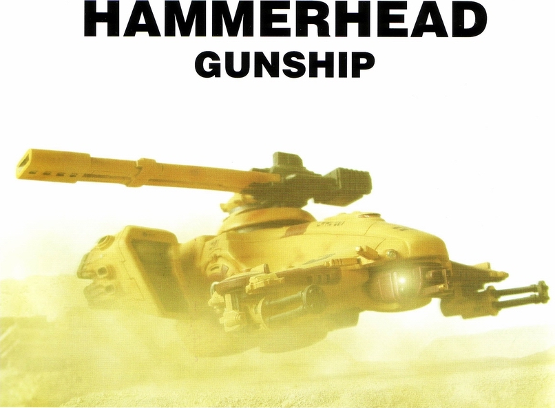
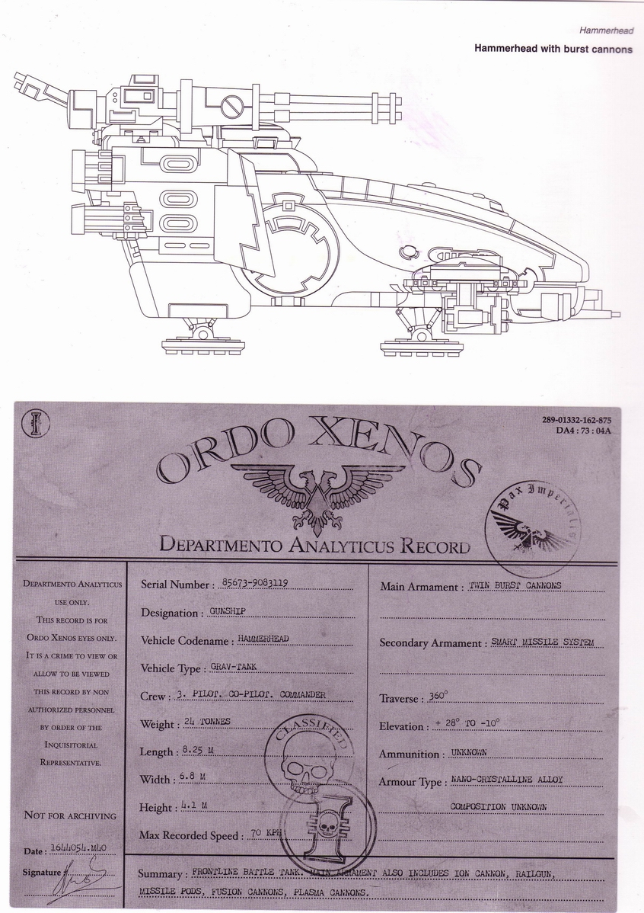
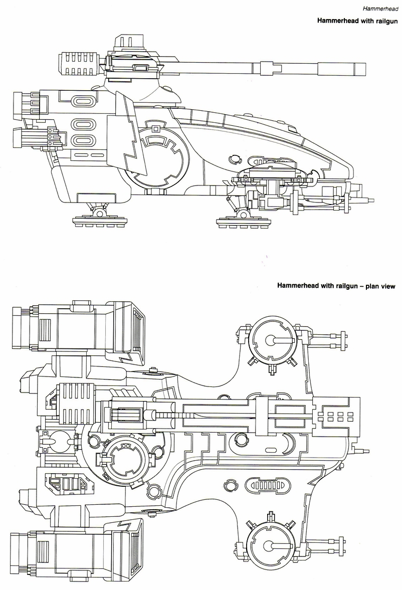
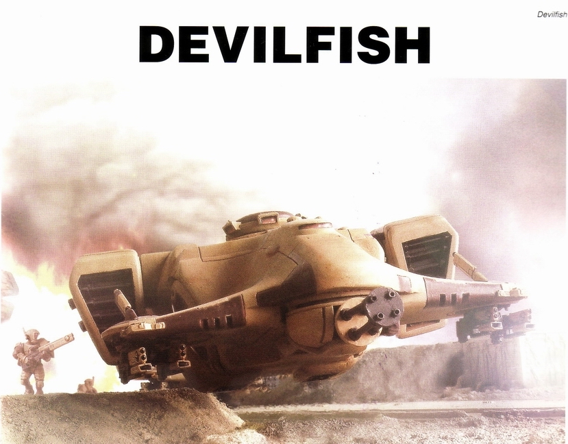
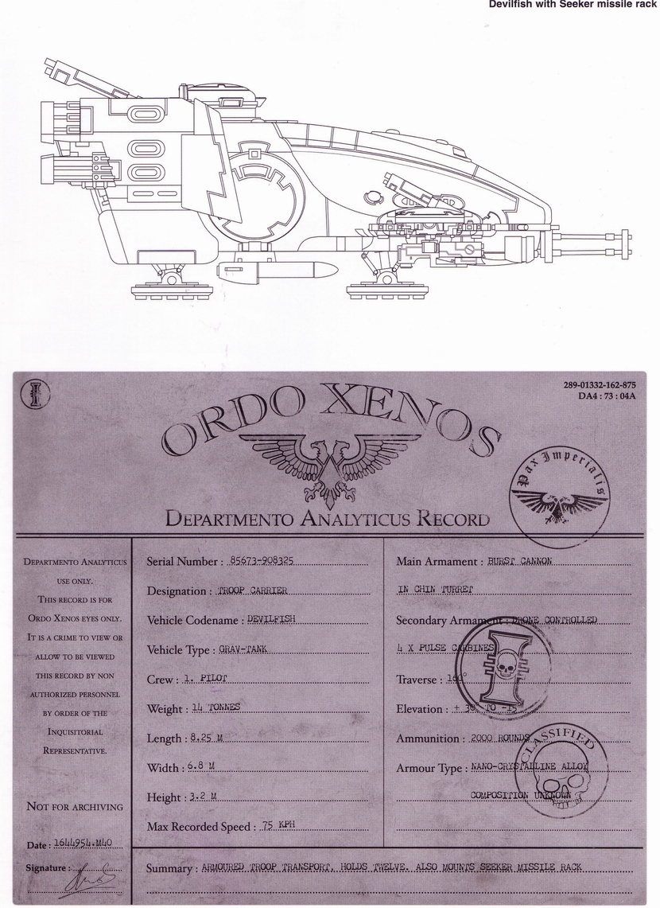
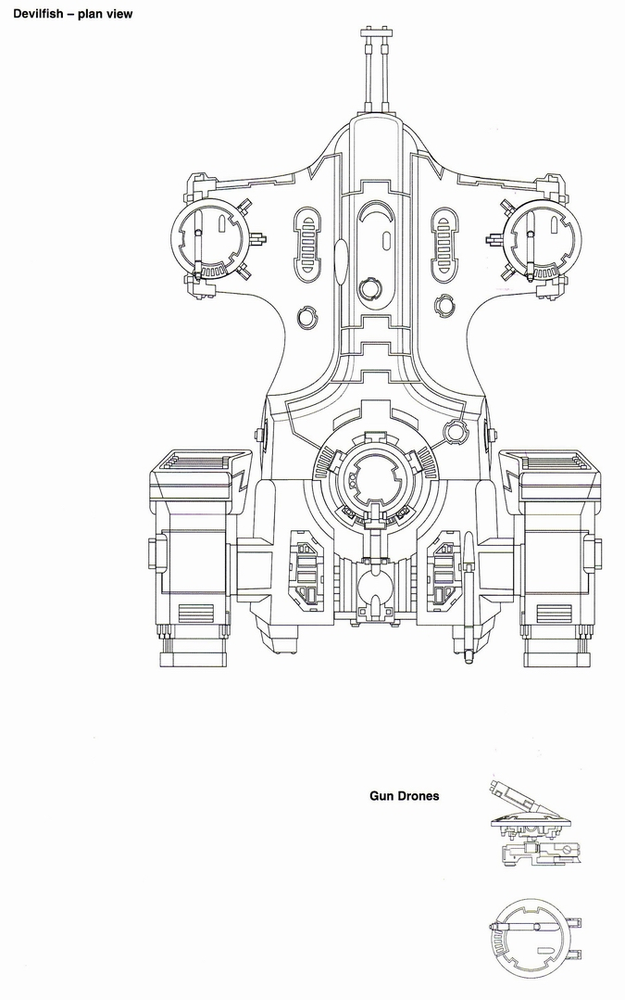
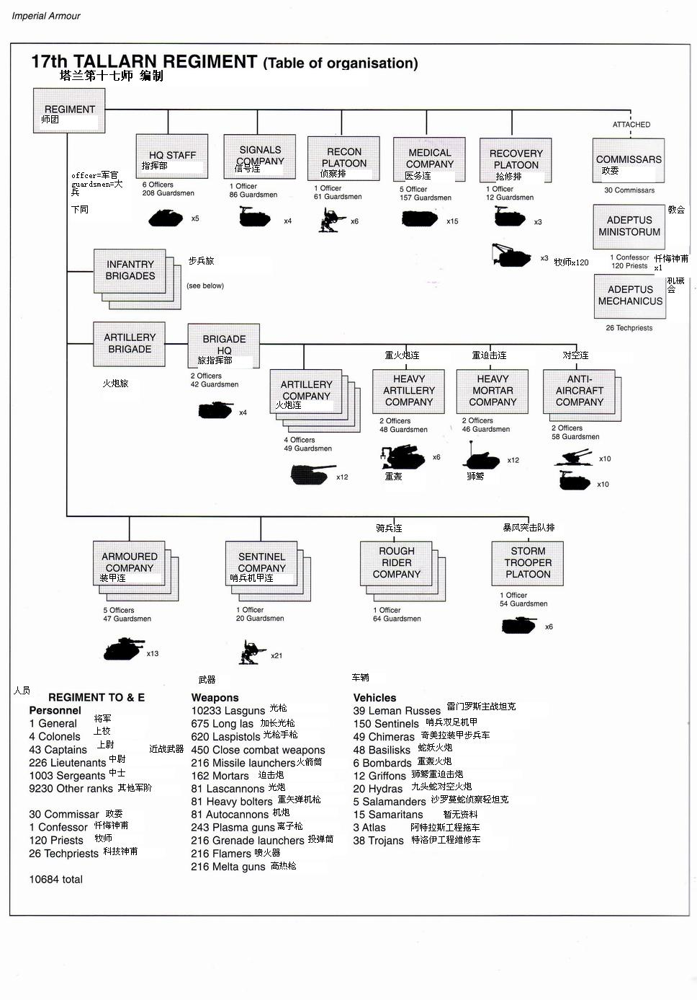

---
title: 塔洛斯战役（附录集中营）
prev: ./the-battle-of-talos-7.md
next: ../space-marine/ultramarines.md
---

# 【分享】帝国装甲三——塔洛斯战役（附录集中营）[zt]

原贴：<http://game.ali213.net/thread-975355-1-1.html>

> 作者：boltgun 

## 附录集中营之 装甲武器资料

### 双髻鲨悬浮坦克

文字翻译：兔子半妖

Ｔａｕ族中专门负责战斗的阶级名为“火焰”．而他们的主战坦克同样有一个响亮的名字“双髻鲨”．从达摩克利斯远征中帝国第一次遭遇这种坦克开始到现在，它一直是Ｔａｕ族猎队战斗力量的核心．（当然其武器系统为适应战争的发展也一直在不断改进．）

双髻鲨的底盘可配备多种武器以适应不同的战斗需要．最常见的是令人畏惧的磁轨炮．这门炮其实是一个加速器，通过超导磁能将固体弹丸加速到高超音速．即使在超远的距离上，高速弹丸在冲击目标时也会产生可怕的破坏效应．在帝国军队的坦克手中，这种武器的威名流传甚广，是最让他们害怕的武器之一．双髻鲨的磁轨炮还配备了子母弹，用于区域火力压制或是对付那些会被高速子弹药轻易穿透的所谓“软”目标．

其他常见与双髻鲨底盘上的武器还包括等离子加农炮、冲击炮和导弹荚舱．而在最近的塔洛斯战役中，帝国军遭遇了配备离子炮和热融炮的双髻鲨——显然是新近装备的．帝国方推测Ｔａｕ是在塔洛斯上测试这些武器的威力．

双髻鲨的内部空间被用来安置电池、备用弹药，以及空调、通讯设备之类的非战斗类装备．

除了精良的武器和装甲外，双髻鲨同时还是一种反重力坦克．通过产生一个反重力垫，双髻鲨可以贴着行星表面滑行．而行驶控制则是由两个推力矢量喷气发动机来实现．当它们向下喷射时，双髻鲨可以翻越障碍；它们向后时，双髻鲨可以以极快的速度前进．与帝国的喷气发动机相比，Ｔａｕ族的更可靠、更有效率，唯一共同点是刺耳的高噪音．

双髻鲨坦克的乘员有３人．驾驶舱中依次是正副驾驶，而副驾驶还要负责监视传感器、通讯、导航以及副武器的操作．车长位于炮塔中，控制双髻鲨的主炮．双髻鲨装备了多套辅助控制系统，使得乘员在战友遭受伤亡时可腾出手来接替其工作．

双髻鲨中还有一些其他的小零碎，比如在反重力引擎关闭时使用的可伸缩滑橇；导航系统；猎－歼式观瞄系统．这些设备大多位于机腹炮塔附近．值得一提的是光电制导系统．通过接收照射在目标上并反射回来的制导光束，双髻鲨的武器系统可以自动修正对目标的瞄准．这意味着一个携带照射仪的操作员可以远离双髻鲨的地方精确地为它的武器提供制导．

双髻鲨的诸元， 上半部分是装备了冲击炮的型号的侧线图

装备磁轨炮的双髻鲨侧、俯线图

### 魔鱼装甲步兵车

文字说明在等兔子半妖或者HELLRACK放出来

性能诸元，上半部分是底盘挂了制导导弹的魔鱼侧图

魔鱼和它前面挂放的机蜂的俯视线图

### 非装甲附录

塔兰第17师的编制。其中步兵旅的编制构成在下一张，以后放。

翻译的原书不是CODEX，是一本装甲单位为主的系列周边集，IMERIAL ARMOUR。目前出到第四本。
第一本是帝国卫军的装甲和帝国海军的大气层内机种介绍，第二本是星际陆战军和审判庭武装的装甲武器介绍，第三本是现在的塔洛斯战役经过和参战的各种装甲介绍，第四本是ANPHELION计划，是一个审判官带着IG和SM大队去调查帝国废弃的一个生化基地的大概经过，牵扯到很多虫子的巨型战斗单位。
把官方给的书的预览页贴上吧

兔子半妖:

有更新！信Khorne就可以得救！俺看在这坦克炮塔颇多份上翻译了！

Ｔａｕ族中专门负责战斗的阶级名为“火焰”．而他们的主战坦克同样有一个响亮的名字“双髻鲨”．从达摩克利斯远征中帝国第一次遭遇这种坦克开始到现在，它一直是Ｔａｕ族猎队战斗力量的核心．（当然其武器系统为适应战争的发展也一直在不断改进．）

双髻鲨的底盘可配备多种武器以适应不同的战斗需要．最常见的是令人畏惧的磁轨炮．这门炮其实是一个加速器，通过超导磁能将固体弹丸加速到高超音速．即使在超远的距离上，高速弹丸在冲击目标时也会产生可怕的破坏效应．在帝国军队的坦克手中，这种武器的威名流传甚广，是最让他们害怕的武器之一．双髻鲨的磁轨炮还配备了子母弹，用于区域火力压制或是对付那些会被高速子弹药轻易穿透的所谓“软”目标．

其他常见与双髻鲨底盘上的武器还包括等离子加农炮、冲击炮和导弹荚舱．而在最近的塔洛斯战役中，帝国军遭遇了配备离子炮和热融炮的双髻鲨——显然是新近装备的．帝国方推测Ｔａｕ是在塔洛斯上测试这些武器的威力．

双髻鲨的内部空间被用来安置电池、备用弹药，以及空调、通讯设备之类的非战斗类装备．

除了精良的武器和装甲外，双髻鲨同时还是一种反重力坦克．通过产生一个反重力垫，双髻鲨可以贴着行星表面滑行．而行驶控制则是由两个推力矢量喷气发动机来实现．当它们向下喷射时，双髻鲨可以翻越障碍；它们向后时，双髻鲨可以以极快的速度前进．与帝国的喷气发动机相比，Ｔａｕ族的更可靠、更有效率，唯一共同点是刺耳的高噪音．

双髻鲨坦克的乘员有３人．驾驶舱中依次是正副驾驶，而副驾驶还要负责监视传感器、通讯、导航以及副武器的操作．车长位于炮塔中，控制双髻鲨的主炮．双髻鲨装备了多套辅助控制系统，使得乘员在战友遭受伤亡时可腾出手来接替其工作．

双髻鲨中还有一些其他的小零碎，比如在反重力引擎关闭时使用的可伸缩滑橇；导航系统；猎－歼式观瞄系统．这些设备大多位于机腹炮塔附近．值得一提的是光电制导系统．通过接收照射在目标上并反射回来的制导光束，双髻鲨的武器系统可以自动修正对目标的瞄准．这意味着一个携带照射仪的操作员可以远离双髻鲨的地方精确地为它的武器提供制导．

boltgun:

LORD以后全阁下

里面用的"师团"是REGIMENT, 人数上了万, 当然装甲师就不是了.

按他们各种兵种来看:

塔兰17骑兵师:所有人员10684. 叫骑兵师, 是因为有三个轻步兵旅之外, 还有三个骑兵连 (别怀疑, 是骑动物的, 虽然不是马, 但是比较适应沙漠气候), 这个师编有一个火炮旅

这样的REGIMENT有三个, 那么估算有三万一两千人

从属塔兰的还有两个装甲REGIMENT, 给出的第12装甲师有人员4039人, 坦克只算雷门罗丝的话有129辆, 奇美拉106辆, 超重型的有BB九台, 影剑(SS)两台, 蜥蜴火炮48台, 工程车60台, 其他如双足大口攻坚九头蛇防空和沙龙曼蛇侦察坦克, 一共有个230台

这样的装甲师有两个, 当然, 如果那第十一军的最后一个装甲师假设编制差不多的话, 就算有三个了.

不过最后那个师没来, 只算两个, 八千人, 加上之前的, 小四万人

第十一军里的空降兵REGIMENT, 只有2866人, 配了180架女武神等等.

那支闪击REGIMENT, 小4000人, 360辆奇美拉. 其他的是一百几十辆的战斗车辆和火炮, 工程车.

这些一共加起来, 有个四万六七千.

那支DRAGOON实在不知道编制, 而两个暴风突击连似乎已经加在了刚才的数字里, 撒拉尼安突击工程兵则不知道.

所以, 这次战役, 第4621帝国卫军军团, 纯论人员的话, 把打死也没出场的宾穆罗克第八装甲剔掉, 也就是五万上下.

恐惧之眼资料手册里, 关于第十三次黑色圣战的资料, 参加了战争的帝国军中

"值得注意的帝国卫军单位" :

|     名称    |         作战单位         |
|-------------|------------------------|
| avellornian gunners         | 32 小队     |
| bar-el penal legions        | 4个legion   |
| Cadian 卡斯金                | 486个连     |
| Cadian 闪击军                | 612个师团   |
| Cadian 青年军                | 16个师团编制 |
| drookian fen guard          | 16个连      |
| finreht highlanders         | 3个师团     |
| gudrunte rifles             | 47个师团     |
| jouran dragoons(又是dragoon) | 7个师团     |
| kellersuburg irregulars     | 3个师团     |
| knovian gharkas             | 14个师团     |
| mordant 303rd 'acid dogs'   | 1个师团     |
| narsine yeomanry            | 32个战斗组   |
| necromundan 第8师团 '蜘蛛'    | 1个师团     |
| thracian guard              | 35个师团    |
| Van demans world 'Redbacks' | 5个师团     |
| zenonian 自由连队             | 9个连     |

然后手册上来了个" 在第N1/24号文件继续"

你你你, 打入TAU异端行列,

XV88机甲上的虽然也是磁轨炮, 但是加速轨长和口径和锤头都差很多地, 空中炮艇的磁轨炮又比锤头大一个等级, 而战舰上的武器.............

说实在的, 那样的武器, 尺寸加重量, 整个一套, 确实不是一个加厚机甲能装配得了的.

等同战舰武器 这句话40K里目前只有泰坦敢说, 不管是谁的泰坦吧.........ORK的烂点,

大气层内比TAU武器搭载, 曼塔才是头一号, 但是曼塔本身在战舰里算迷你型

天魟只挂六枚导弹, 而且优势是在于精确命中, 打装甲很好, 并不是说它的优势是跟磁轨炮比破坏力. 如果是游戏里那样不担心弹药还好. 只是在那种明显要往战场里砸弹药的作战方案中, 还是炮弹多点的双髻鲨比较明智.

skyray 不是驱逐舰, 还是悬浮坦克, 跟蝠鲼锤头一样形状的底盘. 挂六枚制导导弹, 没备弹仓, 打完了六枚就没. 论凶狠, 如果导弹还没打完的话也还可以比上锤头, 因为可以连发, 如果导弹没了, 那就要撤了.

KV85把该死的DEVILFISH从魔鱼让我改成了蝠鲼, 现在MANTA也成蝠鲼了..........

我混乱了, KV85, 出来解释!! 到底哪个词对应的鱼是那个蝠鲼

PS: 我觉得TAU可以外号叫渔民了

渔民用武器，不用太不猥亵。hiahia

发现自己开始对TAU渔民恶感不断，本来芝麻大点势力就整天宣传他们要大银河共荣，开空头支票。一不知道CHAOS这趟混水有多深，二不知道ORK有多少，三不知道虫子面前死字怎么写。这么个连远洋都没做过的小势力，什么大的阵仗都没干过。唯一打过的还都是趁着别人忙着不注意然后偷偷地进村抢殖民地的战争。

这边CHAOS在恐怖之眼里一天比一天生猛，虫子一天比一天多，ED和帝国起码还把士兵的尸体堆起来对抗对抗他们，TAU这个只干过偷人地盘的小渔民，整天还老喊漂亮话，实际上他们什么正经事都没干过。

判断起来，大银河共荣，只是他们这个种姓封建帝国拉拢其他地盘上的人民的美丽宣传而已。不要把周围的势力惹得太厉害……

以上是分析了老半天之后KUSO出来的

这几天一直在外面办事，庄稼三没在手上，没动工。（过几天一定继续）

怪不好意思的，于是把网上能弄到的资料找来一段做了。以下是美杜萨星系的历史资料，本来是GW今年夏天办美杜萨V陷落战役的介绍，我只弄了前半部分，后面的大多是跟战役有关，就没做了。

美杜萨V陷落战役他们已经开始打了，可惜不是报名参加人员，不知道进程。

### 地狱的弹弓

以“范 高斯急速脉动”冠名的亚空间环境，存在于帝国的远东边界之处。它是一个显紫色的几光年大小范围的死亡旋涡，任何绝望或粗心到足以闯进那里的舰船只有毁灭的下场。但是这个急速脉动并不是完全不可利用的。虽然十分危险，但是根据机械会的观察表明，这个脉动比较地来讲十分的稳定。对于经常要经过这个地区的探索舰队和行商浪人们来说，它的存在有不可估量的价值。当以正确的角度航行经过时，它能够将亚空间内的舰船以一个难以置信的速度抛射出去，让它穿越亚空间中的浪潮，比一般的航行速度早上几个月甚至一年到达目的地（按：民用船只的航行速度军用的相比落后很明显）。由于它的这一特点，再加上极其危险的天然环境，这片脉动得到了“地狱的弹弓”这一外号。

早在公元36241年发现了这一脉动时，机械会和帝国海军就已经达成了公识：如果加以合适的利用，这条脉动将具有极高价值。于是，这一亚空间异动的原始发现者加瑞奥 范 高斯被赋予了一个使命——寻找在它附近的一个合适的世界作为合适的驿站点和中转基地，供寻求利用这一加速脉动的舰船使用。在一段探察之后，一个拥有两颗可居住行星的恒星星系被选中了。一支殖民舰队在一个连的钢铁之手星际陆战军团的保护下，开始了对两颗行星的准备工作。钢铁之手的战士们开始清理两颗行星的原居住生物，以他们的荣耀，这个星系被冠以美杜萨之名，以纪念他们的故土。

美杜萨星系和美杜萨V行星

### 一个世界的诞生

美杜萨IV是两颗行星中更大、环境更好的一个。殖民舰队的成员大规模地降落到地表上，在他们高超娴熟的行星殖民化技术面前，美杜萨IV没有多久即宣告正式归属到皇帝陛下的统治之下。规模庞大的城市在数月间纷纷拔地而起，巨大的钢铁建筑在地面上伸展成型。巨大的殖民舰带着从帝国各个巢型都市中聚集来的移民人口，来到他们的新家园。

相对比较来说，美杜萨V则只被小部分建设。钢铁之手的战士们拓展开发地带的速度的确不俗，只是他们继续下去的脚步被拖延了。陆战军被紧急军情所调动离开了，只剩下殖民舰队的成员单独进行着他们的工作。在有价值的矿业设施被建设了之后，继续扩展美杜萨V的建设被认为是不必要的，并被无限延期了。

虽然美杜萨星系有着如此的优势——它的矿产资源以及它和地狱弹弓之间方便的距离——但是这个星系有一个不足。在加速脉动中，不时地会孕育出严重的亚空间风暴，将本星系以外的联系切断，有时风暴会持续几个月，有时几年，甚至有一次持续了几十年。每一次，当风暴过去之后，星系和外界的联系都迅速地恢复，每一次，美杜萨传来的信息都是：一切都好。

美杜萨IV成为了一个大人口中心，行星上丰富的食物来源和温和的气候条件都助长着人口的增长速度。很快，在各个巨大的巢型都市中，总人口已经达到了数百亿。同时，美杜萨V却还是一个相对荒凉的世界。只有几个城市，都依赖着开采宝贵的铱矿石，或者是大量的鉕矿满足着行星周围大太空站中停泊着的帝国舰队。经过美杜萨星系太空站的船只数以百计：需要紧急补充补给的帝国舰队，刚刚在美杜萨IV卸下了人口中心的殖民舰队，还有需求储粮和燃料的行商浪人等待着向东继续探索。虽然美杜萨星系经常会失去联系，但是它的价值，是被所有人认同的。

### 美杜萨异端分裂

在殖民化之后，美杜萨星系曾有过数十种大大小小的麻烦。比如运输船时常遭受精灵海盗的抢劫，正在扩张的钛帝国在只有他们自己知道的原因驱动之下，也曾出现过身影。但是这些敌人，或是其他任何十几桩麻烦事，都没有象两百五十年前，发生在一次亚空间风暴隔绝期间的美杜萨异端分裂这一起灾难这样动摇过帝国在这里统治的根本。

分裂的开端是美杜萨IV两座最大的城市宣布独立。行星政府的反应是迅速的，派遣出三个师的本地驻军对反叛者施加压力，试图将城市重新控制住。没有人知道这次叛变已经在背离皇帝的人们之中计划了多久，但是这一股腐毒在美杜萨IV的阴影中蚕食到了什么程度，超出了任何人的预料。全面武装的狂热邪神信徒用一场风暴一样的火力迎接了行星驻军。对混沌邪神效忠的的旗帜高高挂起，于是反叛背后的真正原因揭晓了。武装教徒和驻军们在大都市的街道上进行了数星期的交战，然后，事态更加严重了。更多的城市宣布加入了邪神的阵营，数量惊人的部队集结了起来前进着。路施农业区被教徒们一把火烧掉，上百万人在试图逃脱的慌乱中丧生。

每个月过去之后，都有更多的人口加入了疯狂的行列，如同被一场瘟疫传染一样，加入黑暗的邪神，对抗皇帝。

很快，只有很少的几座大城市还保持着对帝国的忠诚。但是被敌人包围着，人数的差距极其悬殊，如此危急的情况之下，他们发出了亚空间联络求救信号。他们的求救绝大部分注定不会有回应，在亚空间风暴还在持续的时候，任何人都无法从星系之外赶来增援。只有美杜萨V回应的他们的求救，并以令人敬佩的勇敢，集结了一支勉强可以称为军队的队伍。因为他们并没有多少军队，地方防御军募集了几千名支援矿工和工人，搭上了武装运输船和补给舰，向美杜萨V飞去。

### 一个世界的死亡

在随后的两年半中，来自美杜萨V的这支临时组成的志愿军保护着仍然忠于帝国的居民们免于遭受屠杀的命运。他们一次又一次地将混沌的大军攻势瓦解，战斗着。但是事实是，那样的条件之下，对抗这样规模的敌人，没有任何胜利的希望——即使是当亚空间风暴终于结束，终极陆战军团的第二连赶来援助。神圣的审判庭在派出专员观察了行星上的局势和异端分子的规模之后，认为灭绝令将是唯一可供他们选择的解决方案。

机械会和总管庭的人员出面劝说审判官将灭绝令延迟一下，起码腾出足够长的时间将剩余的忠于帝国的居民撤离出来。由税率预测和重新殖民计划来看，将他们留在地面上一起死亡，会带给这个节区的工业产值一个崩溃性的打击。于是审判官将行刑延缓了一个星期。当撤退开始时，几百万人被运送到平时用来搬运食品的大型运输船上。同时，来自美杜萨V的志愿军和终极陆战军第二连的战士们面对着潮水一样疯狂的敌人，为保证背后的居民能够成功离去而英勇奋战着。

即使是星际陆战军，面对着如此庞大的数量和如此毫无原因的憎恨与疯狂，也只能支撑有限的时间。最后，他们也不得不撤退，将异端们和还没有来得及撤离的群众交给了他们自己的命运。

一架由审判官巴部提斯特指挥的军舰向行星表面发射了一轮鱼雷，那其中装载着的，是致命的大气燃烧弹。弹头的起爆引燃了富含氧气的行星大气层，一阵耀眼的闪耀之中，审判庭的最终审判降临了，一切生命都被从这颗行星上焚毁，金属变成了熔化的渣滓，岩石变成了玻璃。行星本身熊熊燃烧了一个月之久，美杜萨V的居民们敬畏地看着他们的邻居被净化之炎吞没，而从美杜萨IV上逃脱出来的人们则向皇帝祈祷，原他接受死者的灵魂。

将成为美杜萨V新居民的人们从他们燃烧的家园来到了新的行星，在这里迎接他们的是审判庭。一次以清除异端为目的的全面检查在他们中间展开了，为了保证美杜萨V人口的纯洁，几千人被送上了火刑架。巨大的城市被机械会建好运送而来，这些建筑巢体可以装载几百万的人口。难民们被打散分离，组成一个个的群体，安置在这些城市中，以防异端散播。这些金属和岩石建造而成的巨大难民城逐渐地成为了美杜萨V的一部分，为矿产事业提供了大量的劳力。只是短短几年，美杜萨V的燃料、金属和补给的产量便达到了一个他们之前不能想象的高度。
