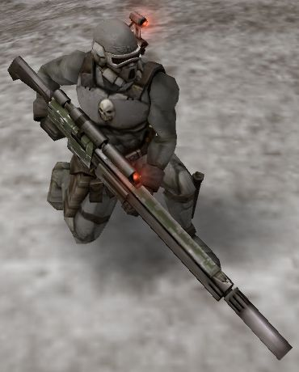
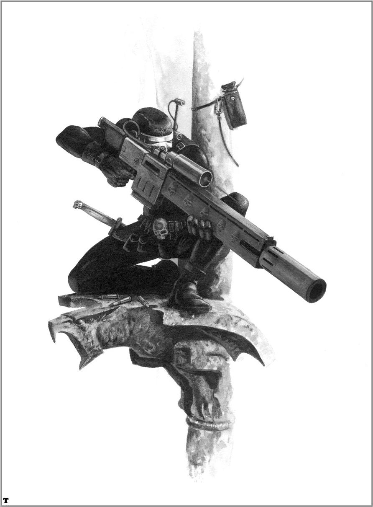
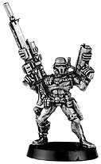
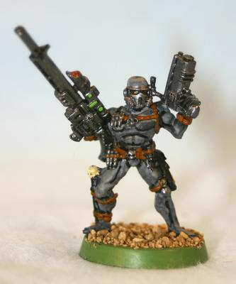

# 帝国刺客

> 作者：兔子半妖
> Khorne庇佑 ，兔妖动手

VindicareTemple（下文中Vindicare刺客简称为Vindicare）

Vindicare刺客神庙专为帝国而杀戮．他们的专长是在神不知鬼不觉的情况下轻易地夺走目标的性命．一切皇帝的敌人都应当可耻地死去——通过一枚狙击步枪的子弹，通过刺客们精湛得堪称艺术的无双枪法，这就是Vindicare的目标．为了实现这一目标，Vindicare神庙特别强调对使用武器、无声潜行、闪避攻击这三大能力的训练．Vindicare的格言是：只有在最佳的位置射击，才能干净利落地杀死敌人．事实也正是如此，这些刺客最出名的能力，便是他们能在发动攻击前潜伏数天以获得最有利的射击点的可怕耐心．

那些施行暴政的地方长官，那些煽动暴乱的演讲者，通常都会成为Vindicare刺客的猎杀目标．有如鬼魅般无法捉摸的狙击手无声无息地接近目标，以手中的狙击步枪带来皇帝的神罚．许多自称为救世主的家伙都在传道时被Vindicare穿透大脑；所有反叛、“起义”的领袖，在大言不惭地散播反帝国的言论时，都暗暗地害怕会有一枚无声的子弹将他们射杀在讲坛上．当看到他们“英明伟大”的领袖被皇帝的一名忠实仆从轻易杀死时，叛乱的支持者们多会树倒猢狲散，再无起事的能力．通过这种方式，Vindicare刺客们阻止了许多次可能发生的叛乱．

帝国的军队在狼烟四起的银河系战争中也时常寻求Vindicare刺客的支援．无论多么杰出的外星人指挥官，或是强大危险的心能者，在被套入Vindicare的瞄准具后都是死尸一具．曾有一个在刺客圈内（也仅限于这个圈子里）广为流传的战例：在Lammas战役中，一名单枪匹马的刺客阻止了一次大规模的Eldar族入侵．这名Vindicare刺客潜藏在一座荒废的塔中，获得了极佳的视野．当Eldar军队接近这座塔时，还丝毫不知死神已无声地翻开了名册，总督、术士乃至重武器小组的成员纷纷倒在这位Vindicare刺客的枪下．当他们醒悟过来，组织火力掩护侦察小队冲入塔中时，却发现它已经空无一人，就像往常一样沉寂．

那些隐藏的邪教领袖或者叛乱首领密谋推翻帝国通统治的时候，他们丝毫不知道死神正隐藏在那些看起来无比忠诚的追随者中．正是那些最值得信赖的军官，那些看起来最无害的仆役，毫不留情地抹去了他们的生命．这，就是Callidus刺客的刺杀之道．

Callidus神庙

Callidus是历史悠久却又不为人知的帝国刺客中最机密敏感的一支．她们的专长是通过伪装和计谋来接近猎杀目标——帝国的敌人．

Callidus的行事风格极端的狡诈诡异．通常他们被“启动”时，都是地球的高阶领主们竭力维持的平衡将要被倾覆的危急时刻．那些玩弄权术的野心家，表面上对帝国唯唯诺诺，背地里却做尽背叛帝国的勾当．当他们沾沾自喜以为自己成功嘲弄了帝国却又没受到制裁的时候，皇帝的惩罚以Callidus之名降临．
　
Callidus的用来除掉一个敌人的方法数不胜数，远不止单单派个刺客去把目标当场砍翻．Callidus神庙曾组织过许多次秘密行动，在这些行动中，一名刺客渗透入敌对势力并潜伏长达数月乃至数年之久．她会尽可能地接近选定的目标以便执行任务．完成任务的方式可能包括影响目标的重大决定，或者在关键时刻将他消灭．

为了完成他们艰巨的任务，Callidus神庙特别擅长制作和使用一种可以使刺客们改变自己形态的变形药物Polymorphine．通过注射这种药物，一名训练有素的Callidus刺客可以完全地改变自己的外形．在这种药物的影响下，使用者的身体发生急剧的变化——对于那些未接受严格训练的受体，这些变化几乎无法控制．改变发生在细胞级上，血肉、骨骼和神经细胞都挣脱了原来的束缚，由使用者重新建立结构．通过这种药物，Callidus刺客能延长自己的骨骼，伸缩自己的皮肤，改变肌肉的形状和大小．一旦任务完成，Callidus刺客就再次注射Polymorphine以变回原形或者新的形态．

Callidus的所有刺客都接受过使用变形剂的训练．单是使用变形剂的话，一个刺客可以变化成他们想要的任何人类的外形——无论是美艳少女还是残疾老人．更有甚者，在帝国医学部的科技协助下，通过一种移植型生化插件，Callidus刺客可以进一步变化为外星种族的样子，比如蘑菇人和灵族人．这些插件类似星际战士们的移植插件，包括活动式的软骨骼和硬化的人造皮肤．当刺客们处于正常状态时，这些插件埋藏在他们的体内．只有当变形剂被注射到提内时，插件才会受刺激而反应，根据原来设定的基因代码帮助刺客们变化成外表怪异弯腰驼背的蘑菇人，或者纤细优雅的灵族．最可怕的一种插件，能让Callidus刺客的外表完全变形成基因盗取者的变种体．

使用变形剂的刺客必须能完全控制自己身体去适应复制样本的生理节奏．但这只是个基本要求．更高层的训练要求刺客做到绝对的冷静与专注，同时学会高度复杂的战斗技巧．千百年过去了，Callidus的高层得出这样一个结论，女性的生理和心理素质比男性更适合接受这些改变，大多数的女性在变形后的效果也比男人更好．

Callidus刺客们要通过数年时间掌握变形剂的使用，并把自己变成Callidus的一部杀戮机器．她们修习无数的远古时期流传下来的秘密武术．通过这些致命的招式，Callidus刺客可以在战斗中轻松对付一个经受过严格训练的敌人．由于要伪装成敌人中的一员，所以Callidus刺客的武器选择相当有限．有时她们甚至要被迫空手战斗．即便如此，空手的Callidus刺客与那些携带了大量暗杀武器的刺客一样无比危险．

Callidus刺客通过秘密空投进入战场，潜伏在敌人战线后．通过她们的狡诈和变形剂的作用，她们能轻松地干掉一个敌人并取而代之．这样，刺客们慢慢地靠近了敌人指挥官或是强力灵能者，影响他们的决策，在必要的时候—将他们抹除．

Eversor神庙

Eversor大概是众多帝国刺客中最可怕的一支．他们最擅长的就是通过大规模恐怖袭击，将恐惧深深地烙在反叛者首脑的心中．Eversor刺客通常被派去对付那些拥兵自重打算造反的家伙．与其动用帝国的庞大武力，以摧毁叛乱的星球为代价来镇压叛乱．高层领主们更乐意借助Eversor的力量．一名Eversor刺客很少被指派去消灭单个目标．Eversor刺客的任务是在叛乱地区制造毁灭性的浩劫，将反叛头目一举歼灭．这样残暴的袭击能保证彻底清除乱党，不留后患．在Eversor刺客毫不停歇的攻击下，敌人将被残杀殆尽．

为了完成这些可怕的任务，Eversor刺客从小就接受这样的训练：对帝国无比忠诚，对敌人冷酷无情．通过基因工程和其他生物技术．Eversor刺客被改造为超人般的杀戮机器，拥有远胜普通人类的能力．此外，Eversor还使用一系列药物来驱动他们的生化身体，将人类的杀戮本能发挥到极限．

每个Eversor刺客免疫系统都经过改造，以消除药物产生的毒素．大部分的药物都极易上瘾：如果没有服用这些药物，刺客几乎必死无疑；而服下这些药，他们就会变成一群疯狂的杀戮者．不可避免的结果就是，Eversor刺客们开始对杀戮本身上瘾．唯一的解决办法是把他们冷冻在帝国各处的飞船中，一旦有任务需要，地球上的最高领主们就会下令投放这些致命的货物．

当一名Eversor刺客被选中去执行任务时，他的冷冻舱被移入一个特别的降落舱中，在那里，他将通过神经连接来接受任务细节．降落舱被投出飞船后，船上的人员将通过遥控激活冷冻舱，把他的身体调节到最佳状态．当降落舱着地时，里面的刺客已经苏醒过来，准备完成任务——屠杀一切敌人．他对在冷冻舱中呆了多久一无所知，也许几年，也许几个世纪．对于他来说，从上个任务结束到下个任务开始不过是片刻而已．

他的情绪开始高涨，对于杀戮的热情疯狂增长．他将对敌人的心脏发动致命一击．他的攻击是如此的迅速而无情，以至于几乎没有敌人在他动手前能有所察觉．等敌人发现一名Eversor刺客破门而入时，一切都太晚了．

杀戮开始．

