# CODEX上的IG军团介绍

> sovietred

最初发在SONICBBS，应斑竹要求，在这里也发一份。

[[toc]]

## 卡迪安突击队

Cadian Shock Troopers

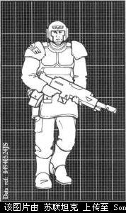

卡迪亚一直是一个堡垒世界，用堵塞来守卫通往恐惧之眼的入口。那里的人民一生就是为军事而存在；出生率和新兵补充率是完全相同的。卡迪安团接受过高水平的训练，能进行卓有成效的射击并在精锐突击队的引导下发起进攻。作为卡迪安突击队的显赫名声的体现，即使教条不尽一致，许多其他地方的团仍然在模仿他们的外貌特征。

首选特殊武器：榴弹发射器
首选重武器：机关炮

军团特性：
掷弹兵
已认可灵能者
特殊武器班
暴风兵班
钢铁纪录
神枪手
动员兵排

## 瓦尔哈拉冰雪战士

Ice Warriors of Valhalla

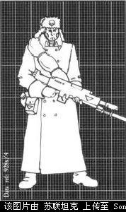

（注：Valhalla，北欧神话中奥丁建造的用于安置战死武士灵魂的巨大殿堂。）
自从在瓦尔哈拉上区的了对抗兽人的最初胜利之后，冰雪战士的禁欲主义和对帝国的奉献闻名于世。那些从瓦尔哈拉冰封的蜂巢城市中组建起来的团，在进行防御作战时以他们不可动摇的勇气赢取了令人敬畏的声望。通常夺取瓦尔哈拉人阵地的唯一方法就是把他们彻底抹平。在进攻时，他们的惯用手段是在大量的炮兵弹幕配合下发起步兵人海突击。

首选特殊武器：火焰喷射器
首选重武器：迫击炮

军团特性：
重武器排
牧师
动员兵排
异族天敌：兽人
密集队形
老兵

## 塔兰沙漠掠袭者

Tallarn Desert Raiders

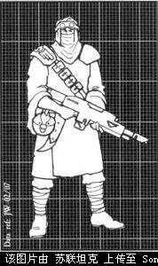

塔兰人是高级机动动游击战战士、闪避和机会主义者。他们的硬拼哨猛战中队和大师级打了就跑的作战方式特别有名。所有塔兰人都是熟练得骑手，他们经常骑着怪兽从一个战场走到下一个战场，只有在接近敌人和他们打算秘密行动时才能拆散骑手和他的坐骑。一旦发现敌人，塔兰人就会使用他们所信赖的熟练射击技术和轻快弯刀去取得胜利。

首选特殊武器：等离子枪
首选重武器：导弹发射架

军团特性：
牧师
坚强战士
蛮骑兵中队
轻步兵
神枪手

## 莫迪安铁卫军

Mordian Iron Guard

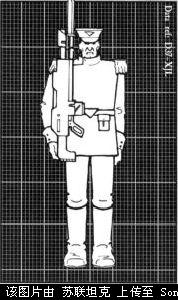

莫迪安铁卫军有着高强度的操练和整装待发的士兵，他们来自来沐浴在永久黑夜之中并被混沌的关注所诅咒的世界。在战斗中，铁卫军向敌人呈现出一道由鲜亮制服、完美列队的士兵组成的兵墙，他们用刺刀组成障碍，以适时的齐射撂倒敌人。一些皇帝的敌人曾被莫迪亚人精致华丽的制服所误导，认为他们面对的是一群业余玩票的，但最终，这些家伙只会发现包裹在明亮制服之下等待着他们的将是群顽强坚决的战士。

首选特殊武器：榴弹发射器
首选重武器：激光炮

军团特性：
已认可灵能者
鼠人班
重武器排
神枪手
密集队形
死战到底

## 哈米吉多顿钢铁军团

Armageddon Steel Legion

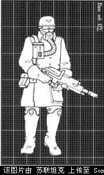

(注：Armageddon是《新约全书》中提到的世界末日时善恶决战的战场)
钢铁军团以在自家荒芜灰烬之地对抗兽人的技能而闻名。全程使用奇美拉运兵车进行机动使他们能够发起迅猛的打击，在奇美拉上蹂躏敌人战线，在步兵下车前就能解决战斗。当在哈米吉多顿巨大的蜂巢城市周围战斗时，钢铁军团偶尔能得到大量渴望加入他们行列的动员兵的支援。

首选特殊武器：榴弹发射器
首选重武器：导弹发射架

军团特性：
机械化
暴风兵班
异族天敌：兽人
鼠人班
动员兵排

## 提尼斯唯一的第一团

Tanith First-and-Only

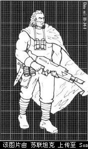

提尼斯的家园在这个团组建后不久就被摧毁，只留下了这个孤儿。他们在家乡时学到的大量技能把他们造就成一群优秀的轻步兵。在机敏的上校政委冈特的率领下，依靠来自于他们曾战斗保卫过的星球的人员补充，他们的声望伴随着一个个胜利不断增长。

首选特殊武器：火焰喷射器
首选重武器：导弹发射架

军团特性：
轻步兵
牧师
神枪手
老兵
坚强战士
独立政委
特殊装备：迷彩服

## 卡塔昌丛林斗士

Catachan Jungle Fighters

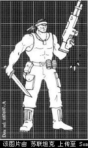

行星卡塔昌是一个无论气候、动物还是植物都对人类充满敌意的死亡世界。在卡塔昌，每天的生存需要别处无法想象的技能和勇气。因此也就无需惊讶于为什么组成卡塔昌团的人都是些顽强狡猾毫不妥协、以近距离的毒砍刀或伏兵的激光枪而致命的战士了。在丛林中他们是无法超越的，在那里每个卡塔昌人都能顶的上十个其他团的士兵。

首选特殊武器：火焰喷射器
首选重武器：重矢弹枪

军团特性：
老兵
丛林斗士
坚强战士
特殊武器班
食人魔班

## 萨夫拉化学狗

Savlar Chem Dogs

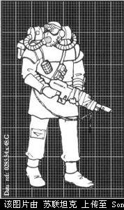

这些帝国社会人渣中的垃圾和罪犯，在萨夫拉被强迫服役并被投入到第三次哈米吉多顿战争中去。在可以保留战利品的许诺和重新扔回萨夫拉去的威胁双重推动下，他们在狭促有害的蜂巢战场上表现出色。在象哈米吉多顿那样的战区，萨夫拉的许多行为被容忍——他们的大多数装备盗窃自别的团，而他们的大部分勇气来源于使用兴奋剂呼吸器。

首选特殊武器：火焰喷射器
首选重武器：重矢弹枪

军团特性：
蛮骑兵中队
食人魔班
特殊装备：兴奋剂呼吸器
轻步兵
异族天敌：兽人

## 特瑞克斯近卫军

Terrax Guard

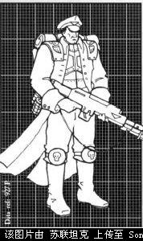

特拉克斯是Schola Progenium的一所主要设施Schola Excubitos所在地，Schola Progenium为帝国训练了大量战斗专家，特别是暴风突击队和政委，他们所使用的方法是严酷而高效的。这些在特拉克斯上组建的规模或兵力很小的团都是在Schola Excubitos监督下训练的，完全按照“整个团都由政委组成”的想法建立。

首选特殊武器：热熔枪
首选重武器：激光炮

军团特性：
独立政委
特殊装备：甲壳盔甲
密集队形
掷弹兵
暴风兵班

## 哈拉考尼战隼

Harakoni Warhawks

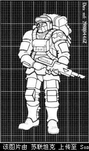

（注，harakiri是切腹自杀的意思……）
哈拉空是一个低重力世界，有着延伸到上部大气层的高耸蜂巢。哈拉考尼人使用重力滑翔机在山峰之间猎杀Vapourwyrms，这使得他们对高度无所畏惧，是判断气流的行家里手。这些技巧对帝国卫队而言十分有用，许多战主都把勇气的桂冠授予哈拉考尼战隼。

首选特殊武器：等离子枪
首选重武器：重矢弹枪

军团特性：
伞兵
暴风兵班
特殊装备：甲壳盔甲
重武器排
特殊武器班

## 克里格死亡兵团

Death Korps of Krieg

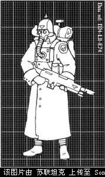

（注，Krieg是德语“战争”的意思）
克里格因为叛变而遭致的了500年的核清洗战役，这把它变成为一块荒芜之地。死亡兵团现在通过成为帝国事业中的烈士来寻求为自身早先的异端行为赎罪。死亡兵团在战斗时没有对死亡的恐惧，鄙视撤退和投降。他们擅长在到处都是铁丝网和堑壕的绞肉机式战斗中碾碎他们的敌人。

首选特殊武器：热熔枪
首选重武器：重矢弹枪

军团特性：
蛮骑兵中队
钢铁纪律
死战到底
坚强战士
暴风兵班
重武器班

## 卡内克头骨猎手

Kanak Skull Takers

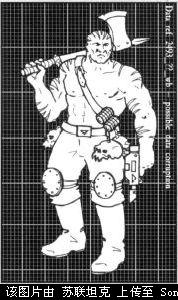

（注，Kanak原意为夏威夷及南洋群岛的土人）
火山肆虐的世界卡内克是许多凶猛的野蛮人部落的老家，相比人类，这些野蛮人更像食人魔。他们在屠杀方面的天才很快帮他们在那些能够容忍他们所展现的原始野蛮的战术的帝国卫队中找到一席之地。就像其他许多原始野生团一样，在帝国卫队中服役，他们会被教授帝国之道，这样如果他们回到家乡的话，他们会是一个接受文明的典范。

首选特殊武器：火焰喷射器
首选重武器：很少使用

军团特性：
特殊装备：格斗武器
食人魔班
坚强战士
蛮骑兵中队
死战到底

感谢CZ75翻译的特拉克斯近卫军部分。
