# 帝国卫队步兵单位介绍

> dies

看到论坛有朋友求棋子的图.转个贴.贴个我比较喜欢的种族IG.希望对新朋友了解IG有所帮助.不知道以前有朋友在这里发过没.如有重复.纯属本人疏忽^_^

星际军团是人类帝国的精英部队，那就说明他们虽然战斗力强盛，但毕竟在人类的抵抗力量中占少数。再者，帝国国内每个星球上的居民也并非等闲之辈，也决非没有爱国救国的意识。他们在帝国内部类似军委会一样的组织领导下，枪口一致对外，组成了一支虽然对敌方式五花八门，但却是人人志坚如钢的部队，这就是帝国卫队。
在战火纷飞的第四十个千年里，帝国卫队靠的不是强化的身体组织，靠的不是多高多精的科技，靠的也不是手术和改造。他们只不过是一群一群看起来极其普通的人类士兵，身穿防弹衣，手拿上了刺刀的激光枪，脸上是一幅不歼顽敌誓不休的表情。他们夜以继日的战斗着，用各种各样他们所能想到的方式巧妙地牵制、拖住、消灭任何胆敢同帝国作对的形体。
谁说他们只能垫炮灰？他们也能把朽拉来把枯摧。谁说他们只是做样子给敌人看？他们也能让敌人心惊胆颤。谁说他们头脑简单四肢不发达？哪怕只剩下一口气，他们也坚决要把敌来杀！

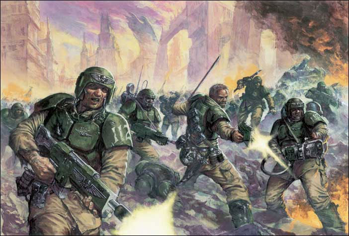

兵种简介：

星际军团的标准建制是十人为一小队，设一小队长（通常为士官）；二至五个小队为一中队，设一中队长（通常为下级军官，如尉官等）；二至六个中队为一大队，设一大队长（通常为上级军官，如上级尉官或下级佐官等）；以及五至十个大队为一团，设一团长；且每个星球的全部军队加起来少说也能组成十个左右的军团，当然这要看人口数目及密度而定。

下图包括两个小队共二十名士兵，基本武器为自动步枪或激光枪（是整个游戏中最弱的基本武器了，不过齐射的话也可能挡不住），还能增装突击武器和/或重型武器一支/一门，比较正规化的部队还能增装步话机。

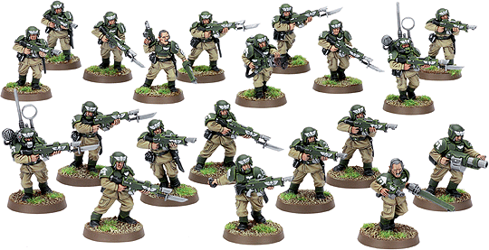

突击武器除了上面所标出的榴弹发射器（下排右数第一名士兵）和火焰喷射器（上排右数第五名士兵）之外，还有杀伤力较大的等离子枪（除了会走火之外没什么不好）。 还有威力可以秒杀坦克的热线枪。（前排三个最显眼的士兵）

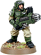

有时侯某些用精良装备的士兵可以组成特殊武器分队，其中还能包括狙击手。

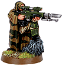

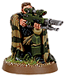

帝国卫队的指挥效率一般很高，这当然与军官的指挥能力是分不开的。军官一般都能从所率部队中挑选最好的士兵作为他的传令兵和贴身护卫。 下图中拿军刀者为军官（起码是个佐官什么的），还有一名旗手，通信员，突击武器手（为热线枪），医疗兵，还有......汗！伤员？？

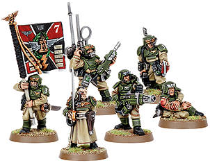

上面那位是上级军官，这些是下级军官（大多是尉官），一般指挥中队以下的编制，他们也能有自己的传令兵。而且两种军官都能优先使用较好的装备。（汗！怎么姿势都是大同小异？）

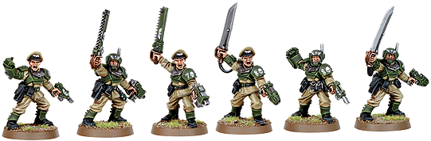

军官也可以增加参谋人员，一共有三种。 政委是铁面冷酷出名的官员，好多士兵和军官害怕他们甚于害怕敌人，在战场上政委可以随时枪毙（游戏中真可以这么做！）临阵脱逃和不称职的任何军官士兵。

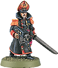

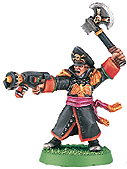

这张比较...

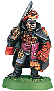

有些人可以将他们独有的精神力量延伸到传说中的“扭曲空间”以达到召唤那里神秘莫测（也十分危险，弄不好就能损坏自己的头脑和身体）的力量作为己用的目的，这些人称作“精神士”，能用强化了的精神力量不用手或武器就可以杀伤敌人。

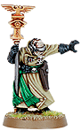

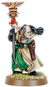

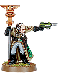

帝国的随军牧师在保证士兵都是士气满满，同时也在拼了命的自己战斗

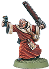

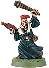

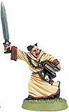

精英部队：

突击队是帝国为对最常用的精英战士之一，他们有着优良的战术技巧和绝佳的战斗力，以及比一般士兵好得多的装备。（看见他们的壳式盔甲和手中的强化型激光枪了吗？这种枪一般称为死光枪。）

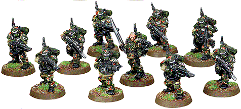

每个突击队小队中可以装备两支突击武器，这样可以弥补他们不能使用步兵重型武器的缺陷。 出上图所示的火焰喷射器和榴弹发射器之外，他们还能装备等离子枪和热线枪。

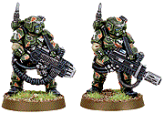

巨人：作为一种四肢发达，头脑也比较简单的突变异种，巨人们也被好多帝国卫队的队伍看好。他们强健的体魄和与生俱来的杀伤力使得他们几乎用不着训练，尽管他们只能使用最简单的武器。
（他们手里的枪实际是一种大号连发散弹枪，近距离时可以当棍棒打开敌人的脑袋和PP）。

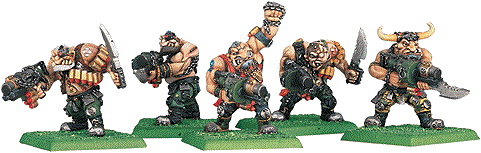

莱特林侏儒是另一种突变异种：他们的身材较小巧，很是会躲。而且他们天生的好眼力造就了他们天生当狙击手的命运。虽然他们不时被人类士兵嘲笑，但是有成千上万的帝国军人因他们那精确而致命的掩护射击而感到庆幸。

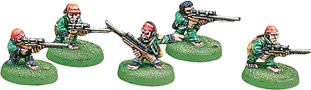

技术军师可以随时在战场上修补受损的车辆，也能有不超过四个半人半机械的扈从跟他上战场。（详见星级军团的兵种介绍）

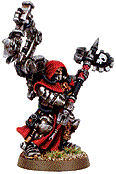
