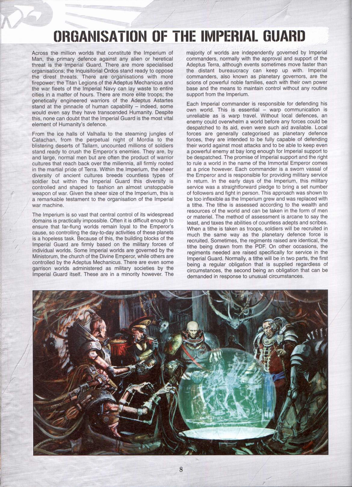
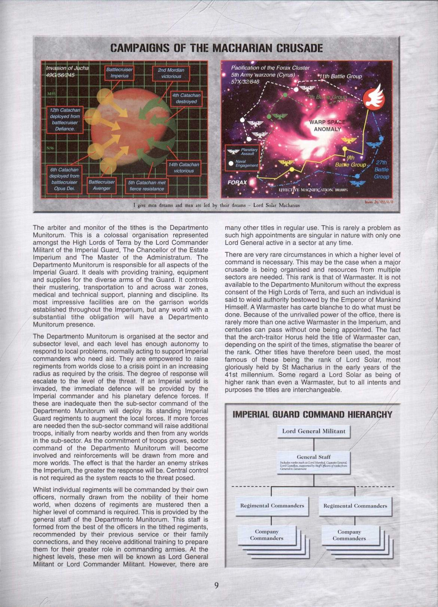
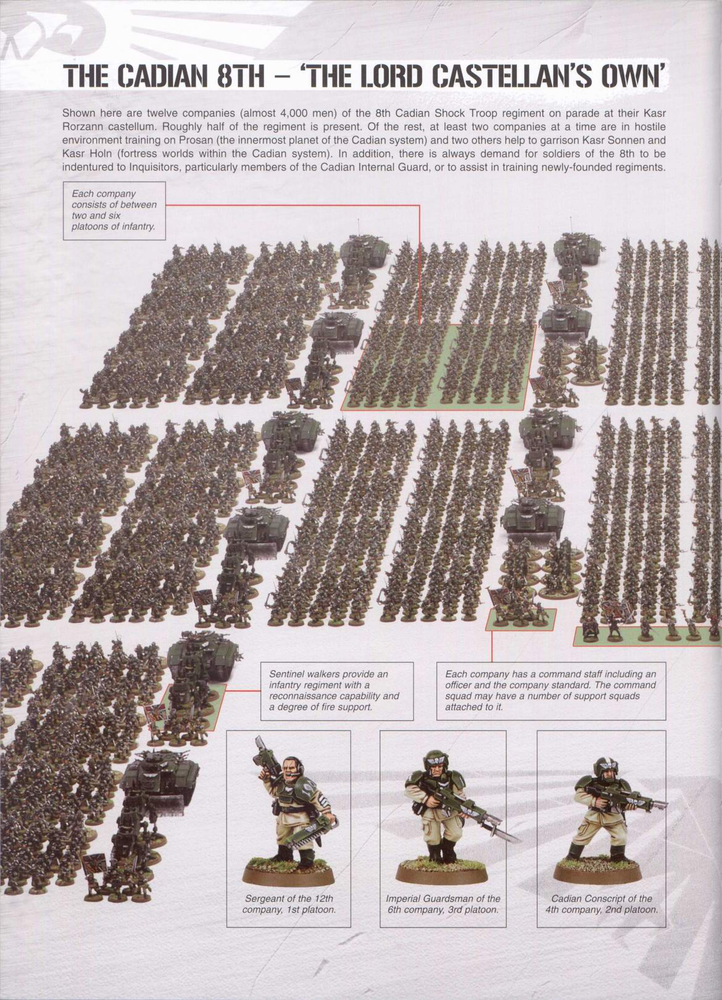
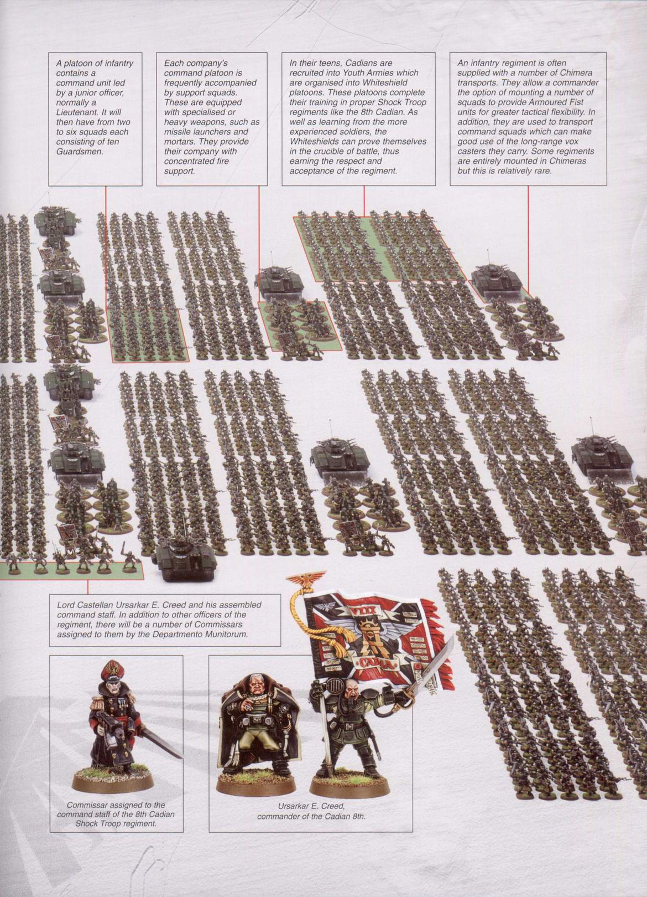
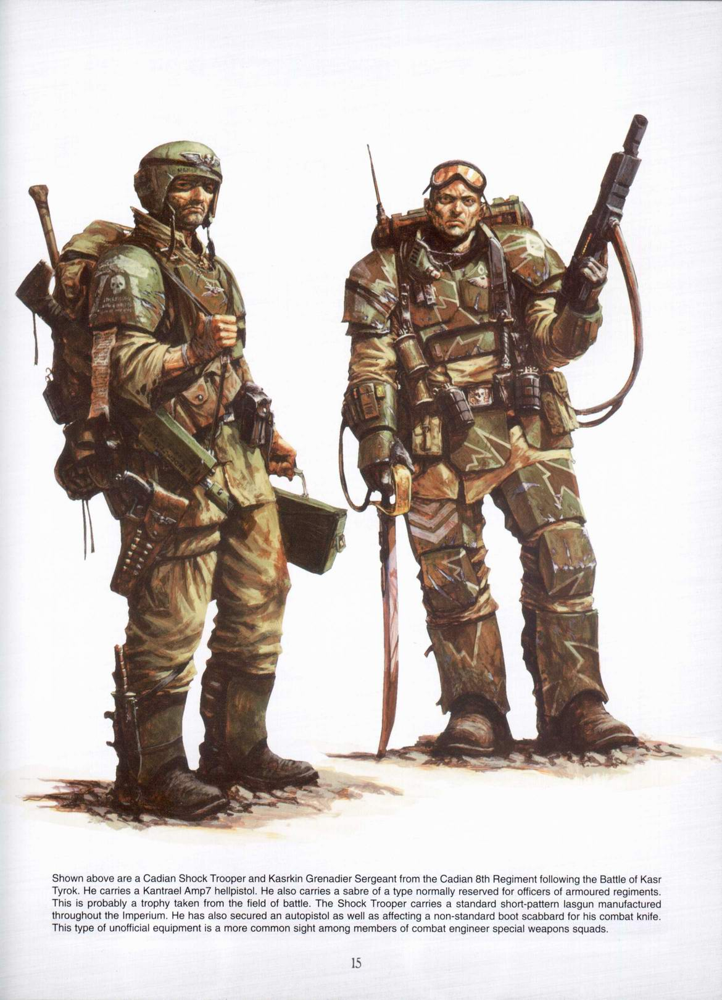
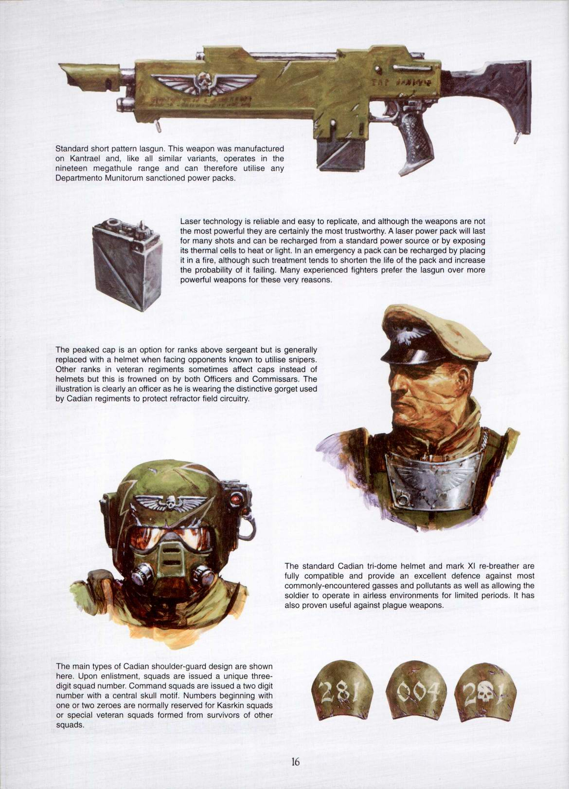
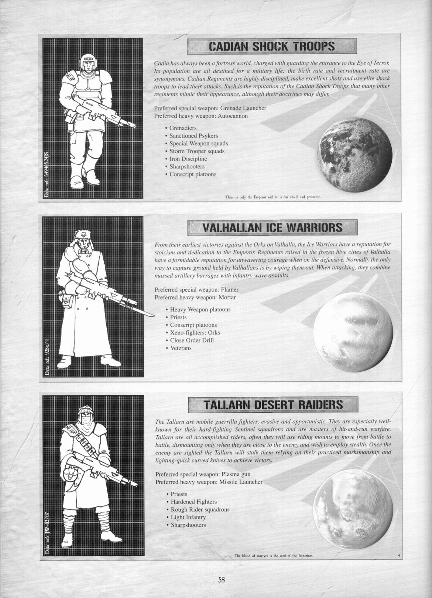
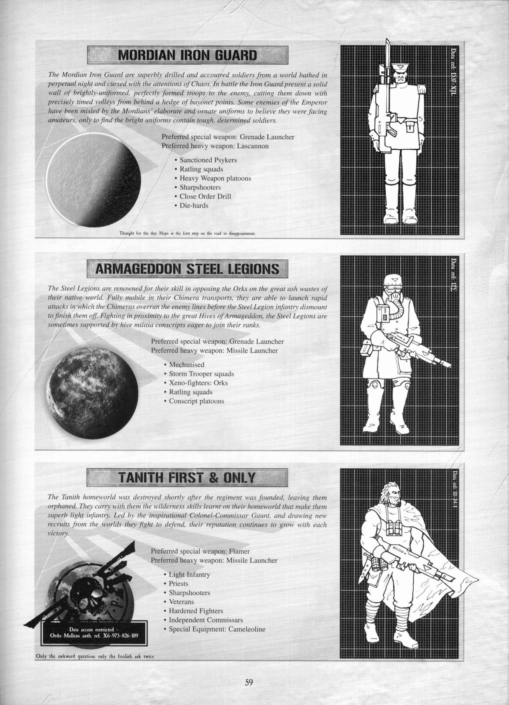
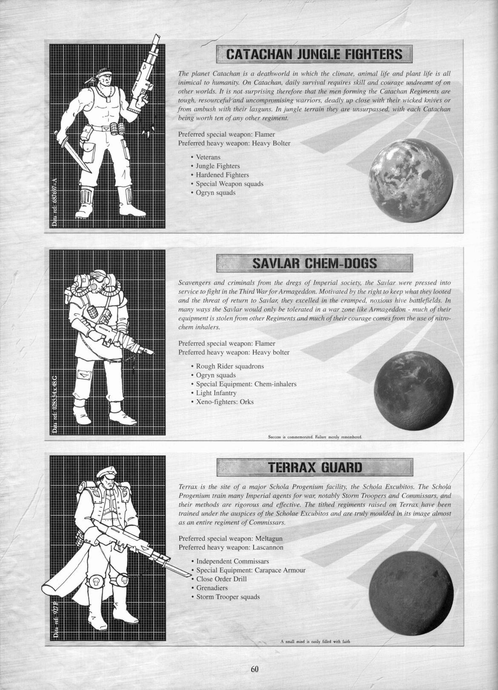
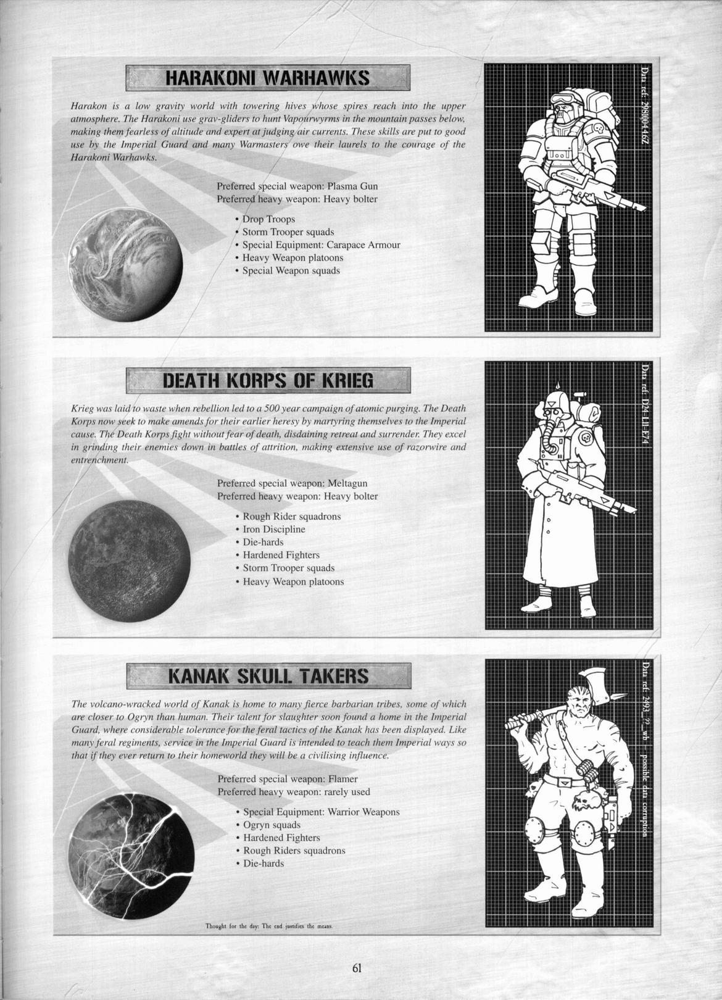

# 关于帝国卫军相关的政委和牧师等一些东西

> boltgun

政委是确实存在的，这个位置第一次出现的时候，还是在皇帝领导的大圣战远征时期，那个时候, 帝国的军队是以二十支星际陆战军大军团为主体，非阿斯塔特的普通人类构成的部队，简单地被叫做帝国军，跟随着二十支军团。当时导致了政委一职位诞生的原因，是因为帝国军的普通编制部队在遭受到一定损失之后，经常会和其他一样损失过半的部队合并，新合并而来的建制部队经常存在合作意识和士气问题。很多时候是因为陆战军的指挥系统经常错误地评估普通人类士兵的士气和纪律性，政委一职于是诞生，职责在于在军中保持士气和专管军纪。

政委这个角色在大反乱之后有了很大的变化，由于大反乱期间，一支帝国军部队要跟随大反叛者荷鲁斯的话，第一件事就是把军中的政委杀掉。由于政委当时并没有威慑力和权威，所以反叛比较普遍。

在大反乱过去之后，帝国卫军建设正式决定下来时，政委一职也变成了无情冷酷和可怕的代名词。政委军官有权利随时处决任何开小差的士兵，或者是指挥不力的军官，同时他们身兼军衔，目前来看由高阶政委直接领军的部队并不少见。在战斗中政委一般作为指挥部成员出现，当然，和不同的军官有不同的指挥风格一样，也有的政委在前线亲自带领士兵作战。
一般来说，政委出现的地方，对于士兵来说是可怕的。

政委们有专门的一个系统调动，政委督军处。

在翻译的塔洛斯战役里，最高军阶的政委是一个COMMISSAR-GENERAL，地位仅在最高指挥官高斯塔夫之下，他对指挥插手不多，但是如果他要插手，肯定不是什么好事。

而牧师么，先说帝国的宗教问题好了。
皇帝在时，是拒绝承认自己是神性化的。虽然这个家伙的异能水平在人类历史上从来没有过，目前看起来也没什么人有希望能达到。但是大反乱之后他进了黄金王座保持濒死，以认同皇帝为神（GOD-EMPEROR）为基础的宗教直接出地下转为正统，宣布皇帝升神，正式成为帝国的信仰基础。现在来看，可以说整个帝国被这个信仰维持在一起也是不过分。
而刚才提到的牧师，在地方上他们是有不同角色的，但是地方教会和教廷的运做一般轮不到他们，在帝国历史上，牧师们相当多的时候是在从军。在军队中不但保持士兵的士气和激励他们的战斗力，而且一般说来这些牧师本身也是十分吓人的战斗人员。在战场上，可以看到的牧师，都是手中持着大号的链锯或者链条剑（链条剑，跟链锯差不多的剑式武器，帝国里专门的突袭单位和士官很爱用这东西）。

对于CZ75施主要的军阶，我目前只能找到40K模型战棋的帝国卫军手册上截几页下来，以后要是再有更详细的资料的话再找。因为是PDF上弄下来的，所以有些左右两页本来是一幅图的也要分开，不好意思。

下面这个是手册里对卫军在帝国中的地位和兵员来源、军官来源还有怎样调配等一个描述。

下面这个是以卡迪安第八师约一半军力列队展示的模式，简略表示一下这样一个师的结构
当然，照片里的是模型棋子

下面是一个卡迪安士兵和士官，有简单的装备描述

制式光枪、军官帽、面具和肩甲

下面是几个比较有名的卫军兵员来源地，和这几个地方出身的卫军部队

对了，还有其他军事力量……
挨个说
最有名的就是阿斯塔特，星际陆战军。
皇帝在统一了太阳系，开始收复人类帝国的圣战之前，曾做过二十个新的基因试验体，据说是他在基因改造技术创作上的颠峰之作。但是这二十个新生的生命体还在胚胎的时期就被一场亚空间波动卷散了（这么小的规模和这种针对性的波动，只能认为是亚空间生物所为）。然后，失去了原作品的皇帝只好按照蓝本，建立起了以着二十个蓝本为基础的改基因战士军团。
这就是第一次星际陆战军建军。

在银河范围内的亚空间大风暴终于平息之后，皇帝带领着军团开始了他的圣战，这次远征直到他本人后来从前线又回到地球上，进行了有两百多年。

当时作为远征主力的，就是二十支星际陆战军军团，还有各个归附势力集结来然后整编到各个军团里去的部队。在远征过程中，二十个失散在银河各处的基因实验体被逐个找到，已经成为了当地统治者的他们也重新回到了皇帝麾下，各自带领着以自己的基因为蓝本改造的军团，作为他们的族长，继续作战。而他们所在的各个世界也成了二十个军团的故乡，由当地人口中选拔出来的新战士经过基因种种植改造之后，进一步扩大了军团规模。

其中，第一个被找到的基因原体也是皇帝最信任的，叫做荷鲁斯，在经过了二百年的战争之后，帝国已经基本成型，这时皇帝宣布退出前线战斗，返回地球，开始一项只有他自己才知道内幕的工作。然后加衔给荷鲁斯大司战，命令他代替自己统领军队继续圣战。

传说中，荷鲁斯是被一个邪神教徒行刺，中了毒，伤好了之后就变了。无论真相是什么，荷鲁斯投向了CHAOS邪神的怀抱，他带领的整个军团统统跟着他一起，成了邪神信徒。而荷鲁斯还秘密拉拢了将近一半的军团族长，将他们引诱到邪神的阵营里，然后突然发动了据说是人类历史上最大的灾难，荷鲁斯大反乱。

反乱的过程就不讲了，结果是荷鲁斯带着当时帝国几乎所有的泰坦军团和大部分机械会势力围攻了地球，结局是皇帝在一场决斗中将荷鲁斯抹杀，皇帝自己濒死，进了黄金王座。

这之后，原来反叛的势力，逃逸进了一个亚空间和现实宇宙连接的大风暴眼中，叫做恐惧之眼（面积极大），继任了荷鲁斯位置的人是原来他手下的第一连队长阿巴登。战役翻译里提到的不断计划黑色圣战攻击帝国的，就是他。

而对于还对帝国尽忠的星际陆战军，为了防止再次出现大反乱的形势，他们按照ULTRAMARINE军团族长总结的阿斯塔特教典，将原来的大军团分散建立成一个个的小CHAPTER，每个CHAPTER是一千人（严格遵循教典的CHAPTER都是）。每个CHAPTER都有自己的CHAPTER MASTER，自己的基因种子标准，他们的独 立性很强，虽然仍然忠于帝国和皇帝，但是总管庭对他们只能请求不能命令。
这一次分建被称为第二次建军。
而自从第二次建军以来，星际陆战军的新建立军团是到处开花，虽然他们仍然不是泛滥部队。（其实这是为了方便玩家自己设定自己的军团，不大好把军团数规定死。但是就目前来说，比较知名和流行的军团还是很固定的）

没想到弄了这么多，继续说其他军事力量

机械会。Adeptus Mechanicus。
本是基地在火星上，信仰机械之神的一个致力发掘人类自黄金时代遗留下来的科技的势力。在皇帝于地球上崛起之后，向他们寻求同盟，机械会认为皇帝是他们教义中所预言的救世主，于是加入了帝国。机械会可以说是帝国里大部分科技的掌握部门，研发和维修部门。他们掌握中的最大的帝国战争武器，就是泰坦。这种巨型战斗兵器，本是黄金时代人类用来在困难地形环境中保证安全的殖民地建立目的设计武器。从现在放出过的各种资料来看，目前各个锻造世界由于风格和技术不同，泰坦的大小和型号都不同。主要的大级别有三个：帝王级、主战级和侦察级。在这三个级别下还有各种不同的型号和CLASS。
在皇帝的二百年远征中，机械会的武装和泰坦军团一直跟随着帝国军队作战。
至于泰坦的高度，各个资料中，出现过40米、60、80和120米多种，但是可以肯定的是，塔洛斯战役里配备给帝国军的那四只，是只有十几米高的战犬……

审判庭从属力量

帝国在建立之后，曾有过一次，一个比较恶劣的政棍叫V什么来着……（汗，手头只有装甲三，实在是不方便啊，感叹）爬到了帝国执政的高位，然后开始了各种政治恐怖活动，对他的敌人无情镇压，利用杀手院，大玩暴君政治。帝国各地揭杆而起，纷纷文攻武斗这家伙，在他派出大军准备进攻反对派首领的时候，估计皇帝是看不过去了，一个超大号的亚空间风暴过去，那支舰队被吞了。这次亚空间风暴后来一直是被叫做皇帝之怒，被认为是皇帝发威做的，教会和帝国的历史记录都这么说，真实情况则不知道。但是能够被知道的是，一直看护着黄金王座和皇宫的禁军头子在这时突然走出了皇宫，来见暴君的私人护卫队首领（暴君的私人护卫队是一个战斗修女会，也不知道他是什么嗜好。）并将她带到了王座厅里。在他们从王座厅出来之后，卫队首领宣布暴君是被皇帝陛下唾弃的叛徒，然后把他处决了。

在这次事件之后，帝国成立了审判庭，（但是据说审判庭的原形是在皇帝的年代就已经存在了）共有五个分庭，其中三个庭是主要部分，分别是：

恶魔审判庭，这个庭的权利最大，也有监管其他审判庭的意思，主要斗争目标是CHAOS恶魔，在帝国各处为消除恶魔隐患。
他们有一个专门的下属战斗力量，叫做灰骑士团。这个部队实际上是一支星际陆战军，但是他们的素质和装备比一般的陆战军军团要优秀，而且对CHAOS、异能着、尤其是恶魔的针对性很强。

外种族审判庭，这个庭的大方向是对付各个外种族威胁，从事针对各个外种族的实验和防御行动。
下属专门作战单位，叫做死亡守望。是从各个星际陆战队中挑选出来的精英战士组成的特种部队。

异端审判庭，这个庭大有FBI的意思，对内监视一切反叛隐患和异端分子、CHAOS传播者。他们其实是几个审判庭中很忙的一个。
下属专门作战单位，战斗修女会。就是以那个暴君的护卫队为基础发展而来的战斗部队，目前已经有了几个不同的修女会。

其他两个，有一个应该是专门管理杀手的杀手庭，现在除了审判庭和帝国军前线高层，没有人能随便调用杀手了。

各个审判庭下属的一线办事员，就是审判官。这些人的权力极大，在他们办事的时候，帝国里几乎所有机关和部门都要给他们配合和方便。他们还可以调动地方部队，就是地方的卫军或者舰队。还有自己从属的审判庭下的配合部队（但是要审批）。不过各个星际陆战军军团是只跟他们客气客气就好，确实不归他们管的。审判官们有一个最可怕的特权，就是签发灭绝令。在一个审判官认定一个行星上的隐患已经危险到不能挽救，并不值得为此再保留这个行星的时候，会签发灭绝令，然后载有相应特殊武器的战舰会对目标行星施行一次轨道轰炸，这一发灭绝令将消灭行星上的所有人口，实际上，是使整个行星变成一个荒废的世界，不再有任何生物，也不再有任何领土价值（所以做的不是很经常）。
　
审判官有决定灭绝令的权利。但是对一个行星的消灭，并不是只有审判官才能下达的命令。

在13次黑色圣战的周边战争中，一个被死亡守卫CHAOS陆战军几乎变成活死人世界的农业行星被执行了灭绝令，但是执行者是星际陆战军的一艘突袭巡洋舰。下达最终命令的是地面上最后的防御城镇的牧师（本来应该是陆战军的队长，但是当时下到地面上的陆战军已经全员战死）。
那一次的灭绝令最终执行者虽然不是审判庭，但是授权的是帝国高层。

这个例子上来看，执行灭绝令的可以不是专属于审判庭的人员，但是授权的级别起码要够高。帝国里权力能高过审判官的……没多少。

游戏里说的情况，很可能是连长同学得知行星上的情况恶化到了不可收拾的程度之后，直接做的决定。星际陆战军一向比较自主，就是帝国高层也不是能直接命令，估计当时是自己手里有设备，懒得申请汇报啥的就直接执行了。所以也怪不得一些审判官有些不爽事后去找找毛病。但是陆战军是帝国里为数不多的能对审判官爱理不理的机构之一（很可能是唯一的机构），所以连长当时的作为没什么顾忌，以及后来对黑人审判官的态度都是因为这个。
话说回来，一个审判官除非是真的抓到了那个陆战军军团有异端罪的铁证，否则还是不要去招惹他们的好。

至于能调动多少火力
灭绝令的执行武器一般是特别准备的，比如之前翻译过的资料中烧掉美杜萨IV的大气层燃烧弹。那东西虽说不是可以随便配置，但是一个星际陆战军军团能拿得出来也不是特别奇怪的事。

另外，关于政委
就目前能参考的例子看，政委也是有军衔的。
而且政委作为一支部队的指挥的例子也是不少，有些政委的能力还相当生猛。
战斗修女么，诞生有历史原因，也有宗教原因。
一说是由处决恶劣的政棍VANDIRE的执政官近卫修女团而来，然后成为那以后新建立的异端审判庭的专署武力。
但是另有资料表明，更早的时期，由圣女 SAINT SABBAT创建的战斗姐妹团和之后的战斗修女团可能有直接联系。
所以战斗修女会是一个特殊团体。

至于男女平等的问题
起码在部队上，帝国卫军是有女性士兵的。有些是纯女性士兵部队，也有男女混编部队，但是比较罕见。但是鉴于男性在生理上更适应战斗，所以总体上来说卫军中男性士兵是肯定的大多数。士官起码见到过女性的上尉，更高的帝国军部委派的指挥官阶级目前还不清楚。政委似乎没有见到过女的。但是各地的执法庭就很经常可以见到女性执法者。
审判庭中的女性也是有的，机关官僚中应该也不少。

唯一的绝对男性部队就是阿斯塔特，星际陆战军。因为基因种植入需要，只有男性能成为陆战军战士。当然成为了陆战军之后就没有性功能和欲望了，当然，陆战军的人除了这点之外，只比普通男人更强不弱。
