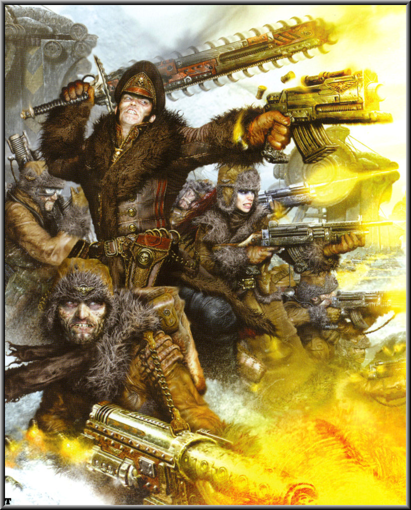
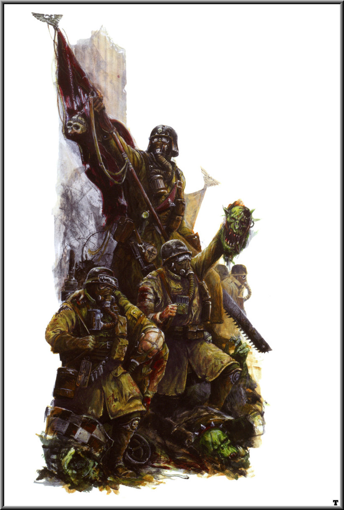
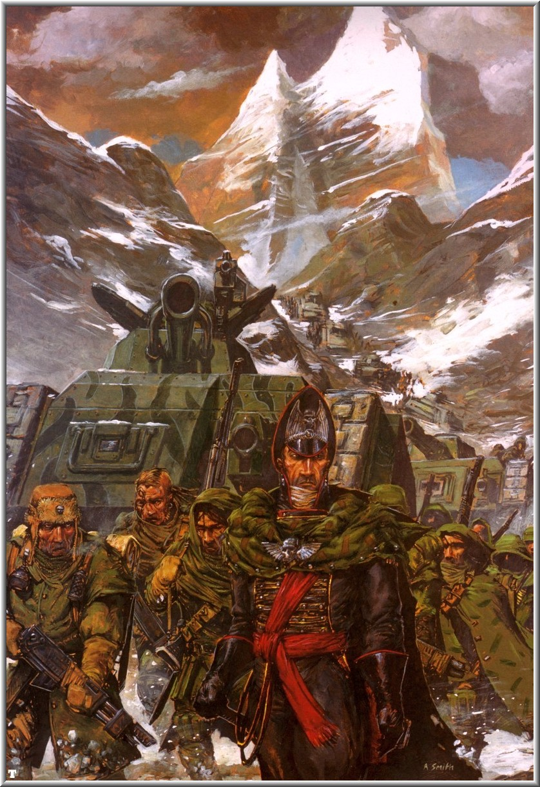
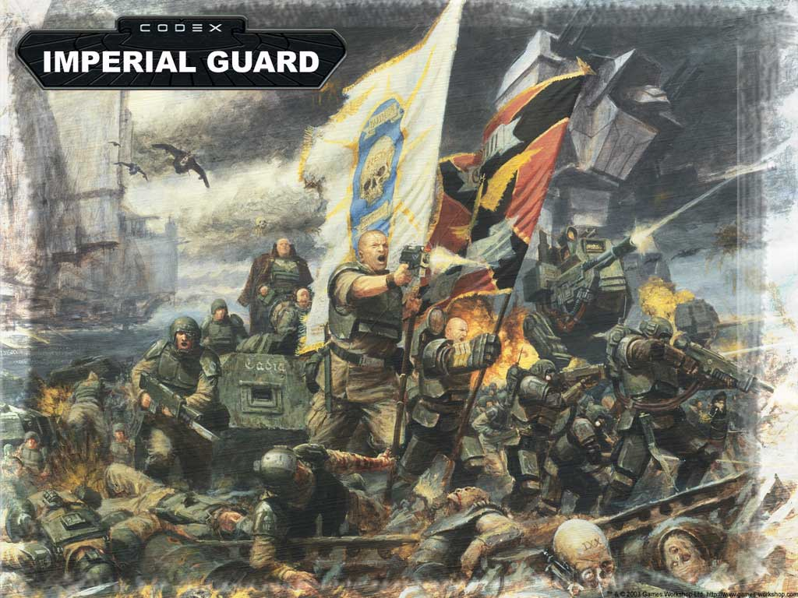

# WIKI上的IG战团史

> 由SONICBBS的 __苏联坦克__ 翻译

[[toc]]

## 瓦尔哈拉冰雪战士

Ice Warriors of Valhalla

瓦尔哈拉原本是个翠绿色的天堂。虽然没有关于它殖民的纪录保存下来，但传说让人回忆起了一个完善的世界。不幸的是，瓦尔哈拉在第31个千年的中早期受到一颗几乎全铁实心彗星的袭击，它轻蔑的突破了行星防卫系统的激光火网。大部分彗星坠入了赤道附近的辽阔海洋之中，但一块一英里宽的碎片砸到了北方大陆，激起的尘埃织成了一张泥毯覆盖了整个星球。同时，星球的轨道也被改变了，它远离了自己的太阳数百万英里。一个短暂的时期后，瓦尔哈拉成为了一个冰雪世界。星球人民为生存而挣扎着，担心着由于可耕种土地减少造成的饥荒。万幸的是，人工种植的藻类植物阻止了饥饿的蔓延，不过命运，将这个星球推入了无尽的苦难之河中。一条受伤的兽人战舰在瓦尔哈拉迫降，并且发起了旨在夺取人类居民所储存食物的攻击。瓦尔哈拉人在他们被冰原所覆盖的巨大蜂巢城市勇敢地阻止了兽人很长时间，但仍被步步紧逼到食物罐附近。最后，他们赐予了兽人毁灭：利用冰镗床直接对兽人集结地的中心实施战略打击，兽人中大部分或烧死或被熔化，剩下的则被击溃。
由瓦尔哈拉人组成的团被分配到各个兽人滋生的星球上，这样做得原因要归结于他们对于兽人战术的渊博知识以及面对换做其他军队可能早已逃跑的失败时所表现出的坚强决心。
瓦尔哈拉是一个极端寒冷的冰雪星球，类似星球大战中的霍斯（Hoth）。瓦尔哈拉冰雪战士类似于二战时的苏联红军。
著名的部队：
瓦尔哈拉第597团：据推测由英雄的政委卡菲斯?盖恩（Ciaphas Cain）领导，579团是由301和296这两团残部组建的，他们是一个男性团和一个女性团。帝国内曾经存在过的唯一的高级女将军（相对于高级将军）——金尼特?舒拉（Jenit Sulla）的军旅生涯就是在296团以中尉的身份开始的。

## 阿米吉多顿钢铁军团

Armageddon Steel Legion

阿米吉多顿是个蜂巢世界，星球表面是辽阔而贫瘠的荒地，这些土地被称为蜂巢城市的巨大类生态建筑所割裂，这些建筑每个都深入天际达数英里之遥。如同它的名字，阿米吉多顿是帝国历史上三次大战的战场，最近的一次入侵来自于兽人军阀哥哈扎格库勒?马格?碎骨.大大（Ghazghkull Mag Uruk Thraka）。因为这个愿意，阿米吉多顿的军队十分擅长与兽人们进行战斗。
阿米吉多顿的工厂生产多种诸如奇美拉运兵车之类的装甲战斗车辆供帝国军队使用。因此，结合阿米吉多顿蜂巢城市外不适合人类居住的险恶环境，阿米吉多顿钢铁军团从根本上来说就是是一群机械化步兵。他们的团大量使用装甲车辆，并且经常在战场上使用奇美拉来保证水给养和保持自己的机动作战风格。
钢铁军团的成员很容易从他们每个士兵都必须穿戴的面罩和呼吸循环系统上识别出来——拜阿米吉多顿的有毒大气层所赐。这些东西，结合他们穿着的重型防水短大衣，进一步加强了他们抵抗尘埃废料的能力。
钢铁军团类似于一战中的德国陆军和二战时的德国伞兵。

## 第13刑事犯军团（谢法上校Schaeffer的最后机会者）

The 13th Penal Legion (Colonel Schaeffer's Last Chancers)

最后机会者是一支由罪犯、叛徒和失职者组成的精锐力量，从行刑队的枪口下拯救出来的这些人，以参加自杀性任务的方式去赢取得到皇帝原谅的最后机会。他们从一部讲叙二战中一支由刑事犯组成的作战单位的经典电影《十二金刚》中得到大量启发。

##  阿提拉蛮骑兵

Attilan Rough Riders

阿提拉是一个繁荣的农业世界，星球表面被巨大的草原所覆盖。在被帝国重新发现之前，阿提拉的文明仍处于游牧部落的程度，他们大多数战事都是在马背上完成的。
阿提拉人的骑兵是帝国中最杰出的。他们看不起任何一个不能骑马的人，而且他们也被认为是最没有纪律，最难指挥的部队。不过，他们用强壮的体格和力量弥补了这些问题。阿提拉的骑兵单位经常以侦察兵和快速反应部队的身份分配在帝国卫队的各个团中。团中的阿提拉蛮骑兵单独编制，尽管他们在帝国的武装力量中是如此的稀有。
他们的造型风格与成吉思汗时代的蒙古人有许多相似之处。

## 莫迪亚铁卫军

Mordian Iron Guard

行星莫迪亚自转一圈要花费一整个莫迪亚年，因此星球的一半被永久的黑暗所笼罩而另一半却被耀眼的太阳晒成了灰。这里是一个相当悲惨的地方。缺乏行星旋转阻止了任何强风的产生，同样大气也变得粘稠和昏暗。数百万居民生活在巨大的蜂巢城市中，城市里所有的资源都由政府控制和分配。那里的人民有许多不满，同样莫迪亚铁卫军也把他们的大部分时间花费在确保平民受到绝对的控制上。
在一次混沌的巨大阴谋中，一群混沌信徒现身在莫迪亚首都凡安达城的忙碌街道上。在那里他们释放了一个咒语，得到了大量的无辜莫迪亚人的鲜血。这个咒语为莫迪亚带来了整船的混沌星际战士和被召唤的魔鬼，他们在星球上到处作乱，最终把铁卫军压到了首都。在这里帝国卫队建立了最后的防线，逐步后退，直到他们不得不拿首都得建筑来作为掩体。他们使用了大部分别的军团都会拒绝执行的危险战术，因为那些军团的人根本无法坚守阵地。而铁卫军，如同他们的名字，挺立在各个毫无希望的位置对抗着形形色色的魔鬼们。在莫迪亚上方的轨道中，星球的灵能者们最终还是成功的破坏了混沌的咒语，渐渐的，魔鬼们开始从这个星球消失。这个现象使剩余的混沌进攻者们感到恐慌，铁卫军却抓住机会，击败了敌人并把他们逐出了这个星球。铁卫军依靠他们的纪律阻挡了混沌大军，给了帝国灵能者们足够的时间来破解这个咒语，确保了莫迪亚仍旧牢牢掌握在帝国的手中。
由于他们老家的环境，在莫迪亚成长的士兵有些阴沉寡言、过于严肃的倾向。莫迪亚人在如何战胜敌人方面信奉完美的精确和持续不间断的操练，你很难看见他们有溃败的时候，事实上他们会有组织的边战边退，脱离战斗并进入一个更好的防御位置。
莫迪亚人通常穿着明亮华丽的制服，无论是战斗、出席业余活动、还是去抓捕那些缺乏警惕性的敌人。他们与俾斯麦时代的普鲁士人或全套礼服的美国海军陆战队有些许相似。许多其他的卫军部队在提到莫迪亚的士兵时都会用“玩具兵”来形容他们的装束。

## 克里格死亡兵团

Death Korps of Krieg

在433.M40，行星克里格的独裁者在一次异次元风暴中宣布从帝国中独立，并与他的圣主——皇帝断绝一切关系。部队立刻在克里格组建起来，并以值得赞扬的迅捷和正义的狂怒粉碎了叛乱。现在已名声狼藉的克里格第33团上校尤尔腾（Colonel Jurten）的核平战役成为了此后500年灾难的根源，这次行动把克里格变成了一个充满有毒灰烬的荒芜之地。从尤尔腾的惩罚中幸存下来的人们直到今日仍不得不生活在地下的碉堡群或置身于辐射废料之中。从他们家乡的自我毁灭中，死亡兵团诞生了。
为了忏悔独裁者的异端行为，死亡兵团的每个团都致力于对救赎的追求，他们经常要求分配到银河中最致命的战区去。每个死亡兵团的士兵都为自己能够成为净化克里格的大军中的一员而自豪，他们鄙视那些会从这伟大行动中退缩的懦夫胆小鬼。团的信条是根除异端和一切能发现的软弱，有许多次，死亡兵团的军队必须要申述他们的滥用武力和未经许可得灭绝战役。
死亡兵团是无畏的战士，从不在面对死亡时退缩，这在他们看来如同对叛乱的偿还，并视自己的死战为对先辈异端行为的赎罪。他们执迷于堑壕战，是攻城专家，并且多次使用死亡骑兵大队，这是帝国广泛用于快速打击的蛮骑兵的一种本地版本。不过死亡骑兵并不像他们的同行兄弟们那样骑乘普通的战马，准确的说，他们或者使用一种植入金属以增强耐久力的重型“再造”战马，要么干脆使用机器马。
外貌方面，死亡兵团与钢铁军团类似，但用大衣代替了防水短大衣，更阴暗的色调，使用激光步枪，他们的面具看起来像骷髅。在所有的帝国卫队中，他们是最阴沉和黑暗的，无论是外在还是内心。他们的战术（堑壕战）和外观非常类似一战中的德国。这在很多团频繁使用Panzer之类的德语词汇中也有暗示。克里格（Krieg）在德语中的意思是战争。

## 萨夫拉化学狗

Savlar Chem Dogs

化学狗是帝国卫队众多刑事犯军团中的一个典型。新兵从行星萨夫拉的监狱中招募，许诺他们可以保留从战场上得到的所有东西，还有机会可以离开萨夫拉的高毒性环境。创建这只部队是为了参与第3次阿米吉多顿战役，他们在蜂巢城市和近距离的战斗中表现出色。他们的勇气主要来自于对硝基化学呼吸器的使用，以及能够从自己和其他团的战友那里偷东西的可能性——就像他们对敌人做的那样。不同于大多数其他帝国卫队，他们的蛮骑兵中队不采用一般的马匹，取而代之的是，他们选择了来自自己恶梦般家乡的一种粗俗且讨人厌的乘用马，这种马相比普通的马匹有更强的适应能力，但是他们的面目看起来非常可憎。

## 卡塔昌丛林斗士

Catachan Jungle Fighters

卡塔昌是一个死亡世界，整个星球完全被浓密的丛林所覆盖，这里的生态系统看起来对人类生活充满了敌意。卡塔昌唯一的出口商品是他的人，在这危险世界中经过优胜劣汰生存下来并变得更坚韧和强壮的人。
卡塔昌丛林斗士因身为全银河最致命的丛林战专家之一而名声在外。他们使用各种近战武器，包括“卡塔昌长牙”，这种最常用的武器基本是一块20英寸长的钢片。它还经常被用于卡塔昌本地人之间的领土纠纷。另一种刀子叫作“暗夜收割者”，它更小也更隐蔽，能够有效的用于夜间渗透和暗杀。为了改善它们的杀戮能力，这些武器有时候会被涂毒，毒药就地取材于卡塔昌。“鬼爪”有4英尺长，是最长的武器，它的名字来源于卡塔昌最强大的捕食者。这种更类似于剑的武器赢得了兽人们一定程度上的尊重，它在兽人中被称为“大砍刀”（Da Cutta）。它的刀身是中空的，为了便于挥舞和控制，其中的一半灌满了水银。这种武器的设计也被卡塔昌团的军官们用在动力武器上。卡塔昌丛林斗士广泛的使用陷阱、地雷和其他不会令人愉快的惊喜。这要归结于这样一个事实，一个卡塔昌人在如何杀戮和从杀戮中生存方面被训练的十分彻底。他们缺乏许多其他帝国卫队那样的军中礼节，实际上，有许多帝国政委在被指派到卡塔昌团后“不小心”触发陷阱的故事。
卡塔昌丛林斗士看起来可以从历史先例中联系到大英帝国传奇般的皇家尼泊尔廓尔喀来复枪旅，比如他们使用廓尔喀弯刀的技能和对丛林作战的掌握。卡塔昌丛林斗士还类似于越战中的老兵和流行形象——蓝波，连同那红色头巾和一个叫Sly Marbo*特殊人物。
著名的团：
卡塔昌XXIV“等死团”（Waiting Death）：大量使用陷阱，利用“鱼饵”班把敌人引诱入陷阱。曾有一次利用峡谷转弯处的深坑陷阱解决掉了一整支兽人军队。
卡塔昌XVIII“沼泽之鼠”（Swamprats）：被一支虫族部落攻击，他们把自己伪装在虫族浓水（ichor）*并且成功的把虫子们搞得精疲力尽。事后他们不得不在去污船里呆了两年。
卡塔昌XVII“尖叫魔鬼”（Screaming Devils）：由索恩上校（Captain Thorn）*带领，包括著名的狙击手戴尔（Sniper Dell），一个赢得了银子弹7年的家伙。

## 塔兰沙漠掠袭者

Tallarn Desert Raiders

塔兰曾是一个翠绿的天堂世界，直到在何露斯之乱中被钢铁战士攻击并遭受病毒轰炸。星球表面的所有生物、甚至包括细菌都被消灭了，只有那些设法在深入地下的特种生物隔离防病毒掩体中找到庇护的人才生存了下来。那之后不久，这个星球成了何露斯之乱中最大的坦克战战场，数百万的战争机器在行星的表面厮杀。幸存者们开始学习适应这个已成为沙漠星球的世界。无法得知钢铁战士打的如此卖力的动机是什么，但可能和深埋在星球下的混沌之门有关。这不太可能是一次胡乱的攻击，钢铁战士并不象其他叛徒军团那么反复无常。
这个星球现在缺乏动植物，大部分的水被蒸发入空气。一千年后，一个神秘的门被发现了，触发了神秘的神灵族以阻止大门被打开而发起的一系列突然进攻。它们失败了，潮水一般的恶魔涌出大门。塔兰人和神灵族很快就不得不为了阻断洪流、重新封印大门而并肩作战。渐渐的，混成部队开始迫使混沌势力后退，塔兰人了解沙漠，他们带领着神灵族在混沌最薄弱之处发起打击。最后，他们把混沌大军打了回去并关闭了大门。神灵族留下了保证大门封锁的机器，塔兰人则用塑钢（plasteel）*盖住了大门，就把它仍道了背后。大门没有被很好的关闭，它会继续沉睡直到再次被召唤。
塔兰沙漠掠袭者擅长游击战，适合在他们家乡的荒芜环境中作战。他们也因他们的武器精确性、出色的哨兵机甲和坦克班而出名。不尊敬人的政委卡菲斯?盖恩（Ciaphas Cain），在他的瓦尔哈拉第579团于阿度姆巴（Adumbria）*协助塔兰第229团作战时，把塔兰人描述为尽职的“帝王麻烦者”，*他们的牧师和瓦尔哈拉人的奇美拉驾驶员一样多。
塔兰沙漠掠袭者有些许阿拉伯风味，但也受到了其他风格的影响，比如二战期间的北非战役。

## 沃斯托尼亚长子军

Vostroyan Firstborn

沃斯托尼亚原本是位于帝国边界的一个纯粹铸造世界。被一个叫做技政三巨头(Techtriarchs)的委员会所统治，这是一个机械神教管理者和传统帝国政府的混合体。沃斯托尼亚的居民宣誓忠于机械神教并为达成生产指标而奋斗终身。
这里专注于他们的工厂生产，可是他们衰败了。在何露斯之乱中，帝国请求沃斯托尼亚将他们的努力方向从生产转到把所有军事重心投入到何露斯大军必经之路。技政三巨头相信这么作会损害到他们为了战争而进行的原料生产努力，拒绝了请求。何露斯事件后，帝国派遣了极限战士的基因原体Roboute Guilliman*进行针对沃斯托尼亚人拒绝遵从帝国命令的审判。
受沃斯托尼亚人民授权去谈判如何忏悔他们此前不义之举的技政三巨头，答应了Guilliman制定的赎罪方案。他们把每个沃斯托尼亚家庭的长子送入帝国卫队的沃斯托尼亚团。
当帝国卫队各个团通常整团整团重建时，沃斯托尼亚长子军只是有规律的补充新兵，保留了大量能够帮助新兵训练的老兵们。沃斯托尼亚人为这样一个事实而自豪：长子军的各个团自10000年前第一个团建立以来都完好无损的存在至今。
每个沃斯托尼亚工人都被要求每10个工时就留出一个小时用于为家族的军事传统制作武器。沃斯托尼亚人视他们的士兵为自己在皇帝心目中地位的拯救者，每件武器都是按最高质量标准手工打造的。这些武器有手工的木制枪托和镶嵌的细节，与其他帝国团大批量制造的武器明显不同。
军队的设计受到了18世纪士兵的很大影响，特别是俄国的哥萨克。

## 提尼斯唯一的第一团（冈特的幽灵）

Tanith First-and-Only (Gaunt's Ghosts)

提尼斯唯一的第一团来自星球提尼斯。在Sabbat*世界远征中，他们的家乡被叛变的混沌势力所摧毁。一小部分提尼斯人逃了出来，并且组建为一个新的团，名为提尼斯唯一的第一团。他们受上校政委艾布拉姆?冈特（Colonel Comissar Ibram Gaunt）的领导——一个带领着他们在Sabbat世界中经历了无数胜利战役的人。

血契（The Blood Pact）是冈特的幽灵系列小说中出场最频繁的敌人，血契并不是帝国的守卫者，事实上它的成员招募自Sabbat世界中被混沌征服的星球，这是大约在700.M41中某个时期的事。
血契以戴着恶毒的面具、奇异的喊叫声和模仿恶魔而出名。所有血契的士兵都不戴手套，这样才能显示他们在契约仪式上留下的疤痕，这是由野牛乌拉基（Urlock Gaur）亲自印上的。他们原本是混沌领主野牛乌鲁克的护卫队，但当帝国在Balhaut胜利、Nadzybar被杀后膨胀到了10万人以上。
作为最有组织性的一支非星级战士的混沌军团，他们献身于混沌之神恐虐（Khorne），并因在战场上的野蛮和残忍而臭名远扬。不同于那些主要由缺乏训练的狂热教徒组成的混沌军队，血契用帝国卫队的战术和纪律进行过高强度训练，并且通过雇用叛变的卫队士兵来学习更多的训练方法。通过挖掘被夺取星球的社会人渣，血契雇用了一些银河中最暴力最令人厌恶的战士，以一个目标训练他们：不知恐惧或杀人不眨眼。相比帝国的同行，他们经常缺乏一些更强力的装备和资源，作为补偿，他们钢板来锻造自己的盔甲，并在占领铸造世界Urdesh*后设法收集了大量的坦克，当然这是在Urdesh被大司战马卡罗斯（Macaroth）*夺回之前的事。血契的装甲和炮兵部队当然比帝国卫队低劣，但他们仍能使用一些强力坦克，诸如AT70强盗版（AT70 Reaver-pattern）和AT83土匪版（AT83 Brigand-pattern）坦克，还有杆式坦克（Stalk-tank）：玷污者（Defiler）的一种轻型版本，在袖珍炮塔上装备了双联脉冲激光。血契也被发现使用偷来的黎曼鲁斯坦克和奇美拉运兵车，有时甚至包括稀有的毒刃坦克。由于他们的战术技能、组织性和残酷狡猾的程度，对帝国来说血契已不止一次地证明自己是个棘手的麻烦。利用Sabbat世界战役的巨大影响，异教军队在行星Herodor*与帝国交战后因为遭受巨大的损失而被打残。

## 卡迪安突击队

Cadian Shock Troopers

卡迪安突击队因为经常能在战争舞台中证明自己而在整个银河闻名遐迩。他们的领袖是堡主（Lord Castellan），现在坐在这个位置上的是卡迪亚的战斗英雄Ursarkar E. Creed。
卡迪亚是一个陆地要塞世界，坐落于恐惧之眼的边缘。卡迪亚在成为一个都市星球（ecumenopolis）前的自然环境类似于神圣的地球，超过一半的行星表面被海洋所覆盖，重力是地球的1.12倍。曾经存在过的大陆被密集的难以置信的森林、被风吹佛着的宽广草原以及巨大的冰河所划分。星球的平均温度为20摄氏度，大部分时间有些凉，但并不对生长条件有什么负面影响。
卡迪亚在第32个千年早期的某一时刻被迅速成为优势种族的人类所固定。卡迪亚是卡迪安地区的首都，是这个地区最大的军队和军需品输出者。卡迪亚同时横卧在卡迪安之门内，通往恐惧之眼的唯一一个稳定和可靠的空间区域。因此，这里成为了许多次混沌攻击的焦点，包括黑色远征（Black Crusades）
数百个卡迪安突击团在帝国全境内服役，但他们并不是来自卡迪亚的唯一力量。每隔9个士兵在外服役，第10人就会自动补充到内卫部队去。卡迪亚的常备行星防卫军不管能力和优点，因此卡迪安行星防卫力量拥有一些最好的卡迪安士兵。许多Ordo Malleus*的检察官受到内卫部队的防卫，以保护对抗经常存在的混沌诱惑。

所有十几岁的卡迪亚年轻人都被召入青年军，也可以称之为“白盾军”（Whiteshields）。青年军进行着持续不断的训练，当没有学习战术或掌握武器时就在各个地区司令部之间进行模拟战斗。从这里起，年轻的卡迪亚人补充到突击队，内卫部队，或精锐的卡斯津团中。有时候青年军会被投入战场以支援他们年长的同胞们，这并没有什么希奇的。
卡斯津是卡迪亚的精锐士兵。卡斯津的成员已找他们在白盾军中时的表现被挑选，and upon their acceptance into the military*拥有更高级的装备，并被训练到和帝国暴风兵同等甚至更高的水平。
卡迪安突击队的灵感来源融合了许多当代不同的著名军队的概念，比如美国（美国陆军）、俄罗斯（俄罗斯地面力量）、英国（英国陆军）和德国（德国国防军/德国陆军）。
著名的团：
在第41个千年末即黑色远征前至少有612个可用的突击团。这个列表中的团是核心规则和其他作品中着重提到过的部队。
卡迪安第7团：“幸运七团”（The Lucky Sevens）
卡迪安第8团：“堡主直属团”（The Lord Castellan's Own）, 在第13次黑色远征中由Ursarkar E. Creed亲自率领。
卡迪安第39团：（Xenobane）*
卡迪安第110团：“暗影兵团”（Shadow Corps）
卡迪安第122团：在Vogen*战役中表现卓著，来自核心规则：城市战斗（Codex: Cityfight）
卡迪安第152团。
卡迪安第412团：来自战争黎明：冬季攻势
卡迪安第417团：“地狱使者”（Hellbringers）
卡迪安第683团：在美杜沙V的全球战役中表现卓著，在Edethor*战区。

## 执政官禁卫队

Praetorian

执政官星是一个沉重的移民蜂巢世界，位于一个离帝国海军基地巴卡（Bakka）*不远的系统里。人口过剩的执政官星蜂巢城市以他们的肮脏贫穷与落后而闻名，盛产一些帝国中所有蜂巢世界最粗暴的工头。无数的人口在巨大的工厂联合体内像奴隶一般的工作，生产的货物使这个星球（还有它的统治者）成为帝国最富有的星球之一，庞大的商船队在整个节段和更远的地方内进行着贸易。
在执政官星组建的帝国卫队在他们的钢铁般纪录和勇敢方面享有胜誉，即使是在面对最糟糕的劣势时也是如此。执政官星行星上议院对这里的统治仅仅通过可怕的训练，以及对在蜂巢中备受煎熬的居民一些最微不足道的违法行为而动用的古代酷刑，以让他们可以服从命令并完成他们所说之事。（The planetary lords of Praetoria hold it is only through fearsome training and draconian punishments for the most minor infringements that the hive-toughened inhabitants of their planet can be made to follow orders and do as they are told）*无论一个人怎么看这种训练方式，他们看起来开始工作了，生产出来的军队在进攻时无比凶残而在防御时又坚如磐石。
执政官禁卫军类似殖民地的英国士兵（像电影祖鲁（Zulu）里那样），穿作明亮彩色的制服和英式帽盔。为了进一步向这部电影致敬，执政官禁卫军经常被描述为在压倒性数量的兽人面前进行绝望的最后抵抗。

## 艾里西亚空降兵

Elysian Drop Troopers

艾里西亚空降兵以快速部署能力而闻名，他们装备瓦尔基里伞兵运输机，用绳索下降或在高空使用加速舱（grav-chutes）。这些步兵有深入打击得能力，同时又能像其他帝国卫队那样使用迫击炮、火箭筒和重矢弹枪。不幸的是，他们必须牺牲重型载具的支援了。作为缺乏重装甲部队的补偿，他们可以使用瓦尔基里和秃鹰来提供近距离空中支援。他们可以利用哨兵机甲和改进型的独眼巨人爆破车从一次战斗空降中求生，但这也就是他们装甲部队能力的极限了。他们还有权使用特别版的狼蛛哨戒炮塔，为了能够快速部署，这种炮塔是按加速舱的尺寸设计的。艾里西亚空降兵的最著名事迹是参与了第3次阿米吉多顿战争和塔洛斯战役。
这支军团的灵感来自于许多伞兵部队，范围从当代的伞兵到近未来的空降部队，比如电影星船伞兵里的机动步兵。
著名的团：
第23艾里西亚团：这个强大的团拥有3200人，但他们在塔洛斯战役3天的敌后战斗中被全歼。
艾里西亚空降兵第99团D-99分遣队：老兵分遣队被指派到贝塔-安帕里奥IV（Beta-Anphelion IV）上进行调查和清洗。D-99的组成包括一个连级指挥部，4个空降兵排，4个空降哨兵机甲中队和帝国海军攻击中队。所有的320个艾里西亚人和50台各种载具在他们能撤退前阵亡。

## 詹亭贵族军

Jantine Patricians

贵族军来自于简特?诺曼留斯（Jant Normanidus）。贵族军和冈特的幽灵之间有一段声名狼藉的世仇。因为贵族军指挥官的父亲，奥尔多?德瑞克斯（Aldo Dericus）被冈特所仇杀，因为他要对冈特的父亲的死负责（在肯塔诺（Kentaur）行星面对一次兽人入侵时，德瑞克斯和他的贵族军抛弃了冈特父亲的部队）。德瑞克斯死的很不光彩，所以他的儿子被剥夺了他所有的遗产和荣誉，被强迫放弃他的家族姓氏。上校德雷克?弗雷斯（Colonel Draker Flense）（德瑞克斯的长子）发誓要找冈特复仇，并在蒙扎多-S(Menazoid Sigma)的一个月亮，蒙扎多-E（Menazoid Epsilon）上试图实现这一目标。弗雷斯宣称冈特的幽灵堕落了，他率领着他的贵族军直接从背后向冈特的人发起攻击，当时冈特的军队正在蒙扎多-E的洞穴内战斗。他们以巨大的损失突破了冈特的后卫线，并到进入阵地开始分割消灭冈特的部队，直到维特瑞安龙骑兵（Vitrian Dragoons）开始攻击贵族军——他们的指挥官是冈特的私人朋友。龙骑兵集中力量在对方战线上的一个薄弱之处，贵族军被彻底击溃。但弗雷斯和他的保镖设法逃入了洞穴并见到了冈特。在并不知晓弗雷斯是德瑞克斯的儿子情况下，岗特恳求他停止内斗并去和真正的敌人开打。弗雷斯无视岗特的和平努力反而开始向他发起攻击。冈特和弗雷斯进行了猛烈的搏斗，但最后，弗雷斯像他大多数的贵族军一样倒下了。
詹亭贵族军穿着紫色制服，上面装饰有许多金色标志用于区分官阶。贵族军外表的灵感来自古罗马执政官卫队，因为他们之间在他们的精英身份、私人护卫制度和凶悍的战斗技能上有不少共通之处。

## 乔帕尔债契中队

Jopall Indentured Squadrons

在行星乔帕尔上刚出生的孩子就会背上他们对政府固有的沉重债务，在他们到青春期前都无法开始偿还。一个最流行的偿还方法就是加入债契中队。乔帕尔是唯一鼓励个性和创造性的军队，他们会得到一些经济方面的奖励——当然这些会被用于还债。
债契中队会为守卫财富战斗到最后一分钟。虽然如此，他们使用的秘密战术能在最后以昂贵的代价做个了解。各个班可能主动采取针对敌人单位和补给的破坏行动，乔帕尔的狙击手则会抓住任何瞬息即逝的机会击杀目标。在第3次阿米吉多顿战争期间一件臭名昭著的时间中，一群乔帕尔军官伪装成叛徒，把3门石化蜥蜴炮和大量弹药送到了一个兽人大技师手里——它之前已经俘虏了一批帝国人员输送车。当这个得意的技师在向它的老大展示这些武器时，军官们引爆了藏在大炮里的炸药，产生了足够诱爆炮弹的能量，摧毁了1/6的兽人炮兵。这些军官们因为自作主张的破坏了3门石化蜥蜴而被剥夺军衔，但他们在那些得到修整得连中很受欢迎。

## 柯洛克猿人皇协军

Krourk Ogryn Auxilia

在高重力行星柯洛克，那里的人类殖民者的后代变成了魁梧、野蛮和蠢笨的猿人。由于不能指望从这些人身上能收到什么什一税，帝国基本上对他们放任自流，只是偶尔会去抓上几个交战中的部落扔到别的世界去帮忙打仗。少数军官不厌其烦的教导他们如何使用撕裂枪。猿人班长有时在经过适当的大脑移植后能听懂命令。柯洛克猿人的典型作战方式就是简单的展开后靠近敌人然后做他们最擅长的事情——砸烂东西和人。这个战术的唯一问题是如何在战斗后重新聚拢他们。在罕见的放出整个皇协军（数千个基本上除了大棍、斧头、棒子外什么也没有的狂怒猿人）去对抗敌人的情况下，你会看到一种令人毛骨悚然的景象。

## 范亭空中兵团

Phantine Air Corps

作为帝国卫队中独一无二的特殊称呼，范亭空中兵团是由数支装备不同飞行器的特殊中队组成的铁翼。每个中队都由12架战斗机或8架轰炸机组成。战斗机中队经常仿照当年的空军编制组成3个4机编队进行巡逻任务。因为范亭本土大部分地区覆盖着腐蚀性的烟雾，星球中唯一可居住的地区就是山顶，在范亭唯一可以使用的军事力量就是空军。可以确信他们是唯一一支可以拥有战机的帝国卫队团——同时包括大气层内的战机和星际战机——这些通常只限于帝国海军能够装备。
出现在周边书籍《双鹰》中，他们的第一次登场是在冈特的幽灵系列小说中的《提尼斯之枪》中。他们的设计灵感受到了电影《不列颠之战》的影响。
著名中队：
铁翼XXI光环中队（XXI Wing Halo Squadron）：由Oskar Viltry领导（他不在时则由Wassimir Kyrklan指挥），光环在诸如Enothis之类的其他战场上大显身手之前是为了家乡的解放而战。光环是一个装备了掠夺者的轰炸机中队。
铁翼XX暗影中队（XX Wing Umbra Squadron）：由Bree Jagdea率领（他不在时则由Milan Blansher指挥），暗影同样在范亭和Enothis战斗过，同时飞闪电和雷霆战机。范亭XX包括许多著名的功勋飞行员：Vander Marquall，他击落了臭名昭著的混沌战机飞行员Khrel Kas Obarkon；还有Larice Asche，她成为了第一个在精锐的第101使徒（101st Apostles）服役的女性。 