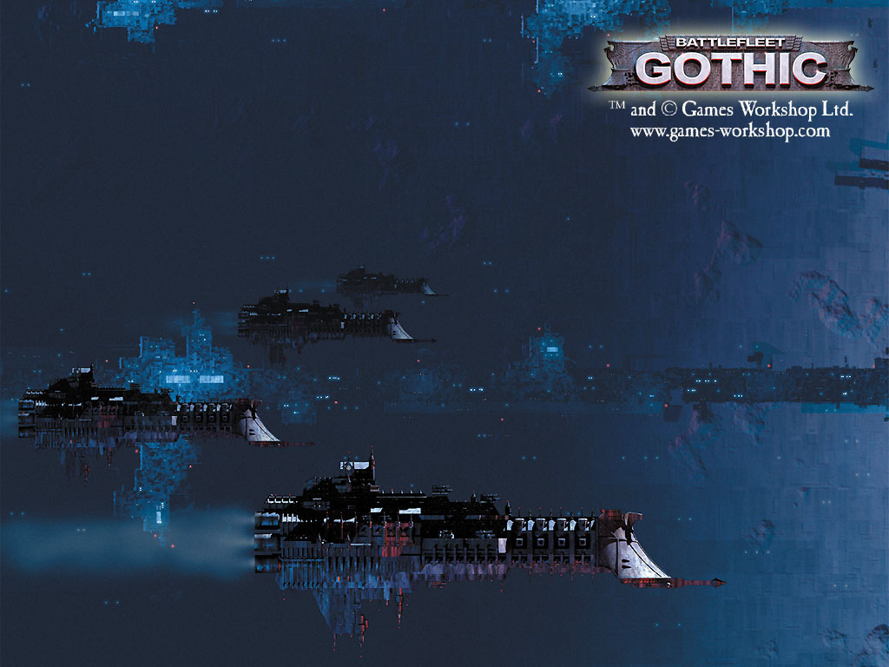

# 帝国海军

解放军席卷亚洲

似乎有写铸造世界仍保持着自动维护的自动化战舰工厂的。不过等这些工厂都因为年代过于久远停工以后……就完了 

boltgun

我非常喜欢40K

因为这个东西它一诞生起, 就是为了战争而战争---------因为是为战棋做的设定

所以40K里的战争是不可避免的, 很多情况下还是生存下去的唯一手段, 战争也是无处不在的. 按照40K的台词说:黑暗遥远的未来, 银河中只有战火在熊熊燃烧

40K是战棋的背景, 所以战争相关的东西它做了很多很多, 编制配备战役记录战术等等都有 不过当然是40K里的

至于帝国退化到什么程度, 只能说: 这个程度, 大家看到的帝国是什么程度就是什么程度. 毕竟没有一个刻度来衡量说----帝国已经退化到摄氏75度了.

有很多东西帝国并不是完全失去了, 只是知道怎么造, 怎么用, 但是 &quot;为什么&quot; 就丢失了. 比如说帝国现役的大部分巡洋舰, 甚至他们还能够改装一些. 但是战列舰等级的东西, 看到的资料里, 情况是已经很少能再生产出来了.

40K里的舰队战规模并不很大, 你可以把40K的银河想象成是大航海时代或者是世界大战时的地球, 那时候一个舰队的规模来比较一下. 40K里的战舰的概念是: 庞大而凶猛(当然说的是巡洋舰以上), 建造和维护不易, 不是大数量会战的战争类型.

在40K专门的舰战战棋游戏手册中, 能够找到的一些数据

&quot;几乎帝国内所有的船只都是被牧师会[注,这个牧师会还没看到究竟是什么组织]所控制的帝国舰队的一部分: 而那不归属的一小部分, 则被一些特殊的组织所有, 比如说机械会, 星际陆战军军团或者是审判庭, 又或是数量极为稀少的一些光荣而古老的行商家族(按:行商浪人, 在皇帝还在世的时代获得的行商权). 即使是帝国卫军的师团也必须依赖帝国舰队将他们运送到遥远的战场去. 舰队分成两部分, 平民商用船只, 和帝国海军的战舰.

为了便于管理, 帝国的疆域分化成五大区域(Segmentae Majoris), 每一个都有自己的商用舰队和海军. 舰队的基地就位于每个区域的要塞地带--太阳区域(Segmentum Solar)是火星, 远终区域(Ultima Segmentum)是Kar Duniash, Segmentum Tempestus是 Bakka, Segmentum Pacificus是Hydraphur, Segmentum Obscuras是 Cypra Mundi. 一个区域的舰队指挥官们, 那些高领主提督们(Lord High Admirals), 他们都是一些权高位倾的人物, 甚至有可能是传说中的帝国高等领主.

所有的人类居住空间都被更详细地分化成各个节区(sectors), 普通来说每个占地200立方光年的空间. 每个节区是被一些10到20立方光年的亚节区(sub-sectors)组成,它们的中心定位在人口密集的恒星簇, 或者是重要的世界集合, 或者是通过亚空间交集的各种交易路线的集交点. 在各个亚节区和节区之间的空间--尚未被探索或是无人居住的区域, 外种族帝国, 或者是不能通过亚空间到达的地点等等--这些地区被称做荒野空间, 或者是荒野区域, 这些地带在银河之中所占的比例远比人类控制的空间要占更大的比例.

为了实战需要, 一个节区的战舰队将是帝国海军最大的运作编制,归属在一名领主提督(Lord Admiral)的指挥之下. 每支舰队都分成若干战队. 战队并不是一个永久性的组合编制, 它是一种行动组合, 按照任务的不同而临时编成, 运输队护航, 巡逻, 还有其他的舰队需要执行的任务, 而编成不同的战队. 只有一小部分战队是几乎永久性的编制, 比如说有名的地球第一巡洋舰战队. 但是一般来说, 大部分战队都是在执行任务过后即行解散. 根据一个战队的规模, 它的指挥官有可能是某一艘战舰上经验丰富的船长(captain or commodore), 一名提督(admiral), 或者是舰队提督(fleet admiral), 有些时候甚至是领主提督本人(Lord Admiral).

每个舰队的规模在50到75艘不同规格的战舰, 但是在一些节区中这个数字会有更大的出入, 取决于此节区的重要程度和它相邻的敌人的数目. 除了这个数目中包含的驱逐舰(Destroyers), 武装船?(frigates), 巡洋舰和战列舰, 一支舰队更会包含无数更小型的舰船比如运输船, 穿梭机, 通讯舰, 和一些长距离巡航舰只. 除了有跨星际航行能力的舰只之外, 一个节区还有一定数量的非亚空间航行能力舰只, 比如内星系巡逻舰, 防御监控舰(defences monitors). 这些舰船的后方还有定点防卫火力的支援, 比如空间站, 轨道防御平台, 地基防御炮塔和导弹基地, 甚至是轨道机雷.

这些看起来也许还算是一支很可以的舰队, 但是他们将要巡防的区域范围十分广阔, 海军必须随时准备执行各种简单的任务. 一个普通的节区, 比如偏西的区域--人类活动最密集的地方, 这样一个节区有可能包括了几万颗恒星星系, 占地八百万立方光年. 在这样广阔的旷野之中, 只有小部分恒星能拥有行星, 而其中又只有小部分是可以殖民的. 但是, 节区内的海军舰队必须时常巡视这些地域, 监视有无敌情, 保护商用船只, 对抗海盗和外种族舰队的攻击, 运送或者是给运送帝国卫军的船只护航, 为地面部队的战斗提供轨道支援, 更别说常规巡逻和为探索舰队提供舰船了.&quot;

以上是手册里的一段. 至于各种型号的战舰生产情况, 则要在具体的每种战舰介绍中查看了. 写了好多, 先到这里吧.
