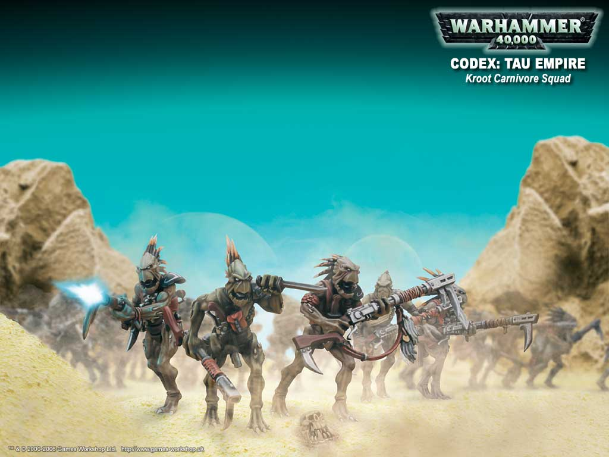

# kroot族的背景

eternalloser 

昨天看了一份kroot族的背景介绍，大吃一惊：原来kroot人食用敌人的尸体，并不只是一种原始的生活习惯，他们居然和虫族一样，可以通过进食，把敌人体内的DNA资源纳为己用？也许很多老手早就知道这个了，不过我相信大部分新手看到这个，都会像我一样吃惊，所以就冒着火星的危险把它贴出来。

我现在才知道为什么kroot族中的长老被称作“塑形者（shaper）”——因为他们可以决定后代的进化形态！塑型者可以通过分析猎物的基因序列，找到有用的DNA片段，然后让族人通过食尸将其吸收，这样他们的后代就可以在进化中学会该猎物的特长，从而增强实力。这种能力其实和虫族非常相似，不过他们对于猎物基因的分析选择能力不如虫族那么强，所以有时候他们“设计制造”出的后代会被猎物的基因干扰，而丧失kroot人本来的特征。现在kroot人军队中驯养的那些猛兽，从猩猩到猎狗，甚至恐龙，其实都是以前进化失败的kroot人后代！（我很早就注意到恐龙头上也长有像kroot人那样的尖刺刚毛，当时还以为是设计者创意枯竭了呢）

再找几个该背景介绍里比较有用的地方：

kroot人可以像很多动物那样，通过汗腺散发的气味传递信息。在伏击敌人的时候，他们会把这种信息传递给周围的动物，于是飞禽走兽都会配合他们的行动，不会因为突然惊散而泄露他们的行踪。他们也可以通过分析其他生物的气味来了解其生理特征甚至心理活动，所以他们很容易就可以学会其他种族的语言。

在另一份背景介绍里还描写过kroot人遭遇到虫族的一只兵虫，他们的塑型者仅从气味中就辨识出：这是一种极具威胁的捕食者，它们和kroot人一样可以通过食用猎物来改进基因特征。

在历史上，kroot人原本散居于丛林中，后来一艘ork的飞船迫降到该星球，他们很快成了kroot人的食物。而kroot人吃掉ork的恶霸技师之后，就迅速掌握了他们的飞船技术，并且效仿ork建立了巨大的城市。后来他们在对外扩张中与ork发生冲突，不幸节节败退，城市也毁于一旦，最终依靠TAU帝国的帮助战胜了ork。kroot人经过反思，不愿意再重建城市，而是重新回到以前的散居状态。目前绝大部分的kroot部族效忠于TAU帝国，但也有一些部族以雇佣军的形式为IG、eldar、ork甚至CSM效力。

kroot人的智商不高，在技术和战术方面没有多少造诣；但他们的个人战斗技巧非常高超，力量和灵巧也远超过一般的人类，一个kroot的近战能力足以和一个装备精良的SM相匹敌。不过kroot经常是以雇佣军的形式出现，因此组织性和纪律性相对较低。

boltgun

实际上，KROOT的进化是有条件的。

它们的基因特征只有有限的空间，吃掉新的东西，并不意味着就能把好的东西都留下。

它们目前已经处于一个不太容易继续进化的状态，如果继续改变的话，恐怕必须牺牲已有的一些特征。

如同已经满满的硬盘一样（没有外接储存）

而且，就算是进化，按照资料看也是要等上四五代人，不过这个时间说起来也不算太长。

其实KROOT是TAU帝国内不算十分稳定的因素，KROOT们自己还经常地向外派遣佣兵，还瞒者TAU。

而且吃尸体的习惯，TAU们一直想让它们改，它们却打哈哈一直保持着。

这一群整天盯着哪个种族有好处就磨牙的，在TAU身边待久了……

不过KROOT还是很守雇佣兵的规矩，就是收钱打仗的，士气定然不如为了活命打仗的高。

hellrack kroot也是个满有意思的族，他们和虫子一样都能吸收其他生物的基因，而吸收的方法是……吃……吃那种生物，由于他们已经吸取了TAU人活动的星系里大部分可用的生物基因，所以他们开始作为佣兵参与向其他世界的征战，以期获得新的基因~~然后每隔若干年这些家伙就回去传宗接代一次，这样的结果是……kroot内部开始出现很多基因特征不同的分支，比如说从模型上看，一些kroot有翅膀另一些没有……
