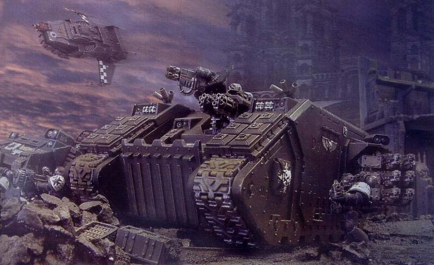
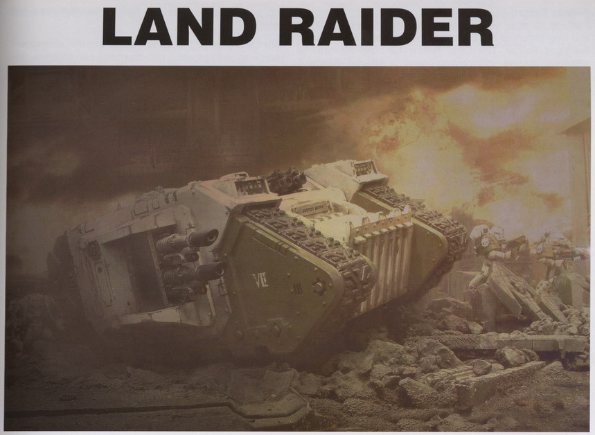
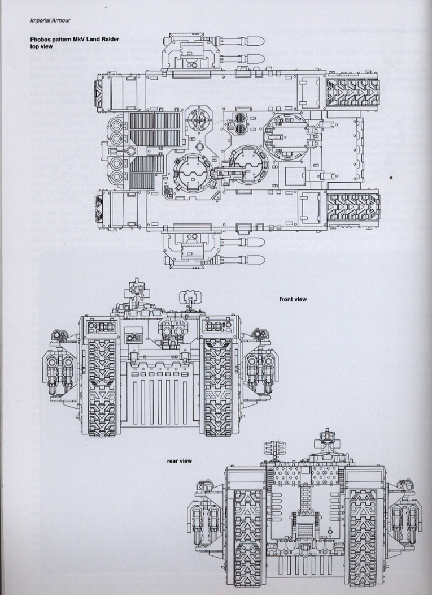
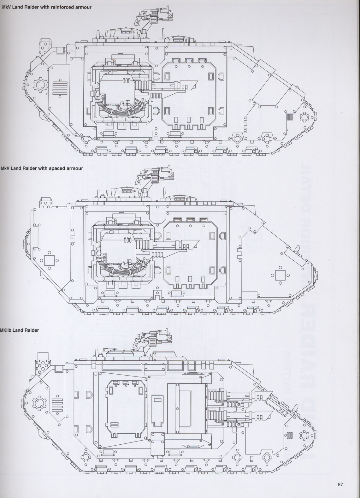
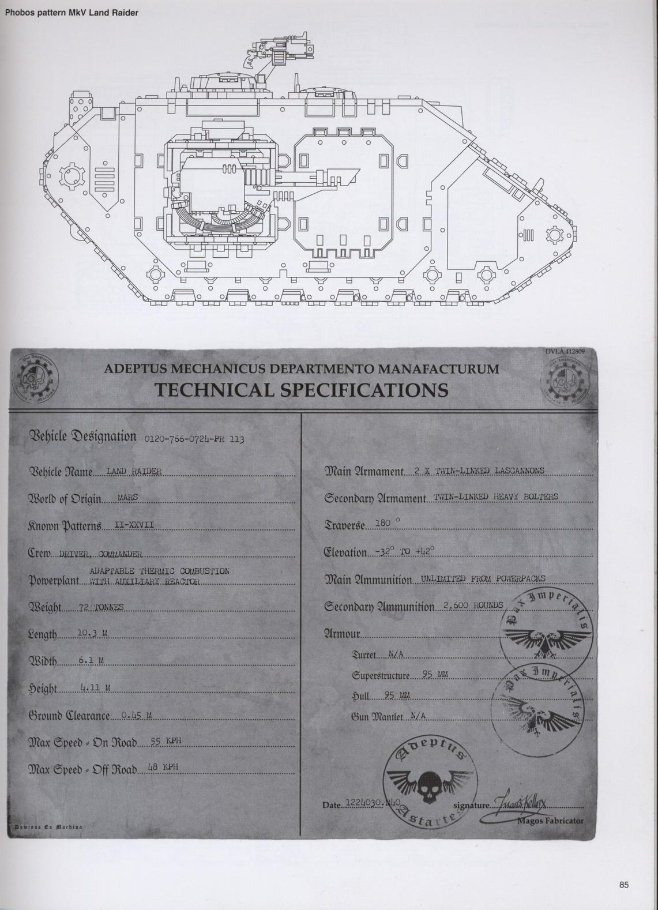
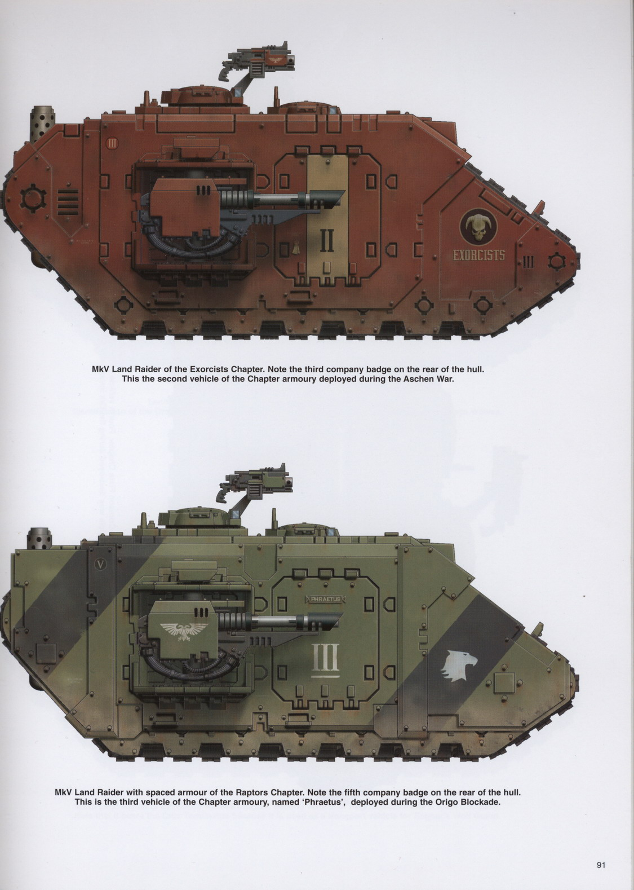
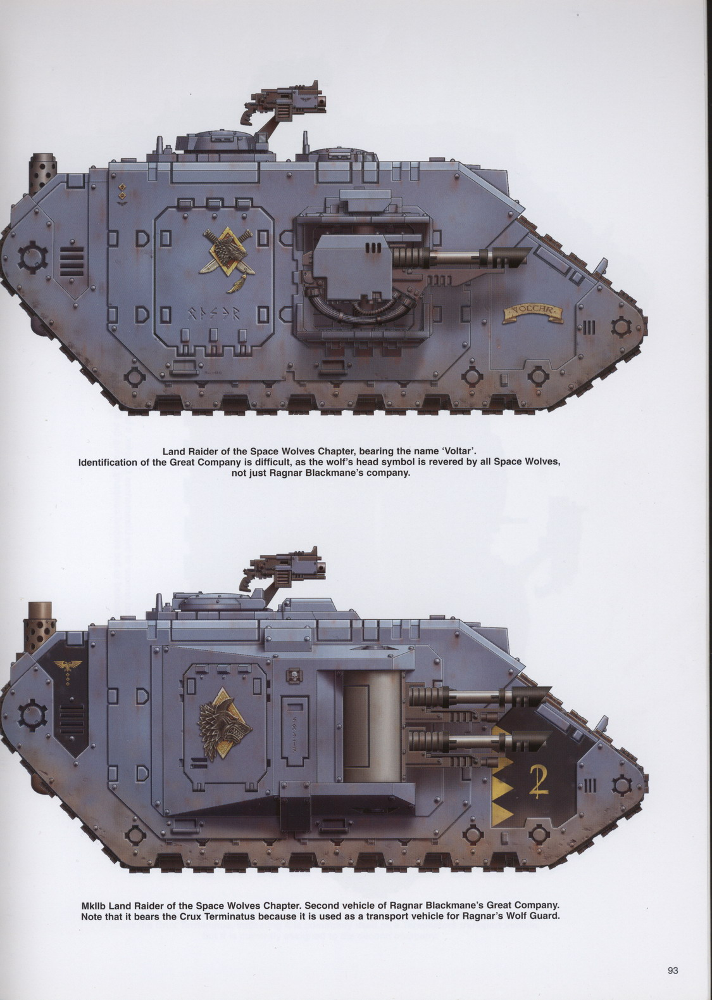
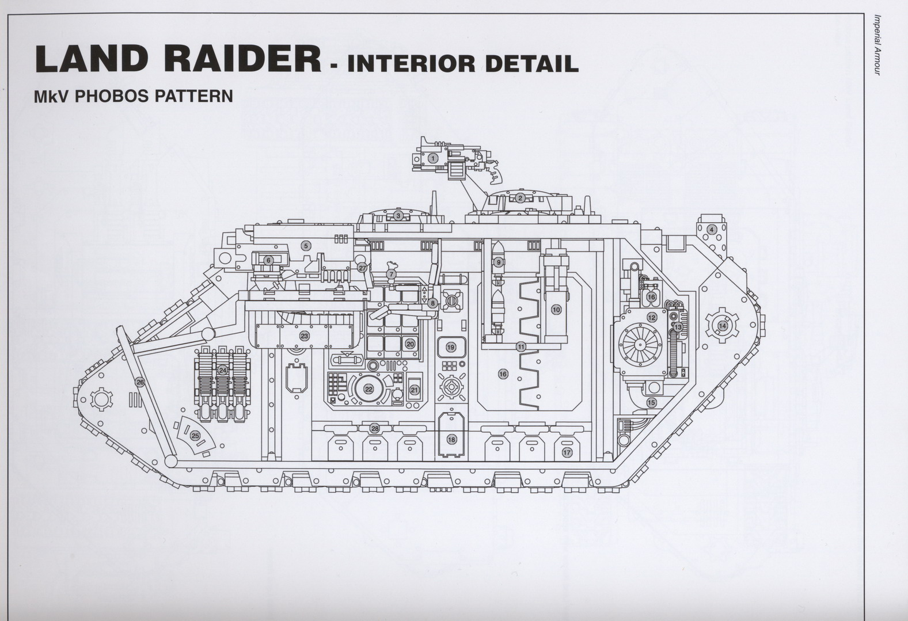
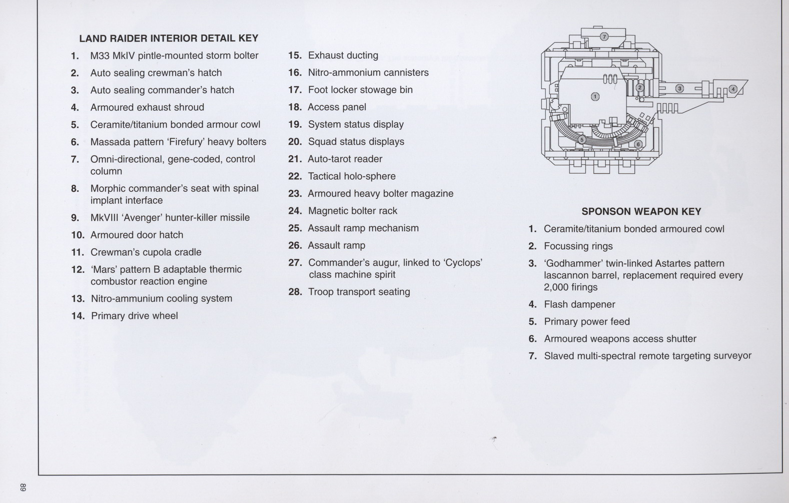

# 终极战车LAND RAIDER的资料集

> [boltgun](http://game.ali213.net/profile-uid-1161426.html)

首先要声明的是,以下资料和图片来自GAMES WORKSHOP官方出版的IMPERIAL ARMOUR 第二卷,版权归GAMES WORKSHOP所有, 本文只做翻译交流之用,请勿转用于商业目的

## 陆地掠袭者（兰德掠袭者）

毫无疑问，第41千年中最有名的战地坦克，非陆地掠袭者莫属。它的STC设计（“标准化建造规范”注1）可以追逆到帝国之前几千年之久，但是在动乱的年代之后，它的设计曾一度失落，直到传奇的技术考古学家阿堪.兰德再度将它发现为止。

## 历史

传说中，陆地（兰德）掠袭者――原命名为“兰德的掠袭者”――被发现的时候，正是帝国的黎明时代。那是技术考古学家阿堪.兰德在火星的万象大书馆的一次伟大的探险。兰德下到这个迷宫古墓的主要目的，是要寻找仍然运作的STC数据库。虽然这次探险的结果他并没有达成这个主要目的，但是却找到了两项让之后一千年中科技开发思想为之变革的发现。第一项是一块数据版上保存着的几乎完整的一台重装战地坦克的STC资料镜像。第二项发现揭示了一种稀有的反重力金属板的资料，很显然导致了日后的“兰德速攻艇”的诞生。兰德本人则在后来第二次的探险中，被一个异能体杀死，他的队伍无一人幸免于难。和他一起死去的，还有哪些黑暗年代的秘密，则成了一个迷。

据说当皇帝陛下新生的军队向一个个星系进军的时候，他们将第一批准备作战的陆地掠袭者带上了战场。那个时候，所有的人类部队都配备着它们，指挥着如此可怕的战争机器，他们征服了一个又一个世界，直到皇帝陛下的人之帝国横跨银河。

陆地掠袭者的需求是如此之高，以至于一个专门生产它的锻造世界为此而建造。Anvilus 9为人类的军队供应了一批又一批数以千记的战车。

可是伟大的圣战长征是以惨剧收尾的，赫鲁斯高举反旗对抗皇帝陛下，帝国被血腥的内战分裂。Anvilus 9被与赫鲁斯联盟的变节科技神甫占领，其他的锻造世界纷纷脱离帝国，远离战斗。于是一夜之间，帝国的陆地掠袭者的供应如一流滴水，摇摇可断。对帝国来说这是个严重的打击，因为陆地掠袭者是少数有能力（如果部署的数量足够的话）击毁敌人泰坦的战车。

随着赫鲁斯的部队挺进到地球本土，事态岌岌可危，皇帝陛下命令所有还在为帝国尽忠的陆地掠袭者必须召回，而在地球最前线作战的、他最器重的星际陆战军，将成为唯一有权力配备这致命武器的军队。

随着皇帝陛下在一场生死决斗中击败了赫鲁斯，帝国被拯救了，但是他本人受到的伤害也是无法挽救的。皇帝陛下被送进了他的黄金王座，从此没有了他的声音。而在这之后，更没有人胆敢改变他颁布过的命令。于是陆地掠袭者便作为星际陆战军的专用武器，一直到十个千年之后的现在，依然如此。

## 服役记录

能够用以标示星际陆战军那忠诚而又悠久的历史的战车，恐怕没有任何车辆能代替陆地掠袭者的位置。掠袭者轰然挺进在炮火中，身着能量装甲的陆战军战士从它的舱门中涌出，突袭前进，可以说这就是人们对“死亡天使”们定义性的一幕了。陆地掠袭者在它一万年的服役岁月中赢得了自己独有的声誉，决非虚名。

自从皇宫保卫战之后，陆地掠袭者在每一次星际陆战军的大规模战役中都必定出现。关于它在战斗中的著名事例数以千记，其中最出名的几例就包括闻名遐迩的那场鲜红之爪军团麾下“鹰爪”号掠袭者，在Amion与叛徒（注：即混沌陆战军）势力对抗战争中，“鹰爪”在一次单独的突袭行动里，消灭了敌人的整个补给站，并对敌人的后撤部队展开追击。敌人的补给被消灭得如此彻底，以至于当帝国卫军发动进攻的时候，敌人的防御力量闪电般崩溃瘫痪。

另一例著名战斗是钢铁之手军团指挥下的陆地掠袭者，对HEAT SINK 871行星发动的进攻。指挥官SINE在他的座机“Cestus（拳套）”中带领着五台战车对抗叛军，在占领HEAT SINK的过程中，此战车身受132次直接炮火命中，依然运作，直到战斗结束。

## 配置

陆地掠袭者，虽有待论证，但可以认为是目前还在帝国军队中服役的最先进的坦克。它搭载着繁多种类的复杂又特殊的系统。由于它密封的结构，陆地掠袭者可以在真空环境之下，以及水下最深可达35米的环境

中正常运作。

每一台陆地掠袭者都搭载着一副机魂（AI？？），例如在Phobos（火卫一）型号中搭载的，是M32“CYCLOPS（独眼巨人）”级的机魂。蒸馏者屏蔽，虚象接口线路布局，以太能量供给线，这一套配备给了它30000 co/每秒 的认知速度（这个cognition speed到底是啥不是很清楚，按前后看应该是描述机魂性能的）。这个速度对于一个陆地掠袭者这样大小的战车来说，实在是高得不同寻常。尤其是可以比较一下，在战犬级泰坦，甚至一些掠夺者级泰坦上的配备。

为它提供主动力的，是火星规格兼容机型的燃烧室热反应引擎，它安装在战车尾部位置，使用硝铵为动力源降温，并由纯洁之印和帝国工科部生产封印预防意外的故障以及恶魔化污染。反应堆通过战车的传输道，为所有的内部系统，以及主动力轮提供能量和动力。一部陆地掠袭者在道路上的最高时速可以达到55公里/每小时。

一个关于陆地掠袭者很著名的特点，是它的“天鹰”履带链片，作为宗教意义，在这套链带上，每隔十二片带片，第十三片就是一片代表了皇帝的“天鹰”，十二片链片代表着十二位帝国的高等领主，第十三片的“天鹰”在其之上，代表着皇帝在他们之上的位置。在星际陆战军作战的同时，也将皇帝陛下的印记烙在那个世界的土地上。

每部陆地掠袭者还搭载着指挥控制设备。对应着每个小队，都会有一个单独的状态显示器供指挥官随时观察他部下单位的生理状态读数。这个功能，通过负载在战车的通讯天线上得以实现。战车上还有战术全息图象显示设备，以及直接连接到“独眼巨人”（那个机魂）上的界面，通过这些设备，陆地掠袭者在作为一个指挥中心的同时成功地担任了前线战车以及战斗小队运输车的多重角色。

陆地掠袭者的其他配置，还包括大气取样设备，抗辐射（这个rad-counter总不会是反雷达吧……），空气过滤，纯净化设施，机炮塔位边缘上的多光谱光学潜望镜设备，安全检查用基因码识别控制系统，还有控制侧炮塔用的从动遥控瞄准系统。

## 建造

陆地掠袭者的装甲覆装体现了帝国工科部鼎盛时期的技术水平，相似的技术应用，确实还可以在一些战斗装甲上见到，比如泰坦的主装甲。STC设计模式意味着地方性的原料是可以取代高级合金作为材料，不过任何一个星际陆战军支部的军工都有生产所需原料的能力。里层装甲层面与结构支撑由精金构造。在这一层上面是钛与槊钢轧制的复合版层，用来加强承受受敌人火力最多的部位，例如正前部的攻城门板（就是正门），前斜面，外舱门，舱侧。接下来是电解纤维，以及两个陶瓷层的第一层。这一层的功用是部分能量的吸收，以及防止分裂（dissapation，这是啥？暂时翻做分裂吧），是对抗高能激光武器的有效防御。第二层陶瓷则是一个隔离层，是战车对抗高温和融爆武器的第一防线。不同的层面将在制炉中被施加极高的压力和高温，以将其制成一体。其正面装甲厚达98毫米，但是可以提供大约普通钢铁装甲300毫米的防御力。

## 兰德之迷

尊敬的技术考古学家阿堪.兰德，兰德的掠袭者和兰德的速攻艇STC的发现者。那些在帝国工科部中仍然追随他道路的信徒，被称作“兰德派”或者“兰德人”。他们继续者这位先人的工作，研究兰德发现的STC资料中潜在的变量。这项工作导致了很多发明的诞生，比如“普罗米修斯”以及“赫利俄斯”（注2）这两个陆地掠袭者战车的改型。在兰德派的圈内人中，有些是资格极深的帝国工科部匠人，他们中曾有谣传说拥有一部新战车存在的证据，但是这个秘密被埋藏了起来。信徒门小圈子里的研究发现，曾经，在伟大的圣战长征的时代，存在过一种比掠食者坦克体型更重，但比陆地掠袭者这样的重突袭运兵车更轻的装甲车。帝国工科部中曾就此在各个等级部门大大争辩过一番，直到公元39个千年中，兰德派的成员有人因异端的罪名被逮捕，判处了鞭刑（arco-flagellation，怀疑是不是那个一捆抽鞭中间绑着一个斧头那个标志代表的刑法，那可是先抽后砍……）。从此以后兰德派人便对自己的研究保持高度的保密。他们相信，就在陆地掠袭者的蓝图中，从最微观的角度，就可以寻找到他们需要的系统兼容以及相关的冗余资料，来重建那部失落的坦克。有很多科技神甫迷陷其中，但是看起来最后的成功还一直在他们的所及之外，而那部失落的神秘战车则到今天还是一个迷。

注1：STC，标准化建造规范，是人类向外殖民过程中针对新殖民地环境和原料有异与地球标准，以及科技资料缺乏造成的社会退化化这样的情况，开发出的一套“万能”科技库，将一切所需科技标准化，模版化，只要有STC的存在，就可以在任何环境下使用任何原料生产人类社会的所需。就是这个东西，最终造成了人类自己对STC的依赖和对科技失去了掌握和理解，最终科技文明失落了。

注2：普罗米修斯型是以指挥战车为标准改造的型号，前装的重Bolter没了，两侧炮塔也成了各两架双驳Bolter。通讯指挥设备加装了不少，而赫利俄斯是只拆了前装重Bolter却在背上加了台风飞弹发射器的攻坚型战车。另一个比较常见的陆地掠袭者的改型就是十字军，这个家伙将重Bolter换成双驳突袭机炮，两侧的炮台装的是左右各三联一共六联的双驳Bolter（六联就是十二个枪口，），想象一下cs里前面两杆机枪，两侧各六支M16的情形（好吧，按照战锤里的规则，其实双驳武器实际不能分开射击不同目标……），十字军就是个绞肉机来的。实在是很想见到这个东西出现在DOW游戏里，会是怎样的情形。至于对付装甲，似乎十字军背上有台多发融弹枪来着。这个家伙全身再次加强装甲，而且做了容量扩增，所以就是个在敌人阵线上绞出一条血路将闪击部队扔到敌人心脏位置的大铁牛。

请注意这一部陆地掠袭者的构造, 它的侧炮塔结构是竖排起来的两个炮管, 而不是游戏里的横排.

MKV型的基本前后和俯视图

这里可以看到上文提过的天鹰标志的履带片了, 就是双头鹰形状的那一片. 前方看到的是正的, 尾部看到的就是反过来的了.

侧视图

这里可以看到游戏里一样的MKV结构, 和最下面的那个双炮管竖排的MKIIb的型号,也就是标题用图里的那个型号了. 不过说实在的, MKIIb这个样子, 侧炮塔和车身的一体化太厉害,做那些改装是很不方便的, 所以会不会渐渐被MKV取代了呢.

帝国工科部的鉴定档案?

主要是一些数字资料, 长宽高等等. 其中可以看到这个家伙需要一个指挥长一个驾驶员. 主武器(侧面的双驳激光炮)由能量供给, 没有弹药限制, 副武器(重Bolter)的弹药量是2600发, 当然游戏里自然没有限制一说........

各个陆战军部队中的战车着漆

两个例子, 主要的意思就是一般来说部队里会怎样给战车涂装,在战车上标识编制番号等等. 这两部都是很正常的MKV, 涂装标识都很标准. 有明显涂装所属陆战军的标志, 大体颜色也与所属部队一致. 在它们的尾部小圆内的罗马数字标识所属连队, 大的无框罗马数字表示是所属连队的第几辆编号战车. 这两个陆战队都是按照星际军部的法典组建的标准陆战军, 所以在编制上都不会有太大出入.

太空之狼的两部

老狼们就是在法典规范之外的一支, 首先这个下面的一台MKIIb是很好认了, 可是上面的那部MKV的侧炮台跑到前面去, 跟侧舱门交换了位置, 这个倒是比较特别. 又没有说是不是MKV的哪个ab分支啥的, 看来MKV的侧炮塔确实比较有兼容性, 提供激光炮能量的发生装置也是可以装前装后都没问题的. 是啊, 要不可以随便改了几联的Bolter呢. 再说这个老狼们的标识就比较特例, 一般特例一点的不同连队会有不同的子军队标识, 可是按照这个图上的诠释, 老狼们各个连队用狼头的太多了, 上面那台MKV更是连第几台的编号都没有........

下面那台则是狼王护卫的专用坐骑, 因为那个小小的终结者标志, 就是狼头和炮管中间的那个十字骷髅. 也顺便提到, 一般来说有这个标志表示着是终结者专用运输战车. 当然, 狼卫们自然是有穿终结者装甲资格的.

内部结构图1

内部结构图2(名称列表和侧炮台

陆地掠袭者内部
1. M33 MKIV 枢轴装风暴bolter
2. 自动封闭式机务员舱口
3. 自动封闭式指挥官舱口
4. 装甲排气口屏护
5. 强化陶瓷/钛合金 装甲顶盖
6. MASSADA型“火暴”重bolter
7. 全方向、基因码认定功能的驾驶杆
8. 带有脊髓接入界面的形态工学指挥官座
9. MKVIII“复仇者”猎手刺杀导弹
10. 装甲舱门
11. 机务员的机炮位站台
12. 火星B型兼容热燃烧舱式反应引擎
13. 硝铵降温系统
14. 主动力轮
15. 排气管道
16. 硝铵容罐
17. 个人储物柜
18. 调设开关面板
19. 系统状态显示器
20. 小队状态显示器
21. 自动塔罗读取器（这个AUTO-TAROT是什么东西不知道，猜想是卡或者板型的控制或者存储设备, 或者是显示什么状态的）
22. 球状战术全息显示器
23. 装甲重bolter弹库
24. 磁性枪架
25. 攻城门板能动机关
26. 攻城门板
27. 指挥官用预测者，和独眼巨人级机魂连接。(这个COMMANDER'S AUGUR又是啥, 刚出了个塔罗又来了个占卜......猜想或者是分析软件一类, 或者它和刚才的塔罗就都是通过AI做战术预测的东西)
28. 士兵乘客座

侧炮塔

1. 强化陶瓷/钛合金装甲顶盖
2. 聚焦圈
3. “神之锤”星型双驳激光炮管，每发射2000发需要置换一次
4. 消闪器
5. 主能量供给
6. 装甲炮台接口
7. 从动多光谱遥控瞄准导向器

好, 上面的一排是各个部件的乱翻译, 可以简单看出来的, 就是那一套指挥系统和侧舱门确实是前后换来换去都可以, 不碍大事. 反正乘客座都要放两边, 攻城门板都要正前开, 一车的战士冲的方向不碍事. 这个侧门应该只是做进入用, 因为对那些侧门开在侧炮前面的车型来说, 从这里走实在是耽误事. 作为一个前开门并能运输终结者的运兵车, 陆地掠袭者的攻击方式就是一个猛字, 重火力厚装甲, 穿过防线, 在敌人的面前张开大口, 让人胆寒的终结者鱼贯涌出, 这才是它的攻击风格. 而在敌人进攻前线将战士放出, 提供掩护, 遮挡火力, 为防御战多添一把柴, 这事还是犀牛这种两侧后尾三开门的车子合适.

