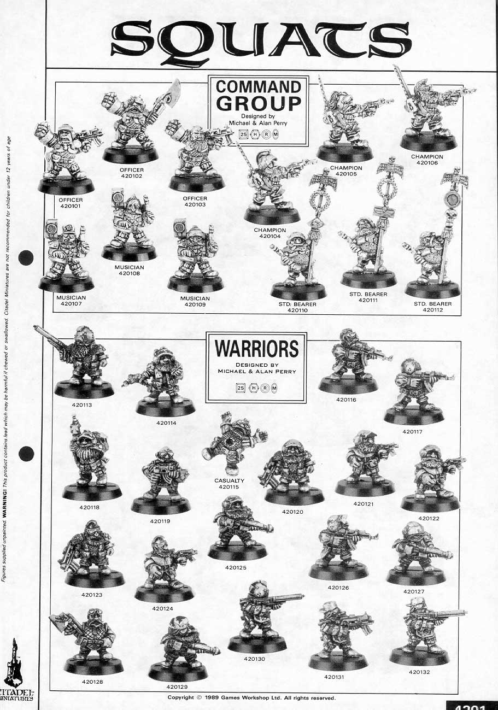

# 被淘汰的种族——太空矮人

被淘汰的种族——太空矮人

五月

在战略金属上看到的

[http://strategymetal.com/phpBB2/viewtopic.php?t=3903](http://strategymetal.com/phpBB2/viewtopic.php?t=3903)

据说：官方说法，他们是被Ork亡国的。。。

有玩家认为是因为他们卖相不好～

更多图片：

[http://www.olleysarmies.co.uk/scrunts.html](http://www.olleysarmies.co.uk/scrunts.html)

[http://www.olleysarmies.co.uk/scrunts1.html](http://www.olleysarmies.co.uk/scrunts1.html)

完成品，矮人的图片在网页底。 

[http://www.olleysarmies.co.uk/gallery.html](http://www.olleysarmies.co.uk/gallery.html)

这是Wiki上翻译来的史料 

Squat的母星系在创建时代﹝Age of Founding﹞开始殖民（也是众所皆知帝国在科技上的黑暗时代）。在孤立时代﹝Age of Isolation﹞（或者称作倾轧时代﹝Age of Strife﹞）之时，Squats变异成了现在的外貌。持续了近三万年的贸易时代﹝Age of Trade﹞中，将Squats母星系孤立的Warp风暴逐渐减弱，Squats开始在这段时期跟欧克蛮人还有神灵族进行贸易。贸易时代在欧克战将Grunhag the Flayer对Squats的母星系全面袭击下结束。Squat曾经试图向他们的神灵族贸易伙伴求援，却遭到拒绝。这促使他们在战乱时代﹝Age of Wars﹞对抗欧克蛮人与神灵族，直到重现时代﹝Age of Rediscovery﹞（或者说帝国时代﹝Age of the Imperium﹞），审判院因为判定Squats为外星异族，而对其发动战争。后来Squats如其它的亚人类般被戏剧化的接受，认为是属于一种自然而生的人类物种。许多 Squat Stronghold加入帝国，但是故事还没结束。Squat Stronghold在变节时代﹝Age of Apostasy﹞全数脱离帝国。然而Squat的母星系依然与帝国保持贸易与相互支持，Squat贩卖军备，并且允许政战军官加入他们的军队，甚至为Adeptus Mechanicus派遣新兵。在纪元四万一千年时，一支泰朗虫族（不太清楚是Leviathan还是Kraken一脉的虫族）扫平Squat的母星系，将Squat在宇宙中的存在彻底抹销。 

其实有很多事情这段史料没有提到，在下面补充一下： 创建时代：这段时间Squat们其实还是普通人类，他们被派遣至后来Squat的母行星系进行殖民。 孤立时代：Squat进行殖民的星系遭到Warp风暴的垄罩，他们失去了对外的联系。由于他们经常性在行星表面挖掘坑道，以及该星系普遍高强度的重力，Squat变成现在又矮又壮的模样。 

贸易时代：由于Warp风暴开始逐渐减弱，Squat开始与欧克蛮人与神灵族进行贸易。 战乱时代：Squat被疯狗欧克咬了，神灵族又拒绝支持，于是打仗（反正WH40K就是有一堆名目可以交战）。 重现时代：帝国再度发现这些已经被遗忘的殖民星系，审判院却误以为Squat是外星人，又打仗了。后来帝国发现原来大家都是同乡，就和好了。 判节时代：Squat与帝国分歧的原因不得而知，但即使在这段时间Squat与帝国仍然非常友好。 亚人类：玩IG的人应该知道帝国除了纯种人还包括诸多亚人类，比如说Ratling（类半身人）、Ogryn（类食人魔），也可以说星际战士属于亚人类，虽然他们经常被视为一种更高等的人种。 

Squat Stronghold：Squat的政经组织单位。
