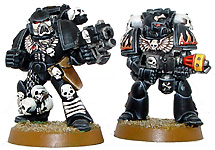
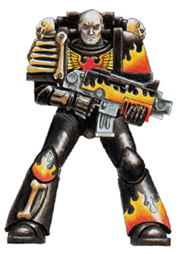

# 锤子资料 =Legion of the Damned= 咒缚军团

> Baron.H

被认为是两只失踪的初创军团之一的神秘战团 。另一只被认为是 灰骑士 ，但是这种说法已被证明是错误的。

小弟第一次翻东西，贻笑大方了。有不准确的地方请大家不吝赐教。 

Legion of the Damned
咒缚军团

咒缚军团是一只多次神秘的在战场上及时出现拯救那些崩溃的帝国军队，并且在留下死亡与毁灭之后，又同样神秘的消失的星际战士战团。咒缚军团的战士们并不像其他战团的战士那样严格穿戴着标准的动力装甲，取而代之的是雕琢着各种火焰，骨头和颅骨图案的黑色动力装甲。咒缚军团被认为是火鹰战团的残余部队。
咒缚军团源于那只悲伤的被诅咒的第21军团。他们最初都是火鹰战团的战士，但是在一次征服某颗行星的旅途中，他们被困在混沌虚空中长达20年。在这段时间里，一种混沌瘟疫袭击了咒缚军团，并且带给他们可怕的痛苦，最终在很长一段苦闷的时间之后，杀死了许多这些在肉体上经过极端强化的战士们。当幸存者最终得以从混沌虚空中逃脱出来的时候，整个战团已经变的支离破碎而难以挽救了。战团的人数极端锐减，战士们的肉体变的苍白而衰老。由于战团所有的元老们都已经死去，剩下的人再也无法延续这只战团了。在混沌虚空中旅行的时候所经受的痛苦使他们几乎就要发狂。这些战士唯求一死以摆脱那种他们无法医治的可怕瘟疫。但是，他们仍旧是帝皇忠诚的仆人，因此他们决心战斗到死。他们取消了一切军阶，以示在死亡面前人人平等。他们用火焰和颅骨的纹章来妆饰自己的动力装甲，并且不再认为自己是火鹰战团。他们现在是咒缚军团。为这悲伤的命运所摆布，他们不再畏惧死亡。除死亡之外，他们也确实极少追寻其他东西。

基因原体： 无 （非初创军团）
战吼 ： 无
涂状 ： 黑色和火焰的色彩

20支初创军团中有2支部队的档案在荷拉斯叛乱中全都浮云了，有人说他们是背叛了然后被K至团灭，也有人说他们是被Warp吞噬了，总之是不见了踪影。 
所以后世有人认为比较神秘的Grey nights 和Legion of the Damned 就是那两支部队。
