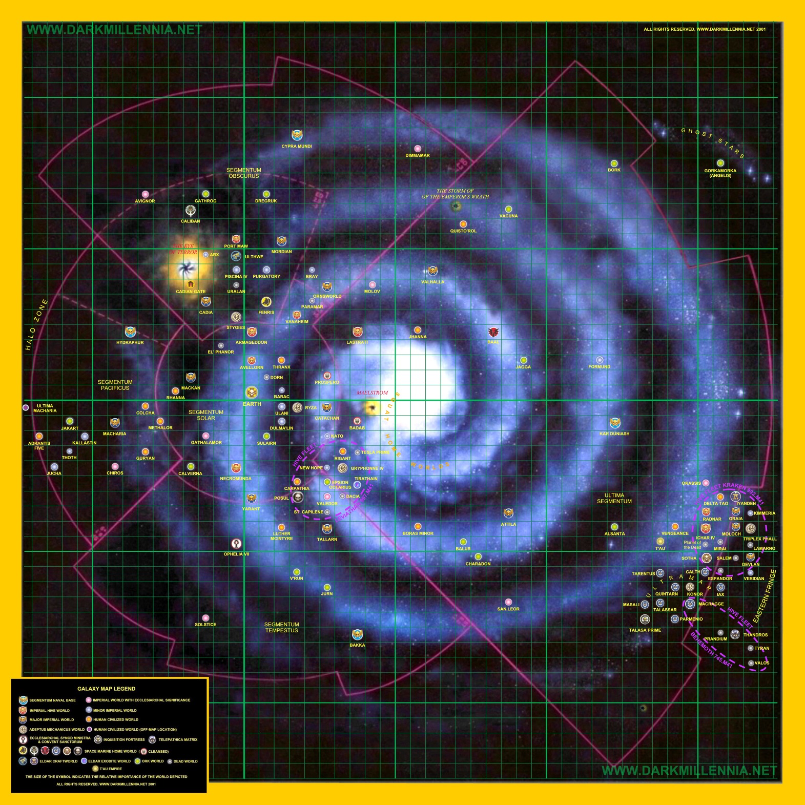
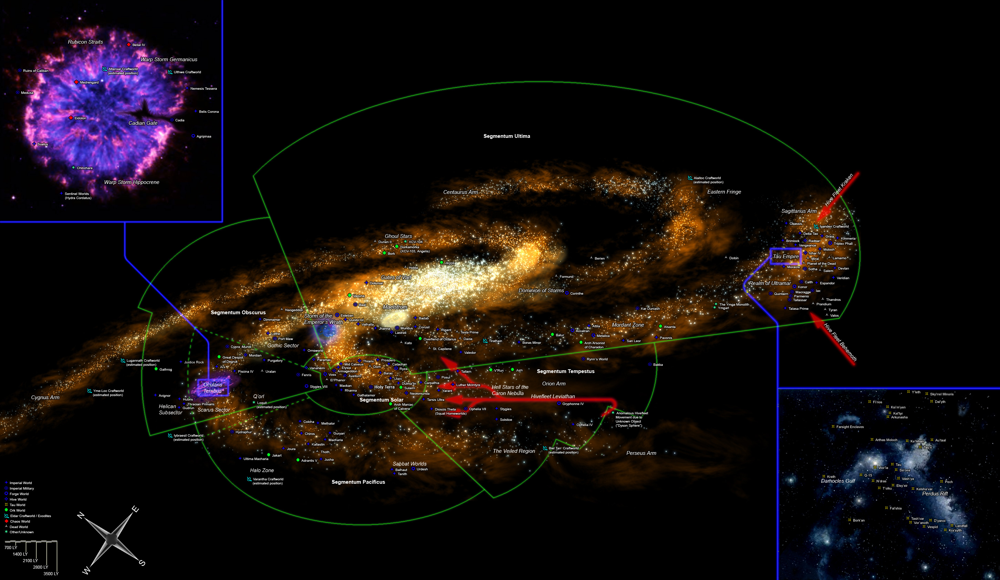

# [翻译]40K银河中的主要世界

[翻译]40K银河中的主要世界

CZ75 

本文翻译自：

http://www.darkmillennia.net/QuadrantMap_pages/GMapIndex2.htm

以下各世界按汉语拼音顺序排列：

阿尔桑塔（Alsanta）：（位于远东星域），蛮人部落阿尔桑塔“大战师”（Warchief of Alsanta）的母星，在450-996.M41年间上面的蛮人征服了至少5个帝国的世界。

阿克斯（Arx）：（位于朦胧星域）：帝国的一个前哨研究站和监视站，负责监视阿克斯通道，通过阿克斯通道，混沌军队就可以饶过卡迪亚之门走出恐惧之眼。第41千年的第139年，毁灭者阿巴顿突袭该站，标志着哥特战争的爆发。

阿特兰蒂斯五号（Adrantis Five）：（位于太平星域），一个科技高度发展的人类聚居星球，与帝国隔离了五百多年。上面的居民“转向了科学的黑暗确定性，并创造出了许多新奇的机器。”

阿特兰蒂斯五号将马卡里乌斯（Macharius）扣留在其港口中长达两年之久，随后其遭到一颗改变了轨道的彗星撞击，彻底毁灭。“它上面的一切秘密都已不存在了。”

阿提拉（Attila）：（位于远东星域），帝国的一个封建世界。阿提拉蛮骑兵（Attilan Rough Riders）的母星。阿提拉比地球略小，其表面上只有一块大陆，约占其表面积的一半。在这片广阔的大地的中部，气温变化很极端，使得这里很多地方依然无人居住，这些地方在夏天是一片如烤炉般炽热的沙漠，而在冬天，就成了一片沙砾与冰雪之海。当地的居民主要是放牧兽群的游牧民族，他们的主要牲畜叫奥维嘉（ovigar），这是一种阿提拉土著生物，体型巨大，毛发浓密，性情暴躁。

阿维隆（Avellorn）：（位于太阳星域）帝国的一个聚居世界。在何露斯叛乱期间，忠于帝国的军队曾在此与钢铁战士军团激战。

阿维诺（Avignor）：（位于朦胧星域）阿维诺主教区，由主教阿尔曼杜斯·海尔弗（Armandus Hellfire）主持。国教的一件圣物——阿维诺节杖（Scepter of Avignor）供奉于此。

艾皮西恩·奥克塔里乌斯（Epsion Octarius）：（位于暴风雨星域；译注：原文如此，但在地图上它位于远东星域）蛮人部落奥克塔里乌斯“终极魔鬼”（Over Fiend of Octarius）的母星，该部落在第41千年第450-996年间征服了帝国的至少五个世界。在这个世界上的丛林战争中，一个卡塔昌团曾经在响尾蛇横行的红树林中生存了接近四十天，并抵达了蛮人基地。卡塔昌士兵的野性给蛮人军阀留下了深刻印象，使它命令它的手下模仿丛林战士的制服，在自己涂上绿色丛林条纹，间杂红色条纹。 第41千年第997年列维坦虫巢舰队曾进攻该世界周边地区。

艾斯潘多尔（Espandor）：（位于远东星域）乌尔特拉马区的一个丛林世界，在第二次虫族战争中被克拉肯虫巢舰队摧毁。在纷争乱世（Age of Strife）中，一些商人被异空间风暴意外地吹到了这里，随后他们便开始在上面定居。该世界是乌尔特拉马区的所有世界中人口密度最小的一个。

昂斯沃尔德（Ornsworld）：（位于朦胧星域）帝国的一个世界，莱特林人（Ratling，他们是一种亚人类，经常在帝国防卫军中担任狙击手）的母星，第41千年中，哥特战争开始时，混沌军队为了夺取“夜晚之眼”（Eye of Night）而进攻这里。

奥菲莉亚七号（Ophelia VII）：（位于暴风雨星域）帝国的一个世界，国教教廷辅佐会议（Synod Ministra）和战斗修女的圣殿修道院（Convent Sanctorum）所在地。大约在第35千年初期，总主教贝涅丁四世为了制衡内政部最高执政官的权力，将教廷最高会议（Holy Synod）和国教的上层机关从地球迁移到这里。该星上的教会宫殿占地近九万平方英里，高达四千米。

奥卡西斯（Okassis）：（位于远东星域）教会世界。第二次虫族战争期间遭到虫族入侵，奥菲莉亚七号星上“我们的殉教圣女”教团（Order of Our Martyred Lady）的女牧师圣女普拉克塞德斯（Saint Praxedes）率部增援该星上的帝国防卫军卡莱尼亚团（Calaenian），他们迟滞了虫族的攻势，使得难民得以有足够的时间撤离。当普拉克塞德斯率部深入虫族大军中战斗时，一切与她和她的部队的联系都中断了。她成为了克拉肯虫巢舰队的第一个殉教者。

巴达布（Badab）：（位于远东星域）叛变的星际陆战队群星之爪（Astral Claws）战团的母星（已被净化）。当帝国军队围攻巴达布的战役接近尾声的时候，休伦·布莱克哈特（Huron Blackheart），这位红色海盗船王（Master of the Red Corsairs）、巴达布的暴君（Tyrant of Badab）、大旋涡统治者（Lord of the Maelstrom，译注：Maelstrom本意是挪威西海岸的大旋涡，在战锤40K的宇宙里，它是指银河远东星域的一个巨大的异空间风暴区），被一发热熔炮击中，受了重伤。他活了下来（现在他身体超过一半都是生化义肢），并和追随他的反叛星际陆战队员一起躲进了大旋涡中，他领导他们发动了一次次攻击，攻击的频率不断增加。更烦人的是一件明显是很可能的事：以前已经失踪的、忠实的星际陆战队员，后来竟然在休伦·布莱克哈特的军队中被人认了出来！

巴尔（Baal）：（位于远东星域）星际陆战队血天使战团的母星，上面遍布沙漠，包括巴尔行星和它的两个卫星——巴尔一号（Baal Prime）和巴尔二号（Baal Secundus）。在上古时期，巴尔是一个遍布铁锈色沙漠的世界，但它的两个卫星却是真正的人间天堂。可是，在科技的黑暗时代末期，细菌武器和核武器杀死了绝大多数居民，并以放射性和化学毒素污染了整个世界，使得幸存的少数人经常发生可怕的变异。曾经兴旺发达的文明社会倒退到了部落状态，一些部落甚至人人相食。血天使战团的基因原体桑吉尼乌斯年幼时降临到巴尔二号上，成年之后成为了巴尔人民心目中的神。当皇帝为了寻找他遗失的孩子君临巴尔时，桑吉尼乌斯马上认出了自己的父亲，并在皇帝面前下跪，宣誓效忠于皇帝，皇帝为桑吉尼乌斯祈福，并成立了血天使。直到今天，血天使仍然从巴尔一号和二号上最强大的部落中招募兵员，在新兵入伍仪式上，一个刚入伍的变异者会脱胎换骨，成为一个超人，这个仪式体现了他们的基因原体桑吉尼乌斯生理上的完美及个人魅力。

巴卡（Bakka）：（位于暴风雨星域）：帝国在暴风雨星域的海军基地，第41千年的第745年，在第一次虫族战争中，一支作战舰队受命从巴卡出发，前去增援马克拉格（Macragge）的部队。

巴拉克（Barac）：（位于太阳星域），一个农业世界，在叛教时期，最高执政官范迪尔下令入侵此地，抓走所有12岁以下的女童为奴。

巴卢尔（Balur）：（位于远东星域），蛮人的一个世界。被星际陆战队极限战士战团的马涅乌斯·卡尔加（Marneus Calgar）率领的帝国军队净化。参战部队中有奥格林英雄诺尔克·德多格（Nork Deddog），他在他的第一场战斗中，被分派给卡塔昌第二团（2nd Catachan Regiment）。

波尔克（Bork）：（位于远东星域）蛮人部落波尔克“疯狂绞肉机”（Mighty Mangler of Bok）的母星，在第41千年第450-996年间，它征服了帝国的至少五个世界。

波苏尔（Posul）：（位于暴风雨星域）一个几乎终年笼罩在夜幕中的世界，它是星际陆战队Mortifactors战团的母星。居住着狂暴的游牧民族，他们之间进行着不断的战争。被Mortifactors战团招募的当地游牧民以吃掉被他们打倒的敌人的肉，作为获得敌人的力量和技术的仪式而闻名。

布莱（Bray）：（位于朦胧星域），帝国前哨站，据称法比乌斯·拜尔（Fabius Bile）已经在布莱登陆。

达奇亚（Dacia）：（位于暴风雨星域）机械教考察基地，第41千年997年被列维坦虫巢舰队摧毁。

大旋涡（Maelstrom）：（位于远东星域）位于银河核心地区的一个大型的现实空间和异空间的交界面。叛变到混沌那边去的叛徒经常利用异空间风暴区作为其巢穴，伺机出来袭击相邻的星系。这些叛徒中最声名狼籍的是“巴达布暴君”、叛变的星际陆战队星空之爪战团的休伦·布莱克哈特（Huron Blackheart）。

德尔塔·陶（Delta Tao）：（位于远东星域）帝国的一个行星（该行星所属的行省也叫这个名字），很可能已遭到基因窃取者袭击。整个行省都被异空间风暴所覆盖，使得进一步的调查无法进行。已被审判庭宣布放弃。

德夫兰（Devlan）：（位于远东星域），帝国的一个矿产世界，第41千年993年被克拉肯虫巢舰队摧毁。德夫兰周围的前哨空间站将虫巢舰队阻挡了足够长的时间，使一支巨型货船队得以撤离。星际陆战队恸哭者战团（Lamenters）的一个连抵挡着疯狂的虫族，直到最后一艘船撤离，该连被留了下来并被分割包围，最后恸哭者们决定向皇帝奉献自己的灵魂，在他们最终被消灭之前，他们给入侵者造成了巨大损失。

德列格鲁克（Dregruk）：（位于朦胧星域）蛮人部落德列格鲁克“大暴君”（Great Despot of Dregruk）的母星，该部落在第41千年第450-996年间征服了帝国的至少五个世界。大暴君嘎兹格里姆（Gazgrim）参加了第三次哈米吉多顿战争。

蒂兰（Tyran）：（位于远东星域）一个海洋世界，机械教的考察基地。最初与虫族遭遇的地点，“虫族”（Tyranid）一词也是由此地而造的。蒂兰的表面有80%都是海洋，该行星于第41千年第745年被贝黑摩斯虫巢舰队毁灭。由于虫巢舰队引发的异空间干扰，该地无法向帝国发出警告。一年之后，克利普特曼审判官抵达该地，并意识到一个巨大的威胁正在逼近帝国。他随后去了坦德洛斯，抢修星际通信矩阵并发出了有关正在逼近的大灾难的警告。

迪马默（Dimmamar）：（位于朦胧星域）第33千年时光明同盟派在迪马默成立，该派宣称忏悔信仰，即信仰皇帝的牺牲应该成为每个人的榜样。他们关于贫困和卑微生活的思想直接与国教抵触，因而被国教宣判为异端，并几乎被消灭。迪马默是第292任总主教塞巴斯蒂安·托尔（Sebastian Thor）的出生地，托尔是一位革命性的传教士，在叛教时代，他领导了反抗奸诈的最高执政官范迪尔的起义，最后当选为总主教托尔一世。托尔开始了改革，最终改革了国教。

地球（Earth）：（位于太阳星域），又叫Terra或神圣地球（Holy Terra），它是人类皇帝安息的“黄金王座”所在地，帝国大多数政府机构都在这里，机械教的大量机构和工厂在火星上，还有星际陆战队灰骑士（Grey Knights）战团的基地设在土星的第六号卫星泰坦（Titan）上。

多尔恩（Dorn）：（位于太阳星域）帝国的一个前哨站，可能在里扎（Ryza）战役中被蛮人摧毁。

杜尔马林（Dulma'lin）：（位于太阳星域）帝国的一个世界，里扎战役期间曾在这里征募兵员。

芬里斯（Fenris）：（位于朦胧星域）星际陆战队太空野狼战团的母星，这是一个冰与火的行星，上面覆盖着广阔的海洋，一年中有一半的时间，海洋会冻结成冰，只有当行星运行到它的椭圆型轨道上接近它的太阳的时候，冰才会融化，在那时候，整个行星表面都是酷热难耐，由于太阳引力的增加，会加剧行星的地壳和火山活动。行星上只有一整块比较小的大陆——阿萨海姆（Asaheim），太空野狼战团把他们的堡垒修建在这块大陆上海拔最高的地方，他们给堡垒取名叫“狼牙堡”（The Fang）。在“逆教之灾”时期，芬里斯曾被叛变的主教布卡利斯的军队包围，但基尔·格里姆布洛德（Kyrl Grimblood）的大连（译注：“大连”[Great Company]是太空野狼战团的一级编制，相当于其他战团的“连”）成功解围，使芬里斯免遭陷落。根据德高望重的大生物学家阿纳托里·列维蒂库斯提出的理论，虫族很可能在以前对芬里斯发动过一次侵略，但由于芬里斯海洋中的一种海怪“克拉肯”（Kraken）的存在，这次侵略并未成功。

佛尔蒙德（Formund）：（位于远东星域），帝国的一个奥格林世界，奥格林英雄诺尔克·德多格（Nork Deddog）的母星，他于110岁时退役之后回到这里，当了他的族人的头领。

复仇星（Vengeance）：（位于远东星域）当阿尔贝兰·瓦尔恩领主（Lord Alberan Varn）进攻这里之前，这个世界就已经被虫族毁灭了。（瓦尔恩的进攻舰队被异空间扰动所影响，困在异空间中长达107年之久。当他终于从异空间之中出来后，复仇星已经变成了一片虫族滋生的废墟。尽管如此，瓦尔恩仍然继续进行他的进攻，他宣称“我为了征服这个该死的行星，花了一百年时间，航过了一千颗星星，我一定能征服它！”

弗伦（V'run）：（位于暴风雨星域）蛮人的一个母星。雅利克政委在他从军生涯的早期曾在这里战斗过，并学会了蛮人的语言。

戈卡摩卡（Gorkamorka，又名安杰利斯[Angelis]）：（位于远东星域）一个被孤立的蛮人世界，居住着几个互相敌对的蛮人部落，它们是由于自己乘坐的飞船失事而来到安杰利斯行星上的，当时帝国正在对这颗行星进行勘察，为数很少的人类在灾难性的飞船坠落事故中全部死亡。幸存的蛮人受本能驱使，开始建造它们的“戈卡摩卡”飞船并希望有朝一日能乘这艘飞船回到群星中，去进行一场伟大的、终极的“战！”。对于蛮人来说不幸的是，它们之间很快爆发了内乱，争夺资源和领导权的斗争不断，因此延缓了建造这艘飞船的进程。被认为存在于这颗行星上的种族还有变种人类（Muties）、部落人类（Diggas），可能还有Necrontyr。戈卡摩卡是同名游戏的背景。

格莱亚（Graia）：（位于远东星域）帝国工厂世界，第二次虫族战争期间曾遭到基因窃取者感染，随后被克拉肯虫巢舰队攻击，但该世界最后成功地击退了虫族，并净化了遭到虫族感染的地方。

格里丰四号（Gryphonne IV）：（位于远东星域）机械教的一个铸造世界，“战争狮鹫”泰坦军团（War Griffons Titan Legion）的母星。第三次虫族战争期间遭到列维坦虫巢舰队的袭击。

古里扬（Guryan）：（位于太平星域）：一个矿产世界，“逆教之灾”期间，在多兰神甫的鼓动下，它成为了第二个成功起义反抗叛变的主教布卡利斯的统治的星系。

哈米吉多顿（Armageddon）：（位于太阳星域），帝国的一个聚居世界。这里发生过三场进攻帝国的大战。在第一次哈米吉多顿战争中，混沌军队在恶魔基因原体安格隆（Angron）的率领下入侵哈米吉多顿，但最后被包括太空野狼战团和灰骑士战团在内的帝国联合部队击退。第二次和第三次哈米吉多顿战争中，蛮人军阀嘎兹卡尔·斯拉卡（Ghazghkull Thraka）率领他的蛮人进犯哈米吉多顿，试图控制这个世界，尽管它们让帝国遭受了巨大损失，但最终还是无功而返。安格隆和嘎兹卡尔都分别发誓要杀回哈米吉多顿以证明他们的破坏力！脚注：在哈米吉多顿赤道附近的丛林中找到过至少一个亡灵族金字塔。

皇帝怒涛（The Storm of the Emperor's Wrath）：（位于远东星域）克拉克斯星系（Clax system）附近的一个大型异空间风暴，在叛教时代末期出现，毁灭了叛徒、最高执政官范迪尔派去毁灭迪马默的舰队。

加尔塔莫（Galthamore；译注：一些资料中，该行星叫加塔拉莫[Galthalamor]，由于目前未能确认哪个是现行设定，故仍沿用“加尔塔莫”这一译名）：（位于太阳星域）帝国的一个世界，是叛变的主教布卡利斯的主教区，布卡利斯奴役了加尔塔莫上的人民，开始了被后世称为“逆教之灾”的残暴统治，在他的帝国的颠峰时期，曾控制了北到芬里斯，西至希德拉弗海军基地，南至巴卡海军基地的一片广阔的宇宙。两件事情粉碎了布卡利斯统治整个帝国的野心：芬里斯围攻战的失败和奇洛斯的起义，后者是由四处旅行号召人民反抗布卡利斯的布道者多兰神甫发动的。 当多兰神甫被叛处死刑之后（对他的审判是公开进行的，并允许他为自己进行了三天的辩护），布卡利斯的宫殿被起义的人民所包围，当布卡利斯试图登上飞船逃离行星时，他被愤怒的暴民五马分尸。

加特洛格（Gathrog）：（位于朦胧星域）蛮人部落加特洛格“大独裁者”（Arch Dictator of Gathrog）的母星，该部落于第41千年第450-996年间征服了帝国的至少五个世界。

基梅里亚（Kimmeria）：（位于远东星域）一个封建世界，第二次虫族战争中遭到克拉肯虫巢舰队的攻击。

卡迪亚（Cadia）：（位于朦胧星域）帝国的一个至关重要的世界，扼守着卡迪亚之门，它是卡迪亚突击队（Cadian Shocktroops）的母星。卡迪亚是帝国军队防守卡迪亚之门、抵御来自恐惧之眼的混沌军队的前进基地，

卡迪亚之门（Caidan Gate）：（位于朦胧星域），恐惧之眼东南边的一条连接异空间和现实宇宙的狭窄通道，要走出恐惧之眼，卡迪亚之门是唯一一条可预测的通道，因此这里经常遭到混沌军队的袭击。

卡尔帕提亚（Carpathia）：（位于太阳星域）帝国的一个世界，第41千年997年遭到虫巢舰队列维坦（Hive Fleet Leviathan，Leviathan是圣经旧约中一种可怕的海怪）攻击，被审判庭宣布放弃。

卡尔·杜尼亚施（Kar Duniash）：（位于远东星域）帝国在远东星域的海军基地。

卡尔特（Calth）：（位于远东星域）乌尔特拉马（星际陆战队极限战士战团母星及周围一带）生产力最发达的行星之一，它是一个没有空气的世界，所有的居民都居住在地下城市里。卡尔特以其提供工艺和技术给极限战士战团用作军民用途的造船厂而驰名银河。

卡尔维尔纳（Calverna）：（位于太阳星域）蛮人部落卡尔维尔纳“大疯子”（Arch Maniac of Calverna）的母星，在第41千年第450-996年间，它征服了帝国的至少五个世界。

卡拉顿（Charadon）：（位于远东星域）蛮人部落卡拉顿“大纵火犯”（Arch Arsonist of Charadon）的母星，在第41千年第450-996年间，它征服了帝国的至少五个世界。

卡拉斯丁（Kallastin）：（位于太平星域）一个被叛乱的变种人占领的行星，后来被索拉尔·马卡里乌斯领主平定。在这颗行星上的战斗中，塔兰第3团（the 3rd Tallarn regiment）得了个绰号叫“塔兰的沙漠之虎”（Tallarn Desert Tigers），并受到了审判庭的嘉奖。

卡利班（Caliban）：（位于朦胧星域）星际陆战队黑暗天使战团的家园行星，它曾是一个被森林覆盖的繁华星球。在击败了何露斯之后，忠于皇帝的基因原体莱昂·艾尔约翰森（Lion El'Jonson）和叛徒卢特（Luther）之间发生了一场内战，内战中卡利班遭到破坏。该行星的剩余部分和它上面重建的修道院堡垒内充满了各种发动机，带着它在银河之中穿行，从附近的世界中征募新兵。

卡塔昌（Catachan）：（位于太阳星域），帝国的一个死亡世界，以其茂密的丛林著称，在卡塔昌上成长起来的“丛林战士”是战场上最完全的帝国防卫军士兵之一，享誉银河。它是卡塔昌恶魔（Catachan Devil，当地的一种巨型蝎型动物）、脑叶（Brainleaf）、Spiker和“维纳斯陷阱”（Venus Mantrap，当地的一种食肉植物）的母星。

卡托（Kato）：（位于太阳星域）帝国的一个前哨站。

科尔查（Colcha）：（位于太平星域）一个农业世界，在多兰神甫缓慢传授的“正义之火”感召下，该行星居民举行暴动，反抗叛教的布卡利斯主教的统治，将他的军队赶出了该星系。

科诺尔（Konor）：（位于远东星域）机械教的一个研究世界。

恐怖之眼（Eye of Terror）：（位于朦胧星域）银河中最大的异空间和现实空间的交界面，在混沌邪神色孽（Slaanesh）的诞生中形成。据说灵族应该对由他们空前放任自己的灵能力而造成这场大祸负责，灵族的绝大多数人口在这场灾难中死亡。在何露斯叛乱之后，叛变的星际陆战队军团的残余躲进了恐怖之眼。

奎斯托洛尔（Quisto'Rol）：（位于远东星域）靠近“皇帝怒涛”异空间风暴（Storm of the Emperor's Wrath）的一个人类世界。

昆坦（Quintarn）：（位于远东星域）乌尔特拉马区的一个农业世界，该行星本来是一个贫瘠的沙漠世界，但当地居民建造了占地数百平方英亩的半球型园艺城市，从风中收集珍稀的水资源，并将水保存在大型的地下水柜里。塔伦图斯（Tarentus）与马萨里（Masali）也使用同样的技术，这三颗行星常被人们统称为“三星”。第一次虫巢战争之后，蛮人趁虚而入，占领了“三星”，但在第41千年第759年，马涅乌斯·卡尔加率领部队赶跑了蛮人，收复了“三星”。

拉德纳尔（Radnar）：（位于远东星域）帝国的一个聚居世界，第二次虫族战争期间遭到基因窃取者感染。

拉马尔诺（Lamarno）：（位于远东星域）一个蛮荒世界，第二次虫族战争期间被克拉肯虫巢舰队毁灭。

拉斯特拉蒂（Lastrati）：（位于远东星域）帝国的一个聚居世界。在叛教时期，野蛮的“神圣军”教派（Divine Army sect）曾控制该地并奴役当地人民，杀死了该行星140亿人口中的250万人。

兰纳（Rhanna）：（位于太阳星域）帝国的一个矿产世界。叛教的布卡利斯主教纠集了叛变的海军将军塞哈拉（Sehalla）和帝国防卫军里盖利亚第25团（Rigellian XXV）的一个上校的部队，占领了该地。凭着这些部队，布卡利斯开始了他的臭名昭著的、让全帝国为止惊恐的“逆教之灾”（Plague of Unbelief）。

里甘特（Rigant）：（位于远东星域）一个农业世界，第三次虫族战争期间遭到列维坦虫巢舰队的入侵。

里扎（Ryza）：（位于太阳星域）机械教的一个铸造世界，曾遭到蛮人大军的入侵，在周边星系的援助下成功地击退了蛮人。

卢特·麦金泰尔九号（Luther McIntyre IX）：（位于暴风雨星域）一个沙漠世界，这里是Ambull、Crawler、Sunworm、Micah Dragon等许多可怕生物的家园。帝国防卫军中至少有一个团是由应征的该地居民组成，雅利克政委（Commissar Yarrick）曾在该团服役。

绿星（Veridian）：（位于远东星域）一个丛林世界，第二次虫族战争期间，克拉肯虫巢舰队曾进攻这里，被防守该地的帝国防卫军卡塔昌团击退。

马卡里乌斯（Macharius）：（位于太平星域）帝国的一个行星，索拉尔·马卡里乌斯领主从这里开始了他的征程，并以此地作为他的后勤基地。他死后，遗体被安葬在这里，为了纪念这位伟大的英雄，这颗行星被改名为“马卡里亚”（Macharia）。

马卡里亚极地（Ultima Macharia）：（位于星矩照射范围边缘的光环区，太平星域）索拉尔·马卡里乌斯领主所征服的最遥远的世界。

马坎（Mackan）：（位于太阳星域）帝国的一个世界，血天使战团曾在这里与毁灭者阿巴顿率领的恐虐狂战士进行过一场史诗般的战斗。

马克拉格（Macragge）：（位于远东星域）星际陆战队极限战士战团的母星。这是一个荒凉、多山的行星，其陆地面积的75%都是荒凉、没有生气的山地和丘陵。当地居民居住在由极限战士修建并维护的城堡中。在赫拉城堡中，有一个圣殿，保存着该团基因原体罗保特·基里曼的遗体，他的遗体被保存在装饰华丽的大理石棺中，由一个静止力场保持遗体不腐烂。第41千年第745年的第一次虫族战争中，马克拉格遭到贝黑摩斯虫巢舰队（Hive Fleet Behemoth）的入侵，最终由极限战士战团、乌尔特拉马辅助部队、来自“执政官”军团（Legio Praetor）的泰坦部队和来自巴卡海军基地的作战舰队组成的联合部队成功地守住了该行星，并歼灭了入侵舰队。在这次战役中，极限战士的精锐第一连队全部牺牲。

马萨里（Masali）：（位于远东星域）乌尔特拉马区的一个农业世界，该行星本来是一个贫瘠的沙漠世界，但当地居民建造了占地数百平方英亩的半球型园艺城市，从风中收集珍稀的水资源，并将水保存在大型的地下水柜里。塔伦图斯（Tarentus）与昆坦（Quintarn）也使用同样的技术，这三颗行星常被人们统称为“三星”。第一次虫巢战争之后，蛮人趁虚而入，占领了“三星”，但在第41千年第759年，马涅乌斯·卡尔加率领部队赶跑了蛮人，收复了“三星”。

梅塔洛（Methalor）：（位于太阳星域）一个聚居世界，成功地举行反抗叛教的主教布卡利斯的统治的起义。在多兰神甫灌输的“正义之怒”影响下，当地主要聚居点的人民让地热能量器过载，引发了狂怒的地狱之火，牺牲了自己。

米拉尔（Miral）：（位于远东星域）一个曾经覆盖着丛林的灭绝世界，在第二次虫族战争期间遭到克拉肯虫巢舰队的入侵，尽管星际陆战队“皇帝之镰”（Emperor's Scythes）战团和帝国防卫军拼命死守，该星球还是被虫族占领和毁灭了。

莫尔迪亚（Mordia）：（位于朦胧星域）帝国的一个聚居世界，当地只有黑夜。这里是帝国防卫军的莫尔迪亚铁卫军（Mordian Iron Guard）的母星。

莫港（Port Maw):（位于朦胧星域）一个聚居世界，哥特行省（Gothic Sector）的海军基地。

莫洛夫（Molov）：（位于远东星域）帝国的一个行星，救世主基利诺夫（Redemptor Kyrinov）曾在当地发动起义，反抗叛变的当地总督弗拉切克（Vlachek），该行星因此而出名。

摩洛客（Moloch）：（位于远东星域）帝国的一个矿产世界，第二次虫族战争期间遭到克拉肯虫巢舰队的袭击。

涅克洛蒙达（Necromunda）：（位于太阳星域）帝国的一个聚居世界，帝国防卫军的征兵世界之一。星际陆战队帝国之拳（Imperial Fist）战团曾在该行星上的废灰荒地（ash wastes，译注：指聚居世界中由于长年累月堆放工业垃圾而形成的巨大的、富有毒性和腐蚀性的垃圾堆）上击败过蛮人，并在这里建立了修道院堡垒，从当地征兵。GW公司曾出过一个以地下都市中的黑帮火并为题材的游戏，也叫“涅克洛蒙达”。

帕尔梅尼奥（Parmenio）：（位于远东星域）乌尔特拉马区的一个世界，极限战士战团用该世界作为训练基地。

帕拉马尔五号（Paramar V）：（位于朦胧星域）帝国的一个聚居世界，在泰坦军团的战斗中被毁灭（混沌一方是混沌星际陆战队骷髅头军团和混沌泰坦军团“Mortis”，帝国一方是泰坦军团“Ignatium”）。

皮西纳四号（Piscina IV）：（位于朦胧星域）一个海洋世界，帝国的一个前哨站。曾遭到由蛮人军阀嘎兹卡尔·斯拉卡（Ghazghkull Thraka）和纳兹德雷格（Nazdrege）率领的蛮人军队入侵，后为黑暗天使（Dark Angels）战团击退。皮西纳五号是一个覆盖着沙漠和丛林的世界，在“科技的黑暗年代”（Dark Age of Technology）之前就有人殖民了。

普尔加托里（Purgatory）：（位于朦胧星域）帝国的一个矿产前哨点，混沌星际陆战队黑夜君王（Night Lords）军团曾在此与帝国防卫军卡迪亚团激战，并夺取了古物“黑暗之手”（Hand of Darkness）。

普兰迪乌姆（Prandium）：（位于远东星域）乌尔特拉马区的一个文明世界，第一次虫族战争期间被贝黑摩斯虫巢舰队毁灭。它曾是一个生机盎然的世界，在何露斯叛乱之后，来自马克拉格的移民开始在它上面殖民，很快它就成为了乌尔特拉马区最美丽的一颗宝石和最兴盛的星球，直到它被虫族毁灭为止。现在它已经是一颗荒无人烟、死气沉沉的星球，因为它的大气层被虫族毁灭了。

普洛斯佩洛（Prospero）：（位于太阳星域）千疮之子（Thousand Sons）的母星，何露斯叛乱期间被莱曼·拉斯和太空野狼军团净化。

奇洛斯（Chiros）：（位于太平星域）多兰神甫的母星，非常繁华，以其出口的珍稀货物而著名，如稀有毛皮和麻醉剂等。在多兰神甫的教导下，奇洛斯成为第一个反抗布卡利斯主教的统治的星系。其他星系在这位神甫热烈的布道下纷纷起义反抗布卡利斯的残暴统治，并最终杀死了这位暴君。

奇普拉·蒙迪（Cypra Mundi）：（位于朦胧星域）铸造世界，朦胧星域的一个海军基地。

塞勒姆（Salem）：（位于远东星域）国教的一个修道院世界，被克拉肯虫巢舰队毁灭。居住在这里的巨大的小行星修道院里的僧侣选择了服毒自尽，并破坏了他们精心建造的生态系统，以避免让自己的神圣的血肉和骨头被虫族毁灭。

三重门星（Triplex Phall）：（位于远东星域）机械教的一个铸造世界，第二次虫族战争期间遭到克拉肯虫巢舰队的攻击。

圣洛尔（San Leor）：（位于远东星域）一个农业世界，“皇帝之女”教派的母星，该派由不超过500名女性组成。在叛教时期，最高执政官范迪尔“选中”皇帝之女会并将其改名为“皇帝新娘会”，让她们来当自己的禁卫卫士（精锐保镖）。范迪尔倒台后，根据《驯顺教令》（Decree Passive），国教不得拥有由“武装士兵”组成的军队，总主教托尔一世（塞巴斯蒂安·托尔）便钻了个空子，将皇帝之女会作为国教的精锐部队，为此成立了战斗修女军事修道会。

译注：英文中“武装士兵”（men under arms）按照字面意思，可以理解为“武装男子”，而皇帝之女会成员全为女性，托尔便是钻了这个空子。

圣卡皮伦（St.Capilene）：（位于远东星域）国教的一个传教世界，第三次虫族战争期间被列维坦虫巢舰队毁灭。

斯蒂吉斯八号（Stygies VIII）：（位于朦胧星域）机械教的一个铸造世界，弗尔卡尼斯星系的一个巨型气体行星的卫星，以其为帝国防卫军生产的多种坦克型号而著称。

死星（Planet of the Dead）：（位于远东星域）一个灭绝世界，第二次虫族战争期间遭到克拉肯虫巢舰队入侵。

索塔（Sotha）：（位于远东星域）星际陆战队皇帝之镰（Emperor's Scythes）战团的母星，第二次虫族战争中被克拉肯虫巢舰队毁灭。

塔拉萨尔（Talassar）：（位于远东星域）乌尔特拉马区的一个海洋世界，上面布满了终日风暴不停的海洋和崎岖的群岛，只有一块叫做格洛多尔（Glaudor）的大陆，何露斯叛乱之后，蛮人立刻入侵此地，极限战士战团曾在此与入侵的蛮人激战。

塔拉萨一号（Talasa Prime）：（位于远东星域）审判庭的堡垒世界。审判官克利普特曼（Kryptman）可能就是从这里开始了他的审判庭调查（Inquisitional Inquiry），这次调查的目的是查明一些世界毁灭的原因，最后确认了虫族的存在。

塔兰（Tallarn）：（位于暴风雨星域）帝国的一个沙漠世界。帝国防卫军塔兰沙漠骑兵（Tallarn Desert Raiders）的母星。它围绕着两个太阳旋转，很久以前曾经是一个富饶的行星，表面上覆盖着海洋、平原和茂密的丛林，它的人民也曾兴盛一时，然而在何露斯叛乱期间，混沌星际陆战队钢铁战士军团用病毒炸弹攻击了这颗行星，当地居民只能躲入地表下的掩体里。7个星期后，当他们走出掩体来到地面上时，看见的只是一个处于钢铁战士军团统治下的死气沉沉的世界。由此引发的塔兰战役持续了好几个月，这场战役还是何露斯叛乱期间最大规模的装甲战。钢铁战士军团最终被赶出这个行星，但塔兰也已变成一片废墟，上面散布着超过一百万辆被毁弃的车辆。

塔伦图斯（Tarentus）：（位于远东星域）乌尔特拉马区的一个农业世界，该行星本来是一个贫瘠的沙漠世界，但当地居民建造了占地数百平方英亩的半球型园艺城市，从风中收集珍稀的水资源，并将水保存在大型的地下水柜里。马萨里（Masali）与昆坦（Quintarn）也使用同样的技术，这三颗行星常被人们统称为“三星”。第一次虫巢战争之后，蛮人趁虚而入，占领了“三星”，但在第41千年第759年，马涅乌斯·卡尔加率领部队赶跑了蛮人，收复了“三星”。

坦德洛斯（Thandros）：（位于远东星域）一个矿产世界，上面有帝国星际通信矩阵系统，第一次虫族战争期间被贝黑摩斯虫巢舰队毁灭。星际通信矩阵是一种通过发送灵能信号进行银河内通信的装置。克利普特曼审判官试图通过该星球上的通信矩阵向帝国发出关于蒂兰星系遭到虫族入侵的预警，但没有成功。当他抵达坦德洛斯星系时，该行星已经被占领。

特'奥（T'au）：（位于远东星域）钛人（Tau）的母星，钛帝国的首都。六百年前（译注：原文如此，疑有误，应为六千年前）首次被发现。自从其首次被发现以来，钛人已经从一个野蛮的封建种族发展成了一个具有高度技术水平、能进行异空间航行的种族。钛帝国方圆三百光年，其中有一个盟友种族叫做克鲁特人（Kroot），他们为钛帝国当雇佣兵。

特兰克斯（Thranx）：（位于太阳星域）帝国的一个聚居世界，大圣战与何露斯叛乱期间，此地都发生过激战（大圣战那次的参加者中有太空野狼军团）。当特兰克斯被基因窃取者占领后，黑暗天使战团用病毒炸弹轰炸了该行星。

特斯拉一号（Tesla Prime）：（位于远东星域）机械教的武器测试行星，第三次虫族战争中被列维坦虫巢舰队毁灭。

托特（Thoth）：（位于太平星域）一个沙漠世界，曾被混沌崇拜者占领，后来被索拉尔·马卡里乌斯领主所解放。来自塔兰的阿尔·拉希姆（Al'Rahem）上尉率领当地的恩戈（N'go）部落开展了一场反抗被混沌感染的当地人的游击战，并为此享誉马卡里乌斯的部队。后来审判庭宣布托特为“Amundi Heretica”并用病毒炸弹净化了该世界。恩戈部落与当地的其他动植物基因标本一起撤离到帝国的其他世界。

瓦尔哈拉（Valhalla）：（位于远东星域）帝国的一个行星，一个冰雪世界，瓦尔哈拉冰雪战士（Vallhallan Ice Warriors）的母星，它曾是一个气候宜人的人间天堂，覆盖着森林和广阔而富饶的平原，直到一颗冲进其轨道的彗星撞击了它为止。这次撞击引发了灾难性的气候改变。而更让瓦尔哈拉人痛苦的是，这里后来又不断遭到蛮人的入侵，入侵持续了很长时间，最后坚定的防御者终于将蛮人击败。

瓦库纳（Vacuna）：（位于远东星域）蛮人部落瓦库纳“大战王”（Grand Warlord of Vacuna）的母星，该部落在第41千年第450-996年间征服了帝国的至少5个世界。

瓦洛斯（Valos）：（位于远东星域）一个贫瘠的世界，在蒂兰遭到贝黑摩斯虫巢舰队袭击之前，瓦洛斯可能就已经遭到了虫族袭击。

瓦莱多（Valedor）：（位于暴风雨星域）帝国的一个教会世界，第三次虫族战争期间遭到列维坦虫巢舰队的袭击。

瓦纳海姆（Vanaheim）：（位于太阳星域）帝国的一个聚居世界，何露斯叛乱期间曾在此发生过大屠杀（三个聚居点遭到屠杀，已知的当时在场的有钢铁战士军团）。

乌尔斯维（Ulthwe）：（位于朦胧星域）灵族的一个人工世界，离恐怖之眼很近。此名字是“乌尔萨纳什·舍尔维”（Ulthanash Shelwe，意为“艾尔达纳什之歌”）的缩写。由艾尔德拉德·乌尔斯兰（Eldrad Ulthran）领导。

乌拉兰（Uralan）：（位于朦胧星域）帝国的一个世界，在何露斯叛乱之后，毁灭者阿巴顿在他进行的第一次黑色圣战中毁灭了该世界。在入侵中，阿巴顿在沉默之塔（Tower of Silence）的地下室中，重新得到了恶魔之剑Drach'Nyen。

乌拉尼（Ulani）：（位于太阳星域）帝国的一个世界，里扎战役期间曾在此征召兵员。

希德拉弗（Hydraphur）：（位于太平星域）帝国在太平星域的海军基地。

新希望星（New Hope）：（位于远东星域）帝国的一个边疆世界，第三次虫族战争中遭列维坦虫巢舰队入侵。

雅加（Jagga）：（位于远东星域）蛮人部落雅加“大暴君”（Great Tyrant of Jagga）的母星，该部落曾在第41千年第450-996年间征服了帝国的至少五个世界。

雅卡尔特（Jakart）：（位于太平星域）一个蛮人世界，被索拉尔·马卡里乌斯领主（Lord Solar Macharius）征服。在袭击一个蛮人占据的堡垒时，马卡里乌斯被防守该地的一个蛮人军阀所伤，而他以前曾亲手杀死过该军阀手下的至少一打蛮人。在马卡里乌斯的余生中，这道伤一直折磨得他不得安宁。

雅兰特（Yarant）：（位于太阳星域）帝国的一个世界，何露斯叛乱期间，毁灭者阿巴顿曾率领千疮之子军团的终结者在此地与忠于皇帝的部队激战。

雅纳（Jhanna）：（位于远东星域）帝国的一个行星，在叛教时期，曾遭到最高执政官范迪尔的攻击，范迪尔用该行星轨道上的电池熔化了雅纳两极的极冠，引发了大洪水，淹死了近四十亿人。第41千年第807年时，马涅乌斯·卡尔加率领部队从混沌星际陆战队手中夺回了两个海洋城市（奥蒙[Omon]和沃尔伦奇亚[Vorlencia]）。

伊卡尔四号（Ichar IV）：（位于远东星域）帝国的一个聚居世界，在第二次虫族战争期间，曾被基因窃取者感染，随后遭到克拉肯虫巢舰队攻击，马涅乌斯·卡尔加率领由极限战士战团与帝国防卫军、伊扬登（Iyanden）的灵族联手击败了虫族，并净化了行星上的基因窃取者。谣传马涅乌斯·卡尔加在此战中牺牲。

伊扬登（Iyanden）：（位于远东星域）灵族的一个人工世界，第二次虫族战争期间遭到克拉肯虫巢舰队的袭击，伤亡惨重。由于该人工世界上的灵族战士在战斗中依靠“鬼魂战士”（Wraith-guardians)来补充他们的队伍，故得名为“伊扬登鬼魂战士”（Iyanden Ghost Warriors）。

尤尔恩（Jurn）：（位于暴风雨星域）蛮人的一个母星。帝国防卫军的瓦尔哈拉团曾在这里战斗过，在一场战斗中，成可夫上尉（Captain Chenkov）率领孤立无援的约600名士兵与蛮人大军激战三天，当援军抵达后，只剩下63人。

尤卡（Jucha）：（位于太平星域）一个丛林世界，当索拉尔·马卡里乌斯领主在此战斗时，感染了致命的热病。

至点星（Solstice）：（位于暴风雨星域）一个覆盖着冰雪的封建世界。“信仰的保护者”（Protector of the Faith）——尤里亚·雅可布斯（Uriah Jacobus）曾在此传教，将国教的教义教导给当地自发的无组织宗教。当他发现当地的基因窃取者教派时，他率领着一支由仅装备着长弓、剑和长矛的步兵与骑兵组成的部队与基因窃取者进行了一场大战。在他打赢了这场战斗之后，他成为了一个传奇人物，他的一生，是在向位于暴风雨星域的22个世界的传教中度过的，直到他在死亡世界戈郎（Gorang）死于一种侵蚀肺部的病毒为止。

参考资料：

Primary Sources:

Codex Imperialis, Warhammer 40,000 2nd Ed.

Rulebook, Warhammer 40,000 2nd Ed.

Codex Chaos, Warhammer 40,000 2nd Ed.

Codex Eldar, Warhammer 40,000 2nd Ed.

Codex Imperial Guard, Warhammer 40,000 2nd Ed.

Codex Sisters of Battle, Warhammer 40,000 2nd Ed.

Codex Tyranids, Warhammer 40,000 2nd Ed.

Codex Ultramarines, Warhammer 40,000 2nd Ed.

Storm of Vengeance, Warhammer 40,000 2nd Ed.

Rulebook, Warhammer 40,000 3rd Ed.

Codex Armageddon, Warhammer 40,000 3rd Ed.

Codex Blood Angels, Warhammer 40,000 3rd Ed.

Codex Catachans, Warhammer 40,000 3rd Ed.

Codex Chaos Space Marines, Warhammer 40,000 3rd Ed.

Codex Craftworld Eldar, Warhammer 40,000 3rd Ed.

Codex Dark Angels, Warhammer 40,000 3rd Ed.

Codex Dark Eldar, Warhammer, 40,000 3rd Ed.

Codex Eldar, Warhammer, 40,000 3rd Ed.

Codex Imperial Guard, Warhammer 40,000 3rd Ed.

Codex Space Marines, Warhammer 40,000 3rd Ed.

Codex Space Wolves, Warhammer 40,000 3rd Ed.

Codex Tyranids, Warhammer 40,000 3rd Ed.

Imperial Armour, Warhammer 40,000 3rd Ed.

Battlefleet Gothic Rulebook

Epic 40,000 Rulebooks

Gorkamorka Rulebooks

White Dwarf Magazine Articles

Secondary Sources:

Imperial Archives by Sean Patten

Chapter Librarium's Dictionary Page 
