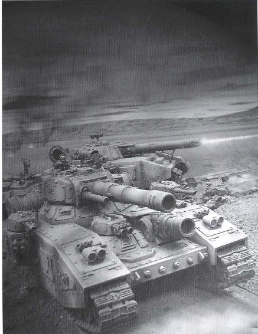

# 帝国坦克王牌传：马克西米利安·魏斯曼

> liujj312

译者按：本篇收录于《帝国装甲》第一辑，讲述了帝国最著名的坦克王牌Maximilian Weiseman的战斗经历。本来预备在《帝国装甲》全文翻译完毕之后再行放出，无奈烂尾，是以单行推出，以飨众人。

帝国坦克王牌传：马克西米利安·魏斯曼

原作：佚名
翻译：芦屋惟任逍遥轩(Liujj312)

人皇麾下的坦克指挥官中，名列荣誉榜首的就是马克西米利安·魏斯曼。他是Konig星系一个贵族军人世家的子弟。

他早年的生活都围绕着他日后的发展打算，未满十四岁就精通西洋剑和马刀——不过，这在Konig上都是相当普及的。十四岁刚满，他便加入了行星防卫军，两年后就领导一支当地民团的强袭骑兵小队作战。

十八岁那年，他同整个团一起被正式划入帝国卫队旗下。他的坐骑旋即由战马换成了黎曼·鲁斯主战坦克（尽管如此，他的马术在一生中也未曾退步）。首先他当上了车长，很快又因为智勇双全的战斗风格被提拔为中队长，并在拉马斯（Lamas）和贝洛第二（Balor Secundus）的战场上证明他无愧于此。在历时三年的贝洛战役结束后，他共击毁了98辆敌军载具。如此的天才怎能被埋没？他被光荣转调到一个装备有3台Lucius版“帝王毒刃”的超重型坦克特遣队中。新的指挥车是212号帝王毒刃坦克“阿雷修萨”（Arethusa,希腊神话中的林荫女神，原译“阿蕾苏萨”，为增强战争气氛，采用男性化译名）。自此，他真正成为了一个传奇，其英名随着光辉的战绩，载入帝国史册。

魏斯曼是一位严苛的指挥官，从不纵容丝毫过错，对组员和部下要求绝对严格地执行纪律。他的车组早晚做弥撒从不间断，每天都要参拜机器本灵。组员们的生活就是三点一线：祈祷——维护机械——训练。他在训练方面要求极为严格，以致组员们上了战场后感慨道“战斗比训练还容易！”。不过，无论魏斯曼多么的严苛，他的组员们依然很崇敬他。因为他们深知，只要魏斯曼在，就一定会取得胜利。四十多年来，魏斯曼从未让他们失望。

=“阿雷修萨”的最后出击=
魏斯曼辉煌战斗的一生在克罗尼亚（Colonia）宣告终结。时至今日，一座祭坛仍矗立在他最后奋战过的地方。当时，由老大队长旮旯·巴脱夫率领的兽人部队新近突破了寒武河（River Cambria）防线，并建立了一座桥头堡。帝国卫队Mortant第七“猎头族团”正在与之奋力抗衡，但兽人援军仍在蜂拥过河，随时会再行突击。

魏斯曼和他的车组作为预备队加入了增援“猎头族”的行列。他的坦克是全连第一个到达作战位置、封锁桥头的。战斗打响第一天的清晨，一个侦察兵报告大量的兽人压路碉堡和突击小车正成密集队形向河岸进攻。魏斯曼未加踌躇，决定不等连队主力到来，要乘兽人尚未集结足够力量突破薄弱分散的防线，先发制人。

魏斯曼和组员们上了坦克，晨雾正浓，随着引擎的低声咆哮，“阿雷修萨”独自沿路开进了弥漫的浓雾中。

兽人军被彻头彻尾地打了一个措手不及。引擎的声音远远地被浓雾阻隔住、被兽人自己的摩托声掩盖住了。当帝王毒刃披挂重甲的车头从三十米外的雾中出现时，兽人们才发现到它。魏斯曼对主炮手杜兰恩下令：瞄准那些压路碉堡开炮！同时车侧的自动炮也开始向正在匆忙集合的兽人车组扫射。 第一发炮弹掀掉了一台压路碉堡的主炮塔，弹片把整个车体内部扫荡了一遍。第二发引爆了一台压路碉堡的弹仓，接着一个大火球便飞上了高空。兽人们急忙散开，争分夺秒抢上他们的小吉普和摩托，呜呜地发动引擎想逃之夭夭，但最终也只是被自动炮和激光命中，归于沉寂了。魏斯曼直接压进一片混乱的场面中，通过炮塔的观察口指示全车的行动。而兽人们，在他的战车杀到之前就纷纷逃散了。

坦克扫清了整条路，身后留下了三台压路碉堡、八台突击小车与战斗拖拉机的残骸。看到这里，很多读者大概会以为这该是凯旋的时刻了。然而，魏斯曼意识到，如果他能够单枪匹马突入桥头，就能够独力截断兽人撤退的唯一路线。接着主力就能靠一次常规进攻消灭他们，并重组河岸防线。

魏斯曼命令驾驶员全速前进，坦克低吼着朝着桥头，朝着兽人部队的心脏驶去。机械师麦加拉一边向机器本灵祈祷着，一边将引擎推到了最大档——25公里。阿雷修萨单车直进，晨雾里突然杀出的兽人步兵和战车纷纷如野草一般被它的火力刮倒。然而它毕竟是太慢了，给了兽人反应和重组的时间，巴脱夫老大集结起了部队，准备应对魏斯曼的进攻。

魏斯曼探出头来，透过渐渐散开的雾看到了桥头上，一大群绿皮怪物来回奔忙，依托着方才守军遗留下的沙包，占据防御位置。还开来了更多的突击小车和压路碉堡。

装弹手奥廖尔报告主炮准备，炮手旋即将一台压路碉堡套进了准星中。惊雷般的巨响宣示着：帝王毒刃在此！兽人们急忙回击，刺眼的曳光连成了一片光幕。

魏斯曼闪进炮塔里，下令坦克前进。装弹手报告主炮仅剩七发炮弹了，魏斯曼仍不为所动。兽人的炮弹连续不断地冲击，最终撕开了帝王毒刃坚实的装甲，无情地猛然击中控制室。驾驶员洛尔被一块内壁装甲残片刺透了肩部，当下昏死过去，坦克也顿时一偏，摔进了路边潮湿松软的泥潭里。魏斯曼下令施放烟幕掩护，让洛尔接受紧急治疗。就在这时，兽人的坦克杀手们蹑手蹑脚地接近，围住了阿雷修萨。

烟雾散去，洛尔尝试着让坦克再次开动，然而它300吨重的躯体已经陷入松软的地面，动弹不得。洛尔加大油门，履带把泥浆掀得满天飞溅，坦克却仍然缓缓地沉入泥中。主炮手杜兰恩、副炮手赫布罗恩与赛本哈根三人使用重型速射炮奋力驱赶着逼近的兽人，然而他们都清楚，弹药一旦耗尽，他们就只能坐以待毙。通讯员托拜厄斯已经呼叫了支援，第一装甲小队正在紧急集结，准备沿路杀来救援阿雷修萨。然而他们至少也要一个小时才能赶到。

巴脱夫老大眼看着他的小弟们根本接近不了这只受困的装甲巨兽，于是命令他的战斗轰炸鸡（Fighta-bommer）解决掉这台坦克。第一架战斗轰炸机霎时间低空掠过河面而来，火箭弹在坦克旁爆炸，泥浆和着污水喷溅而起。魏斯曼从观察孔里看到第二架飞机咆哮着接近。希望已然渺茫。他下令全员弃车，同时猛地拉动紧急弹射杆。就在飞来的兽人火箭命中时，他的座椅猛地一震，弹出了炮塔。阿雷修萨随即爆炸，组员们纷纷向就近的掩体扑去。坦克里剩余的弹药引起了一连串惊天动地的巨响。两名组员遇难了，他们破碎的肢体散落在泥水上漂动着。魏斯曼掏出了仅有的手枪，一边集合了手下，此时第三架轰炸机正尖啸着飞临。机炮喷出烈焰，激起股股水注，一阵扫射过后，机械师麦加拉和炮手杜兰恩受了伤，托拜厄斯则直接被射死，未受伤的组员仅剩5人。魏斯曼命令他们往帝国军战线撤退，自己则决意待在他爱车燃烧的残骸旁，保护伤员直至救援赶到。生还者们的任务同样艰巨——在受伤的洛尔带领下，紧握着他们唯一的武器——激光手枪，想方设法从兽人的围追堵截中徒步逃离。

他们终究做到了。生还者们在公路上与正在开进的“装甲铁拳”小队相遇，然而尾随着他们的是兽人的另一波攻势，营救魏斯曼的路线遭到封锁。奇美拉战车努力地尝试突破，但直到夜幕降临，魏斯曼仍然只身一人奋战着……

第七Mortant“猎头族团”经过两个月的激战，才夺回了这座桥。当他们终于发现帝王毒刃212号半泡在沼泽中那扭曲的残骸时，魏斯曼和其他组员奋战的痕迹都早已消弭了。他的遗体至今也没有发现，而他最终的命运，也许将就此成为永远的难解之谜。

