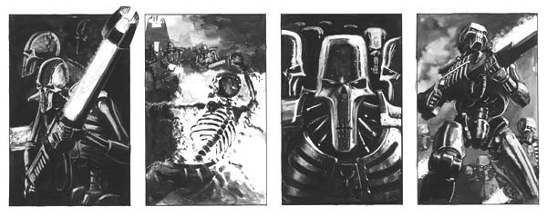

# 骷髅的高斯枪原理

boltgun

手册里解释是用力场（还是磁场来着）困住大量能量，加速后喷射出去。能量大到武器本身的材料单独承受不了的地步。

背景描写里，那种东西喷到人身上是直接往化灰的程度去的。

核心手册里的初步解释：

高斯武器是一种能把目标在几秒钟之内一个分子一个分子地分解成原子原料的可怕武器。

后面的介绍里，说：

基本上，可以看做是一个异步线性电磁感应原动机，在射击时，它们制造出一个双极磁场，将它瞄准的目标（比如一个人）拉向这把武器——当然是在原子量级上。然后，我们看到这把武器喷射出强烈的脉冲流，将目标的构成原子拉离，吸向武器本身。

